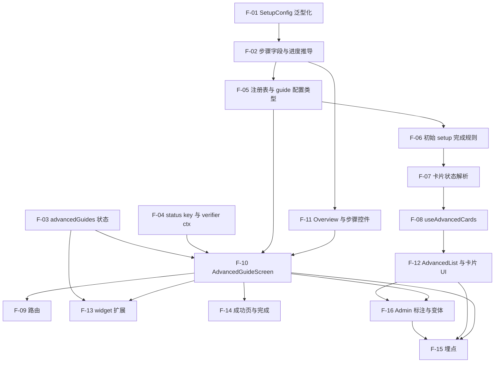

# 详细计划：Advanced 共享基础（Promotions 与 Bundles 共用）

- **上级计划：** [promotions-advanced-dev-plan.md](promotions-advanced-dev-plan.md)、[bundles-advanced-dev-plan.md](bundles-advanced-dev-plan.md)（Bundles 任务 0.2）
- **范围：** 只含 `free-to-play-pc`。两份能力计划共用的引擎、状态、卡片、路由和 widget 只在这里做一次。
- **代码核对日期：** 2026-10-20（对 `free-to-play-pc` 当前分支只读核对）。
- **状态：** 草稿，revision 2（独立 reviewer 审查后修订：runId 取数、卡片状态优先级、步骤组件接线、run 生命周期、info 与 confirm 死锁、URL 前缀）。步骤编号 `F-xx`。能力计划的步骤编号：Promotions 用 `PR-xx`，Bundles 用 `BU-xx`。

## 阅读方法

每一步写成同一种格式：

| 字段 | 含义 |
|---|---|
| 输入 | 这一步开始前必须存在的代码、数据或决定 |
| 输出 | 这一步结束后新增或改变的文件、导出和行为 |
| 要点 | 实现时必须遵守的规则 |
| 先写的测试 | 项目规则：测试先于代码。除非用户要求，不运行 |
| 完成标准 | 可以逐条检查的结果 |

路径缩写：`GS` = `src/pages/GetStarted`，`SW` = `src/pages/GetStarted/setup-wizard`，`SLICE` = `src/core/store/slices`，`ADV` = `src/pages/GetStarted/advanced`（新目录）。

## 与现状核对的结果

高层计划引用的代码事实基本正确。下面几条改变了实现方式：

| 计划的说法 | 实际情况 | 对本计划的影响 |
|---|---|---|
| 进度存在 `getStartedLocal`，加 `SCHEMA_VERSION` 即可 | `parseProjects`（`SLICE/getStartedLocal.ts:158`）会丢弃未知字段。版本不匹配时 `readPersisted` 返回 `{}`，**没有迁移链**。持久化 listener 是白名单（:426-433）。 | 不往 `getStartedLocal` 里加字段，也不升它的版本。否则所有伙伴的初始 setup 进度被清空。新建独立 slice 和独立 localStorage key（F-03）。 |
| `SetupPathId` 是封闭 union | `SetupConfig.id`、`StepProps.setupId` 都用它（`SW/types.ts:26,330`）。`selection/analytics.ts` 的 `Record<SetupPathId, …>` 依赖它不变。 | 把 `SetupConfig` 改成泛型，默认值仍是 `SetupPathId`（F-01）。 |
| status key 加 run id | key 是 `statusKey(projectId, setupId)`（`SLICE/getStartedStatus.ts:89`）。`campaignId` 是按 `(projectId, setupId)` 从 `getStartedLocal` 读的，不在 key 里。 | 加 ctx 字段要同时改三处：`types.ts:134-152`、`useSetupStatus.ts:149-154` 和 `:183-188`、`statusKey`（F-04）。 |
| `PIN_ROUNDS` 可复用 | `PIN_ROUNDS = 2` 在 `getStartedStatus.ts:31`，**未导出**。 | F-04 先导出它。 |
| 步骤引擎有 `beforeNext` | `WizardStep` 没有 `beforeNext`、`optional`、`confirm`。`beforeNext` 只能通过 `StepProps.registerBeforeNext` 在运行时注册。 | 新增字段加在 `WizardStep` 上（F-02）。 |
| Next 和 Skip 分别标记 passed | 两者共用 `handleAdvance`（`GS/SetupScreen.tsx:465-493`）。只有**无 `verify`** 的步骤才记 passed（:476-477）。 | Advanced guide 用自己的 screen 和自己的 `onAdvance`，不走这段代码（F-10）。 |
| `GetStarted/index.tsx` 分派 `:setupId` | `index.tsx` 只是布局。查表发生在 `SetupScreen.tsx:191` 的 `getSetupById`。 | 新路由直接加在 `routes/inside/get-started.ts`（F-09）。 |
| `guideAnalytics.ts` 含事件名 | 它只导出 `useGuideTracker` 等 3 个符号。事件值在 `src/core/utils/analytics/platform-events.ts`。 | F-15 在 `platform-events.ts` 旁加新常量。 |
| Promotions RBAC 测试放 `rbac-contract.test.ts` | 该文件只测顶层 `dataId`，不测 Promotions 子项。 | RBAC 测试放 `project-sidebar-v2/nav-items-config.test.tsx`（PR-02）。 |
| Widget 在 `GetStarted` 下 | 在 `src/components/SetupGuideWidget/`。路径含 `/get-started` 时返回 `null`（`SetupGuideWidget.tsx:51`）。 | Advanced guide 路由在 `/get-started` 下，widget 在 guide 页内本来就不显示。这是预期行为（F-14）。 |
| 路径是 `/projects/:id/...` | 真实 URL 带 merchant 前缀：`/${merchantId}/projects/...`、`/${merchantId}/get-started/...`。导航项的 `to` 不带前缀，由 `UIMLink` 补上（`nav-items-config.tsx:340`）；`history.push` 要手工加（`SetupGuideWidgetCard.tsx:81`）。 | 所有路径函数同时提供不带前缀的 route 形式和带 `merchantId` 的 url 形式（F-05）。 |
| `pin` 能挡住多次强制重试 | `statusFetchStarted` 每开一轮取数就把 pin 减 1（`getStartedStatus.ts:140-145`）。`PIN_ROUNDS = 2` 只能挡住 pin 之后的 1 轮取数；第 2 轮开始时 pin 已删除，`false` 生效。 | `setStepDone` 加可选 `rounds`，frame 事件按重试次数加 1 设置（F-04、BU-10）。 |
| Vitest 4 | 项目用 vitest `^3.2.7`，`globals: true`，**没有 msw**。 | 测试不 import `vi/describe/it`，API 测试用 `vi.mock`。 |

## 步骤依赖图



---

## 工期预估

**单位与假设：** 人天，一名熟悉 `free-to-play-pc` 的前端开发。**不含写测试的时间**：每步的"先写的测试"只是规格，测试由 AI 生成。**也不含**：审查 AI 生成的测试、运行测试和修失败（项目规则：除非用户要求，不运行）、MR review 往返、等待外部答复、stage 验证、release 和 merge（用户负责）、Premium PC。这些是粗估，不是承诺；每步的风险等级写在该步的"预估"一行里。

| 范围 | 人天 | 说明 |
|---|---|---|
| 基础 F-01 到 F-17 | 13.75 | 其中 F-10 占 2.5，F-12、F-13 各占 1.5 |
| Promotions PR-01 到 PR-11 | 8 | 真实 endpoint 接入（R2 答复后）另加约 0.5 |
| Bundles BU-01 到 BU-13 | 10.75（fallback 模式）；12.75（加 frame，BU-10 的 2） | |
| **合计** | **32.5**；加 frame 和真实 endpoint 约 **35** | |
| 加 20% 缓冲（review 往返、返工、联调） | 约 **39 到 42** | 单人串行约 8 周（每周 5 天） |

**两人并行的排法（估算）：**

| 阶段 | 内容 | 工作日 | 说明 |
|---|---|---|---|
| 1 | 基础关键路径 F-01 → F-02 → F-05 → F-11 → F-10 → F-09（约 5.75），加 F-03、F-04 | 约 7 | 同时另一人做不依赖基础的纯逻辑：PR-03、PR-04、PR-05、BU-01、BU-02、BU-04 的纯函数（约 4） |
| 2 | 基础剩余（F-06 到 F-08、F-12 到 F-16，约 6） | 约 3 | 两人分担 |
| 3 | Promotions（PR-06 到 PR-11，约 5）和 Bundles（BU-03 到 BU-13，约 8.25）并行 | 约 9 | 受 Bundles 约束，它是较长的一边 |
| 合计 | | 约 **19 个工作日，4 周左右**；加缓冲约 **4 到 5 周** | |

### vibe coding 口径（AI 写代码，人审查和验证）

上面的数字按"人手写代码"估。如果由 AI 生成代码，人负责提规格、审查、跑检查和手动验证，估算如下。**折算系数是经验假设，没有实测数据。**

| 类别 | 原人天 | 系数 | 折后 | 包含 |
|---|---|---|---|---|
| 低风险 | 7.75 | ×0.3 | 2.3 | 纯函数、类型、常量、展示组件 |
| 中风险 | 18 | ×0.5 | 9 | slice、hook、verifier、配置、接线 |
| 高风险 | 4.5 | ×0.7 | 3.15 | F-10、BU-06（要读懂 `SetupWizard` 和 status 引擎） |
| 手动工作 | 2.25 | ×1.0 | 2.25 | PR-01、PR-11、BU-01a 探测、BU-13 手动检查 |
| **小计（只算写代码）** | 32.5 | | **约 17** | |
| 加审查 diff、跑 `type-check`、`lint:fix`、测试并修失败（约 +25%） | | | **约 21** | |
| 再加 20% 缓冲 | | | **约 25** | 单人约 5 周 |
| 加 frame 和真实 endpoint | | | 约 +1.5 到 2 | |

相比手写口径（32.5，含缓冲 39），约省 35% 到 40%。

**为什么没有更快：**
- 耗时大头不是打字。F-04、F-10 这类要读懂现有引擎的步骤，AI 省下的有限，生成错了还要人看出来。
- 外部等待（R2、C3、Q4/C4、设计稿）不变，日历时间很可能由它们决定。
- vibe coding 的瓶颈是"人来审查"，两人并行的收益比手写时小。

**最可能偏差大的步骤：** F-10、BU-06、F-04。AI 在这三步反复出错时，实际可能接近手写口径。如果有以前用 AI 做类似功能（例如 `creator-campaign`）的实际耗时，可据此重新校准系数。

**风险最高的四步：** F-10（2.5）、BU-06（2）、BU-10（2，且阻塞于 Q4/C4）、F-13（1.5）。这四步的预估误差最可能超过 50%。

**会拉长工期的外部因素：** R2（Promotions 列表 endpoint）、C3（权限名）、Q4/C4（frame）、Q5（初始 setup 规则变化）。它们的答复时间不在上面的数字里。

**没算进去但会发生的事：** AI 生成的测试要有人看。测试写的是行为规格，AI 容易生成"能通过但没验证关键行为"的测试，尤其是 F-04（pin 轮数）、F-10（run 规则）和 BU-10（后端滞后）。这些步骤的测试建议人工过一遍。

## F-01 `SetupConfig` 泛型化

- **预估：** 0.75 人天（风险：低。只改类型，要逐个收窄受影响的文件）
- **输入：** `SW/types.ts` 现状。`SetupConfig.id: SetupPathId`（:330-378）；`StepProps.setupId: SetupPathId`（:37-89）。
- **输出：**
  - `SetupConfig<Id extends string = SetupPathId>`，`id: Id`。
  - `StepProps.setupId: string`。
  - `SetupWizard`、`SetupHub`、`SetupWizardSkeleton`、`SetupHubSkeleton` 的 `config` 属性类型改为 `SetupConfig<string>`。
  - `SETUPS: SetupConfig[]` 保持不变（默认 `SetupPathId`）。
- **要点：**
  - 不扩 `SetupPathId`。扩了会让 `selection/analytics.ts` 的 `Record<SetupPathId, …>` 报错，也会让 "Start with" 网格可能收到 guide。
  - 只改类型，不改运行时行为。
  - 用 `pnpm type-check` 找出所有受影响文件。逐个收窄，不用 `as`。
- **先写的测试：** 无新行为。类型层面：加一个 `types.test-d.ts` 或在现有 `index.test.ts` 加编译期断言，确认 `SETUPS[0].id` 仍是 `SetupPathId`，`SetupConfig<'x'>` 可构造。
- **完成标准：** `pnpm type-check` 通过；`setups/index.test.ts` 不变且通过；`selection/analytics.ts` 无改动。

## F-02 步骤字段与进度推导（纯函数）

- **预估：** 0.5 人天（风险：低。纯函数）
- **输入：** F-01。
- **输出：**
  - `WizardStep` 新增可选字段（`SW/types.ts`）：
    - `optional?: boolean` — 可跳过，跳过计为完成，可重新打开。
    - `confirm?: { labelId: string; descriptionId?: string }` — 需伙伴确认的步骤。
    - `paths?: { id: string; labelId: string; descriptionId: string }[]` — 双路径。
  - 新文件 `ADV/guide/progress.ts`：
    ```ts
    type StepKind = 'detect' | 'confirm' | 'info';
    getStepKind(step: WizardStep): StepKind;          // 有 verify → detect；有 confirm → confirm；否则 info
    deriveGuideProgress(steps: WizardStep[], input: {
      detectedDoneIds: string[];   // 来自 useSetupStatus（含 pin）
      confirmedIds: string[];      // 来自 advancedGuides 状态
      skippedIds: string[];        // 同上，只对 optional 步骤有效
    }): { doneStepIds: string[]; resumeStepId: string | null; kinds: Record<string, StepKind> };
    isConfirmEnabled(steps: WizardStep[], stepId: string, doneStepIds: string[]): boolean;
    ```
- **要点：**
  - `detect` 步骤：在 `detectedDoneIds` 中为完成。伙伴不能手动完成（D3-FR4）。
  - `confirm` 步骤：在 `confirmedIds` 中为完成。Next 和 Skip 都不影响（D3-FR5）。
  - `optional` 且 `detect`：已检测到，或在 `skippedIds` 中，为完成。
  - `info` 步骤：**下一个非 info 步骤**完成时，它一并完成（Promotions P3 的默认）。最后一个步骤不能是 `info`；违反时抛出开发期错误。
  - `resumeStepId` = 第一个未完成步骤；全部完成时为 `null`。它只用于 resume 和 widget。**活动步骤**（伙伴正在看的步骤）是另一个概念，由 F-10 的 `activeStepId` 保存，可以越过未完成的步骤。两者不要混用。
  - `isConfirmEnabled`：一个 `confirm` 步骤可用，当且仅当它之前的所有 `detect` 步骤都已完成。它**不**要求这个步骤是 `resumeStepId`。原因：`info` 步骤跟随后面的 `confirm` 步骤完成，如果要求 `confirm` 步骤必须是当前步骤，`info` 步骤会等 `confirm` 步骤，`confirm` 步骤又等 `info` 步骤，guide 无法结束。
  - 这个文件**不 import** React、store 或 API。
- **先写的测试：** `progress.test.ts`
  - 三种 kind 的判定。
  - `info` 跟随下一个非 info 步骤；连续两个 `info` 都跟随同一个目标。
  - 确认步骤在 `detectedDoneIds` 含它的 id 时仍未完成（检测信号不能替代确认）。
  - `optional` 步骤跳过后完成，且 `resumeStepId` 越过它。
  - 全部完成时 `resumeStepId === null`。
  - 最后一步是 `info` 时抛出。
  - `isConfirmEnabled`：前面有未完成的 `detect` 步骤时为 `false`；前面只有未完成的 `info` 步骤时为 `true`。
  - **不死锁：** 步骤序列 `detect(done)、info、confirm`：确认 `confirm` 后 `info` 随之完成，`resumeStepId === null`。
- **完成标准：** 测试覆盖上面所有分支；该文件没有副作用。

## F-03 `advancedGuides` 状态 slice

- **预估：** 1 人天（风险：中。新 slice、持久化 listener、store 注册）
- **输入：** `SLICE/getStartedLocal.ts` 的写法（`createSlice`、`prepare` 加 `at`、`isAnyOf` listener、`MAX_PERSISTED_PROJECTS = 20`）。F-02。
- **输出：** 新文件 `SLICE/advancedGuides.ts`，并在 `@core/store` 注册 reducer 和 listener middleware。
  - localStorage key：`f2p.advancedGuides`。独立 `SCHEMA_VERSION = 1`。
  - 持久化形状：
    ```ts
    { version: 1, projects: Record<projectId, { updatedAt: number; guides: Record<guideId, GuideState> }> }
    GuideState = {
      runId: string;                          // 每个 run 唯一
      startedAt: number; lastOpenedAt: number; completedAt?: number;
      overviewSeen: boolean;
      engagedAt?: number;                     // 伙伴点了 overview 的 "Start" 或任一步骤按钮的时间；widget 只统计有 engagedAt 的 run
      selectedPaths: Record<stepId, pathId>;
      confirmedStepIds: string[];
      skippedStepIds: string[];
      target?: { sku?: string };              // Bundles 用；Promotions 不用
      snapshot?: { skus: string[] };          // Bundles 用
      previousRunCompletedAt?: number;        // 供 "View guide" 判断
    }
    ```
  - Actions（payload 都带 `projectId`、`guideId`）：`startRun`、`markOverviewSeen`、`selectPath {stepId, pathId}`、`confirmStep {stepId}`、`skipStep {stepId}`、`reopenStep {stepId}`（清除 skip）、`setTarget {sku?}`（`sku` 为空表示清除 target）、`setSnapshot {skus}`、`markEngaged`、`completeRun`、`touchOpened`。
  - Selectors：`selectGuideState(state, projectId, guideId): GuideState | undefined`；`selectActiveGuideCandidates(state, projectId)`（给 widget，F-13；只返回 `engagedAt` 有值、`completedAt` 为空的 run）。
- **要点：**
  - `startRun` 生成新 `runId`，`engagedAt` 为空。仅浏览（打开 overview 或"View guide"）不会让 widget 出现。若上一个 run 已完成，新 run 不继承 `confirmedStepIds`、`skippedStepIds`、`target`、`snapshot`。
  - `parseProjects` 逐字段重建，不信任存储内容。未知版本直接丢弃**本 slice** 的数据，不影响 `getStartedLocal`。
  - 所有写入 action 都在 listener 白名单中。漏一个就不会落盘（`getStartedLocal` 的已知坑）。
  - 超过 20 个项目时，按 `updatedAt` 淘汰最旧的。
  - **跨设备限制：** 这是 `localStorage`。D3-FR7 要求按项目共享并可从任意设备 resume。后端存储由 Q14/P2 决定。把读写封装在 selector 和 action 后面，以后替换存储时调用方不变。MR 描述里列出该缺口。
- **先写的测试：** `advancedGuides.test.ts`
  - `startRun` 后 `runId` 非空；完成后再 `startRun` 得到不同 `runId` 且清空确认和 target。
  - `confirmStep` 幂等。`skipStep` + `reopenStep` 往返。
  - `markEngaged` 之前 `selectActiveGuideCandidates` 不含该 run；之后含；`completeRun` 之后不含。
  - 序列化往返：写入后重新 `readPersisted`，字段全在。
  - 版本不匹配返回空，且不触碰 `f2p.getStarted.local`。
  - 超过 20 个项目时淘汰最旧项目。
  - 损坏的 JSON 不抛出。
- **完成标准：** 测试通过；`getStartedLocal.ts` 没有任何改动。

## F-04 status key 与 verifier ctx

- **预估：** 1 人天（风险：中。三处联动；要保证旧测试不动）
- **输入：** `SW/types.ts:134-152`（`StepVerifier` ctx）；`SW/useSetupStatus.ts:54-65,126-129,149-154,162,183-188`；`SLICE/getStartedStatus.ts:31,89`。
- **输出：**
  - `statusKey(projectId, setupId, runId?)`：有 `runId` 时返回 `${projectId}:${setupId}:${runId}`，否则保持 `${projectId}:${setupId}`。
  - `export const PIN_ROUNDS`。
  - `StepVerifier` ctx 新增可选字段 `target?: { sku?: string }` 和 `runId?: string`。
  - `SetupStatusContext` 新增可选 `runId`、`target`：
    - **`runId` 进入 `runFetch` 的 deps，也进入渲染期算出的 `key`。** 它是 status key 的一部分，不能像 `campaignId` 那样走 ref：`useSetupStatus.ts:208` 的 deps 不含它时，换 run 后 effect 不重跑，新 key 在 `selectSetupStatus` 里返回 `EMPTY_SETUP_STATUS`（:226-227），`phase` 一直是 `loading`。
    - `target` 走 ref（方式同 `campaignIdRef`）。ref 变化不会触发取数，所以调用方在 `setTarget` 之后必须调用 `refresh({force: true})`（F-10 负责）。
  - `setStepDone` 的 payload 加可选 `rounds?: number`，默认 `PIN_ROUNDS`。`markDone(stepId, rounds?)` 同步加参数。
  - `useSetupStatus` 的 `refresh` 新增参数：`refresh(options?: { force?: boolean })`。`force` 跳过 `STATUS_TTL_MS` 检查（:164-167）。
- **要点：**
  - 所有新字段可选。现有测试断言 `toHaveBeenCalledWith({merchantId, projectId, storeDomain})`；`undefined` 属性不会破坏它。
  - `runFetch` 在 :162 也要用同一个带 `runId` 的 key，否则读和写用不同的 key。
  - `refresh` 现在是 `runFetch` 本身（:259）。加 `force` 时，保持无参调用的旧行为不变。
  - `markDone`（:238-249）就是"系统 pin"：dispatch `setStepDone`，有意不刷新。**不要**新增第二个 pin API。约束是**谁能调用它**，见 F-10。
  - **pin 的寿命：** `statusFetchStarted` 每开一轮取数就把 pin 减 1（`getStartedStatus.ts:140-145`）。默认 `PIN_ROUNDS = 2` 时，pin 之后第 1 轮取数里的 `false` 被忽略，第 2 轮开始时 pin 已删除，`false` 生效。需要挡住 N 次强制重试时，用 `rounds = N + 1`（BU-10）。
- **先写的测试：** 扩展 `useSetupStatus.test.tsx`、`getStartedStatus` 的 slice 测试
  - `statusKey` 有无 `runId` 两种输出。
  - 两个不同 `runId` 的状态互不可见（run A 的 pin 不影响 run B）。
  - verifier 收到 `target` 和 `runId`。
  - `refresh({force: true})` 在 TTL 内也重新请求；无参 `refresh()` 在 TTL 内不请求。
  - **runId 变化触发取数：** 同一个 hook 实例，`runId` 从 `undefined` 变为 `'r1'`（或从 `'r1'` 变为 `'r2'`）后，新 key 发起一次取数，`phase` 最终变为 `ready`。
  - `markDone(stepId, 4)`：之后 3 轮取数里的 `false` 都不改写该步骤；第 4 轮开始时 pin 才被删除。
  - 旧测试不改动仍通过。
- **完成标准：** 旧测试零改动通过；新测试通过。

## F-05 注册表与 guide 配置类型

- **预估：** 0.75 人天（风险：低。类型、注册表、路径函数）
- **输入：** F-01、F-02。`SETUPS` 在 `GS/setups/index.ts`。
- **输出：** 新文件：
  - `ADV/types.ts`：
    ```ts
    type AdvancedGuideId = 'promotions-discounts' | 'promo-codes-coupons' | 'bundles';
    interface AdvancedGuideConfig {
      id: AdvancedGuideId;
      order: number;                                  // 卡片顺序
      card: { titleId: string; descriptionId: string; examplesId: string };
      overview: { goalId: string; outcomeIds: string[]; beforeYouStartIds: string[] };
      setup: SetupConfig<AdvancedGuideId>;            // steps 与展示字段；不进入 SETUPS
      liveRule: (ctx: { projectId: string | number }) => Promise<boolean>;
      nextGuideId?: AdvancedGuideId;                  // 成功页推荐
      managePath?: (ids: { merchantId: string | number; projectId: string | number }) => string;  // Live 卡片 "Open" 的 url（带 merchant 前缀）
      ManageComponent?: ComponentType<{ config: AdvancedGuideConfig }>;  // 有它才有 /manage 路由；Bundles 提供 BU-11 的组件
    }
    ```
  - `ADV/paths.ts`：每个路径同时提供两种形式。
    ```ts
    // route 形式：不带 merchant 前缀。用于路由声明和 UIMLink（UIMLink 会补前缀）。
    advancedGuideRoute(guideId): string        // `/get-started/advanced/${guideId}`
    advancedManageRoute(guideId): string       // `/get-started/advanced/${guideId}/manage`
    // url 形式：带前缀。用于 history.push、<a href>。
    advancedGuideUrl({merchantId, guideId, intent?}): string   // `/${merchantId}/get-started/advanced/${guideId}` + 可选 `?intent=new`
    advancedManageUrl({merchantId, guideId}): string
    getStartedUrl({merchantId, setupId?}): string              // `/${merchantId}/get-started` 或加 `/${setupId}`
    ```
  - `ADV/registry.ts`：`ADVANCED_GUIDES: AdvancedGuideConfig[]`（初始为空数组）、`getAdvancedGuideById(id?: string)`、`getOrderedAdvancedGuides()`。
- **要点：**
  - **不要**把任何 guide 加进 `SETUPS`。加进去会出现在 "Start with"（违反 D2-FR1）；标 `hidden` 又会被 widget 和 resume 跳过（违反 D3-FR10）。
  - `setup.steps` 的每个步骤要满足 F-02 的规则（最后一步不能是 `info`）。注册表加载时做一次开发期校验。
- **先写的测试：** `registry.test.ts`、`paths.test.ts`（每个 url 形式 = `/${merchantId}` + route 形式；`intent` 只出现在查询串）
  - `ADVANCED_GUIDES` 与 `SETUPS` 的 id 集合不相交。
  - 每个 guide 的 `id` 唯一；`order` 唯一。
  - `getAdvancedGuideById` 对未知 id 返回 `undefined`。
  - 每个 guide 最后一步不是 `info`。
- **完成标准：** 测试通过；`SETUPS` 和 `SetupSelection.tsx:29` 零改动。

## F-06 "初始 setup 完成"规则

- **预估：** 0.75 人天（风险：中。要读 `useSetupProgress` 的内部行为，Q5 可能改规则）
- **输入：** `GS/useSetupProgress.ts`（返回 `complete`、`cleared`、`total`、`blocked`、`config`）；Q5 未决。
- **输出：** 新文件：
  - `ADV/cards/initialSetupRule.ts`（纯函数，集中所有 Q5 逻辑）：
    ```ts
    evaluateInitialSetup(input: {
      currentSetupId: string | undefined;     // 来自 selectCurrentSetupId
      progress: { config?: { id: string; titleId: string }; complete: boolean; ready: boolean } | undefined;
    }): { status: 'unknown' | 'incomplete' | 'complete';
          unfinished?: { setupId?: string; titleId: string } };   // 没有 setupId 表示还没选起步路径
    ```
    链接由调用方用 `getStartedUrl({merchantId, setupId})` 生成（F-05），规则文件不需要 `merchantId`。
  - `ADV/cards/useInitialSetupState.ts`：hook，读取 `useSetupProgress` 的数据并调用上面的函数。
- **要点：**
  - **默认（Q5 未决）：** 项目的当前 setup 完成（`useSetupProgress().complete`）即视为初始 setup 完成。这是应用里唯一已有的按项目计算的初始 setup 状态。
  - Advanced guide 不调用 `setCurrentSetup`（F-10），所以打开 guide 不会改变判定。
  - 如果伙伴用 `?switch=1` 切换到另一个 setup，判定会跟着变。这是已知限制，Q5 决定后再改规则，只改这个文件。
  - `currentSetupId` 为空（伙伴还没选起步路径）→ `incomplete`，`unfinished` 为 `{setupId: undefined, titleId: <通用 "Initial setup" 文案 key>}`，链接指向 `/get-started` 选择页。这种伙伴应看到 Blocked，不是骨架。
  - 有 `currentSetupId` 但 `ready === false` 时返回 `unknown`。卡片显示加载态，不闪成 Blocked。
  - 不复用 `requiredStepIds`（它按 setup 内部生效）。
- **先写的测试：** `initialSetupRule.test.ts`
  - 未就绪 → `unknown`；未完成 → `incomplete` 且带 setup 名称和路径；完成 → `complete`。
  - `currentSetupId` 为空 → `incomplete` 且 `unfinished.setupId` 为空；有 id 但 `config` 还没加载 → `unknown`；两种情况都不是 `complete`。
  - 使用 `useInitialSetupState` 渲染后，打开 Advanced guide 不会改变结果（见 F-10 的 State 测试）。
  - Q5 的其他取值（"所有 setup 完成"）写成 `it.skip`，注明启用条件：Q5 关闭并选定。
- **完成标准：** 规则只存在于这一个文件；测试通过。

## F-07 卡片状态解析（纯函数）

- **预估：** 0.25 人天（风险：低。纯函数）
- **输入：** F-06；每个 guide 的 `liveRule` 结果；F-03 的 run 状态。
- **输出：** `ADV/cards/resolveCardState.ts`：
  ```ts
  type CardState = 'loading' | 'blocked' | 'available' | 'live';
  type LiveSignal = 'pending' | 'error' | boolean;   // pending = 还没取到；error = 取数失败
  resolveCardState(input: {
    initial: 'unknown' | 'incomplete' | 'complete';
    live: LiveSignal;
  }): CardState;
  ```
  规则，**按这个顺序判断**：
  1. `initial === 'incomplete'` → `blocked`（不看 `live`；优先于 Live，Bundles P7）。
  2. `initial === 'unknown'` → `loading`。
  3. `live === 'pending'` → `loading`。
  4. `live === 'error'` → `available`（见下）。
  5. `live === true` → `live`；`live === false` → `available`。
- **要点：**
  - `incomplete` 不需要等 `live`：F-08 在这种状态下不取 `live`，所以输入是 `(incomplete, 'pending')`，结果必须是 `blocked`，不是 `loading`。
  - `live` 取数失败（`'error'`）时，不得显示 Live。显示 `available`，并记录一条 console 警告。PRD R2 未关闭前，不做静默降级成 Live。`'pending'` 和 `'error'` 是两个不同的值，不能合并。
  - 状态只来自账户数据，不来自 guide 访问记录（D2-FR4）。
- **先写的测试：** `resolveCardState.test.ts` — 3（initial）× 4（`pending`、`error`、`true`、`false`）= 12 种输入的全表；`(incomplete, pending)` 得到 `blocked`；`(incomplete, true)` 得到 `blocked`；`(complete, error)` 得到 `available`；失败不产生 `live`。
- **完成标准：** 全表测试通过。

## F-08 `useAdvancedCards` hook

- **预估：** 1 人天（风险：中。去重取数、失败隔离）
- **输入：** F-03、F-05、F-06、F-07。
- **输出：** `ADV/cards/useAdvancedCards.ts`：
  ```ts
  useAdvancedCards(): {
    loading: boolean;
    cards: Array<{
      guideId: AdvancedGuideId; config: AdvancedGuideConfig; state: CardState;
      unfinished?: { setupId?: string; titleId: string };
      run: 'none' | 'in-progress' | 'completed';      // 来自 F-03
    }>;
  }
  ```
- **要点：**
  - 每次页面加载，每个 guide 的 `liveRule` 只调用一次（NFR：不重复取数）。用 `useRef` 或模块级 in-flight 去重，参考 `shared-verifiers.ts` 的 `loadLandings`。
  - 只有 `initial === 'complete'` 时才调用 `liveRule`；`incomplete` 时不发请求，`live` 传 `'pending'`（F-07 保证结果仍是 `blocked`）。`liveRule` 的 Promise 拒绝时，`live` 传 `'error'`。
  - 卡片顺序按 `config.order`。
  - 返回的 `cards` 只含 `ADVANCED_GUIDES` 里的条目。
- **先写的测试：** `useAdvancedCards.test.tsx`
  - 初始 setup 未完成：不调用任何 `liveRule`；全部 `blocked`。
  - 完成：每个 `liveRule` 恰好调用一次，即使组件重渲染。
  - `liveRule` 抛错：该卡片 `available`（`live: 'error'`），其他卡片不受影响。
  - 初始 setup 未完成且 `currentSetupId` 为空：所有卡片 `blocked`，不是 `loading`。
  - 初始 setup 从未完成变为完成后（模拟下一次加载）：`blocked` → `available`（D2-FR8）。
- **完成标准：** 测试通过。

## F-09 路由

- **预估：** 0.25 人天（风险：低。两条路由）
- **输入：** F-05（`paths.ts`）、F-10（`AdvancedGuideScreen`）。`src/routes/inside/get-started.ts:13-20`（父路由非 exact；两个 exact 子路由）。
- **输出：** 在同一个文件新增两条 exact 子路由：
  - `${root}/get-started/advanced/:guideId` → `AdvancedGuideScreen`（F-10）
  - `${root}/get-started/advanced/:guideId/manage` → `AdvancedManageScreen`：读 `getAdvancedGuideById(guideId)`，有 `ManageComponent`（Bundles 的 BU-11 提供）就渲染它；没有则重定向回 guide。
- **要点：**
  - F-09 排在 F-10 之后，因为路由引用 F-10 的组件。F-10 只依赖 F-05 的 `paths.ts`，不依赖本步骤。
  - `/get-started/:setupId` 是 exact，`/get-started/advanced/x` 不会匹配它。但 `/get-started/advanced`（无 guideId）会被当成 `setupId='advanced'`。这个值查不到，`SetupScreen.tsx:578` 会重定向到选择页，行为可接受，加一条测试固定它。
  - 未知 `guideId`：重定向到 `/get-started`。
  - 路由与 `GetStartedRoute` 的 role 守卫（`src/routes/GetStartedRoute.tsx:23,33`）保持在同一父路由下，权限行为不变。
  - `?intent=new` 由 F-10 读取（见 run 规则），本步骤不解析。
- **先写的测试：** 路由测试
  - `/get-started/advanced/<已注册 id>` 渲染 guide screen。
  - 未知 id 重定向。
  - `/get-started/<已有 setupId>` 仍渲染 `SetupScreen`。
  - `/get-started/advanced` 落到选择页。
  - `/get-started/advanced/<有 ManageComponent 的 id>/manage` 渲染该组件；没有 `ManageComponent` 的 id 重定向回 guide。
- **完成标准：** 测试通过；现有 `/get-started`、`/get-started/:setupId` 行为不变。

## F-10 `AdvancedGuideScreen`

- **预估：** 2.5 人天（风险：高。最大的一步：screen、context、run 规则、接入 `SetupWizard`）
- **输入：** F-02、F-03、F-04、F-05（含 `paths.ts`）、F-11。`GS/SetupScreen.tsx` 的渲染部分（`SetupWizard`、`SetupHub` 的 props，见"与现状核对的结果"）。
- **输出：** `ADV/guide/AdvancedGuideScreen.tsx`、`ADV/guide/useAdvancedGuide.ts`、`ADV/guide/AdvancedGuideContext.tsx`、`ADV/guide/runIntent.ts`。
  - **`AdvancedGuideContext`（步骤组件的接线方式）。** `SetupWizard` 只给步骤组件传 `StepProps`（`SetupWizard.tsx:389-403`），所以 guide 的能力不能走 props。`AdvancedGuideScreen` 用 context 提供：
    ```ts
    useAdvancedGuideContext(): {
      guideId; run: GuideState; kinds: Record<string, StepKind>; doneStepIds: string[];
      confirm(stepId): void; unconfirm(stepId): void; isConfirmEnabled(stepId): boolean;
      selectPath(stepId, pathId): void; skip(stepId): void; reopen(stepId): void;
      setTarget(sku: string | undefined): void;   // 内部：dispatch setTarget，再 refresh({force: true})
      markEngaged(): void; recheck(): void;
    }
    useTrustedPin(): (stepId: string, rounds?: number) => void;   // 单独的 context，只有 CatalogFrame（BU-10）使用
    ```
    F-11 的展示组件保持纯展示，由每个能力自己的步骤组件（`Component`）从 context 取值后传入。`useTrustedPin` 与上面分开，普通步骤组件不 import 它；用测试 `grep` 固定：`useTrustedPin` 只在 `CatalogFrame` 里被引用。
  - `useAdvancedGuide(guideId)` 返回：
    ```ts
    { config; run: GuideState | undefined; phase: 'loading' | 'overview' | 'step' | 'success';
      doneStepIds: string[]; resumeStepId: string | null; activeStepId: string | null;
      kinds: Record<string, StepKind>;
      openStep(id): void; advance(): void; }   // 其余能力走 context
    ```
  - `ADV/guide/runIntent.ts`（纯函数，从 Bundles 的 BU-09 提升到这里，Promotions 同样使用）：
    ```ts
    resolveRunIntent(input: {
      state: GuideState | undefined;
      intent: 'default' | 'new';     // 来自 URL 的 `?intent=new`；卡片的 "View guide" 在已完成的 run 上带它
    }): { action: 'resume'; runId: string } | { action: 'new-run' };
    secondaryLinkKind(state: GuideState | undefined): 'resume' | 'view' | 'none';
    ```
- **run 规则：**

  | 当前 run | URL | 结果 |
  |---|---|---|
  | 无 | 任意 | 新 run |
  | 未完成 | 任意（包括 `intent=new`） | resume，**不新建**。Live 卡片永远不丢弃未完成的 run |
  | 已完成 | 无 `intent` | 新 run（"Set up" 或直接访问链接：卡片是 Available 说明账户数据已不满足 Live，比如伙伴删光了 bundle，必须能重做） |
  | 已完成 | `intent=new` | 新 run（Live 卡片的 "View guide"） |

  已完成的 run 只在 widget 之外通过成功页查看：成功页刚完成时仍显示，之后重新进入一律开新 run。新 run：新 `runId`，`target`、`snapshot`、`confirmedStepIds`、`skippedStepIds`、`engagedAt` 全部为空。`secondaryLinkKind`：未完成 → `resume`（"Resume guide"）；已完成或无 → `view`（"View guide"，带 `intent=new`）。
- **要点：**
  - **挂载顺序：** 先决定 run（`resolveRunIntent` + `startRun`），拿到 `runId` 之后再挂载 `useSetupStatus`。`runId` 为空时 guide 渲染骨架，不调用 `useSetupStatus`。这样 `runId` 不会从 `undefined` 变成值（F-04 里它也在 deps 里，作为双重保险）。
  - 第一次（`overviewSeen === false`）进 overview；否则进 `resumeStepId`（D3-FR2、D3-FR7）。`activeStepId` 初始等于 `resumeStepId`，之后随 `advance`/`openStep` 移动，可以停在未完成步骤之后。
  - **`markEngaged`：** overview 的 "Start" 点击、任一步骤主按钮点击、确认、跳过、选路径时调用一次（幂等）。仅浏览不调用。
  - **不调用** `useTrackCurrentSetup`，不 dispatch `setCurrentSetup`、`markHubReached`、`markStepPassed`。初始 setup 保持为当前 setup（D3-FR1）。
  - 状态来自 `useSetupStatus(steps, {projectId, merchantId, setupId: guideId, runId, target})`；再用 F-02 的 `deriveGuideProgress` 合并确认和跳过。
  - 渲染复用 `SetupWizard`（`config={config.setup}`）。传给它的回调：
    - `onAdvance`：自己的 `advance`。只移动活动步骤，**不完成任何步骤**。
    - `onStepDone`：**空函数**。步骤组件通过 `StepProps.markStepDone` 能调用它，所以必须断开；否则伙伴可以手动完成检测步骤（违反 D3-FR4）。
  - `recheck`：在窗口重新获得焦点、路由返回 guide、页面加载时调用 `refresh({force: true})`（Bundles 2.6）。Promotions 用同一个 `recheck`。
  - 全部步骤完成 → `completeRun` → `phase: 'success'`（F-14）。
  - 打开时调用 `touchOpened`，供 widget 排序（F-13）。
- **先写的测试：** `AdvancedGuideScreen.test.tsx`、`useAdvancedGuide.test.tsx`、`runIntent.test.ts`
  - **State：** 打开 guide 前后，`selectCurrentSetupId`、`SetupProgressBadge` 的输入、`resolveEntry` 的结果完全不变。
  - 第一次打开显示 overview；第二次直接到 `resumeStepId`。
  - 未完成 run 被 resume，`runId` 不变；URL 带 `intent=new` 时也不新建。
  - 已完成 run：无 `intent` 和 `intent=new` 都开新 run，新 run 的 `target`、确认记录为空。
  - **死胡同回归：** 已完成的 run + 数据不再满足（mock 空列表，卡片 Available）→ "Set up" 开新 run，伙伴可以重做。
  - 仅浏览（打开 overview、不点 Start）后，`selectActiveGuideCandidates` 不含该 run；点 Start 后含。
  - 点 Next 和 Skip 都不会让 `confirm` 步骤完成；`detect` 步骤也不会因 Next 完成。
  - 步骤组件调用 `markStepDone` 不产生任何完成。
  - 确认后步骤完成；刷新（重新挂载）后仍完成。
  - `recheck` 绕过 TTL。
  - `setTarget` 之后发起一次强制取数。
  - `useTrustedPin` 只被 `CatalogFrame` 引用（静态检查）。
  - `runId` 为空时不调用 `useSetupStatus`；`runId` 确定后只取一轮。
- **完成标准：** 测试通过；`SetupScreen.tsx`、`useTrackCurrentSetup.ts` 零改动。

## F-11 Overview 与步骤控件

- **预估：** 1 人天（风险：低。四个展示组件，含无障碍）
- **输入：** F-02、F-03。`SW/types.ts` 的 `StepProps`。
- **输出：** `ADV/guide/` 下的组件：
  - `GuideOverview.tsx`：属性 `{ config: AdvancedGuideConfig; onStart(): void }`。显示目标、步骤数（`config.setup.steps.length`，自动计算）、"What you'll do"、"Before you start" 清单、"Start" 按钮。
  - `ConfirmControl.tsx`：属性 `{ step; confirmed: boolean; disabled?: boolean; onConfirm(): void; onUnconfirm?(): void }`。`disabled` 来自 `isConfirmEnabled`（F-02），**不是**"是否为当前步骤"。显示 "I've done this" 复选或按钮，带文字状态。
  - `PathChooser.tsx`：属性 `{ step; selected?: string; onSelect(pathId): void }`。只渲染所选路径的说明；另一条路径可再选（D3-FR6）。
  - `OptionalStepNotice.tsx`：可选步骤显示 "Optional" 标签和 "Skip" 说明。
- **要点：**
  - 所有状态标签都有文字（NFR 无障碍）。按钮有描述性 `aria-label`。
  - 文案只通过 intl key 取，key 来自 config（不在组件里写死文案）。
  - 这些组件无副作用，不读 store、不读 context。每个能力的步骤组件从 `useAdvancedGuideContext()`（F-10）取值，再作为属性传入。
- **先写的测试：**
  - `GuideOverview`：步骤数等于 `steps.length`；"Start" 触发回调。
  - `ConfirmControl`：未确认时 `aria-checked=false` 且有文字；点击触发 `onConfirm`；`disabled` 时不触发，且有文字说明原因（"Finish the earlier steps first"）。
  - `PathChooser`：选中路径只显示该路径说明；点另一条切换。
  - 键盘：Tab 可达，Enter/Space 可触发。
- **完成标准：** 测试通过。

## F-12 `AdvancedList` 与卡片 UI

- **预估：** 1.5 人天（风险：中。卡片 UI、三个挂载点（要先定位 hub、完成页组件））
- **输入：** F-08；`GS/setup-hub/` 和完成页的挂载点（实现时先定位组件文件）；`GS/selection/SelectionScreen.tsx`。
- **输出：**
  - `ADV/cards/AdvancedCard.tsx`：属性 `{ card: ReturnType<useAdvancedCards>['cards'][number]; onPrimary(); onViewGuide?() }`。
  - `ADV/cards/AdvancedList.tsx`：调用 `useAdvancedCards`，渲染卡片；`cards` 为空或 `loading` 时显示骨架。
  - 挂载（P1 默认）：初始 setup 的 hub、它的完成页、`?switch=1` 下的选择页。
- **要点：**
  - 每张卡片：名称、描述、状态 badge（文字 + 样式）、一个主按钮（D2-FR2）。
  - 按状态：
    | 状态 | 主按钮 | 次要入口 |
    |---|---|---|
    | live | "Open" → `config.managePath({merchantId, projectId})`（带 merchant 前缀的 url；用 `history.push` 或 `UIMLink` 的无前缀 route 形式，二选一并在 MR 里写明） | `secondaryLinkKind`（F-10）：未完成 run → "Resume guide"；否则 "View guide"（带 `?intent=new`） |
    | available | "Set up" → `advancedGuideUrl`（无 `intent`；F-10 的 run 规则会在需要时开新 run） | 无 |
    | blocked | 禁用 | 显示 `unfinished.titleId` 对应名称，链接到 `getStartedUrl({merchantId, setupId: unfinished.setupId})` |
    | loading | 禁用 | 骨架 |
  - Blocked 卡片的按钮不可点击，也不发埋点（F-15）。
  - 页面加载时只通过 `useAdvancedCards` 取一次状态。三个挂载点各自挂载时，不重复请求（hook 内去重，F-08）。
- **先写的测试：** `AdvancedCard.test.tsx`、`AdvancedList.test.tsx`
  - 4 种状态的 badge 文字、主按钮标签、禁用状态。
  - Live 卡片的两种次要链接。
  - Blocked 卡片写出 setup 名称且链接正确。
  - 三个挂载位置各渲染一次 `AdvancedList`（Component 层）。
  - 点击 Blocked 按钮无导航。
- **完成标准：** 测试通过；`SetupSelection` 的 "Start with" 网格不含 Advanced 卡片。

## F-13 Widget 扩展

- **预估：** 1.5 人天（风险：中。要改现有 widget 和候选逻辑，不能影响初始 setup 的显示）
- **输入：** F-03；`useSetupProgress.ts`；`src/components/SetupGuideWidget/SetupGuideWidget.tsx`、`SetupGuideWidgetCard.tsx`。
- **输出：**
  - `ADV/widget/useActiveAdvancedGuide.ts`：返回 `{ guideId; capabilityTitleId; resumeStepLabelId; stepUrl; guideUrl } | null`（url 带 merchant 前缀）。
  - `SetupGuideWidget` 在**初始 setup 不需要显示时**，改显示 Advanced guide（P4 默认：先初始 setup，后最近打开的未完成 Advanced guide）。
  - `SetupGuideWidgetCard` 新增 Advanced 变体：能力名称、当前步骤标签、"Go to step"、"View full guide"（D3-FR10）。
- **要点：**
  - 候选 = `selectActiveGuideCandidates`（有 `engagedAt`、`completedAt` 为空）且 `resumeStepId !== null` 的 guide；取 `lastOpenedAt` 最大的。只浏览过的 run 不进入候选，否则"View guide"会让 widget 在所有页面常驻。
  - `useSetupProgress`、`SetupProgressBadge`、`resolveEntry` **只继续报告初始 setup**，不改它们的返回值。
  - 路径含 `/get-started` 时 widget 仍返回 `null`（现有行为 `:51`）。
  - 计算当前步骤要用 F-02 的 `deriveGuideProgress`，需要这个 guide 的检测状态。widget 在其他页面显示时，用 `useSetupStatus`（长 TTL，参考 `SETUP_PROGRESS_TTL_MS` = 5 分钟）。
  - Admin 放行（`useSetupProgress.ts:117`）对 Advanced widget 同样生效，并带 F-16 的标注。
- **先写的测试：** `useActiveAdvancedGuide.test.tsx`、`SetupGuideWidget.test.tsx`
  - 初始 setup 未完成时，widget 仍显示初始 setup。
  - 初始 setup 完成、有两个已 engaged 的未完成 guide：显示 `lastOpenedAt` 最近的。
  - 只打开过 overview、没点 Start 的 guide：不显示。
  - 全部完成：返回 `null`。
  - Advanced 变体显示 4 项内容；"Go to step" 链接到该步骤。
  - `SetupProgressBadge` 的输入在 Advanced guide 未完成时不变。
- **完成标准：** 测试通过；原有 widget 测试不改动仍通过。

## F-14 成功页与完成

- **预估：** 0.25 人天（风险：低。单个展示组件）
- **输入：** F-02、F-03、F-05。
- **输出：** `ADV/guide/GuideSuccess.tsx`：属性 `{ config; summaryIds: string[]; summaryValues?: Record<string,string>; managePath?: string; nextGuide?: AdvancedGuideConfig }`。
- **要点：**
  - 写出已设置的内容、说明该能力已上线、给出下一个推荐能力的入口（D3-FR8）。
  - 有 `managePath` 时显示 "Manage" 按钮（Bundles 的 "Manage bundles"）。
  - 完成后卡片是否 Live 由账户数据决定，成功页**不**写任何"已 Live"状态到存储（D3-FR9）。
  - 下一个推荐：`config.nextGuideId`；对应卡片是 `blocked` 时不显示入口。
  - 完成后 guide 仍可从卡片的 "View guide" 重新打开（D3-US7）。
- **先写的测试：** `GuideSuccess.test.tsx` — 摘要内容渲染；有无 `managePath`、有无 `nextGuide` 四种组合；无下一个推荐时不渲染推荐区。
- **完成标准：** 测试通过。

## F-15 埋点

- **预估：** 0.5 人天（风险：低。事件名占位）
- **输入：** `SW/guideAnalytics.ts`（`useGuideTracker`）；`src/core/utils/analytics/platform-events.ts`；`src/core/utils/analytics/platform-analytics.ts:35`（`trackClick`）。C2 未决。
- **输出：**
  - `ADV/analytics.ts`：
    ```ts
    type AdvancedEvent = 'card_click' | 'guide_opened' | 'step_started' | 'step_skipped' | 'frame_saved' | 'guide_completed';
    trackAdvanced(event: AdvancedEvent, p: {
      capabilityId: AdvancedGuideId; step?: string; cardState: CardState;
    }): void;   // 内部补 account_variant 和 timestamp
    ```
  - 事件名常量放在 `platform-events.ts` 旁；先用占位值，C2 确认后替换。
- **要点：**
  - `account_variant` 来自 F-16 的常量，`timestamp` 在这里生成（`Date.now()`）。
  - 通过现有 `platformAnalytics.trackClick` 发送，不新增通道。
  - 事件发送失败不影响 UI（捕获 Promise rejection）。
  - Promotions 只用前 3 个加 `guide_completed`；Bundles 用全部 6 个。调用方各取所需。
- **先写的测试：** `analytics.test.ts` — 每个事件都带 `capability_id`、`card_state`、`account_variant`、`timestamp`；有 step 时带 step；`trackClick` 抛错不外溢。事件名的最终值写成 `it.skip`，启用条件：C2 关闭。
- **完成标准：** 测试通过。

## F-16 Admin 标注与账户变体

- **预估：** 0.25 人天（风险：低。标注组件和变体常量）
- **输入：** `useSetupProgress.ts:117`（admin 放行）；`selectCurrentUserIsAdmin`。
- **输出：**
  - `ADV/variant.ts`：`export const ACCOUNT_VARIANT = 'f2p' as const;`，以及 `variantKey(base: string): string`，在 content model 中取变体文案。
  - `ADV/PartnerViewNotice.tsx`：admin 用户在卡片、guide、widget 上显示 "Partner-facing view"。
- **要点：**
  - 非 admin 不渲染该标注。
  - 变体只影响文案 key（D2-FR9、D3-FR11）。逻辑不分支。Premium 文案属于 C1，不在本仓库。
- **先写的测试：** admin 看到标注、非 admin 看不到；`variantKey` 的输出稳定。
- **完成标准：** 测试通过。

## F-17 Locale 约定

- **预估：** 不计（风险：—。约定，工作量已含在各步骤的 locale 改动里）
- **输入：** `src/locales/en.json`；`src/locales/index.test.ts`。
- **输出：** 本文档规定的 key 前缀：
  - 共享：`host.pages.getStarted.advanced.common.*`（overview 标签、确认控件、可选标签、路径选择、成功页通用文案、admin 标注、卡片 badge 和按钮）。
  - 每个能力：`host.pages.getStarted.advanced.<capabilityKey>.*`。
- **要点：** 只改 `en.json`。不手改另外 8 个文件（Smartcat CI 写入）。不复制 `platform-shared.*` key。
- **先写的测试：** 无新测试。每一步加 key 后，`locales/index.test.ts` 须仍通过。
- **完成标准：** `locales/index.test.ts` 通过。

---

## 步骤清单（给跟踪用）

| 步骤 | 产物 | 依赖 | 被谁使用 |
|---|---|---|---|
| F-01 | `SetupConfig` 泛型 | — | F-02 之后所有步骤 |
| F-02 | `progress.ts` + 步骤字段 | F-01 | F-05、F-10、F-11、F-13 |
| F-03 | `advancedGuides` slice | F-02 | F-08、F-10、F-13 |
| F-04 | key 与 ctx 扩展 | — | F-10、BU-03、BU-09 |
| F-05 | 注册表与类型 | F-01、F-02 | F-06 以后 |
| F-06 | 初始 setup 规则 | F-05 | F-07、F-08 |
| F-07 | 卡片状态解析 | F-06 | F-08 |
| F-08 | `useAdvancedCards` | F-03、F-07 | F-12 |
| F-09 | 路由 | F-05、F-10 | — |
| F-10 | `AdvancedGuideScreen`、context、run 规则 | F-02、F-03、F-04、F-05、F-11 | F-09、F-13、PR、BU |
| F-11 | Overview 与控件 | F-02 | F-10 |
| F-12 | 卡片 UI 与列表 | F-08 | PR、BU |
| F-13 | widget 扩展 | F-03、F-10 | — |
| F-14 | 成功页 | F-05 | PR、BU |
| F-15 | 埋点 | F-10、F-12、F-16 | PR、BU |
| F-16 | 标注与变体 | F-12 | 全部 |
| F-17 | locale 约定 | — | 全部 |

## 未决事项对本文档的影响

| 编号 | 影响的步骤 | 默认值（答复前） |
|---|---|---|
| Q5（初始 setup 完成） | F-06 | 当前 setup 完成。规则只在一个文件。 |
| Q10/P7（Blocked 还是隐藏，Blocked 与 Live 的优先级） | F-07 | Blocked 优先于 Live。 |
| P1（列表位置） | F-12 | hub、完成页、`?switch=1` 选择页。 |
| P2/Q14（进度存储） | F-03 | `localStorage`，调用方不依赖存储细节。 |
| P4/P5（widget 优先级） | F-13 | 初始 setup 优先，其次最近打开的 Advanced guide。 |
| R2（Live 信号） | F-07、F-08 | 取数失败不显示 Live。 |
| C2（埋点名） | F-15 | 占位事件名。 |
