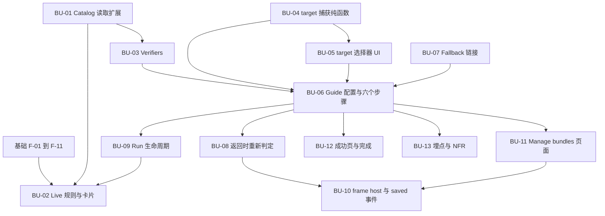

# 详细计划：Bundles Advanced feature（F2P）

- **上级计划：** [bundles-advanced-dev-plan.md](bundles-advanced-dev-plan.md)（revision 2）
- **PRD：** [bundles-advanced-prd.md](bundles-advanced-prd.md)
- **共享基础：** [advanced-foundation-detail-plan.md](advanced-foundation-detail-plan.md)（步骤 `F-xx`，对应上级计划的任务 0.2）。本文只写 Bundles 自己的步骤 `BU-xx`。
- **范围：** 只含 `free-to-play-pc`。Catalog frame 本身由别的团队开发（Q18）。本计划只做承载和 fallback。
- **状态：** 草稿。每步的格式见基础文档的"阅读方法"。

路径缩写同基础文档。新增：`BUN` = `src/pages/GetStarted/advanced/bundles`。

## 交付模式

Q4、Q5、C4 未答复前，按**fallback 模式**交付。frame 模式在事件可用后接入，不改步骤配置。

| 模式 | 步骤的"去哪里操作" | 步骤状态何时更新 | 步骤 |
|---|---|---|---|
| fallback（v1 默认） | 按钮跳转到完整 Catalog 页面 `/projects/:id/storefront/bundles`（第 1 步 `/storefront`） | 伙伴返回或窗口重新获得焦点时 | BU-01 到 BU-09、BU-11 到 BU-13 |
| frame | guide 内嵌 Catalog frame | frame 发出 "saved" 事件时立即更新 | 在 fallback 之上加 BU-10 |

## 步骤依赖图



## 开发顺序

| 阶段 | 步骤 | 说明 |
|---|---|---|
| A. 读取与规则（纯逻辑，先做） | BU-01、BU-03、BU-04 | 可在基础完成前先写测试和代码 |
| B. 基础完成后 | BU-07、BU-05、BU-06、BU-08、BU-09、BU-02 | fallback 模式的完整 guide 和卡片 |
| C. 收尾 | BU-11、BU-12、BU-13 | |
| D. frame 事件可用后 | BU-10 | 依赖 Q4、C4 |

---

## BU-01 Catalog 读取扩展

- **对应：** 上级计划 2.2；R3、Q13。
- **输入：**
  - `core/apis/catalog.ts`：`CatalogItemOption`（:422-460）有 `type`、`bundleType`、`isPaid`、`isEnabled`、`isShownInStore`。
  - `normalizeCatalogItem`（:517-531）**丢弃** `content`、`periods`、`limits`、`vc_prices`、`is_free`。
  - `listCatalogItems`（:540-547）POST 同一路径，**不分页**。
  - `isLivePriceRow`、`priceRowsOf` 未导出；`priceRowsOf` 在 `is_free === true` 时返回 `[]`。
  - 开放问题：列表接口是否返回这些字段（BU-01a）。
- **输出：**
  - **BU-01a 探测（先做，只读）：** 在 stage 上取一个已有 bundle 的原始列表响应和单个 bundle 响应，记录两件事：(1) 列表响应是否含 `content`、`vc_prices`、`is_free`、`limits`、`periods`；(2) 目录超过一页时，POST 列表是否返回全部 item。结果写进 MR 描述。
  - `CatalogItemOption` 新增可选字段：`isFree?: boolean`、`hasVcPrice?: boolean`、`contentCount?: number`、`hasLimit?: boolean`、`hasPeriod?: boolean`。`normalizeCatalogItem` 在原始数据里有对应字段时填充，否则留 `undefined`。
  - 如果 BU-01a 发现列表不返回这些字段：新增 `getBundleDetail(projectId, sku): Promise<CatalogItemOption | null>`，GET 单个 bundle（用现有 `adminItemSkuUrl(projectId, 'bundle', sku)`），返回同一形状。
  - 如果 BU-01a 发现 POST 列表在大目录下不完整：新增分页读取 `listBundleItems(projectId)`（带 `bundle_type` 过滤），Live 规则和第 1 步改用它。
- **要点：**
  - 只读。**不得**调用 `createBundle`、`updateBundle` 或任何 `ensure*`。
  - `hasVcPrice` = `vc_prices` 非空数组。`contentCount` = `content` 数组长度。`hasLimit` = `limits.per_user` 有值。`hasPeriod` = `periods` 非空数组。
  - 新字段不改变现有字段的值。`isPaid` 的语义保持不变，因为其他 setup 在用它。
  - 现有调用方（`CatalogItemOption` 的消费者）不受影响，因为新字段全部可选。
- **先写的测试：** 扩展 `catalog.test.ts`（`vi.mock('./store-instance', …)` 模式）
  - `normalizeCatalogItem` 映射新字段：有 `vc_prices` → `hasVcPrice: true`；`is_free: true` → `isFree: true`；`content` 3 项 → `contentCount: 3`；`limits.per_user` 有值 → `hasLimit: true`；`periods` 非空 → `hasPeriod: true`。
  - 字段缺失时全部为 `undefined`，不是 `false` 或 `0`（区分"没有数据"和"没有该特性"）。
  - 旧的断言全部不改动仍通过。
  - 若新增了 `getBundleDetail`：404 返回 `null`；其他错误抛出。
- **完成标准：** 测试通过；`createBundle`、`updateBundle` 仍无生产调用方（`grep` 验证）。

## BU-02 Live 规则与卡片注册

- **对应：** 上级计划 1.1 到 1.4；D1；Q6、P3、P7、P8、P9。
- **输入：** BU-01、BU-09；基础 F-05、F-07、F-12。
- **输出：**
  - `BUN/live.ts`：
    ```ts
    isLiveBundle(item: CatalogItemOption): boolean
    // type === 'bundle' && bundleType 不是 'virtual_currency_package' && 不是 'partner_side_content' && isEnabled
    isBundlesCardLive(items: CatalogItemOption[]): boolean
    ```
  - 在 `ADVANCED_GUIDES` 注册 Bundles：`id: 'bundles'`、`order` 排在 Promotions 之后（先用 30，最终顺序见 Q9）、`managePath: projectId => advancedManagePath(...)`（即 Manage bundles 路由）、`hasManageRoute: true`。
  - `liveRule: ({projectId}) => listCatalogItems(projectId).then(isBundlesCardLive)`（或 BU-01 的分页版本）。
  - 卡片：Live → "Open" 进入 Manage bundles；次要链接按 run 状态为 "Resume guide" 或 "View guide"（基础 F-12 已实现，这里只提供 `hasManageRoute` 和 run 状态）。
- **要点：**
  - **默认（P3、P8 未决）：** 排除 currency package 和 dynamic bundle；只要求 `isEnabled`，不要求 `isShownInStore`。规则只在 `live.ts`。
  - Blocked 优先于 Live（P7，基础 F-07 已处理）。
  - 状态只来自账户数据（D1-FR4）。
  - 文案前缀 `host.pages.getStarted.advanced.bundles.card.*`。账户示例：item 和 currency package（F2P）。
- **先写的测试：** `live.test.ts`
  - 普通 enabled bundle → Live。
  - disabled bundle → 不 Live。
  - `bundleType: 'virtual_currency_package'` → 不 Live。
  - `bundleType: 'partner_side_content'` → 不 Live。
  - `type: 'virtual_good'` → 不 Live。
  - 列表为空 → 不 Live；混合列表中有一个合格 bundle → Live。
  - 注册测试：Bundles 不在 `SETUPS`；顺序在 Promotions 卡片之后。
- **完成标准：** 测试通过。

## BU-03 Verifiers

- **对应：** 上级计划 2.5。
- **输入：** BU-01；基础 F-04（`ctx.target`、`ctx.runId`）；`GS/setups/shared-verifiers.ts` 的 `verifyItemCatalog`（**不复用**：它用 `listCatalogItemRefs`，bundle 也算）。
- **输出：** `BUN/verifiers.ts`，全部符合 `StepVerifier`：

  | 导出 | 读什么 | 返回 `true` 的条件 | 没有 target 时 |
  |---|---|---|---|
  | `verifyBundleSourceItems` | `listCatalogItems` | 非 bundle 条目数 ≥ N（N 来自 Q10，默认 1）。currency package 算 item | 不需要 target |
  | `verifyTargetBundleSaved` | target bundle（BU-01） | target 存在 | `false` |
  | `verifyTargetBundleContents` | target bundle | `contentCount >= 1` | `false` |
  | `verifyTargetBundlePrice` | target bundle | `isPaid`，或 `hasVcPrice`，或 `isFree` | `false` |
  | `verifyTargetBundleLimits` | target bundle | `hasLimit` 或 `hasPeriod` | `false` |

- **要点：**
  - "非 bundle"：`type !== 'bundle'`，或 `bundleType === 'virtual_currency_package'`。Q10 的 N 放在一个常量 `MIN_SOURCE_ITEMS`。
  - target 通过 `ctx.target?.sku` 读取，从 `listCatalogItems` 结果里按 SKU 找；找不到返回 `false`（不抛错）。
  - `isFree`、`hasVcPrice` 为 `undefined`（BU-01 没有数据）时，不当作 `true`。
  - 一次 guide 页面加载内多个 verifier 共享同一次 `listCatalogItems` 调用（模块级 in-flight 去重，参考 `loadLandings`），避免 5 个步骤发 5 次请求。
  - 不调用任何写操作。
- **先写的测试：** `verifiers.test.ts`
  - Source items：只有 bundle → `false`；有 1 个 virtual good → `true`；只有 currency package → `true`；N=2 时 1 个 item → `false`。
  - Target：无 `ctx.target` → 四个都 `false`。
  - target 存在 + 无 contents → saved `true`、contents `false`。
  - Price：real 价格 → `true`；仅 VC 价格 → `true`；`is_free` → `true`；三者都没有 → `false`。
  - Limits：有 limit → `true`；有 period → `true`；都没有 → `false`。
  - target SKU 不在列表中（被删除）→ 全部 `false`。
  - 同一次页面加载内 `listCatalogItems` 只被调用一次。
- **完成标准：** 测试通过；文件里无写操作。

## BU-04 target 捕获（纯函数）

- **对应：** 上级计划 2.7；P1、P8。
- **输入：** BU-01 的 `CatalogItemOption`；基础 F-03 的 `snapshot`、`target`。
- **输出：** `BUN/target.ts`：
  ```ts
  snapshotBundleSkus(items: CatalogItemOption[]): string[]           // 项目里现有的所有标准 bundle（含 disabled），见要点
  candidateNewBundles(snapshot: string[], items: CatalogItemOption[]): CatalogItemOption[]
  resolveTarget(input: {
    fromEvent?: string;                       // frame "saved" 事件里的 SKU
    snapshot: string[]; items: CatalogItemOption[];
    chosen?: string;                          // 伙伴从短列表选的 SKU
  }): { sku?: string; needsChoice: boolean; candidates: CatalogItemOption[] }
  ```
- **要点：**
  - **快照范围：** 快照包含项目里**所有** `type === 'bundle'` 且不是 currency package、不是 dynamic bundle 的 SKU，**包括 disabled 的**。这样，run 开始前就存在的任何 bundle 都不会被当成 target。
  - `candidateNewBundles`：当前列表里，满足同样条件但**不在快照中**的 bundle。
  - `resolveTarget` 规则：`fromEvent` 有值 → 直接用，`needsChoice: false`；否则候选为 0 → `{needsChoice: false, sku: undefined}`（还没有新 bundle）；候选为 1 → 自动选它；候选 ≥ 2 → `needsChoice: true`，`sku` 取 `chosen`（如果它在候选中）。
  - dynamic bundle 永远不是候选，永远不是 target（P8）。
  - `chosen` 不在候选中时被忽略。
  - 纯函数，无 I/O。
- **先写的测试：** `target.test.ts`
  - 快照包含 disabled 的老 bundle。
  - 老 bundle 在列表里但在快照中 → 不是候选。
  - 新增一个 → 自动成为 target。
  - 新增两个 → `needsChoice: true`；传入有效 `chosen` → 得到 `sku`；传入无效 `chosen` → 仍未选定。
  - `fromEvent` 优先于候选。
  - 新增的是 dynamic bundle 或 currency package → 不是候选。
  - 快照为空且项目没有 bundle → 无候选。
- **完成标准：** 测试通过。

## BU-05 target 选择器 UI

- **对应：** 上级计划 2.7（多个新 SKU 时伙伴选一个）。
- **输入：** BU-04；基础 F-03 的 `setTarget`。
- **输出：** `BUN/TargetPicker.tsx`：属性 `{ candidates: CatalogItemOption[]; onChoose(sku: string): void }`。显示新 bundle 的短列表（名称加 SKU），一个选择动作。
- **要点：**
  - 只在 `needsChoice` 为 `true` 时由 guide 渲染（BU-06）。
  - 只列**新**候选，不列老 bundle。
  - 选择后 dispatch `setTarget`；之后 verifier 立即用新 target 重新判定（走 BU-08 的 `recheck`）。
  - 单选，键盘可达，选项有描述性标签。
- **先写的测试：** 渲染候选列表；选一个触发 `onChoose(sku)`；列表为空时不渲染；键盘选择。
- **完成标准：** 测试通过。

## BU-06 Guide 配置与六个步骤

- **对应：** 上级计划 2.1、2.3、2.4；D2-FR1 到 FR18。
- **输入：** BU-03、BU-04、BU-05、BU-07；基础 F-02、F-05、F-10、F-11。
- **输出：** `BUN/config.tsx`：`SetupConfig<'bundles'>`，名称 "Build and manage bundles"。

  | # | 步骤 id | 标题（en） | kind | 完成条件 | 按钮目标（fallback） |
  |---|---|---|---|---|---|
  | 1 | `prepare-items` | Prepare items and groups | detect + 双路径（`have-items` / `create-items`） | `verifyBundleSourceItems` | `/storefront`（Catalog） |
  | 2 | `describe-bundle` | Describe the bundle | detect | `verifyTargetBundleSaved` | `/storefront/bundles` |
  | 3 | `choose-contents` | Choose the contents | detect | `verifyTargetBundleContents` | `/storefront/bundles` |
  | 4 | `set-price` | Set the price | detect | `verifyTargetBundlePrice` | `/storefront/bundles` |
  | 5 | `limits-period` | Limits and display period | detect + `optional` | `verifyTargetBundleLimits`，或已跳过 | `/storefront/bundles` |
  | 6 | `check-store` | Check it in your store | confirm | 伙伴确认（Q16 的文案） | storefront 地址 |

  Overview 内容（D2-FR2）：目标；步骤数（自动）；"before you start"：要包含的 item、价格和币种、可选限制；两条规则："bundle 不能为空"、"bundle 不能包含自身"。

- **要点：**
  - **第 2–4 步的检测局限（P6 默认）：** 已保存的 bundle 一定带价格或 `is_free`，Catalog 禁止空 bundle，所以 fallback 模式下第 2 步变为完成时，第 3、4 步同时完成，guide 直接到第 5 步。第 3、4 步仍可重新打开查看 contents 和价格。这改变了 D2-FR4 的逐步推进，需要 PRD owner 签字。**在 MR 里写明。**
  - 步骤 2 打开时：dispatch `setSnapshot`（BU-04 的 `snapshotBundleSkus`），只在 `snapshot` 还不存在时写一次（同一个 run 内不覆盖）。
  - target 的来源：fallback 模式下，伙伴返回后用 `resolveTarget`；`needsChoice` 时在步骤里渲染 `TargetPicker`。
  - 步骤 1 的 "Create items now" 路径（P2 默认）：只给 fallback 页面链接，**不复用** `CreateItemForm`。
  - 步骤 5 是 `optional`：伙伴可以 Skip 并完成；可以再打开。
  - 步骤 6：Next 和 Skip 都不完成它。
  - 步骤 3 的 Premium key 库存提示：content model 中留一个可选文案位，F2P 不填。
  - 校验规则（bundle 非空、不含自身）和保存逻辑不在 guide 里实现（D3-FR3），guide 只显示说明。
  - 文案前缀 `host.pages.getStarted.advanced.bundles.*`。
- **先写的测试：** `config.test.tsx` 与 guide 集成测试
  - 6 个步骤；kind 序列 detect、detect、detect、detect、detect（optional）、confirm。
  - 步骤 1 的路径选择持久化，只显示所选路径的说明。
  - 步骤 2 打开时写入快照，重新打开不覆盖。
  - 没有 target 时步骤 2 到 5 都未完成，即使项目里有老 bundle（D2-US13）。
  - 创建了一个新 bundle（mock 列表新增 SKU）→ 步骤 2、3、4 同时完成，当前步骤是 5。
  - 两个新 bundle → 显示 `TargetPicker`；选择后继续。
  - 步骤 5 Skip 后完成；再打开后仍可操作；有 limit 时检测为完成。
  - 步骤 6：Next、Skip 都不完成；确认后完成。
  - 老 run 已完成的 bundle，在新 run 里不让步骤 2 完成（BU-09 的 State 测试再覆盖一次）。
  - 步骤 3 和 4 在已完成状态下可以重新打开。
- **完成标准：** 测试通过。

## BU-07 Fallback 链接

- **对应：** 上级计划 3.3、3.5（fallback 部分）；D3-FR7、NFR Reliability。
- **输入：** `routes/inside/storefront.ts` 的路由；`nav-items-config.tsx:47-51`（`/storefront/bundles` 已是 "All items" 的 active path）。
- **输出：** `BUN/links.ts`：
  ```ts
  catalogPath(projectId): string       // `/projects/${projectId}/storefront`
  bundlesPath(projectId): string       // `/projects/${projectId}/storefront/bundles`
  ```
  以及 `BUN/FallbackButton.tsx`：属性 `{ href: string; labelId: string }`，作为步骤的主按钮。
- **要点：**
  - fallback 目标是账户 shell 内的页面（不跳出账户）。
  - 按钮在新页面打开还是同页导航：用同页导航，伙伴返回时走 BU-08 的重新判定。
  - fallback 不依赖任何 frame 状态，永远可用，所以 frame 失败永远不会阻塞 guide（BU-10 复用它）。
- **先写的测试：** 两个函数的输出；按钮渲染标签和 `href`；导航不触发 `setCurrentSetup`。
- **完成标准：** 测试通过。

## BU-08 返回时重新判定

- **对应：** 上级计划 2.6；D3-FR4、D2-FR4；P4。
- **输入：** 基础 F-04（`refresh({force: true})`）、F-10（`recheck`）。
- **输出：** `BUN/useRecheck.ts`（或直接在 `useAdvancedGuide` 里启用）：
  - 窗口 `focus` 事件 → `recheck()`。
  - 路由回到本 guide 的路径 → `recheck()`。
  - 页面加载 → 已有（F-10）。
  - `useBoundedRetry(verify, {attempts: 3, withinMs: 10_000})`：供 BU-10 的 frame 事件使用。保存后后端可能还没更新，重试期间绕过 TTL（`force: true`）。
- **要点：**
  - `focus` 事件防抖（例如 500ms 内只触发一次），避免来回切标签页时连续请求。
  - 重试总次数有上限；到上限后停止，不无限轮询。
  - 重新判定是**更新**状态，不会把已完成的步骤改回未完成（有 pin 兜底，见 BU-10）。fallback 模式下没有 pin：状态以最新读取为准，这也是 P4 提到的缺口——步骤在返回时更新，不是即时更新。
- **先写的测试：**
  - `focus` 触发一次 `refresh({force: true})`；500ms 内的第二次 `focus` 不触发。
  - 路由回到 guide 触发一次。
  - 重试：第 1、2 次读到 `false`，第 3 次读到 `true` → 步骤完成；3 次都 `false` → 停止，不再请求。
  - 卸载后不再重试。
  - **P4 缺口：** "frame 无 saved 事件时，步骤在返回或聚焦时更新" 是预期行为，写成一个明确的测试，注释写明它是已记录的缺口。
- **完成标准：** 测试通过。

## BU-09 Run 生命周期（resume 与新 run）

- **对应：** 上级计划 2.10；D1-FR6、D2-FR8、D2-US13；P9。
- **输入：** 基础 F-03（`startRun`、`completeRun`）。
- **输出：** `BUN/runIntent.ts`（纯函数）：
  ```ts
  resolveRunIntent(input: {
    state: GuideState | undefined;
    intent: 'set-up' | 'view-guide' | 'resume';
  }): { action: 'resume'; runId: string } | { action: 'new-run' };
  secondaryLinkKind(state: GuideState | undefined): 'resume' | 'view' | 'none';
  ```
- **规则：**

  | 当前 run | 意图 | 结果 |
  |---|---|---|
  | 无 | set-up / view-guide / resume | 新 run |
  | 未完成 | 任意 | resume（不新建） |
  | 已完成 | view-guide | 新 run |
  | 已完成 | set-up / resume | resume 已完成的 run（显示成功页或最后一步，不新建） |

  `secondaryLinkKind`：未完成 → `resume`（"Resume guide"）；已完成或无 → `view`（"View guide"）。
- **要点：**
  - **Live 卡片永远不丢弃未完成的 run。** Live 状态来自数据，与 run 无关。
  - 新 run：新 `runId`，`target`、`snapshot`、`confirmedStepIds`、`skippedStepIds` 都为空。第 1 步的条件仍满足时保持完成（它不依赖 target，D2-US13）。
  - 新 run 的 status key 带新 `runId`（基础 F-04），旧 run 的缓存和 pin 不可见。
  - `AdvancedCard` 通过 `secondaryLinkKind` 决定链接文案（基础 F-12 预留了位置）。
- **先写的测试：** `runIntent.test.ts` — 上表每一行；Live 卡片 + 未完成 run → `resume`；已完成 + view-guide → 新 run 且第 1 步仍完成、第 2 步未完成。
  State 测试：新 run 看不到旧 run 的 status 和 pin（用基础 F-04 的 key）。
- **完成标准：** 测试通过。

## BU-10 Frame host 与 "saved" 事件（frame 模式，阻塞于 Q4/C4）

- **对应：** 上级计划 3.1、3.2、3.4、2.6（事件部分）；D3-FR1 到 FR6。
- **输入：** Q4、C4（`module_id`、container scope、frame id、事件约定）；`@accounts-sdk/platform-shell/remote-module` 的 `RemoteModule`；BU-07（fallback）、BU-08（重试）、基础 F-10（`pinFromTrustedEvent`）。
- **输出：**
  - `BUN/CatalogFrame.tsx`：属性
    ```ts
    { frameId: string; stepId: string; fallbackHref: string;
      onSaved(e: { sku: string; stage?: 'details' | 'contents' | 'price' | 'limits' }): void }
    ```
  - 加载 frame；5 秒内未加载完成、加载失败或不可用 → 显示 `FallbackButton`（BU-07）。
  - 收到 "saved"：(1) 对该步骤调用 `pinFromTrustedEvent`；(2) 写入 `setTarget`（事件带 SKU）；(3) 启动 `useBoundedRetry`（BU-08）。
  - 每步到 frame id 的映射表（`BUN/frames.ts`）：group、item 或 currency package、bundle 创建（details、contents、price、limits）、bundle 列表与编辑。
  - 访问控制：没有 Catalog 权限（C3）的用户看到步骤文字和提示，不渲染 frame。
- **要点：**
  - `RemoteModule` 的 `name` 必须等于后端 `module_id`；container global 与 scope 不同时用 `containerMapping`；frame 有内部 router 时传 `pathname={match.url}`，**不要**包 `withAccountBasename()`（见项目 `CLAUDE.md` Gotchas）。
  - 传入账户 theme 和语言，宽度适配步骤面板。
  - frame 按打开的步骤懒加载。
  - **只有这里**调用 `pinFromTrustedEvent`。伙伴点击不能触发它。事件来源需校验：只接受来自该 frame 的事件（按 C4 约定的事件格式）。
  - 若 frame 只发 "saved"、不带阶段：第 2–4 步按 P6 默认一起完成（BU-06）。若带阶段：按阶段 pin 对应步骤。
  - Q5 若接受 v1 只用 fallback：**本步骤整体不做**，BU-06 的 fallback 已满足。
- **先写的测试：** `CatalogFrame.test.tsx`
  - "saved" 事件 → 调用 `pinFromTrustedEvent(stepId)`、`setTarget(sku)`。
  - **后端滞后：** pin 之后重试 3 次都读到 `false` → 步骤仍保持完成，不跳回待办（PIN_ROUNDS 内）。
  - 加载失败 → 显示 fallback 按钮，链接正确。
  - 5 秒超时 → 显示 fallback 按钮（用 fake timers）。
  - 无 Catalog 权限 → 不渲染 frame，显示提示。
  - 非该 frame 来源的事件被忽略。
  - frame 真实事件契约测试写成 `it.skip`，启用条件：Q4 与 C4 关闭。
- **完成标准：** 测试通过；frame 失败永远不阻塞 guide。

## BU-11 Manage bundles 页面

- **对应：** 上级计划 2.8；D2-FR19、FR20；Q12。
- **输入：** 基础 F-09（`/manage` 路由）；BU-07；BU-10（frame 模式时）。
- **输出：** `BUN/ManageBundles.tsx`，挂在 `get-started/advanced/bundles/manage`。
  - fallback 模式：一个说明加按钮，链接到 `bundlesPath`。
  - frame 模式：内嵌 bundle 列表 frame（BU-10 的 `CatalogFrame`，frame id 为 bundle 列表与编辑）。
  - 可从成功页（BU-12）和 Live 卡片的 "Open" 进入。
- **要点：**
  - 在 Q12 答复前，不在 guide 里做任何删除逻辑。可用操作（编辑、删除、已购买或在购物车里的 bundle 如何处理）全部由 frame 或 Catalog 页面负责。
  - 页面不读写 `advancedGuides` run 状态。它与 run 无关。
  - 无 Catalog 权限的用户看到提示（同 BU-10）。
- **先写的测试：** fallback 模式渲染按钮和链接；frame 模式渲染 `CatalogFrame`；无权限提示；Live 卡片 "Open" 的目标是 manage 路由；页面挂载不改变 run 状态。
- **完成标准：** 测试通过。

## BU-12 成功页与完成

- **对应：** 上级计划 2.9；D2-FR9、FR10。
- **输入：** 基础 F-14；BU-06；BU-11。
- **输出：** 成功页摘要写出 target bundle 的名称，说明 bundles 已上线，提供 "Manage bundles" 按钮（`managePath`）和下一个推荐能力。`completeRun` 在全部步骤完成时调用。
- **要点：**
  - bundle 名称从 `listCatalogItems` 里按 `target.sku` 取；取不到时显示 SKU。
  - 推荐下一个能力：按 Bundles 之后的 Advanced 顺序，没有则不显示（基础 F-14 已处理）。
  - 卡片变为 Live 由账户数据决定（BU-02），成功页不写 Live 状态。
  - 当前 run 标记完成后，卡片的次要链接变为 "View guide"（BU-09）。
- **先写的测试：** 成功页渲染 target 名称；"Manage bundles" 链接指向 manage 路由；`completeRun` 被调用一次；完成后再渲染卡片，次要链接为 "View guide"；名称缺失时回退显示 SKU。
- **完成标准：** 测试通过。

## BU-13 埋点与 NFR

- **对应：** 上级计划 4.1 到 4.6；PRD NFR。
- **输入：** 基础 F-15、F-16、F-17；BU-10。
- **输出：**

  | 事件（`trackAdvanced`） | 触发点 | 字段 |
  |---|---|---|
  | `card_click` | 卡片按钮和次要链接（Blocked 不触发） | capability、cardState |
  | `guide_opened` | guide 挂载一次 | capability、cardState |
  | `step_started` | 步骤主按钮或 fallback 按钮点击 | capability、step |
  | `frame_saved` | BU-10 收到 saved 事件（fallback 模式不会触发） | capability、step |
  | `step_skipped` | 步骤 5 的 Skip | capability、step |
  | `guide_completed` | run 完成一次 | capability |

  NFR 检查表：

  | 项 | 检查方式 | 判定 |
  |---|---|---|
  | 无障碍：badge、步骤状态、frame 与 fallback 按钮 | Component 测试 + 手动 Tab | 文字标签齐全，键盘可达 |
  | Admin 标注 | F-16 的测试 | admin 可见 |
  | 性能：卡片和 guide 3 秒内可交互；每次加载只取一次卡片状态；frame 懒加载 | 测试（每个 `liveRule` 一次）+ 手动计时；frame 与 Publisher Account 同页加载时间对比（stage） | 3 秒内；无明显退化 |
  | 布局：1366x768、13 英寸 Mac | 手动 | 无溢出 |
  | 向后兼容：现有 bundle 与 catalog 数据不变 | 全部读取只用 GET 或只读 POST；`grep` 确认无 `createBundle`、`updateBundle` 调用；stage 上对已有 bundle 的项目前后对比 | 无差异 |
  | locale | `locales/index.test.ts`；C5 决定是否暂缓 Smartcat export | 通过 |

- **先写的测试：** 每个事件的字段齐全；Blocked 不发事件；`frame_saved` 只在 frame 模式触发；重渲染不重复发 `guide_opened`。
- **完成标准：** 测试通过，检查表填完。release 和 stage 验证由用户负责，不在本步骤里。

---

## 自动化测试清单（汇总）

| 层级 | 文件 | 来自步骤 |
|---|---|---|
| Unit | `live.test.ts`、`verifiers.test.ts`、`target.test.ts`、`runIntent.test.ts`、`links.test.ts`、`catalog.test.ts`（扩展） | BU-01 到 BU-09 |
| Component | guide 六步流程、`TargetPicker`、卡片、成功页、`ManageBundles`（两种模式）、无权限提示、widget 内容 | BU-05 到 BU-12 |
| Frame host | saved 事件、后端滞后、加载失败、5 秒超时、无权限、错误来源事件 | BU-10 |
| State | 不改变 `currentSetupId`；Blocked → Available；resume；Live 卡片不重置 run；新 run 隔离 | BU-06、BU-09、F-10 |
| Analytics | 六个事件字段 | BU-13 |
| Locale | `locales/index.test.ts` | 每一步 |
| Skipped（未来行为） | frame 事件契约（Q4、C4）；R3 真实 Live 信号；store check 自动检测 | BU-01、BU-10 |

## 本计划的外部依赖

| 编号 | 需要什么 | 谁答复 | 影响的步骤 | 答复前的做法 |
|---|---|---|---|---|
| R3 / BU-01a | 列表和单个 bundle 响应有哪些字段；POST 列表是否完整 | 自己在 stage 探测，必要时问 Catalog 团队 | BU-01、BU-03 | 先写测试，字段以 `undefined` 处理 |
| Q4、C4 | frame 清单、阶段、事件约定、`module_id` | Catalog frame 负责人 | BU-10 | 不做 frame，走 fallback |
| Q5 | v1 能否只用 fallback | PRD owner | BU-10 | 默认只用 fallback |
| P6 | 第 2–4 步同时完成是否可接受 | PRD owner | BU-06 | 默认可以，MR 中写明 |
| Q10 | 第 1 步最少 item 数 | PRD owner | BU-03 | 默认 1 |
| Q6、P3、P8 | Live 规则、currency package、dynamic bundle | PRD owner | BU-02 | 默认值见 BU-02 |
| P1 | target 如何确定 | PRD owner | BU-04 | 快照加新 SKU |
| P2 | "Create items now" 能否复用 `CreateItemForm` | PRD owner | BU-06 | 默认只用 fallback |
| P9 | Live 卡片的 "View guide" 行为 | PRD owner | BU-09 | 默认见 BU-09 的规则表 |
| Q12 | Manage 页可用操作 | Catalog 负责人 | BU-11 | 全部交给 frame 或 Catalog 页面 |
| C3 | Catalog 权限名 | 账户负责人 | BU-10、BU-11 | 占位；实现 skip |
| C2 | 埋点名 | 数据团队 | BU-13 | 占位 |
| C5 | 是否暂缓 Smartcat export | 本地化负责人 | 全部 locale 改动 | 默认不暂缓，MR 中写明 |
