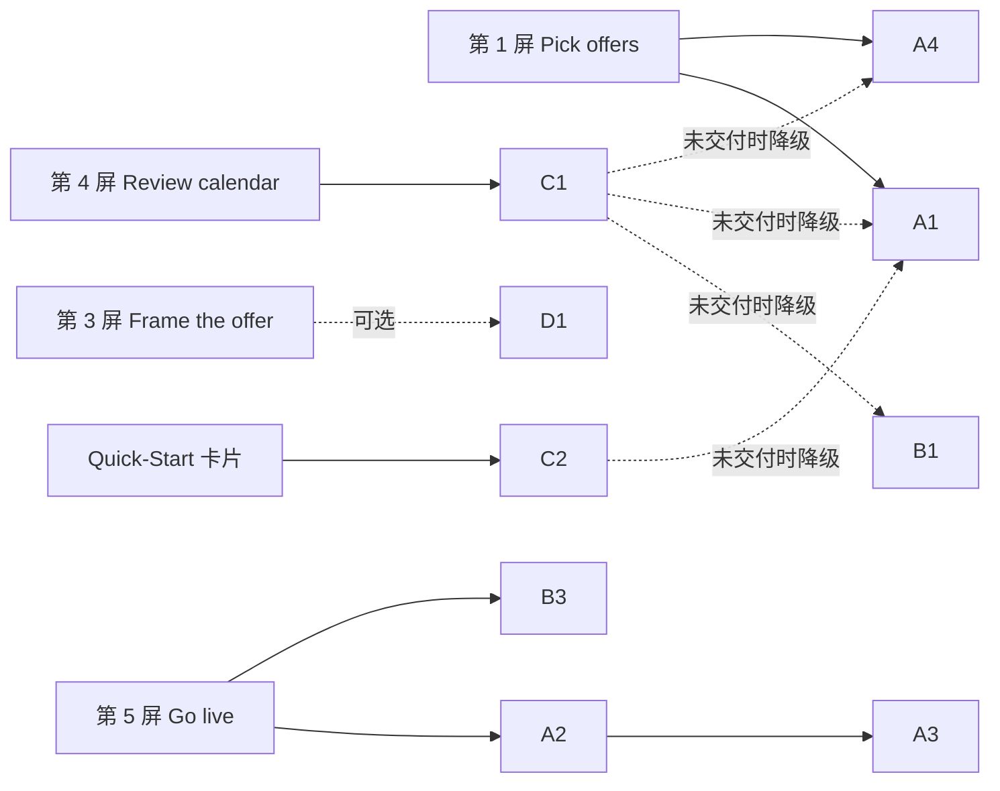

# 后端 API 清单：QSG Live-service: Time-limited offers（F2P）

- **来源：** [PRD](qsg-live-service-time-limited-offers-prd.md)、[开发计划](qsg-live-service-time-limited-offers-dev-plan.md)、[详细计划](qsg-live-service-time-limited-offers-detail-plan.md)、`free-to-play-pc` 代码（`src/core/apis/catalog.ts`、`store-instance.ts`、`config.ts`；`feat/advanced-guides-first-batch` 分支上的 `promotions.ts`）、Xsolla 公开 API 文档（见文末）。
- **日期：** 2026-10-28
- **状态：** 草稿。接口路径和字段来自公开文档和现有代码，**都还没有在 stage 上用 PA bearer token 实测过**。探测方法见第 6 节。
- **范围：** 只列本功能前端要调用的后端 API。不列 Metrika 埋点（埋点不需要后端 API，只需要在 tracking plan 中登记，见开发计划 C3）。

状态标记：

| 标记 | 含义 |
|---|---|
| 在用 | 代码已经在调用，并在 stage 上跑通过 |
| 有代码，未验证 | 代码已经写了调用，但路径或字段未经实测 |
| 有文档 | 公开文档有记载，代码里还没有 |
| 新增 | 后端还没有，需要对应团队开发 |
| 待定 | 是否需要后端，取决于 PRD owner 的答复 |

## 1. 总览

| # | API | 用途 | 使用位置 | 状态 | 关联 |
|---|---|---|---|---|---|
| A1 | 列出 catalog 条目 | 第 1 屏条目列表、"Visibility now" 列、Live 判断 | TO-04、TO-11、TO-13 | 在用 | — |
| A2 | 读取单个完整 item（3 种类型） | 整体写回前读取原始 payload | TO-05、TO-06、TO-08 | 有文档 | C2 |
| A3 | 更新 item（3 种类型，整体替换） | 写入 `periods`；失败时回滚 | TO-06、TO-08、TO-16 | 有代码，未验证 | C2 |
| A4 | 列出 item group | overlap 按 group 展开 | TO-10 | 在用 | P6 |
| B1 | 列出 discount promotion | overlap 日历的数据源；幂等查找 | TO-09、TO-10 | 有代码，未验证（路径与文档不符，见 3.1） | C1、R2 |
| B2 | 读取单个 discount promotion | 创建后读回校验 | TO-09 | 有文档 | C1 |
| B3 | 创建 discount promotion | 第 3 屏的关联折扣（TLO-03） | TO-09、TO-15 | 有文档 | C1 |
| B4 | 更新 discount promotion（整体替换） | manage 视图同步时段（v1 默认不同步） | TO-16 | 有文档，v1 可能不用 | 详细计划"新增"项 |
| B5 | 删除 discount promotion | 探测后清理；以后可能用于撤销 | 探测、TO-16 | 有文档，v1 可能不用 | — |
| C1 | overlap 查询 | 第 4 屏重叠检测 | TO-10 | 新增 | DEP-1、OD4 |
| C2 | capability 状态 flag | 卡片 Live 判断 | TO-11 | 新增（父 PRD 共享 API） | DEP-2、P2 |
| D1 | badge 与 countdown 的存储 | 第 3 屏 | TO-14 | 待定 | P5 |
| D2 | 按账户开启的 feature flag | Wave 1 灰度 | TO-17 | 待定 | C4 |
| D3 | 写权限判定数据 | 只读模式（NFR-04） | TO-12 | 待定 | C6 |



## 2. 公共约定：鉴权、host、CORS

| 项目 | 现状 | 风险 |
|---|---|---|
| host | 所有 A、B 组接口都走 Store API。stage 和 development 为 `https://store-api.nl-k8s-stage.srv.local`，production 为 `https://store.xsolla.com/api`（`src/config.ts`）。调用方只传 `/v2/...` 或 `/v3/...` 路径 | stage host 是内网地址，本地探测需要连 VPN |
| 鉴权 | 前端用 `storeInstance`，只带 PA bearer token（`store-instance.ts`） | **公开文档写的是 basicAuth（项目凭据）。** catalog admin 接口用 bearer 已经跑通；promotion 的 `/v3` 接口用 bearer 是否可用，**必须实测**。不可用时，前端无法直连，需要网关或后端代理 |
| CORS | 不能发送 `Business-Account-Id` header，它不在 store-api 的 CORS 白名单里，会导致 preflight 失败 | `/v3` promotion 接口的 CORS 配置未验证 |
| 写入原子性 | 没有批量接口。最多 50 个条目，逐个 PUT | 无法原子写入，用"失败即回滚"代替（P3） |

## 3. 现有 API

### 3.1 A 组：Catalog

#### A1 列出 catalog 条目（在用）

```
POST /v2/project/{project_id}/admin/items        body: {}
GET  /v2/project/{project_id}/admin/items        分页（listCatalogItemRefs）
```

- 代码：`listCatalogItems`（`catalog.ts`，POST，不分页）。
- 缺口：`normalizeCatalogItem` 丢弃了 `periods` 和 `groups`。first-batch 分支只加了布尔值 `hasPeriod`。TO-04 需要保留完整的 `periods` 和 group 的 `external_id`。
- 待探测：列表响应里 `periods` 和 `groups` 是否完整返回（与单条读取一致），还是只返回部分字段。

#### A2 读取单个完整 item（有文档）

```
GET /v2/project/{project_id}/admin/items/virtual_items/sku/{item_sku}
GET /v2/project/{project_id}/admin/items/bundle/sku/{sku}
GET /v2/project/{project_id}/admin/items/virtual_currency/package/sku/{item_sku}
```

- 用途：A3 是整体替换，写入 `periods` 前必须先读出完整的原始 payload，再合并写回（TO-05）。
- 文档中的响应包含 `periods` 和 `groups`：

```json
{
  "periods": [{ "date_from": "2020-08-11T10:00:00+03:00", "date_until": "2020-08-11T20:00:00+03:00" }],
  "groups": [{ "external_id": "horror", "name": { "en": "Horror" } }]
}
```

- `date_from` 和 `date_until` 的类型都是 `string | null`。
- 不在范围内：未打包的 virtual currency 和 game key（TLO-04；game key 没有 `periods`）。
- 待探测：GET 响应的形状能否直接作为 PUT body 写回；哪些字段要去掉（例如 `limits.per_item` 中的 `available`、`reserved`、`sold` 看起来是系统维护的计数）。

#### A3 更新 item（有代码，未验证）

```
PUT /v2/project/{project_id}/admin/items/virtual_items/sku/{item_sku}             updateVirtualItem
PUT /v2/project/{project_id}/admin/items/bundle/sku/{sku}                         updateBundle
PUT /v2/project/{project_id}/admin/items/virtual_currency/package/sku/{item_sku}  updateVirtualCurrencyPackage
```

- 写入内容：本功能只改 `periods`，其他字段按 A2 读到的原样写回。
- 写入的元素：`{ "date_from": "<UTC ISO-8601>", "date_until": "<UTC ISO-8601>" }`。PRD NFR-07 要求以 UTC 存储。
- VC package：代码注释说路径未经验证，可能在 `/mapi` 网关上。**公开文档给出的就是上面的 Store API 路径**，还需要实测确认。
- 回滚：用 A2 读到的原始 payload 再 PUT 一次，不需要额外接口。
- 现有缺口：sell-virtual-goods 和 off-platform-distribution 更新 item 时固定写 `periods: []`，会清空已有时段（TO-06）。
- 待探测：
  1. PUT 后再 GET，`periods` 是否原样保存；时区偏移是否被改写。
  2. 省略可选字段时，是清空还是保留（VC package 的文档没有说明）。
  3. **语义问题：** 文档把 `periods` 描述为 "Item sales period"（售卖期）。PRD 要的是"只在窗口内可见"。窗口外的条目在 storefront 上是隐藏，还是可见但不能买？

#### A4 列出 item group（在用）

```
GET /v2/project/{project_id}/admin/items/groups
```

- 响应：`{ groups: [{ external_id, name: {en}, is_enabled, ... }] }`。
- 用途：overlap 检测时，判断两个条目是否属于同一 group（TLO-02）。

### 3.2 B 组：Promotions discount

**与 first-batch 代码的出入：** `feat/advanced-guides-first-batch` 上的 `promotions.ts` 假设 discount 列表在 `/v2/project/{id}/admin/promotion/item`，行字段为 `date_start` / `date_end`。公开文档给出的是 **`/v3`**，时段字段是 **`promotion_periods`**。PR-04 需要按 R2 的答复修正，本功能的 TO-09 要基于修正后的版本。

#### B1 列出 discount promotion（有代码，未验证）

```
GET /v3/project/{project_id}/admin/promotion/item?limit=&offset=
```

- 文档中每条 promotion 的字段：

| 字段 | 类型 | 本功能用途 |
|---|---|---|
| `id` | integer | 引用 |
| `name` | object（locale → string） | 显示；放幂等标记（见 B3） |
| `promotion_periods[]` | `{date_from: string, date_until: string \| null}` | overlap 时间判断 |
| `discount.percent` | string \| null | 显示；"折扣最大者生效" |
| `items[]` | `{sku}`，可能为 `null` | overlap 条目判断 |
| `price_conditions` | array \| null | 见下方"overlap 缺口" |
| `attribute_conditions` | array | 见下方"overlap 缺口" |
| `is_enabled` | boolean | 只统计启用的 promotion |
| `excluded_promotions` | array | 互斥关系，影响"谁生效" |

- 响应顶层还有 `total_promotions_count`、`active_promotions_count`、`inactive_promotions_count`。
- 没有过滤参数：只能全量分页拉取，再在前端按 SKU 和时间过滤。
- **overlap 缺口：**
  1. 文档没有 group 目标字段。group 级重叠只能通过"条目属于哪个 group"（A4）间接判断（P6）。
  2. `items` 为 `null`、改用 `price_conditions` 的 promotion，按价格匹配条目，不列 SKU。前端要按价格条件判断它是否覆盖选中的条目，否则会漏报。
  3. `attribute_conditions` 按用户属性生效，前端无法判断某个玩家是否命中。默认按"可能重叠"处理并提示。

#### B2 读取单个 discount promotion（有文档）

```
GET /v3/project/{project_id}/admin/promotion/{promotion_id}/item
```

- 用途：B3 创建后读回，确认时段、条目和折扣值都正确。

#### B3 创建 discount promotion（有文档）

```
POST /v3/project/{project_id}/admin/promotion/item
```

```json
{
  "name": { "en-US": "Halloween offer [tlo:3f9a1c]" },
  "promotion_periods": [{ "date_from": "2026-10-30T17:00:00Z", "date_until": "2026-11-02T22:59:00Z" }],
  "discount": { "percent": "30" },
  "items": [{ "sku": "shards_pack_100" }, { "sku": "shards_pack_500" }],
  "is_enabled": true
}
```

- 响应：`201 { "promotion_id": <integer> }`。
- 必填：`name`、`discount.percent`（**字符串**）、`items[].sku`。
- 只有一个时段时，`date_until` 才能为 `null`。本功能的窗口总有结束时间，不受影响。
- **幂等：** 文档没有 `external_id` 字段，幂等标记只能放进 `name`（上例的 `[tlo:3f9a1c]`）。这需要 Promotions 团队认可：名称是伙伴可见、可编辑的字段（C1②）。
- 文档没有 group 目标字段：只能按 SKU 创建（P6）。

#### B4 更新 discount promotion（有文档，v1 可能不用）

```
PUT /v3/project/{project_id}/admin/promotion/{promotion_id}/item
```

- 整体替换。文档原话："New data will replace old data."
- v1 默认：manage 视图修改时段后，不自动同步关联 promotion，只提示伙伴手动修改。如果 PRD owner 要求同步，就用这个接口。

#### B5 删除 discount promotion（有文档，v1 可能不用）

```
DELETE /v3/project/{project_id}/admin/promotion/{promotion_id}/item
```

- v1 用途：只用于探测后清理测试数据。
- P10 默认：promotion 创建失败时保留 schedule，所以正常流程里不需要删除 promotion。

## 4. 新增 API（PRD Dependencies）

### C1 overlap 查询（DEP-1，新增）

- 负责：Promotions 团队，还没有估时。
- PRD 要求：50 个条目的查询 p95 < 1 s（NFR-02）；能读到 guide 之外创建的 discount（OD4，默认要）。
- 给 Promotions 团队的最小需求（只是需求输入，形状由对方定）：

| 方向 | 内容 |
|---|---|
| 输入 | `project_id`；SKU 列表（≤ 50）；时间窗口（UTC） |
| 输出 | 与窗口重叠、并且覆盖任一 SKU 的 discount：`id`、`name`、`discount.percent`、`promotion_periods`、命中的 SKU、命中方式（SKU、group、价格条件、属性条件） |

- 未交付时的降级（TO-10）：前端用 B1 全量分页 + A1 + A4 计算。限制：catalog 和 promotion 多时可能达不到 NFR-02；价格条件和属性条件的判断不如后端准确。

### C2 capability 状态 flag（DEP-2，新增）

- 负责：父 PRD 的共享 API。
- 用途：卡片 Live 判断（CARD-04）。
- 未交付时的降级（TO-11）：按 A1 判断，"至少一个条目有尚未结束的时段"即为 Live（P2 默认）。限制：所有窗口结束后卡片会退回 Available，可能与后端口径不一致。

## 5. 待定是否需要后端

| # | 问题 | 什么情况下需要后端 | 答复前的做法 |
|---|---|---|---|
| D1 | badge 文本和 countdown 存在哪里（P5） | item 和 promotion 上都没有合适字段时，要加字段或改 storefront 配置。PRD 写明 countdown 需要 storefront 支持 | 只在第 3 屏预览中显示，不保存 |
| D2 | Wave 1 的 feature flag 名称和按账户开启的方式（C4） | 需要后端或账户侧提供 flag 和配置入口 | 占位常量 |
| D3 | 写权限判定（C6）：Viewer 怎么识别；Promotions 属于 LiveOps 还是单独的 privilege | 现有角色数据不足以区分 item 写权限和 promotion 写权限时 | 按详细计划 TO-12 的默认值 |

## 6. 探测计划

在本地 `pnpm dev:stage` 中探测：登录 stage PA，连 VPN，通过 `storeInstance` 发请求，与功能上线后的调用方式完全一致。探测入口放在 `?dev=1` 调试面板（`lazy()` 加载，production 构建不包含）。探测用的 client 函数就是 TO-05 和 TO-09 的正式代码。

| 轮次 | 请求 | 回答 | 风险 |
|---|---|---|---|
| 1 | A2：三种类型各 GET 一条 | A2 路径；`periods`、`groups` 的真实形状 | 只读 |
| 1 | B1、B2：GET discount 列表和单条 | **bearer 能否调 `/v3`**；CORS；字段是否与文档一致 | 只读 |
| 1 | A1：对比列表和单条的 `periods`、`groups` | A1 能否直接用于 Live 判断 | 只读 |
| 2 | A2 → 改 `periods` → A3 → A2 读回比对（三种类型各一次） | A3 路径（尤其是 VC package）；时区处理；只读字段；可选字段是否被清空 | 写 stage，只用测试项目的测试 item |
| 2 | B3 → B2 读回 → B5 删除 | B3 payload；`name` 能否放标记；`percent` 是否必须是字符串 | 写 stage，测完删除 |
| 2 | 在 storefront 上查看窗口外的测试 item | A3 待探测第 3 项：隐藏还是不能买 | 只读 |

第 2 轮开始前，需要确认使用哪个 stage 测试项目。探测结果是观测，不是契约。结论要请对应团队确认，并记录在本文件和 MR 描述中。

## 7. 要向后端确认的问题

| 对象 | 问题 | 关联 |
|---|---|---|
| Catalog / Store API 团队 | A2 的响应能否直接作为 A3 的 body；哪些字段只读 | C2 |
| Catalog / Store API 团队 | VC package 的 PUT 是否就在 Store API 的 `/v2/.../virtual_currency/package/sku/{sku}` | C2 |
| Catalog / Store API 团队 | `periods` 窗口外的条目在 storefront 上是隐藏，还是只是不能买 | C8；TLO-05、CARD-01 文案 |
| Promotions 团队 | PA bearer token 能否调 `/v3/.../admin/promotion/*`（文档写的是 basicAuth）；CORS 是否允许本应用的 origin | C1 |
| Promotions 团队 | 能否提供 `external_id` 或类似字段做幂等；不能的话，在 `name` 里放标记是否可以接受 | C1② |
| Promotions 团队 | 是否支持以 item group 为目标的 discount | P6 |
| Promotions 团队 | overlap 查询（C1）的排期；v1 是否接受前端计算 | DEP-1 |
| 父 PRD 负责人 | capability 状态 flag（C2）的接口和交付时间 | DEP-2 |

## 参考

- [Admin get virtual item](https://developers.xsolla.com/api/igs/operation/admin-get-virtual-item)
- [Admin get bundle](https://developers.xsolla.com/api/catalog/bundles-admin/admin-get-bundle)
- [Admin get virtual currency package](https://developers.xsolla.com/api/catalog/virtual-items-currency-admin/admin-get-virtual-currency-package)
- [Admin update virtual currency package](https://developers.xsolla.com/api/catalog/virtual-items-currency-admin/admin-update-virtual-currency-package)
- [Get item promotion list](https://developers.xsolla.com/api/liveops/promotions-discounts/get-item-promotion-list)
- [Get item promotion](https://developers.xsolla.com/api/liveops/promotions-discounts/get-item-promotion)
- [Create item promotion](https://developers.xsolla.com/api/liveops/promotions-discounts/create-item-promotion)
- [Update item promotion](https://developers.xsolla.com/api/liveops/promotions-discounts/update-item-promotion)
- [Delete item promotion](https://developers.xsolla.com/api/liveops/promotions-discounts/delete-item-promotion)
