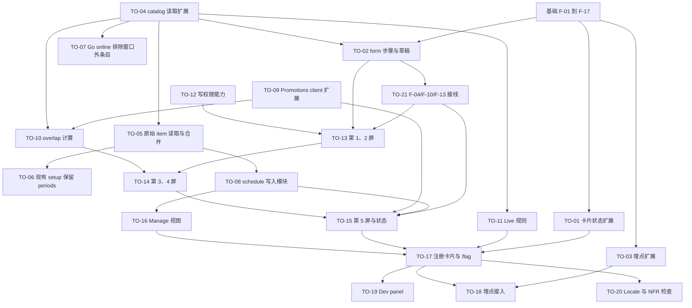

# 详细计划：QSG Live-service: Time-limited offers（F2P）

- **上级计划：** [qsg-live-service-time-limited-offers-dev-plan.md](qsg-live-service-time-limited-offers-dev-plan.md)（revision 3）
- **PRD：** [qsg-live-service-time-limited-offers-prd.md](qsg-live-service-time-limited-offers-prd.md)
- **共享基础：** [advanced-foundation-detail-plan.md](advanced-foundation-detail-plan.md)（步骤 `F-xx`）。本文只写本功能的步骤 `TO-xx`。TO-01 到 TO-03 是本功能要求的 foundation 扩展，代码落在 foundation 的文件里。
- **范围：** 只含 `free-to-play-pc`。Premium PC 不显示本卡片（PRD CARD-01）。
- **状态：** 草稿，revision 3。每步的格式见基础文档的“阅读方法”（输入、输出、要点、先写的测试、完成标准）。
- **后端 API：** [qsg-live-service-time-limited-offers-backend-api.md](qsg-live-service-time-limited-offers-backend-api.md)（编号 A1–A4、B1–B5、C1–C2、D1–D3）。
- **Revision 3：** 对照 Xsolla 公开 API 文档修订（未在 stage 实测）：
  - TO-09：discount 接口改为 `/v3/project/{id}/admin/promotion/item`；字段改为 `promotion_periods`、`discount.percent`（字符串）、`items[].sku`；没有 group 目标和 `external_id`，marker 只能放在 `name`。
  - TO-10：去掉 `via: 'group'`；新增按 `price_conditions` 和 `attribute_conditions` 生效的 discount 的处理；多个 `promotion_periods` 逐个求交集；`is_enabled: false` 不计入。
  - TO-04、TO-05：`date_from` 也可能为 `null`；单条读取的 endpoint 按文档填入；写回前去掉系统计数字段。
  - 新增待确认项：PA bearer token 能否调 `/v3` promotion 接口（文档写 basicAuth）；`periods` 是售卖期还是可见期。
- **Revision 2：** 按新上下文 reviewer 的审查修订：
  - 第 5 屏的完成条件加上“已确认”和“promotion 已处理”。
  - TO-06 改为 C2 关闭后才合并。
  - 第 2 屏 v1 去掉 "Always"，`planSchedule` 改为接收 `periods[]`。
  - 卡片状态和 `featureEnabledSentAt` 移到 project 级别，先比较再写入。
  - 原有 6 个埋点事件保持 `trackClick`。
  - promotion marker 加入折扣值。
  - 新增 TO-21（F-04、F-10、F-13 接线和 "Step N of 5"），并修正依赖顺序。
  - TO-12 按 `isRestrictedUser` 判断。
  - 修正 foundation 文件名。

路径缩写同基础文档（`GS`、`SW`、`SLICE`、`ADV`）。新增：`TLO` = `src/pages/GetStarted/advanced/time-limited-offers`，`SVG` = `src/pages/GetStarted/setups/sell-virtual-goods`，`OPD` = `src/pages/GetStarted/setups/off-platform-distribution`。

编号对照：上级计划的任务是 `TL-xx`，PRD 的需求是 `CARD-xx`、`GDE-xx`、`TLO-xx`，本文的步骤是 `TO-xx`。

## 步骤依赖图



## 开发顺序

| 阶段 | 步骤 | 原因 |
|---|---|---|
| A. 不依赖基础和设计稿 | TO-04、TO-05、TO-06、TO-07 | 只改 catalog 读取和现有 setup。TO-07 可以单独先合并。**TO-06 要等 C2 关闭后才能合并**：它在现有 setup 的保存路径上调用 `getRawCatalogItem`，endpoint 未确认时会让“编辑已有 item”全部失败。C2 关闭前，TO-06 只写代码和测试，现有 setup 继续写 `[]` |
| B. 依赖外部答复 | TO-09（C1）、TO-12（C6） | 先写接口和 mock 测试，真实 endpoint 和权限名等答复 |
| C. 纯逻辑 | TO-08、TO-10、TO-11 | 不依赖 UI，可以先完成并测满。TO-08 通过注入的 `ledger` 接口写清单，不依赖 TO-02 |
| D. foundation 扩展 | TO-01、TO-02、TO-03、TO-21 | foundation F-01 到 F-17 完成后，或与其同一批次交付 |
| E. 依赖设计稿（DEP-3） | TO-13 → TO-14 → TO-15、TO-16 | Figma 交付后 |
| F. 收尾 | TO-17 → TO-18、TO-19、TO-20 | 需要完整链路。TO-17 最后做，因为注册表要求 guide 的步骤齐全 |

---

## 工期预估

人天，**不含写测试**（由 AI 生成），不含运行测试、review、等待答复和 stage 验证。假设与总表见 [基础文档的“工期预估”](advanced-foundation-detail-plan.md)。

| 阶段 | 步骤 | 人天 |
|---|---|---|
| A | TO-04（0.5）、TO-05（0.75）、TO-06（0.5）、TO-07（0.25） | 2 |
| B | TO-09（1）、TO-12（0.75） | 1.75 |
| C | TO-08（1.5）、TO-10（0.75）、TO-11（0.25） | 2.5 |
| D | TO-01（0.5）、TO-02（1）、TO-03（0.75）、TO-21（1） | 3.25 |
| E | TO-13（1.5）、TO-14（1.5）、TO-15（1）、TO-16（1.5） | 5.5 |
| F | TO-17（0.5）、TO-18（0.5）、TO-19（0.5）、TO-20（0.5） | 2 |
| **合计** | | **17**（其中 5.5 依赖设计稿；C1、C2 答复后接入真实 endpoint 另加约 1） |

---

## TO-01 卡片状态扩展：不受初始 setup 限制，读取失败保留旧状态

- **预估：** 0.5 人天（风险：低。纯函数加 hook 的一个分支）
- **对应：** 上级计划“共享部分”的 F-06、F-07、F-08 扩展；PRD CARD-02、CARD-04；spec 05 GS-STATUS-002。
- **输入：** F-05、F-06、F-07、F-08 已完成。
- **输出：**
  - `ADV/types.ts`：`AdvancedGuideConfig` 新增可选字段 `ignoresInitialSetup?: boolean`。
  - `ADV/types.ts`：`AdvancedGuideId` 加入 `'time-limited-offers'`。
  - `ADV/cards/resolveCardState.ts`（F-07）：输入新增 `ignoresInitialSetup: boolean` 和 `lastDeterminate?: 'live' | 'available'`。
  - `ADV/cards/useAdvancedCards.ts`（F-08）：对 `ignoresInitialSetup` 的 guide，不论初始 setup 状态都调用 `liveRule`。
  - F-03 slice：在 **project 级别**（与 run 无关）新增 `cardStates: Record<guideId, { lastDeterminate?: 'live' | 'available'; featureEnabledSentAt?: number }>`，以及 action `observeCardState {guideId, state, at}`。
- **要点：**
  - `ignoresInitialSetup === true` 时，跳过 F-07 的第 1 条（`incomplete` → `blocked`）和第 2 条（`unknown` → `loading`），直接按 `live` 判断。
  - `live === 'error'` 时：有 `lastDeterminate` 就返回它，没有就返回 `available`。这一条只对带 `ignoresInitialSetup` 的 guide 生效。其他 guide 保持 F-07 的原规则，不改变 Promotions 和 Bundles 的行为。
  - **为什么放在 project 级别：** `GuideState` 只在 `startRun` 之后存在，新 run 还会清空它。伙伴第一次在 hub 上看到 Available 卡片时还没有 run，必须有地方记录。
  - 只有 `live` 为 `true` 或 `false` 时，才 dispatch `observeCardState`。`'pending'` 和 `'error'` 不记录。
  - `observeCardState` 在 **同一个 reducer** 里先比较、再写入：读取旧的 `lastDeterminate`，判断是否是 `available` → `live`、并且 `featureEnabledSentAt` 为空；是的话设置 `featureEnabledSentAt = at`。然后写入新的 `lastDeterminate`。埋点由 TO-03 根据 `featureEnabledSentAt` 是否等于本次 `at` 发出。这样比较和写入没有先后竞争。
  - `observeCardState` 加进 listener 白名单；`parseProjects` 逐字段重建 `cardStates`（TO-02 的持久化契约同样适用）。
- **先写的测试：** `resolveCardState.test.ts`（追加）、`useAdvancedCards.test.tsx`（追加）、`advancedGuides.test.ts`（追加）
  - `(ignores, incomplete, true)` → `live`；`(ignores, incomplete, false)` → `available`；`(ignores, unknown, false)` → `available`。
  - `(ignores, complete, 'error', lastDeterminate='live')` → `live`；没有 `lastDeterminate` → `available`。
  - 不带 `ignoresInitialSetup` 的 guide：原有测试全部不变。
  - 初始 setup 未完成时，带开关的 guide 的 `liveRule` 被调用一次，其他 guide 的不被调用。
  - `'error'` 不触发 `observeCardState`。
  - `observeCardState`：没有 run 时也能记录；`available` → `live` 设置 `featureEnabledSentAt`；已设置后不再改变；`startRun` 和 `completeRun` 不影响 `cardStates`。
  - `cardStates` 写入后重新 `readPersisted`，值都在。
- **完成标准：** 测试通过；Promotions、Bundles 的卡片状态测试没有改动。

## TO-02 `form` 步骤类型与表单草稿

- **预估：** 1 人天（风险：中。改 F-02 的完成规则和 F-03 的持久化）
- **对应：** 上级计划“共享部分”的 F-02、F-03 扩展和 F-03 持久化契约；PRD GDE-03；P1；spec 05:267-275、GS-LOCAL-002、GS-LOCAL-003。F-10 和 F-13 的接线在 TO-21。
- **输入：** F-02、F-03、F-10 已完成。TO-04（`StorePeriod` 类型）。
- **输出：**
  - `SW/types.ts`：`WizardStep` 新增可选字段 `form?: true`。
  - `ADV/guide/progress.ts`：`StepKind` 加入 `'form'`。`getStepKind` 的顺序：有 `verify` → `detect`；有 `confirm` → `confirm`；有 `form` → `form`；否则 `info`。`deriveGuideProgress` 的输入加 `formDoneIds: string[]`。
  - F-03 `GuideState` 新增字段：
    ```ts
    formDoneStepIds: string[];
    draft?: Record<string, unknown>;     // guide 自己定义并校验结构，slice 只存不解释
    writeLedger?: { sku: string; before: StorePeriod[]; after: StorePeriod[] }[];
    confirmResult?: { scheduledAt: number; promotion: 'none' | 'created' | 'pending' };   // 第 5 屏确认的结果，见 TO-15
    ```
  - F-03 新增 action：`markFormDone {stepId}`、`setDraft {draft}`、`appendLedger {entry}`、`clearLedger`、`setConfirmResult {result}`。
- **要点：**
  - `form` 步骤：在 `formDoneIds` 中即为完成。主 CTA 校验通过并且 `setDraft` 成功后，再 dispatch `markFormDone`。
  - `form` 步骤不能是最后一步（同 `info` 的规则）。最后一步由 guide 用 `detect` 完成（见 TO-15）。
  - **持久化契约：**
    - 新 action 全部加进 listener 的白名单。漏掉的 action 不会落盘。
    - `parseProjects` 逐字段重建新字段：`formDoneStepIds` 不是字符串数组时取 `[]`；`draft` 不是对象时丢弃；`writeLedger` 中结构无效的条目丢弃。
    - **不升 `SCHEMA_VERSION`。** 缺少的字段取默认值。升版本会让 F-03 丢弃所有伙伴的 Advanced 进度。
  - `draft` 中不放敏感字段（GS-LOCAL-002）。本功能的草稿只有 SKU、时间、时区、折扣、badge 和开关。
  - `startRun` 开新 run 时，清空 `formDoneStepIds`、`draft`、`writeLedger` 和 `confirmResult`。project 级别的 `cardStates`（TO-01）不受影响。
  - 存储不可用时，F-03 降级为内存状态（GS-LOCAL-003）。这时次日 resume 做不到，属于可接受的降级。
- **先写的测试：** `progress.test.ts`（追加）、`advancedGuides.test.ts`（追加）
  - `form` 步骤在 `formDoneIds` 中为完成；Next 和 Skip 不会让它完成。
  - 第 1–3 步完成、第 4 步未完成时，`resumeStepId` 是第 4 步。
  - 最后一步是 `form` 时抛出开发期错误。
  - 5 个新 action 分别写入后重新 `readPersisted`，值都在（逐个 action 一条测试，防止漏进白名单）。
  - 旧数据缺少新字段时，解析出默认值，旧字段不丢失，`version` 仍是 1。
  - 无效的 `draft`、`writeLedger` 和 `confirmResult` 被丢弃，不抛错。
  - 新 run 清空这四个字段（`formDoneStepIds`、`draft`、`writeLedger`、`confirmResult`）。
- **完成标准：** 测试通过；`SCHEMA_VERSION` 仍为 1；`getStartedLocal.ts` 没有改动。

## TO-03 埋点扩展：事件类型、可选参数、Live 转变检测

- **预估：** 0.75 人天（风险：中。改 F-15 的公开接口）
- **对应：** 上级计划“共享部分”的 F-15 扩展、TL-11；PRD Analytics；C3；spec 15 XPL-INFRA-005。
- **输入：** F-15、TO-01（project 级别的 `cardStates`）。`src/core/utils/analytics/platform-analytics.ts`（`trackOpen` :22、`trackClick` :36、`trackCustomEvent` :43）。
- **输出：** `ADV/analytics.ts`：
  ```ts
  type AdvancedEvent =
    | 'card_click' | 'guide_opened' | 'step_started' | 'step_skipped' | 'frame_saved' | 'guide_completed'   // 原有
    | 'step_viewed' | 'step_completed' | 'error' | 'feature_enabled'                                       // 新增通用事件
    | `custom:${string}`;                                                                                   // guide 自定义事件
  trackAdvanced(event: AdvancedEvent, p: {
    capabilityId: AdvancedGuideId;
    cardState?: CardState;             // 改为可选：guide 内的事件不需要
    step?: string; stepName?: string; durationMs?: number; errorCode?: string;
    entry?: 'card' | 'widget' | 'what_next'; daysSinceOpened?: number;
    extra?: Record<string, string | number | boolean>;   // guide 自定义参数
  }): void;
  ```
  以及 `ADV/useFeatureEnabledTransition.ts`：dispatch TO-01 的 `observeCardState` 之后，如果 `featureEnabledSentAt` 等于本次的 `at`，发出一次 `feature_enabled`。比较和写入都在 TO-01 的 reducer 中完成，这个 hook 只负责发事件。
- **要点：**
  - **原有 6 个事件保持 `trackClick`**（foundation F-15 :585），不改变 Promotions 和 Bundles 已登记的 et。
  - 只有新增事件配置方法：`step_viewed` → `trackOpen`；`step_completed`、`error`、`feature_enabled`、`custom:*` → `trackCustomEvent`。映射表放在一处。
  - 因此 PRD 的 `qsg_guide_opened` 映射到原有的 `guide_opened`，用 `trackClick` 发送。这一条覆盖上级计划 TL-11 中“`qsg_guide_opened` 用 `trackOpen`”的写法。
  - 参数映射成 exv 字段时，只发 tracking plan 中已登记的字段（C3）。字段名常量先用占位值，C3 答复后替换。
  - 只有两次**确定**状态之间的 `available` → `live` 才算转变。`'error'` 和 `'pending'` 不参与比较（TO-01）。
  - 每个项目只发一次 `feature_enabled`：`featureEnabledSentAt` 存在 project 级别的 `cardStates` 中，新 run 不会清空它。窗口全部到期后再次 Live 不再发（P11 的默认）。
  - 原有 6 个事件的调用方不需要改动：`cardState` 只是从必填变成可选。
- **先写的测试：** `analytics.test.ts`（追加）、`useFeatureEnabledTransition.test.tsx`
  - 原有 6 个事件仍调用 `trackClick`；新增事件调用映射表中的方法。
  - 没登记的参数不进入 exv。
  - `available` → `live` 发出一次；之后的 `live` → `live` 不发；`live` → `error` → `live` 不发；已发过之后，`available` → `live` 也不再发。
  - 主流程：hub 上看到 Available（记录）→ 打开 guide → 确认 → 下次加载变为 Live → 发出一次。
  - 第一次加载就是 `live`、没有 `lastDeterminate` 时不发（无法判断是不是新的转变）。
  - 完成 run 后再开新 run，`featureEnabledSentAt` 仍在，不会再发。
- **完成标准：** 测试通过；Promotions、Bundles 的埋点测试没有改动。

## TO-04 Catalog 读取扩展：`periods` 和 `groups`

- **预估：** 0.5 人天（风险：低。扩展 read model）
- **对应：** TL-02；C2；`src/core/apis/catalog.ts:517-531`（`normalizeCatalogItem`）、`:540`（`listCatalogItems`）。
- **输入：** `sell-virtual-goods/import-template.json:43-48` 给出的 `periods` 结构。
- **输出：**
  - `catalog.ts`：
    ```ts
    interface StorePeriod { date_from: string; date_until: string | null }   // ISO-8601，带时区偏移
    // CatalogItemOption 新增：
    periods: StorePeriod[];   // 原始值；无效元素丢弃
    groups: string[];         // 原始 group external_id 列表
    ```
    `periods: unknown[]` 在三个 payload 类型（:79、:147、:188）中改为 `StorePeriod[]`。
  - 新文件 `src/core/utils/periods.ts`（纯函数）：
    ```ts
    isWithinAnyPeriod(periods: StorePeriod[], now: Date): boolean   // periods 为空 → true（一直可见）
    hasActiveOrUpcomingPeriod(periods: StorePeriod[], now: Date): boolean
    periodsEqual(a: StorePeriod[], b: StorePeriod[]): boolean        // 按时间点比较，不按字符串
    ```
- **要点：**
  - `date_until` 为 `null` 时表示没有结束时间。公开文档把 `date_from` 和 `date_until` 都标为 `string | null`。`date_from` 为 `null` 时按“没有开始时间”（已开始）处理。两者都要在 C2 中确认，确认前写注释。
  - 文档把 `periods` 描述为 "Item sales period"（售卖期）。窗口外的条目在 storefront 上是隐藏还是只是不能买，待 C8 确认。`isWithinAnyPeriod` 的命名不受影响，"Visibility now" 列的文案受影响。
  - 列表响应（A1）是否返回完整的 `periods` 和 `groups`，要在探测第 1 轮确认。不完整时，Live 判断和第 1 屏要改为按需调用 TO-05 的单条读取。
  - 比较时间时一律转成毫秒时间戳。不同偏移的同一时间点相等。
  - 现有 setup 写入 `periods: []` 的代码只改类型，不改行为（行为由 TO-06 处理）。
- **先写的测试：** `catalog.test.ts`（追加）、`periods.test.ts`
  - `normalizeCatalogItem` 保留合法的 `periods` 和 `groups`；丢弃无效元素；字段缺失时为 `[]`。
  - `isWithinAnyPeriod`：空数组、窗口内、窗口前、窗口后、多个窗口、`date_until` 为 `null`、边界时间点。
  - `periodsEqual`：`+03:00` 与 `Z` 表示同一时间点时相等；顺序不同时不相等。
- **完成标准：** 测试通过；现有 catalog 测试没有改动。

## TO-05 原始 item 读取与合并 helper

- **预估：** 0.75 人天（风险：中。单条读取的 endpoint 未确认）
- **对应：** TL-03、TL-15 的共同基础；C2；`catalog.ts:604`、`:665`、`:692`（三个 `update*`）、`:658-664`（VC package PUT 路径未验证）。
- **输入：** TO-04。C2：单条原始 item 的读取 endpoint。公开文档给出（后端 API 文档 A2），还要在 stage 上用 PA bearer token 实测：
  ```
  GET /v2/project/{project_id}/admin/items/virtual_items/sku/{item_sku}
  GET /v2/project/{project_id}/admin/items/bundle/sku/{sku}
  GET /v2/project/{project_id}/admin/items/virtual_currency/package/sku/{item_sku}
  ```
- **输出：** `catalog.ts`：
  ```ts
  type SchedulableKind = 'virtual_good' | 'bundle' | 'virtual_currency_package';
  getRawCatalogItem(projectId, kind: SchedulableKind, sku: string): Promise<Record<string, unknown>>;
  withPeriods(raw: Record<string, unknown>, periods: StorePeriod[]): Record<string, unknown>;   // 只替换 periods，其余字段原样保留
  putRawCatalogItem(projectId, kind: SchedulableKind, sku: string, payload: Record<string, unknown>): Promise<void>;  // 按 kind 分发到对应的 update*
  schedulableKindOf(item: CatalogItemOption): SchedulableKind | undefined;   // unit、virtual_currency → undefined
  ```
- **要点：**
  - **不能**用 `normalizeCatalogItem` 的结果写回，它会丢字段。写回的 payload 必须来自 `getRawCatalogItem`。
  - `withPeriods` 不修改入参，返回新对象。
  - 只读字段（例如服务端生成的 id、时间戳）如果 PUT 不接受，在 `withPeriods` 中去掉。字段清单以 C2 的答复为准。候选：`limits.per_item` 中的 `available`、`reserved`、`sold`（文档未标只读，看起来由系统维护）。
  - VC package 的 PUT 路径：公开文档给出的就是现有代码的 Store API 路径 `/v2/.../virtual_currency/package/sku/{item_sku}`，不是 `/mapi`。实测通过前保留代码注释。stage 走查必须包含 VC package。
  - VC package 的文档没有说明 PUT 是否整体替换。探测第 2 轮要验证：省略可选字段时是清空还是保留。
  - C2 未答复时：写接口和 mock 测试，响应形状的假设写在注释里。真实 endpoint 接入前，不得合并为“已实现”。
- **先写的测试：** `catalog.test.ts`（追加）
  - `withPeriods` 只改变 `periods`，其余字段深度相等；入参不变。
  - `putRawCatalogItem` 按 kind 调用对应的 `update*`。
  - `schedulableKindOf`：`virtual_good` → `virtual_good`；`bundle` + `virtual_currency_package` → `virtual_currency_package`；其他 `bundle` → `bundle`；`unit` 和 `virtual_currency` → `undefined`。
  - 真实 endpoint 的契约测试写成 `it.skip`，启用条件：C2 关闭。
- **完成标准：** mock 下的测试通过。

## TO-06 现有 setup 更新时保留 `periods`

- **预估：** 0.5 人天（风险：中。改现有 setup 的写入路径）
- **对应：** TL-15；`SVG/itemPayload.ts:117-138`、`OPD/itemPayload.ts:134-151`（update 是整体替换，固定写 `periods: []`）。
- **输入：** TO-05。
- **输出：** 两个 setup 的 **update** 路径在 PUT 前读取原始 item，把服务端的 `periods` 原样放进 payload。**create** 路径仍写 `[]`。
- **要点：**
  - 只合并 `periods` 一个字段。代码注释里列出的其他已知缺口（`attributes`、`media_list`、`limits` 等）不在本步范围内，保持现状。
  - 读取失败时，不发出 PUT，按现有的保存失败流程报错。不能退回写 `[]`，否则会静默清空 schedule。
  - 更新代码注释，删掉“`periods` 会被清空”的说明。
- **先写的测试：** 两个 setup 的 `itemPayload.test.ts` 或保存流程测试（追加）
  - 更新已有 item 时，服务端的 `periods` 原样出现在 PUT payload 中。
  - 创建 item 时，`periods` 为 `[]`。
  - 读取原始 item 失败时，不发出 PUT。
  - `__contract__` 快照只有 update 路径的变化，并在 MR 中说明。
- **合并条件：** C2 关闭、`getRawCatalogItem` 接入真实 endpoint 之后。在这之前只写代码和测试，不合并；现有 setup 继续写 `[]`。原因：endpoint 未确认时会返回 404，而本步规定读取失败时不发出 PUT，会让两个 setup 中所有“编辑已有 item”的保存都失败。
- **完成标准：** 测试通过；create 路径的快照不变；C2 已关闭。

## TO-07 Go online 排除窗口外的条目

- **预估：** 0.25 人天（风险：低。一个判断条件）
- **对应：** TL-17；`SVG/GoOnlineStep.tsx:62-75`（`isTestPurchasable`）；spec 06 SVG-GO-005。
- **输入：** TO-04。
- **输出：** `isTestPurchasable` 加一条：`isWithinAnyPeriod(item.periods, now)`。
- **要点：**
  - `periods` 为空表示一直可见，仍是候选。
  - `now` 由调用方传入或可注入，便于测试。
  - 没有候选时，沿用现有的空状态文案。不新增文案。
- **先写的测试：** `GoOnlineStep.test.tsx`（追加）
  - 窗口外的条目不是候选；窗口内的是；`periods` 为空的是。
  - 所有付费条目都在窗口外时，显示现有的空状态。
- **完成标准：** 测试通过。

## TO-08 Schedule 写入模块

- **预估：** 1.5 人天（风险：高。回滚、重试、冲突检测都在这里）
- **对应：** TL-03；PRD TLO-01、TLO-05、边界情况（网络中断、两个用户同时编辑）；P3、P7。
- **输入：** TO-04、TO-05。清单通过注入的 `ledger` 接口写入，不直接依赖 TO-02；TO-15 接线时传入 F-03 的 `appendLedger`。
- **输出：** `TLO/schedule/`：
  ```ts
  // 纯函数
  planSchedule(input: { targets: {sku: string; kind: SchedulableKind}[]; periods: StorePeriod[]; mode: 'replace' }): PlannedWrite[];   // periods 为 [] 表示取消排期（TO-16）
  validatePlan(plan: PlannedWrite[], now: Date): ValidationResult;   // 结束早于开始 → error；短于 1 小时 → warning；超过 50 个 → error；periods 为 [] 时跳过时间校验
  // 执行器
  executeSchedule(plan, deps: { read, put, ledger, snapshot }): Promise<ScheduleOutcome>;
  type ScheduleOutcome =
    | { kind: 'done'; written: string[] }
    | { kind: 'conflict'; changedSkus: string[] }
    | { kind: 'failed'; written: string[]; rolledBack: string[]; notRolledBack: string[]; error: unknown };
  ```
- **要点：**
  - **P7 默认：** 替换条目原有的 `periods`，不追加。
  - **执行顺序：**
    1. `validatePlan` 有 error 时，不发出任何请求。
    2. 对每个条目重新读取原始 item，与打开 guide 时的快照比较 `periods`。不一致、并且当前值既不是本次目标值、也不是清单中“写入后”的值时，返回 `conflict`，不写入。
    3. 逐条写入。每条成功后 `appendLedger`。
    4. 中途失败时，按快照把已写入的条目恢复原值（有清单时以清单为准），返回 `failed`，并列出恢复成功和未恢复的条目。
  - **重试：** 重新读取服务端值，与目标值比较，只补写不相等的条目。正确性不依赖清单（清单可能丢失）。
  - 写入串行执行，不并发。50 个以内的条目串行可以接受，并且回滚更简单。
  - 时间统一转成 UTC 写入（NFR-07）。
- **先写的测试：** `planSchedule.test.ts`、`validatePlan.test.ts`、`executeSchedule.test.ts`
  - 结束早于开始 → error；59 分钟 → warning；51 个条目 → error；`periods: []`（取消）通过校验。
  - 全部成功 → `done`，清单记录每一条。
  - 第 3 条失败 → 前 2 条恢复原值 → `failed`，`rolledBack` 含前 2 条。
  - 回滚时第 1 条也失败 → `notRolledBack` 含第 1 条。
  - 他人修改了第 2 条 → `conflict`，没有发出任何 PUT。
  - 自己之前写入过（当前值 = 目标值）→ 不报冲突，也不重复写。
  - 清单为空时重试，只补写服务端值 ≠ 目标值的条目。
  - PUT 的 payload 除 `periods` 外与原始 item 完全相同。
- **完成标准：** 测试通过；分支覆盖率满足项目门槛。

## TO-09 Promotions client 扩展：discount 读取与幂等创建

- **预估：** 1 人天（风险：中。endpoint 未确认）
- **对应：** TL-03a、TL-06、TL-07；C1；P10。Promotions 详细计划 PR-04 的 `core/apis/promotions.ts`。
- **输入：** PR-04 已完成（或在本步一起建立该文件）。C1：discount 的读取字段和创建 endpoint。公开文档给出（后端 API 文档 B1–B3），还要在 stage 上用 PA bearer token 实测：
  ```
  GET  /v3/project/{project_id}/admin/promotion/item?limit=&offset=   列表，无过滤参数
  GET  /v3/project/{project_id}/admin/promotion/{promotion_id}/item   单条
  POST /v3/project/{project_id}/admin/promotion/item                 创建，201 → { promotion_id }
  ```
  **注意：** 文档写的鉴权是 basicAuth。PA bearer token 能否调这些接口、CORS 是否放行，是 C1 的第一个问题（C1①）。不能时，前端无法直连，本步和 TO-10 的方案都要改。
- **输出：** `src/core/apis/promotions.ts` 追加：
  ```ts
  interface DiscountDetail {
    id: number; name: string; percent: number;   // 文档中 discount.percent 是字符串，在 normalize 中转成数字
    periods: StorePeriod[];                       // 来自 promotion_periods，可能有多个
    targetSkus: string[];                         // 来自 items[].sku；items 为 null 时为 []
    hasPriceConditions: boolean;                  // items 为 null、改用 price_conditions 时为 true
    hasAttributeConditions: boolean;              // attribute_conditions 非空时为 true
    isEnabled: boolean;
    excludedPromotions: number[];
    marker?: string;                              // 从 name 中解析出的本功能标记
  }
  listDiscountDetails(projectId): Promise<DiscountDetail[]>;
  createDiscountPromotion(projectId, input: { name: string; percent: number; period: StorePeriod; skus: string[]; marker: string }): Promise<{ id: number }>;
  // 请求体：{ name: { 'en-US': `${name} ${formatMarker(marker)}` }, promotion_periods: [period], discount: { percent: String(percent) }, items: skus.map(sku => ({ sku })), is_enabled: true }
  // TLO 内
  discountMarker(input: { guideId: string; skus: string[]; window: StorePeriod; percent: number }): string;   // 排序后的 SKU + 窗口 + 折扣值的稳定 hash
  ensureDiscountPromotion(projectId, input): Promise<{ id: string | number; created: boolean }>;  // 先按 marker 查找，存在则复用
  ```
- **要点：**
  - PR-04 规定该文件只读。本步在文件中新增写方法，需要在 PR-04 的要点中同步说明“只读”的范围改为“PR-04 的方法只读”。
  - `discountMarker` 不使用 `runId`。本地状态丢失后会生成新的 `runId`，标记就失效了。
  - marker 包含折扣值。否则伙伴把同一组 SKU、同一窗口的折扣从 10% 改成 20% 时，会复用旧的 10% promotion，成功页显示 20%，实际生效的是 10%。
  - `ensureDiscountPromotion` 复用前再比较一次折扣值和 SKU 集合，不一致时视为冲突，不复用。
  - 文档中 promotion 没有 `external_id` 字段，marker 只能作为名称后缀，例如 `[tlo:3f9a1c]`。格式要短，并且对伙伴可读。名称是伙伴可见、可编辑的字段：伙伴改名去掉后缀后，幂等查找会失效，最坏结果是重试时多建一个 promotion。这需要 Promotions 团队认可（C1②）。
  - 文档中 discount 没有 group 目标字段，只能按 SKU 创建（P6）。
  - `listDiscountDetails` 没有过滤参数，只能全量分页拉取（limit 200、短页停止，同 PR-04）。
  - `discount.percent` 是字符串。解析失败的行丢弃，不抛错。
  - **P10 默认：** `periods` 已写成功、promotion 创建失败时，保留 schedule，只重试 promotion。
  - C1 未答复时：写接口和 mock 测试，假设写在注释里。
- **先写的测试：** `promotions.test.ts`（追加）、`discountMarker.test.ts`
  - `listDiscountDetails` 的映射：多页、空、无效项过滤、HTTP 错误上抛；`percent` 从字符串转数字；`items: null` + `price_conditions` → `targetSkus: []`、`hasPriceConditions: true`；多个 `promotion_periods` 全部保留；从 `name` 解析 marker。
  - `createDiscountPromotion` 的请求体：`percent` 为字符串；`name` 带 marker 后缀；`items` 为 `{sku}` 数组。
  - `discountMarker`：SKU 顺序不同 → 结果相同；窗口不同 → 结果不同；折扣值不同 → 结果不同；时间偏移不同、时间点相同 → 结果相同。
  - `ensureDiscountPromotion`：已有相同 marker → 不调用 create，`created: false`；没有 → 调用一次。
  - 真实 endpoint 的契约测试写成 `it.skip`，启用条件：C1 关闭。
- **完成标准：** mock 下的测试通过。

## TO-10 Overlap 计算

- **预估：** 0.75 人天（风险：中。group 语义未定）
- **对应：** TL-07；PRD TLO-02、TLO-07、NFR-02；P6；OD4；DEP-1。
- **输入：** TO-04（`groups`）、TO-09（`DiscountDetail`）。
- **输出：** `TLO/overlap.ts`（纯函数）：
  ```ts
  findOverlaps(input: {
    offers: { sku: string; groups: string[] }[];
    window: StorePeriod;
    discounts: DiscountDetail[];
    excludeMarker?: string;          // 本次自己的 promotion 不计入
  }): Overlap[];
  interface Overlap {
    sku: string; discount: DiscountDetail;
    via: 'sku' | 'price_condition';   // price_condition：discount 按价格匹配，不列 SKU，只能判为“可能重叠”
    conditional: boolean;             // discount 带 attribute_conditions，只对部分玩家生效
    from: string; until: string | null; effectivePercent: number;
  }
  ```
  以及 `TLO/useOverlapData.ts`：discount 列表没有过滤参数，只能全量分页读取一次，在本次 guide 会话内缓存，再在前端按所选条目过滤。
- **要点：**
  - 时间求交集时，边界相接（一个的结束等于另一个的开始）不算重叠。
  - `effectivePercent`：同一条目上多个 discount 重叠时，取最大值（PRD TLO-07 “largest discount wins”）。只用于说明，不改变任何数据。
  - **P6 默认（revision 3 修改）：** 公开文档中 discount 没有 group 目标字段，所以不生成 `via: 'group'`。PRD TLO-02 的验收例子（Shards packages 上的周末促销）是 SKU 级重叠，已覆盖。如果 PRD owner 的意思是“同 group 内其他条目上的 discount 也算”，再加一种 `via`，`offers[].groups` 先保留。
  - `items` 为 `null`、改用 `price_conditions` 的 discount：v1 不在前端计算价格条件，对所有所选条目判为 `via: 'price_condition'`，警告文案写“可能适用”。否则会漏报。
  - 带 `attribute_conditions` 的 discount：照常判断 SKU 和时间，`conditional: true`，警告文案写“对部分玩家生效”。
  - 一个 discount 有多个 `promotion_periods` 时，逐个与窗口求交集，每个交集生成一条 `Overlap`。
  - `isEnabled: false` 的 discount 不计入。
  - `effectivePercent` 只取最大值，不考虑 `excluded_promotions`。互斥规则的真实效果以 Promotions 的逻辑为准，界面只做说明。
  - **OD4 默认：** 读到的所有 discount 都计入，不区分是否由 guide 创建。
  - DEP-1 交付后，`useOverlapData` 改用后端查询，`findOverlaps` 的接口不变。
- **先写的测试：** `overlap.test.ts`、`useOverlapData.test.tsx`
  - 同一 SKU 重叠；边界相接不重叠；完全不重叠；`date_until` 为 `null`。
  - `items: null` + `price_conditions` 的 discount 时间重叠 → 每个所选条目一条 `via: 'price_condition'`。
  - 带 `attribute_conditions` 的 discount → `conditional: true`。
  - 多个 `promotion_periods`，其中两个与窗口相交 → 两条 `Overlap`。
  - `isEnabled: false` 的 discount 不计入。
  - 两个 discount 同时重叠时，`effectivePercent` 取最大值。
  - `excludeMarker` 的 discount 不计入；同一 SKU 和窗口、但折扣值不同的旧 discount 仍计入重叠。
  - 同一会话内重复打开第 4 屏，不重复请求（全量列表只拉一次）。
  - DEP-1 的后端查询测试写成 `it.skip`，启用条件：DEP-1 交付。
- **完成标准：** 测试通过。

## TO-11 Live 规则

- **预估：** 0.25 人天（风险：低。纯函数）
- **对应：** TL-02；PRD CARD-04；P2；DEP-2。
- **输入：** TO-04。
- **输出：** `TLO/live.ts`：
  ```ts
  isTimeLimitedOffersLive(items: CatalogItemOption[], now: Date): boolean;   // 至少一个可排期条目有尚未结束的时段
  timeLimitedOffersLiveRule: AdvancedGuideConfig['liveRule'];               // (ctx) => listCatalogItems(...).then(...)
  ```
- **要点：**
  - **P2 默认：** 至少一个 `schedulableKindOf` 不为空的条目，`hasActiveOrUpcomingPeriod` 为真。
  - 读取失败时，`liveRule` 拒绝 Promise，由 TO-01 的规则保留上一次的确定状态。不能在这里吞掉错误并返回 `false`。
  - DEP-2 交付后，只改这个文件，改为读取 capability flag。
- **先写的测试：** `live.test.ts`
  - 空列表 → false；只有已结束的时段 → false；有进行中的时段 → true；只有未开始的时段 → true。
  - game key 有时段（理论上不可能）也不算。
  - catalog 读取失败 → Promise 被拒绝。
  - DEP-2 的测试写成 `it.skip`，启用条件：DEP-2 交付。
- **完成标准：** 测试通过。

## TO-12 写权限能力

- **预估：** 0.75 人天（风险：中。判定方式未确认）
- **对应：** TL-10；PRD NFR-04；C6；spec 05 GS-ROUTE-006、spec 15 XPL-RBAC-001、XPL-ROUTE-007、XPL-AUTH-007；`src/routes/useSectionBasedRestrictions.ts:25-43`、`src/core/utils/projectAccess.ts:9-27`。
- **输入：** C6：Viewer 的识别方式，以及两类按 section 受限的角色分别对应哪项能力（**影响真实实现**）。
- **输出：** `TLO/useWriteCapabilities.ts`：
  ```ts
  useWriteCapabilities(): { canWriteItems: boolean; canWritePromotions: boolean; isViewer: boolean; ready: boolean };
  ```
- **要点：**
  - **不改** Get Started 的路由 gate。财务和 Support 系列仍然转到 `/forbidden`。
  - Viewer：两项能力都为 `false`。
  - `items_catalog_only_role` 和 `liveops_only_role` 是 feature flag，不是角色。真正的受限条件是 `isRestrictedUser = hasAnyRestrictions && isJuniorDeveloper`（`useSectionBasedRestrictions.ts:28-44`）。只看 flag 会把开了 flag 的账户上的 Owner 也判成受限。
  - **C6 默认：** `isRestrictedUser && isItemsCatalogOnlyRole` → 只有 `canWriteItems`；`isRestrictedUser && isLiveOpsOnlyRole` → 只有 `canWritePromotions`（结果是整个 guide 只读，因为 schedule 需要 item 写权限）。不是 `isRestrictedUser` 的用户不受这两个 flag 影响。
  - 角色未加载时（`ready === false`），视为没有写权限，写操作保持禁用（fail closed）。
  - 写入前（TO-08、TO-09 的调用方）再检查一次，不只在渲染时检查。
- **先写的测试：** `useWriteCapabilities.test.tsx`
  - Owner、Developer → 两项都为 true。
  - Viewer → 两项都为 false。
  - Junior Developer + items-catalog-only flag → 只有 items；Junior Developer + liveops-only flag → 只有 promotions。
  - Owner + 任一 flag 开启 → 两项都为 true。
  - 角色未加载 → 两项都为 false。
  - 财务角色：路由 gate 测试保持原样（不在本步新增路由行为）。
- **完成标准：** 测试通过；`projectAccess.ts` 和 Get Started 路由没有改动。

## TO-13 Guide 配置与第 1、2 屏

- **预估：** 1.5 人天（风险：中。依赖设计稿）
- **对应：** TL-04、TL-05；PRD GDE-01、GDE-02、GDE-04、TLO-04、TLO-05；边界情况（结束早于开始、短于 1 小时、时区变化）；P4、P9。
- **输入：** TO-02、TO-21、TO-04、TO-05（`schedulableKindOf`）、TO-12。Figma（DEP-3）。
- **输出：**
  - `TLO/config.tsx`：`AdvancedGuideConfig`，含 overview（目标、20 分钟、准备事项）和 5 个步骤。第 1–4 屏是 `form` 步骤，第 5 屏是 `detect` 步骤。
  - `TLO/draft.ts`：草稿的类型、`parseDraft`（校验从 F-03 读出的 `draft`）和默认值。
  - `TLO/steps/PickOffersStep.tsx`、`TLO/steps/SetWindowStep.tsx`。
- **要点：**
  - **第 1 屏：**
    - 列表来自 `listCatalogItems`，只保留 `schedulableKindOf` 不为空的条目。
    - 列：Entry、Type、Price、Visibility now（用 `periods` 显示“Always”或现有窗口）。
    - 本地搜索；最多选 50 个，第 51 个禁用并说明原因。
    - CTA 文案带数量（"Schedule 2 offers"），没有选中时禁用。
  - **第 2 屏：**
    - **v1 不显示 "Show in store: Always / Limited time"**，固定为 Limited time（P12）。原因：Always 会写入 `[]`，卡片不会变为 Live（违反 CARD-04、TLO-08），而 guide 的目的就是排期。取消排期在 manage 视图中完成（TO-16）。
    - 时区下拉的默认值是浏览器时区。切换时区时，显示的时间重新计算，草稿中的 UTC 值不变。
    - 结束早于开始：行内错误，Continue 禁用。短于 1 小时：警告，可以继续。
    - **P4 默认：** 不显示 "Repeat this window"。
  - 每屏显示面包屑（PRD UX 表的 “PA location”）。**P9 默认：** 左侧导航仍高亮 Get Started。
  - 草稿通过 `setDraft` 保存；主 CTA 成功后 `markFormDone`。
  - 没有写权限时，CTA 照常可用（只是选择和填写），但第 5 屏的确认禁用（TO-15）。
- **先写的测试：** `config.test.tsx`、`PickOffersStep.test.tsx`、`SetWindowStep.test.tsx`、`draft.test.ts`
  - 注册表校验通过：最后一步不是 `info` 或 `form`。
  - 第 1 屏：VC 和 game key 不出现；VC package 出现；第 51 个不能选；搜索过滤；CTA 文案随数量变化。
  - 第 2 屏：结束早于开始时 Continue 禁用；59 分钟时显示警告且 Continue 可用；切换时区后草稿中的 UTC 值不变；没有 Always 选项；“Step 2 of 5” 显示正确（TO-21）。
  - 在第 2 屏离开再回来，值保留。
  - `parseDraft` 丢弃无效的草稿。
- **完成标准：** 测试通过；与 Figma 一致（MR 截图）。

## TO-14 第 3、4 屏

- **预估：** 1.5 人天（风险：中。日历组件和设计稿）
- **对应：** TL-06、TL-07；PRD TLO-02、TLO-03、TLO-06、TLO-07、NFR-02、NFR-06；P5、P6。
- **输入：** TO-10、TO-12、TO-13。Figma（DEP-3）。
- **输出：** `TLO/steps/FrameOfferStep.tsx`、`TLO/steps/ReviewCalendarStep.tsx`、`TLO/components/OverlapCalendar.tsx`。
- **要点：**
  - **第 3 屏：**
    - 字段：Discount %（1–99 的整数）、Badge text、"Show countdown on store card" 开关、store 卡片预览。
    - `canWritePromotions === false` 时，Discount 字段禁用，并说明原因。
    - **P5 默认：** Badge 和 countdown 只出现在预览中，不写入任何数据。界面上注明“预览”。
    - 预览中，购买链接只显示结束日期（TLO-06）。
    - "Skip framing"：清空草稿中的 discount、badge 和 countdown，然后进入第 4 屏。
  - **第 4 屏：**
    - 日历显示新 offer 和窗口内的 discount。重叠行用警告色，**并且**配文字（NFR-06）。
    - 有重叠时显示警告通知，写出两个活动的名称和重叠日期。重叠只是警告，不阻止确认（TLO-07）。
    - 没有重叠时显示 "No overlaps"。
    - 加载时显示 skeleton，不出现空白页（NFR-02）。
    - "Adjust dates" 回到第 2 屏，草稿保留。
- **先写的测试：** `FrameOfferStep.test.tsx`、`ReviewCalendarStep.test.tsx`、`OverlapCalendar.test.tsx`
  - Discount 输入 0、100、小数时显示错误。
  - 没有 promotion 写权限时 Discount 禁用。
  - Skip framing 后草稿中没有 discount。
  - 有重叠：警告色行带文字，通知写出两个名称；Confirm 仍可用。
  - 无重叠：显示 "No overlaps"。
  - 加载中：显示 skeleton。
  - Adjust dates：回到第 2 屏，值保留。
- **完成标准：** 测试通过；与 Figma 一致（MR 截图）。

## TO-15 第 5 屏、确认与画面状态

- **预估：** 1 人天（风险：中。把写入、promotion 和完成串起来）
- **对应：** TL-08、TL-09；PRD TLO-01、TLO-08、GDE-05、CARD-04、边界情况；P3、P10。
- **输入：** TO-08、TO-09、TO-12、TO-14、TO-21（verifier ctx 中的 targets、periods 和 `confirmResult`）、F-14。
- **输出：** `TLO/steps/GoLiveStep.tsx`、`TLO/verifiers.ts`（第 5 屏的 `verify`）。
- **要点：**
  - **确认流程：**
    1. 再检查一次写权限（TO-12）。
    2. 执行 TO-08。结果是 `conflict` 时，提示对方已修改，列出条目，提供“重新加载”。结果是 `failed` 时，保留草稿，显示重试，列出未恢复的条目，并发出 `error` 事件。
    3. `done` 后立即 `setConfirmResult({scheduledAt, promotion: 草稿中有 discount ? 'pending' : 'none'})`。
    4. 草稿中有 discount 就执行 `ensureDiscountPromotion`。成功后把 `promotion` 改为 `'created'`。失败时 `promotion` 保持 `'pending'`，schedule 保留，只重试 promotion，页面写明 discount 尚未生效（P10）。
    5. 全部成功后显示 "N offers scheduled" 和摘要列表。
  - **第 5 屏的 `verify`：** 三个条件同时成立才为完成：
    1. `confirmResult` 存在（本 run 已点过 Confirm）。没有这一条时，条目原本的值碰巧等于目标值，run 会在没点 Confirm 的情况下完成。
    2. `confirmResult.promotion !== 'pending'`。没有这一条时，promotion 失败后，伙伴切换标签页触发 F-10 的 `recheck`，`verify` 返回 true，`completeRun` 让页面进入成功页，promotion 的重试入口消失，discount 永远不会创建。
    3. 目标条目的服务端 `periods` 都等于目标值。
    它让第 5 屏成为 `detect` 步骤，满足“最后一步不能是 `info`”的规则。
  - **能力在 guide 外已配置：** 不再自动完成第 5 屏（条件 1 不成立）。第 1 屏的 "Visibility now" 列会显示条目已有的窗口；伙伴仍需点 Confirm，这时 TO-08 不会重复写入（当前值等于目标值），立即得到 `done`。父 PRD FR-11 的“标为完成”由卡片的 Live 状态体现（TO-11）。
  - 成功页（F-14）：CTA "Back to Quick-Start Guide"；次要 CTA "View in catalog" 指向 `/${merchantId}/projects/${projectId}/storefront`，用户缺少 `/storefront` 的四项 privilege 时隐藏（`routes/inside/storefront.ts:5-11`）；"What's next?" 用 `nextGuideId`。
  - 网络中断：草稿保留在 F-03 中，不产生部分写入（依赖 TO-08 的回滚）。
- **先写的测试：** `GoLiveStep.test.tsx`、`verifiers.test.ts`
  - 全部成功：显示数量和摘要；`verify` 为 true。
  - `failed`：草稿保留；显示重试；列出未恢复的条目；发出 `error` 事件。
  - `conflict`：没有写入；显示提示。
  - promotion 失败：schedule 已写入；只重试 promotion；不重复创建；这时触发 `recheck`，run 仍未完成，重试入口仍在。
  - 没有 item 写权限：Confirm 禁用，显示只读横幅。
  - 没有 storefront privilege：不显示 "View in catalog"。
  - 没点 Confirm、条目原本的值等于目标值：`verify` 为 false。
  - 目标值在 guide 外已写入：点 Confirm 后不发出 PUT，立即完成。
- **完成标准：** 测试通过。

## TO-16 Manage 视图

- **预估：** 1.5 人天（风险：中。新页面，设计稿未定）
- **对应：** TL-16；PRD TLO-08（窗口开始前可编辑）；P8；foundation F-09 `/manage` 路由、F-05 `ManageComponent`。
- **输入：** TO-08、TO-09、TO-11、TO-12。Figma（DEP-3）。
- **输出：** `TLO/manage/ManageSchedules.tsx`，通过 `ManageComponent` 注册，经 `/get-started/advanced/time-limited-offers/manage` 访问。
- **要点：**
  - 列出带时段的可排期条目，按窗口分组，并显示关联的 promotion（按 marker 匹配）。
  - 窗口尚未开始：可以修改时段或取消。取消用 `planSchedule({periods: []})`。修改和取消都走 TO-08。
  - 窗口已开始或已结束：只读。
  - 只读用户（TO-12）：全部只读，显示只读横幅。
  - 修改时段时，关联 promotion 的时段**不**自动同步（Promotions 的更新 API 不在 C1 的范围内）。页面提示伙伴到 Promotions 中修改。是否需要自动同步，列入外部依赖表。
- **先写的测试：** `ManageSchedules.test.tsx`
  - 未开始的窗口可以编辑和取消；已开始的只读。
  - 编辑调用 TO-08，并处理 `conflict` 和 `failed`。
  - 只读用户没有编辑入口。
  - 有关联 promotion 时显示提示。
- **完成标准：** 测试通过；与 Figma 一致（MR 截图）。

## TO-17 注册卡片与 feature flag

- **预估：** 0.5 人天（风险：低。注册表加一项，加一个 flag 判断）
- **对应：** TL-01、TL-12；PRD CARD-01、CARD-02、CARD-03、Rollout、Rollback；OD1、OD3；C4。
- **输入：** TO-01、TO-11、TO-13 到 TO-16。C4：flag 名（**影响真实实现**）。
- **输出：** `ADV/registry.ts` 加入 `time-limited-offers`：
  - `card`：名称和描述用 CARD-01 原文。
  - `ignoresInitialSetup: true`。
  - `liveRule: timeLimitedOffersLiveRule`。
  - `managePath` 和 `ManageComponent: ManageSchedules`。
  - `nextGuideId`：OD1 决定前不设置。
- **要点：**
  - 只在 F2P 变体下注册（F-16）。
  - feature flag 用 `selectEnabledFeatureByName`。flag 关闭时，注册表过滤掉本 guide：卡片、guide 路由和 widget 都不出现。直接访问 guide 的 URL 会回到 Get Started。
  - **C4 默认：** flag 名用占位常量，放在 `TLO/flag.ts` 一处。项目规则禁止改 SDK，如果 SDK 的 `FEATURES` 中没有这个名字，用字符串常量调用 selector。
  - flag 关闭不影响已经写入的 `periods` 和 promotion（PRD Rollback）。
  - 卡片上不显示 team-engagement 警告。foundation 中没有这个概念，不需要额外代码（CARD-03）。
- **先写的测试：** `registry.test.ts`（追加）、`flag.test.tsx`
  - 注册表校验通过；`ignoresInitialSetup` 为 true。
  - flag 关闭：卡片不在列表中；直接访问 guide 回到 Get Started。
  - flag 开启、没有 web shop、初始 setup 未完成：卡片为 Available，CTA 为 "Set up"。
- **完成标准：** 测试通过。

## TO-18 埋点接入

- **预估：** 0.5 人天（风险：低。按表接入）
- **对应：** TL-11；PRD Analytics 表、NFR-05；C3。
- **输入：** TO-03、TO-17。
- **输出：** 在各屏和卡片中调用 `trackAdvanced`：

  | PRD 事件 | `AdvancedEvent` | 触发位置 | 参数 |
  |---|---|---|---|
  | `qsg_card_clicked` | `card_click` | 卡片 CTA | `cardState`、`variant`（F-16） |
  | `qsg_guide_opened` | `guide_opened` | overview 显示 | `entry` |
  | `qsg_guide_step_viewed` | `step_viewed` | 每屏显示 | `step`、`stepName` |
  | `qsg_guide_step_completed` | `step_completed` | 主 CTA 成功 | `step`、`durationMs` |
  | `qsg_guide_error` | `error` | TO-08、TO-09 失败 | `step`、`errorCode` |
  | `qsg_feature_enabled` | `feature_enabled` | TO-03 的转变检测 | `daysSinceOpened` |
  | `qsg_offer_framing_set` | `custom:offer_framing_set` | 第 3 屏主 CTA | `discount`、`countdown` |
  | `qsg_schedule_conflict_shown` | `custom:schedule_conflict_shown` | 第 4 屏有重叠时，每次进入发一次 | `count` |

- **要点：**
  - `durationMs`：从这一屏显示到主 CTA 成功的时间。
  - `daysSinceOpened`：从本 run 的 `startedAt` 算起，取整数。
  - development 环境不初始化 Metrika。埋点验证只能在 stage 上做。
- **先写的测试：** 各屏测试中追加埋点断言（mock `trackAdvanced`）。
  - 每个事件在正确的时机触发一次，参数齐全。
  - 第 4 屏来回切换时，每次进入只发一次 `schedule_conflict_shown`。
- **完成标准：** 测试通过；stage 上 8 个事件在 dashboard 中可见（Wave 1 gate 前）。

## TO-19 Dev panel

- **预估：** 0.5 人天（风险：中。production 隔离）
- **对应：** TL-14；spec 05:313、GS-DEV-001；项目 `CLAUDE.md` 的 dev panel 说明。
- **输入：** TO-17。现有 panel：`GS/dev/`（`devOverrides.ts:42`、`scenarios.ts:36`），只挂在 `SetupScreen` 中。
- **输出：**
  - `AdvancedGuideScreen`（F-10）用与 `SetupScreen` **相同的** production 常量和 `lazy()` import 挂载 panel。
  - 新增本 guide 的场景：各屏完成状态、有重叠、无重叠、保存失败、promotion 失败、只读、卡片 Live。
- **要点：**
  - production 构建不得产出 panel 的 chunk，也不得读写它的存储（GS-DEV-001）。
  - 场景只改变显示，不发出真实写请求。
- **先写的测试：** `scenarios.test.ts`（追加）
  - 每个新场景都能加载，并得到预期的画面状态。
- **完成标准：** 测试通过；`pnpm build:prod && grep -r gs-dev__toggle dist/` 没有结果。

## TO-20 Locale 与 NFR 检查

- **预估：** 0.5 人天（风险：低。检查和补漏）
- **对应：** TL-13；PRD NFR-01、NFR-02、NFR-06、NFR-07；C7；spec 15 XPL-INFRA-006。
- **输入：** TO-13 到 TO-18。
- **输出：** 一份检查记录（写进 MR 描述）：

  | 检查项 | 方法 | 结果 |
  |---|---|---|
  | 新 key 只在 `src/locales/en.json` | `git diff --stat src/locales/` | |
  | 没有复制 `platform-shared.*` key | 搜索 diff | |
  | 日期按浏览器 locale 显示，存储为 UTC | 组件测试加 stage 抽查 | |
  | 状态 badge 和重叠颜色都配文字（WCAG 2.1 AA） | 组件测试加键盘走查 | |
  | guide 画面可交互 p95 < 2 s、overlap 查询 p95 < 1 s | stage 抽样；正式 p95 等埋点数据（C3） | |

- **要点：**
  - 不为本功能的新 key 运行 Smartcat 的 `export`（C7）。译文文件缺少的 key 会回退到 `en.json`。
  - 本功能的字符串放在单独的分支上，避免其他字符串翻译时被一起导出。
- **先写的测试：** `locales/index.test.ts` 加入新 key 后仍通过（不新增测试文件）。
- **完成标准：** 检查记录填完；没有未解决的项。

## TO-21 F-04、F-10、F-13 接线与进度条

- **预估：** 1 人天（风险：中。改 foundation 的 guide 页面和 widget）
- **对应：** 上级计划“共享部分”的 F-10 扩展（按 `form` 记录 resume、"step N of 5"、面包屑）；PRD GDE-02、GDE-03、GDE-04；P9。
- **输入：** TO-02、F-04、F-10、F-13。
- **输出：**
  - F-04：`StepVerifier` 的 ctx 新增可选字段 `guideRun?: { targets: string[]; periods: StorePeriod[]; confirmResult?: GuideState['confirmResult'] }`。F-10 从 F-03 的 `draft` 和 `confirmResult` 构造它，像 `target` 一样传入 `useSetupStatus`。
  - F-10 `useAdvancedGuideContext()` 新增：`markFormDone(stepId)`、`setDraft(draft)`、`draft`、`appendLedger(entry)`、`setConfirmResult(result)`。
  - F-10 调用 `deriveGuideProgress` 时传入 `formDoneIds = run.formDoneStepIds`（foundation:463）。
  - F-13 widget 计算 "Go to step" 时同样传入 `formDoneIds`（foundation:545）。
  - F-10 页面顶部新增 `GuideProgressHeader`：显示 "Step N of M" 文字和 N/M 进度条，以及面包屑。`SetupWizard` 现在只渲染 chip 步骤条（`SW/SetupWizard.tsx:377`），"Step {current} of {total}" 只在 hub 卡片中使用（`GS/setup-hub/SetupHubStepCard.tsx:100`）。
- **要点：**
  - `guideRun` 发生变化时（例如 `setConfirmResult` 之后），F-10 调用 `refresh({force: true})`，与 `setTarget` 的做法相同。
  - `GuideProgressHeader` 的 N 是活动步骤（`activeStepId`）的序号，不是 `resumeStepId`。
  - 面包屑文字来自 guide 配置（每一步一个 `breadcrumbId`）。**P9 默认：** 左侧导航仍高亮 Get Started。
  - Promotions 和 Bundles 不使用 `form` 和 `guideRun`，它们的行为不变。
- **先写的测试：** `AdvancedGuideScreen.test.tsx`、`useAdvancedGuide.test.tsx`、widget 测试（均为追加）、`GuideProgressHeader.test.tsx`
  - 第 1–3 步的 `form` 已完成：重新挂载后进入第 4 步（GDE-03）；widget 的 "Go to step" 也指向第 4 步。
  - 第 3 屏显示 "Step 3 of 5" 和 3/5 的进度条（GDE-02）。
  - 每屏显示面包屑。
  - `setConfirmResult` 后 verifier 拿到新的 `guideRun`，并重新运行。
  - Promotions、Bundles 的 guide 测试没有改动。
- **完成标准：** 测试通过。

---

## 自动化测试清单（汇总）

| 层级 | 文件 | 来自步骤 |
|---|---|---|
| Unit（foundation 扩展） | `resolveCardState.test.ts`、`progress.test.ts`、`advancedGuides.test.ts`、`analytics.test.ts`（均为追加）、`useFeatureEnabledTransition.test.tsx` | TO-01 到 TO-03 |
| Component（foundation 接线） | `AdvancedGuideScreen.test.tsx`、`useAdvancedGuide.test.tsx`、widget 测试（均为追加）、`GuideProgressHeader.test.tsx` | TO-21 |
| Unit（catalog） | `catalog.test.ts`（追加）、`periods.test.ts` | TO-04、TO-05 |
| Unit（逻辑） | `planSchedule.test.ts`、`validatePlan.test.ts`、`executeSchedule.test.ts`、`discountMarker.test.ts`、`overlap.test.ts`、`live.test.ts` | TO-08 到 TO-11 |
| API client | `promotions.test.ts`（追加） | TO-09 |
| 回归 | 两个 setup 的 `itemPayload` 测试、`GoOnlineStep.test.tsx`（追加）、`__contract__` 快照 | TO-06、TO-07 |
| Access | `useWriteCapabilities.test.tsx` | TO-12 |
| Component | 5 个步骤组件、`OverlapCalendar.test.tsx`、`ManageSchedules.test.tsx`、`config.test.tsx` | TO-13 到 TO-16 |
| State | 第 3 屏离开后次日回到第 3 屏；打开 guide 不改变 `currentSetupId`；确认后卡片 Live；promotion 未处理时 run 不完成 | TO-02、TO-15、TO-17、TO-21 |
| Flag | `flag.test.tsx` | TO-17 |
| Analytics | 各屏的埋点断言 | TO-18 |
| Build | production 构建中没有 panel 的 chunk | TO-19 |
| Locale | `locales/index.test.ts` | 每一步 |
| E2E（可选，按需启用） | 用 dev panel fixture 走完 5 屏的冒烟测试 | TO-19 之后 |
| Skipped（未来行为） | C1 promotion endpoint 契约；C2 原始 item 读取契约；DEP-1 后端 overlap 查询；DEP-2 capability flag；P5 badge 和 countdown 写入 | TO-05、TO-09、TO-10、TO-11、TO-14 |

## 本计划的外部依赖

| 编号 | 需要什么 | 谁答复 | 影响的步骤 | 答复前的做法 |
|---|---|---|---|---|
| C1 | 公开文档已给出 `/v3` 的读取和创建接口及字段（后端 API 文档 B1–B3）。剩下：① PA bearer token 能否调 `/v3` promotion 接口、CORS 是否放行（文档写 basicAuth）；② 能否接受 marker 放在 `name`（没有 `external_id`）；③ 是否支持 group 目标 | Promotions 团队 | TO-09、TO-10、TO-15、TO-16 | 按文档写接口加 mock 测试；本地 `pnpm dev:stage` 探测；真实 endpoint 的测试 skip |
| C2 | 公开文档已给出单条读取 endpoint、VC package 的 PUT 路径、`periods` 结构（两个字段都可为 `null`）（后端 API 文档 A2、A3）。剩下：GET 响应能否直接作为 PUT body；哪些字段只读；VC package 的 PUT 是否整体替换 | Catalog / Store API 团队 | TO-04、TO-05、TO-06、TO-08 | 按文档实现；本地 `pnpm dev:stage` 探测；真实 endpoint 的测试 skip；stage 走查必须包含 VC package |
| C8（新增） | `periods` 在文档中是 "Item sales period"。窗口外的条目在 storefront 上是隐藏，还是可见但不能买？ | Catalog / Store API 团队 | TO-04、TO-13（文案）、CARD-01 描述 | 按“隐藏”写文案；探测第 2 轮在 storefront 上查看 |
| C3 | tracking plan 中的事件、et 类型和 exv 字段 | 数据团队 | TO-03、TO-18 | 占位字段名 |
| C4 | feature flag 名和按账户开启的方式 | 账户负责人 / 后端 | TO-17 | 占位常量 |
| C6 | Viewer 的识别方式；受限角色与两项能力的对应 | 账户负责人 | TO-12 | 默认值见 TO-12 |
| DEP-1 | 后端 overlap 查询 | Promotions 团队 | TO-10 | 前端计算 |
| DEP-2 | capability flag | 父 PRD 的共享 API | TO-11 | 按时段判断 |
| DEP-3 | Figma 设计稿 | 设计 | TO-13 到 TO-16 | 先做阶段 A 到 D |
| P1 | 草稿存在本地是否可以 | PRD owner | TO-02 | 存在本地 |
| P2 | “已配置”的定义 | PRD owner | TO-11 | 有尚未结束的时段 |
| P3 | 失败即回滚是否满足 “no partial write” | PRD owner | TO-08 | 接受 |
| P4 | "Repeat this window" 是否进 v1 | PRD owner | TO-13 | 不显示 |
| P12（新增） | 第 2 屏的 "Show in store: Always" 是否进 v1；如果保留，选 Always 是否算 Live | PRD owner | TO-13、TO-11 | v1 不显示，固定为 Limited time |
| P5 | badge 和 countdown 存在哪里 | PRD owner | TO-14 | 只出现在预览中 |
| P6 | overlap 中 group 的含义 | PRD owner | TO-10 | 文档中 discount 不能以 group 为目标，v1 只判 SKU 级和价格条件重叠 |
| P7 | 替换还是追加 `periods` | PRD owner | TO-08 | 替换 |
| P8 | Live 卡片的 "Open" 打开什么 | PRD owner | TO-16、TO-17 | manage 视图 |
| P9 | 左侧导航是否高亮 "All items" | PRD owner | TO-13 | 不高亮 |
| P10 | promotion 失败时 schedule 是否回滚 | PRD owner | TO-09、TO-15 | 保留 schedule |
| P11 | 到期后再次 Live 是否再发 `qsg_feature_enabled` | PRD owner | TO-03 | 每个项目只发一次 |
| OD1、OD3 | 卡片名称、位置，是否为独立卡片 | 产品 | TO-17 | 按 PRD 的 CARD-01 原文 |
| OD4 | overlap 是否读取 guide 外的 discount | PRD owner | TO-10 | 全部读取 |
| 新增 | manage 视图修改时段后，关联 promotion 是否自动同步 | PRD owner | TO-16 | 不同步，提示伙伴手动修改 |
