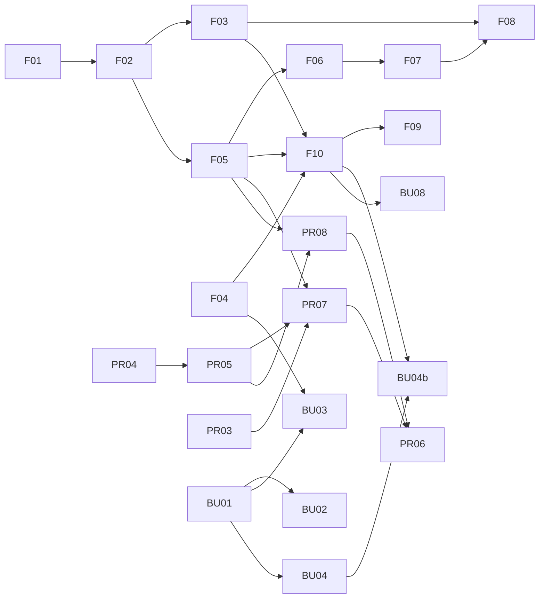

# 第一批开发清单：不需要设计稿的步骤

- **来源：** [advanced-foundation-detail-plan.md](advanced-foundation-detail-plan.md)（`F-xx`）、[promotions-advanced-detail-plan.md](promotions-advanced-detail-plan.md)（`PR-xx`）、[bundles-advanced-detail-plan.md](bundles-advanced-detail-plan.md)（`BU-xx`）。每步的完整输入、输出、测试规格在对应详细计划里，本文只写顺序和边界。
- **范围：** 不需要设计稿，也不被外部答复卡住的步骤。共 **24 步，约 20 人天**（总量 32.5 的 62%）。
- **口径：** 人天，一名熟悉 `free-to-play-pc` 的前端开发，不含写测试（由 AI 按详细计划里"先写的测试"生成），不含 review、运行测试、stage 验证、release 和 merge。
- **vibe coding 口径：** 本批按同样的系数折算（低 ×0.3、中 ×0.5、高 ×0.7、手动 ×1.0；系数是假设，见基础文档"工期预估"）：只算写代码约 **10 人天**，加审查和验证（+25%）约 **13**，再加 20% 缓冲约 **15**，单人约 3 周。
- **状态：** 草稿。

## 本批边界

| 本批做 | 本批不做 |
|---|---|
| 类型、纯函数、状态 slice、hook、verifier、配置、路由、路径函数、埋点封装 | 新界面组件：F-11（overview、确认控件、路径选择）、F-12（卡片与列表）、F-13（widget 变体）、F-14（成功页）、F-16（admin 标注）、BU-05、BU-07、BU-11、BU-12 |
| `AdvancedGuideScreen` 的**外壳**（直接渲染现有 `SetupWizard`，不含 overview） | Bundles 的 guide 配置和注册（BU-06）：它含双路径和 target 选择界面 |
| Promotions 两个 guide 的**步骤配置和 verifier**（步骤 2 的路径选择界面除外） | Promotions 接线、NFR 检查（PR-09、PR-11）、Bundles 埋点与 NFR（BU-13） |
| `listPromotions` 接口和 mock | PR-02（等 C3）、真实 promotions endpoint（等 R2）、BU-10 frame（等 Q4/C4） |

## 本批使用的默认值

答复变了，只改括号里的那一个文件。

| 编号 | 默认值 | 影响的步骤（改动文件） |
|---|---|---|
| Q5 | 当前 setup 完成 = 初始 setup 完成 | F-06（`initialSetupRule.ts`） |
| Q4、Q6、P5 | 每张卡只统计自己类型；bonus 归 "Sales, discounts & offers" | PR-05（`promotions-live.ts`） |
| Q6、P3、P8 | 排除 currency package 和 dynamic bundle；只要求 `isEnabled` | BU-02（`live.ts`） |
| P3（Promotions） | 无 "Done when" 的步骤为 `info` | PR-07、PR-08（`config.tsx`） |
| C2 | 埋点事件名占位 | F-15（`platform-events.ts` 旁的常量） |
| Q10 | 第 1 步最少 1 个 item | BU-03（常量 `MIN_SOURCE_ITEMS`） |

## 开发顺序

按波次排。同一波次内的步骤互不依赖，可以并行。

| 波次 | 步骤 | 前置 | 人天 |
|---|---|---|---|
| 0 | F-01、F-04、PR-01、PR-03、PR-04、BU-01 | 无 | 0.75 + 1 + 0.5 + 0.25 + 1 + 1.5 = 5 |
| 1 | F-02、PR-05、BU-02 | F-02←F-01；PR-05←PR-04；BU-02←BU-01 | 0.5 + 0.25 + 0.5 = 1.25 |
| 2 | F-03、F-05、BU-03 | F-03←F-02；F-05←F-02；BU-03←BU-01、F-04 | 1 + 0.75 + 1.25 = 3 |
| 3 | F-06、F-10（逻辑和外壳）、PR-07、PR-08、BU-04（纯函数部分） | F-06←F-05；F-10←F-02、F-03、F-04、F-05；PR-07/08←F-02、F-05、PR-03、PR-04、PR-05；BU-04←BU-01 | 0.75 + 2.5 + 1.25 + 1.5 + 0.5 = 6.5 |
| 4 | F-07、F-09、F-15、PR-06、BU-04b、BU-08 | F-07←F-06；F-09←F-10；PR-06←PR-07、PR-08；BU-04b、BU-08←F-10 | 0.25 + 0.25 + 0.5 + 0.25 + 1 + 1 = 3.25 |
| 5 | F-08 | F-03、F-05、F-06、F-07 | 1 |
| **合计** | 24 步 | | **20** |

## 清单

每步的"输出"只列本批要交付的东西。完整输入、输出、测试规格见"详见"。

### 波次 0

| 步骤 | 做什么 | 输出 | 人天 | 详见 |
|---|---|---|---|---|
| F-01 | `SetupConfig` 泛型化，`SetupPathId` 保持封闭 | `SetupConfig<Id extends string = SetupPathId>`；`StepProps.setupId: string`；`SETUPS` 不变 | 0.75 | 基础 F-01 |
| F-04 | status key 带 `runId`，verifier ctx 加 `target`、`runId` | `statusKey(…, runId?)`；`PIN_ROUNDS` 导出；`setStepDone` 和 `markDone` 加可选 `rounds`；`refresh({force})`；`runId` 进入 `runFetch` 的依赖 | 1 | 基础 F-04 |
| PR-01 | 在 stage 验证嵌入的 Promotions 模块 | 验证记录表（写进 MR 描述，不是代码） | 0.5 | Promotions PR-01 |
| PR-03 | 抽取 Promotions 地址常量 | `promotionsRoute`、`promotionsUrl`、`storefrontUrl`；导航项改用 `promotionsRoute` | 0.25 | Promotions PR-03 |
| PR-04 | Promotions 只读 client（接口加 mock） | `src/core/apis/promotions.ts`：`listPromotions`、`normalizePromotion`；响应形状标注为假设，真实 endpoint 的契约测试 `it.skip` | 1 | Promotions PR-04 |
| BU-01 | Catalog 读取扩展 | BU-01a 的探测结果（写进 MR 描述）；`CatalogItemOption` 新增 `isFree`、`hasVcPrice`、`contentCount`、`hasLimit`、`hasPeriod`；`getBundleDetail` | 1.5 | Bundles BU-01 |

### 波次 1

| 步骤 | 做什么 | 输出 | 人天 | 详见 |
|---|---|---|---|---|
| F-02 | 步骤字段和进度推导（纯函数） | `WizardStep` 加 `optional`、`confirm`、`paths`；`ADV/guide/progress.ts`：`getStepKind`、`deriveGuideProgress`、`isConfirmEnabled` | 0.5 | 基础 F-02 |
| PR-05 | Promotions Live 规则 | `isDiscountsCardLive`、`isCodesCardLive`、`hasAnyCode` | 0.25 | Promotions PR-05 |
| BU-02 | Bundles Live 规则和卡片元数据 | `isLiveBundle`、`isBundlesCardLive`、`BUNDLES_CARD`（本步不注册） | 0.5 | Bundles BU-02 |

### 波次 2

| 步骤 | 做什么 | 输出 | 人天 | 详见 |
|---|---|---|---|---|
| F-03 | `advancedGuides` 状态 slice | `SLICE/advancedGuides.ts`：独立 localStorage key 和版本；actions 和 selectors；`@core/store` 注册。`getStartedLocal.ts` 零改动 | 1 | 基础 F-03 |
| F-05 | 注册表、guide 配置类型、路径函数 | `ADV/types.ts`、`registry.ts`（空数组）、`paths.ts`（route 与 url 两种形式） | 0.75 | 基础 F-05 |
| BU-03 | Bundles verifiers | `verifyBundleSourceItems`、`verifyTargetBundle{Saved,Contents,Price,Limits}`；共享列表缓存；字段缺失时读 `getBundleDetail`，仍缺则返回 `undefined` | 1.25 | Bundles BU-03 |

### 波次 3

| 步骤 | 做什么 | 输出 | 人天 | 详见 |
|---|---|---|---|---|
| F-06 | 初始 setup 完成规则 | `initialSetupRule.ts`：`evaluateInitialSetup`；`useInitialSetupState` | 0.75 | 基础 F-06 |
| F-10（逻辑和外壳） | guide 的状态逻辑和页面外壳 | `useAdvancedGuide`、`AdvancedGuideContext`、`useTrustedPin`、`runIntent.ts`；`AdvancedGuideScreen` 外壳：直接渲染 `SetupWizard`，`onStepDone` 为空函数，不含 overview 和成功页（等 F-11、F-14） | 2.5 | 基础 F-10 |
| PR-07 | Promotions Guide 1 | `PROMO/config.tsx`（5 步）、`verifiers.ts`；文案 key 写入 `en.json` | 1.25 | Promotions PR-07 |
| PR-08 | Promotions Guide 2 | `CODES/config.tsx`（6 步）、`verifiers.ts`；步骤 2 的路径选择界面等 F-11 | 1.5 | Promotions PR-08 |
| BU-04 | target 捕获纯函数 | `BUN/target.ts`：`snapshotBundleSkus`、`candidateNewBundles`、`resolveTarget` | 0.5 | Bundles BU-04 |

### 波次 4

| 步骤 | 做什么 | 输出 | 人天 | 详见 |
|---|---|---|---|---|
| F-07 | 卡片状态解析 | `resolveCardState`（判断顺序：Blocked → loading → error → live） | 0.25 | 基础 F-07 |
| F-09 | 路由 | `get-started/advanced/:guideId`、`/manage` 两条 exact 子路由 | 0.25 | 基础 F-09 |
| F-15 | 埋点封装 | `ADV/analytics.ts`：`trackAdvanced`；事件名占位 | 0.5 | 基础 F-15 |
| PR-06 | 注册两张 Promotions 卡片 | 在 `ADVANCED_GUIDES` 注册两条，字段一次填齐 | 0.25 | Promotions PR-06 |
| BU-04b | `useBundleTarget` | 快照、解析、清除 target 的 hook | 1 | Bundles BU-04 的 BU-04b |
| BU-08 | 返回时重新判定 | `useRecheck`（focus 防抖、路由返回）；`useBoundedRetry`；`RETRY_ATTEMPTS` | 1 | Bundles BU-08 |

### 波次 5

| 步骤 | 做什么 | 输出 | 人天 | 详见 |
|---|---|---|---|---|
| F-08 | `useAdvancedCards` | 每次页面加载每个 `liveRule` 只调一次；`incomplete` 时不取数；`live` 三态 | 1 | 基础 F-08 |

## 每步完成的定义

1. 代码按详细计划的"输出"写完，没有越出本文"本批边界"。
2. AI 按详细计划的"先写的测试"生成了测试。
3. `pnpm type-check` 和 `pnpm lint:fix` 通过（由你运行）。
4. 新增文案只写在 `src/locales/en.json`。
5. 没有改动这些文件：`getStartedLocal.ts`、`SetupScreen.tsx`、`useTrackCurrentSetup.ts`、`SetupSelection.tsx`、`selection/analytics.ts`。

## 本批里需要人工过一遍测试的步骤

这些步骤的测试最容易"通过但没验证关键行为"，建议人工看过再合并。

| 步骤 | 看什么 |
|---|---|
| F-04 | pin 轮数测试用真实 slice，不 mock reducer；`runId` 从 `undefined` 变为值时会发起取数 |
| F-02 | `info` 步骤不死锁：`detect(done)、info、confirm` 确认后 `resumeStepId === null` |
| F-10 | 打开 guide 不改变 `currentSetupId`；已完成的 run 开新 run；`onStepDone` 断开 |
| BU-04b | 返回后新增一个 SKU：`setTarget` 一次，随后强制取数 |
| BU-08 | 重试有上限，卸载后不再重试 |

## 进入第二批的条件

| 第二批内容 | 需要 |
|---|---|
| F-11、F-12、F-13、F-14、F-16、BU-05、BU-07、BU-11、BU-12 | 设计稿，或确认完全复用 Quick-Start 现有组件和样式 |
| PR-09、PR-11、BU-06、BU-13 | 上面的 UI 步骤完成 |
| PR-02 | C3：权限名 |
| PR-04 真实 endpoint | R2 |
| BU-10 | Q4、C4；Q5 若接受 v1 只用 fallback 则不做 |

## 两人分工建议

| 人 | 主线 | 步骤 |
|---|---|---|
| A | 基础主线 | F-01 → F-02 → F-05 → F-04 → F-03 → F-10 → F-09 → F-15；然后 F-06 → F-07 → F-08（约 9.25） |
| B | 能力逻辑 | PR-01、PR-03 → PR-04 → PR-05 → PR-07 → PR-08 → PR-06；BU-01 → BU-02 → BU-03 → BU-04；F-10 完成后 BU-04b、BU-08（约 10.75） |

两条线只在三处交汇：F-02 和 F-05（B 的 PR-07、PR-08 依赖）、F-04（B 的 BU-03 依赖）、F-10（B 的 BU-04b、BU-08 依赖）。A 先做 F-01、F-02、F-05、F-04，B 此时做不依赖基础的步骤，不会空等。按这个排法，本批约 **11 个工作日**，由 B 线决定。
