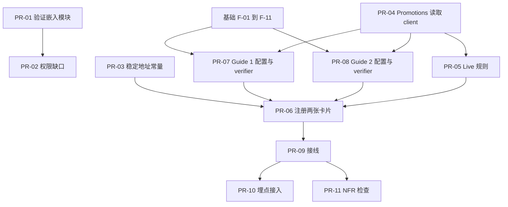

# 详细计划：Promotions Advanced feature（F2P）

- **上级计划：** [promotions-advanced-dev-plan.md](promotions-advanced-dev-plan.md)（revision 2）
- **PRD：** [promotions-advanced-prd.md](promotions-advanced-prd.md)
- **共享基础：** [advanced-foundation-detail-plan.md](advanced-foundation-detail-plan.md)（步骤 `F-xx`）。本文只写 Promotions 自己的步骤 `PR-xx`。
- **范围：** 只含 `free-to-play-pc`。Premium PC 见上级计划 C1。
- **状态：** 草稿，revision 2（独立 reviewer 审查后修订：PR-06 排序、路径含 merchant 前缀、Guide 2 步骤 3 改为"存在即可"、info 与 confirm 的完成规则）。每步的格式见基础文档的"阅读方法"。

路径缩写同基础文档。新增：`PROMO` = `src/pages/GetStarted/advanced/promotions-discounts`，`CODES` = `src/pages/GetStarted/advanced/promo-codes-coupons`。

## 步骤依赖图



## 开发顺序

| 阶段 | 步骤 | 原因 |
|---|---|---|
| A. 不依赖基础和未决事项 | PR-01、PR-03 | 只读验证和常量 |
| B. 依赖外部答复 | PR-02（C3）、PR-04（R2） | 先写 client 接口和测试，真实 endpoint 等答复 |
| C. 依赖基础 | PR-05 → PR-07、PR-08 → PR-06 | 基础 F-01 到 F-12 完成后。PR-06 在 PR-07、PR-08 之后做，因为注册表要求每个 guide 的步骤齐全 |
| D. 收尾 | PR-09 → PR-10 → PR-11 | 需要完整链路 |

---

## PR-01 验证嵌入的 Promotions 模块

- **对应：** 上级计划 1.1、1.2、1.3；PRD D1-FR1/FR3、R3。
- **输入：** stage 环境；一个在 Publisher Account 里已有 promotions 的项目；`src/routes/inside/storefront.ts:5-11`、`src/layouts/storefront/index.tsx:63`（`RemoteModule name="storefront"`）。
- **输出：** 一份验证记录（写进 MR 描述，不是代码）。表格式：

  | 检查项 | 结果 | 缺口 |
  |---|---|---|
  | `/projects/:id/storefront/promotions` 在账户 shell 内渲染 | 是 / 否 | |
  | 模块内是否有跳回 Publisher Account 的链接（逐个列出） | | |
  | 已有 promotions 的状态、数值、兑换行为与 Publisher Account 一致 | | |
  | LiveOps 下 Promotions 项在 F2P 账户可见 | | |

- **要点：** 发现跳出链接时只记录，**不重写模块**（R3）。用 `pnpm dev:stage`（不是 `pnpm dev`）做本地预览，但它不算 MR 的 stage 验证。
- **测试：** 无自动测试。Routing 层测试在 PR-02。
- **完成标准：** 记录表填完；所有缺口已列出并有负责人。
- **注意：** 这是手动步骤。按项目规则，release 和 stage 验证由用户负责，这一步不替用户做。

## PR-02 补齐 Promotions 权限缺口

- **对应：** 上级计划 1.4；D1-FR5、D1-US4。
- **输入：**
  - C3：Promotions 查看和管理的权限名（**阻塞**）。
  - `nav-items-config.tsx:225-229`：Promotions 项，当前**无** `privileges`、无 `dataId`。
  - `src/core/access/filter-accessible-nav-items.ts`：`privileges` 是"全部都要有"，admin 不绕过缺失的 privilege。
  - `src/routes/inside/storefront.ts:5-11`：守卫是整个 `/storefront` 子树共用一份（需要 catalog、delivery、project-settings 权限）。
- **输出：**
  - Promotions 导航项加 `privileges: [<C3 权限名>]`，并加 `dataId`（便于测试按 id 查找）。
  - Promotions 子路由的独立守卫：只有 Promotions 权限的用户也能打开 `/storefront/promotions`，没有该权限的用户打不开。
- **要点：**
  - 先在实现时确认 `route()` 是否支持子路由各自带 `privileges`。支持：在 `storefront.ts` 里为 `${path}/storefront/promotions` 声明独立子路由，放在通用 `/storefront` 之前。不支持：把守卫逻辑放进 `StorefrontContainer` 的路由匹配层。选择后在 MR 里写明原因。
  - 不放宽 `/storefront` 其他子路径的权限。
  - 权限名未知（C3）时，先写测试并用占位权限名，实现标 `it.skip`，启用条件：C3 答复。
- **先写的测试：**
  - `project-sidebar-v2/nav-items-config.test.tsx`（用现有 `buildItems()`）：没有 Promotions 权限 → Promotions 项不在结果里；有 → 在。
  - `filter-accessible-nav-items.test.ts`：带 `privileges` 的 Promotions 形状的项被正确过滤。
  - Routing 测试：只有 Promotions 权限的用户能打开子路由；有 catalog 权限但没有 Promotions 权限的用户打不开它。
  - `rbac-contract.test.ts` 只测顶层 `dataId`，如果新增了 `dataId` 影响其矩阵断言，更新对应期望。
- **完成标准：** 测试通过；其他 `/storefront` 子路径的访问规则不变。

## PR-03 稳定地址常量

- **对应：** 上级计划 1.5；D1-FR6。
- **输入：** `nav-items-config.tsx:225-229` 里手写的路径 `/projects/${projectId}/storefront/promotions`。
- **输出：** `ADV/links.ts`：
  ```ts
  // route 形式：不带 merchant 前缀。用于导航项的 `to`（UIMLink 会补前缀）。
  promotionsRoute(projectId: string | number): string   // → `/projects/${projectId}/storefront/promotions`
  // url 形式：带前缀。用于 history.push 和 <a href>。真实地址是 `/${merchantId}/projects/...`。
  promotionsUrl(ids: { merchantId: string | number; projectId: string | number }): string
  storefrontUrl(ids: { merchantId; projectId }): string // guide 步骤"Check it in your store"等的目标
  ```
  `nav-items-config.tsx` 改为调用 `promotionsRoute`。卡片和 guide 步骤用 `promotionsUrl`（或把 `promotionsRoute` 交给 `UIMLink`）。
- **要点：** 只抽取常量，不改变任何路径值。
- **先写的测试：** `links.test.ts`：`promotionsRoute` 等于当前硬编码字符串；`promotionsUrl` = `/${merchantId}` + route 形式；`nav-items-config.test.tsx` 中 Promotions 项的 `to` 不变。
- **完成标准：** 全仓库没有第二处手写 `storefront/promotions`。

## PR-04 Promotions 读取 client

- **对应：** 上级计划 2.2；PRD R2。
- **输入：** R2：Catalog 团队提供的 promotions 列表 endpoint（**阻塞真实实现**）。`src/core/apis/` 里没有 promotions、discount、coupon 文件。client 写法参考 `core/apis/catalog.ts`（`store-instance` 的 `get/post`，测试 `vi.mock('./store-instance', …)`）。
- **输出：** `src/core/apis/promotions.ts`（只读）：
  ```ts
  type PromotionKind = 'discount' | 'bonus' | 'promocode' | 'coupon';
  interface PromotionRef { id: string | number; kind: PromotionKind; isActive: boolean; name?: string }
  // `listPromotions` 返回所有未删除的 promotion，包括已排期（未开始）和已过期的。`isActive` 只表示"现在生效"。
  listPromotions(projectId: string | number, kinds?: PromotionKind[]): Promise<PromotionRef[]>
  ```
- **要点：**
  - 只读。不得调用任何创建、更新或 `ensure*` helper。
  - 分页要处理到最后一页（参考 `listCatalogItemRefs` 的 limit 200、短页停止）。
  - 把 endpoint 响应到 `PromotionRef` 的映射集中在一个函数 `normalizePromotion`。字段名以 R2 答复为准。
  - R2 未答复时：写接口、`normalizePromotion` 的测试（用假定响应形状）和 `listPromotions` 的测试，全部带注释说明形状是假设。真实 endpoint 接入前，不得合并为"已实现"。
  - 任何降级方案（例如只显示 Available）先要产品签字（上级计划风险表），不得默认上线。
- **先写的测试：** `promotions.test.ts`
  - 单页、多页（直到短页）。
  - 空列表。
  - 无效响应项被过滤，不抛错。
  - HTTP 错误向上抛出（由调用方决定如何显示）。
  - 真实 endpoint 的契约测试写成 `it.skip`，启用条件：R2 关闭。
- **完成标准：** mock 下的测试通过；文件里没有写操作。

## PR-05 Live 规则

- **对应：** 上级计划 2.2；D2-FR4；Q4、Q6、P5。
- **输入：** PR-04。
- **输出：** `ADV/promotions-live.ts`：
  ```ts
  isDiscountsCardLive(refs: PromotionRef[]): boolean   // 存在 isActive 的 discount 或 bonus
  isCodesCardLive(refs: PromotionRef[]): boolean       // 存在 isActive 的 promocode 或 coupon
  hasAnyCode(refs: PromotionRef[]): boolean            // 存在 promocode 或 coupon，不论是否 active（Guide 2 步骤 3 用）
  ```
  以及两个 `liveRule` 适配函数：`(ctx) => listPromotions(...).then(isXxxLive)`，供注册表使用（PR-06）。
- **要点：**
  - **默认（Q4、Q6、P5 未决）：** 每张卡只统计自己类型的 promotion。bonus 归 "Sales, discounts & offers"（PRD D2-FR3 写了"time-limited discounts and bonus rewards"）。奖励为折扣的 promo code 只让 "Promo codes & coupons" 变 Live。
  - 规则只在这一个文件。Q4/Q6/P5 答复后只改这里。
  - `isActive` 的判定（日期窗口、状态）由 client 的 `normalizePromotion` 完成，规则文件只读布尔值。
- **先写的测试：** `promotions-live.test.ts`
  - 只有 inactive → false。
  - discount active → 卡 1 Live、卡 2 不 Live。
  - bonus active → 卡 1 Live。
  - promocode 或 coupon active → 卡 2 Live，卡 1 不 Live。
  - 空数组 → 都不 Live。
- **完成标准：** 测试通过。

## PR-06 注册两张卡片

- **对应：** 上级计划 2.1、2.5、2.6；D2-FR1、FR2、FR3、FR9。
- **输入：** 基础 F-05（注册表类型）、F-12（卡片 UI）、PR-03、PR-05、**PR-07、PR-08**（两个 guide 的 `setup` 和 `overview`）。
- **输出：** 在 `ADVANCED_GUIDES` 中新增两条，字段一次填齐（`setup`、`overview`、`liveRule`、`nextGuideId`、`managePath`）：

  | id | order | `card.titleId`（en 文案） | `managePath` | `nextGuideId` |
  |---|---|---|---|---|
  | `promotions-discounts` | 10 | "Sales, discounts & offers" | `promotionsUrl` | `promo-codes-coupons` |
  | `promo-codes-coupons` | 20 | "Promo codes & coupons" | `promotionsUrl` | `promotions-discounts` |

  描述写出：卡 1 点名限时折扣和奖励（discounts and bonus rewards）；卡 2 点名 promo code 和 coupon。`examplesId` 给 F2P 示例（virtual item、currency pack）。
- **要点：**
  - 文案 key：`host.pages.getStarted.advanced.promotionsDiscounts.card.*`、`...promoCodesCoupons.card.*`。
  - "Promo codes & coupons" 在 taxonomy 里没有短描述（PRD Q6）。先写一句默认描述，在 MR 里标注"待产品确认"。
  - 不使用 `steps: []` 的占位条目，这样基础 F-05 的注册表校验（最后一步不是 `info`）不需要弱化。
- **先写的测试：**
  - 两张卡片出现在 `getOrderedAdvancedGuides()` 中，顺序为 卡 1、卡 2。
  - 两张卡片不出现在 `SETUPS`，不出现在 "Start with" 网格（D2-FR1）。
  - 卡片 Live 状态按 PR-05 的规则（mock `listPromotions`）。
- **完成标准：** 测试通过；`SetupSelection` 渲染结果不变。

## PR-07 Guide 1：Sales, discounts & offers

- **对应：** 上级计划 3.1 到 3.4、3.9；D3-FR12 到 D3-FR16。
- **输入：** 基础 F-02（kind 规则）、F-05；PR-03、PR-04；`GS/setups/shared-verifiers.ts` 的 `verifyItemCatalog`。
- **输出：** 目录 `PROMO/`：
  - `config.tsx`：`SetupConfig<'promotions-discounts'>`，5 个步骤，见下表。
  - `verifiers.ts`：`verifyActivePromotion`。

  | # | 步骤 id | 标题（en） | kind | 完成条件 | 按钮目标 |
  |---|---|---|---|---|---|
  | 1 | `choose-items` | Choose what to promote | detect | 至少有一个 catalog item：复用 `verifyItemCatalog`（包含 item 和 bundle） | `/projects/:id/storefront`（Catalog） |
  | 2 | `choose-offer` | Choose the offer | info | 随步骤 4 完成（P3 默认） | `promotionsUrl` |
  | 3 | `schedule-limits` | Set schedule and limits | info | 随步骤 4 完成（P3 默认） | `promotionsUrl` |
  | 4 | `review-activate` | Review and activate | detect | `verifyActivePromotion`：存在 active 的 discount 或 bonus | `promotionsUrl` |
  | 5 | `check-store` | Check it in your store | confirm | 伙伴点 "I've done this"（Q15 默认接受） | storefront 地址 |

  Overview 内容（D3-FR2）：目标（让一个限时折扣或奖励在 store 上线）；将完成的内容；"before you start"：要打折的 item、折扣幅度或奖励内容、开始和结束日期、可选的地区和每人限制。
- **要点：**
  - `verifyActivePromotion`：`listPromotions(projectId, ['discount','bonus'])`，返回 `isDiscountsCardLive` 的同一规则，**不再写第二套**。直接调用 PR-05 的函数。
  - 只读。不调用 `ensure*`。
  - 步骤 2、3 为 `info`：伙伴在 Promotions 表单里一次完成它们，没有分别的信号。Next 移动位置，不完成。P3 答复后若要改成 confirm，只改这个文件的两个步骤。
  - 步骤 1 的 `verifyItemCatalog` 用的是 `listCatalogItemRefs`（含分页），不检查 type。这符合 D3-FR12 "至少有一个 catalog item"。
  - 每个步骤只有一个按钮（D3-FR3），目标是现有页面，不在 guide 内重做表单。
  - 文案：`host.pages.getStarted.advanced.promotionsDiscounts.*`，含 `overview.*`、`steps.<id>.*`、`confirm.*`、`success.*`。
- **先写的测试：**
  - `verifiers.test.ts`：mock `listPromotions`；无 active → `false`；有 active discount → `true`；只有 active promocode → `false`；API 报错 → 抛出或返回 `undefined`（与 `useSetupStatus` 的 `readVerdict` 约定一致，实现时对照 `useSetupStatus.ts:45-52`）。
  - `config.test.tsx`：5 个步骤；kind 分别为 detect、info、info、detect、confirm；最后一步是 confirm；每个 `hub` 或步骤都有 `titleId`、按钮目标。
  - 集成（Component）：步骤 4 的检测结果为 `false` 时，点 Next 越过步骤 2、3 后，**活动步骤**是 4，`resumeStepId` 仍是 2（info 步骤没有完成）；检测为 `true` 后步骤 2、3、4 同时完成，`resumeStepId` 是 5。
  - 步骤 5：Next 和 Skip 都不能完成它；步骤 4 未完成时确认控件禁用（`isConfirmEnabled`）；步骤 4 完成后确认，guide 进入成功页。
  - **已排期的 promotion：** `listPromotions` 返回一个开始日期在明天的 discount（`isActive: false`）→ 步骤 4 为 `false`，guide 停在步骤 2。这是 PRD D3-FR15（"Done when an active promotion exists"）的字面结果，写成一个明确的测试，并在 MR 里提示 PRD owner：伙伴提前排期的 promotion 不会让 guide 前进。
- **完成标准：** 测试通过；`config.tsx` 没有硬编码英文文案。
- **已确定：按 PRD 字面实现。** 步骤 4 只在存在 active promotion 时完成（D3-FR15）。开始日期在未来的 promotion 不让 guide 前进。
- **备选方案（PRD owner 若要改，只动 `verifyActivePromotion` 和步骤 4 文案）：**

  | 备选 | 做法 | 改动范围 | 代价 |
  |---|---|---|---|
  | B：已排期也算完成 | `verifyActivePromotion` 改用"存在 discount 或 bonus，不论是否 active"（新增 `hasAnyDiscountOrBonus`，PR-05） | PR-05 一个函数、PR-07 的 verifier 和测试 | 偏离 PRD D3-FR15，需要 PRD owner 签字。成功页写"capability is live"（D3-FR8），但此时 promotion 尚未生效，成功页文案要改成"scheduled" |
  | C：字面实现加提示 | 仍按 PRD。`PromotionRef` 加 `isScheduled`（开始日期在未来）；步骤 4 检测到已排期的 promotion 时显示"已排期，开始后自动完成" | PR-04 加字段和 `normalizePromotion` 映射；PR-07 加一个提示组件和文案 key | 不偏离 PRD；依赖列表 endpoint 返回开始日期（R2） |


## PR-08 Guide 2：Promo codes & coupons

- **对应：** 上级计划 3.1 到 3.4、3.8、3.9；D3-FR17 到 D3-FR22。
- **输入：** 同 PR-07。
- **输出：** 目录 `CODES/`：`config.tsx`、`verifiers.ts`（`verifyCodeExists`）。

  | # | 步骤 id | 标题（en） | kind | 完成条件 | 按钮目标 |
  |---|---|---|---|---|---|
  | 1 | `choose-reward` | Choose the reward | info | 随步骤 3 完成 | `promotionsUrl`（D3-FR3：每步一个按钮） |
  | 2 | `choose-code-type` | Choose the code type | info + 双路径 | 随步骤 3 完成；路径记入状态 | `PathChooser` |
  | 3 | `create-codes` | Create the codes | detect | `verifyCodeExists`：存在 promocode 或 coupon，**不论是否 active**（PRD D3-FR19："Done when a code exists"） | `promotionsUrl` |
  | 4 | `validity-limits` | Set validity and limits | info | 随步骤 5 完成 | `promotionsUrl` |
  | 5 | `let-players-redeem` | Let players redeem | confirm | 伙伴确认 | storefront 地址 |
  | 6 | `test-redemption` | Test a redemption | confirm | 伙伴确认 | storefront 地址（在 store 里兑换） |

  双路径（步骤 2）：`shared-code`（shared promo code）、`one-time-coupon`（one-time coupon linked to a predefined offer）。只显示所选路径的说明，另一条仍可选（D3-FR6）。
- **要点：**
  - **注意 info 的推导：** 步骤 1 跟随步骤 3（下一个非 info），步骤 2 跟随步骤 3，步骤 4 跟随步骤 5（下一个非 info 是 confirm 步骤）。所以步骤 4 要等步骤 5 被确认才算完成。步骤 5 的确认控件在步骤 3 完成后就可用（`isConfirmEnabled` 只看前面的 detect 步骤），不要求步骤 4 先完成，所以不会死锁。
  - `verifyCodeExists`：`listPromotions(projectId, ['promocode','coupon'])`，用 PR-05 的 `hasAnyCode`（**不是** `isCodesCardLive`）。原因：伙伴常把有效期起始设在未来；用 `isActive` 会让步骤 3 在起始日前一直为 `false`，guide 无法前进。卡片的 Live 仍用 `isCodesCardLive`，所以 guide 完成后卡片要等 code 生效才变 Live，这是预期的。
  - 步骤 3 的 "bulk upload"（Q13）：Publisher Account 的 bulk 上传随它自己上线，本仓库不做任何工作。步骤说明里不承诺上传。
  - 步骤 5、6 都是 confirm。两者都在步骤 3 完成后可确认（`isConfirmEnabled`）；步骤 6 不要求先确认步骤 5，顺序只靠文案提示。
  - 文案前缀 `host.pages.getStarted.advanced.promoCodesCoupons.*`。
- **先写的测试：**
  - `verifiers.test.ts`：无 code → `false`；有 active promocode → `true`；有 coupon → `true`；**已排期（`isActive: false`）的 promocode → `true`**；只有 active discount → `false`。
  - `config.test.tsx`：6 个步骤；kind 序列 info、info、detect、info、confirm、confirm；步骤 2 有两条路径。
  - 路径持久化：选 `one-time-coupon` 后重新挂载仍是该路径，且只显示该路径说明；再选 `shared-code` 能切换。
  - 步骤 3 为 `true` 后，步骤 1、2、3 完成，`resumeStepId` 变为 4。
  - **不死锁：** 步骤 3 完成、步骤 4 未完成时，步骤 5 可确认；确认后步骤 4、5 完成；再确认步骤 6，guide 进入成功页。
  - 步骤 5、6：Next 和 Skip 都不能完成；确认后各自完成。
  - 步骤 3 未完成时，步骤 5、6 的确认控件都禁用。
- **完成标准：** 测试通过。
- **已确定：按 PRD。** PRD 没有规定步骤 5 和步骤 6 的确认顺序（D3-FR21、D3-FR22 都是"Done by partner confirmation"）。两步在步骤 3 完成后都可确认，顺序只靠文案提示。
- **备选方案（产品若要严格顺序）：**

  | 备选 | 做法 | 改动范围 | 代价 |
  |---|---|---|---|
  | B：强制步骤 5 先确认 | `confirm` 配置加可选字段 `after?: string[]`；基础 F-02 的 `isConfirmEnabled` 额外要求 `after` 中的步骤已确认；PR-08 的步骤 6 设 `after: ['let-players-redeem']` | 基础 F-02（类型、`isConfirmEnabled`、测试）；PR-08 一行配置和一条测试 | 引擎多一个字段，所有 guide 共用；确认是自报，仍拦不住不诚实的确认 |


## PR-09 接线

- **对应：** 上级计划 2.4、3.6、3.7；D2、D3-FR8 到 FR10。
- **输入：** PR-05 到 PR-08；基础 F-08、F-10、F-12、F-13、F-14。
- **输出：**
  - 不再改 `ADVANCED_GUIDES`（PR-06 已一次填齐）。本步骤只接线成功页和端到端行为。
  - 成功页摘要：guide 1 写出已设置的 promotion（"Your discount or bonus is live"）；guide 2 写出已设置的 code。
  - Live 卡片 "Open" → `promotionsUrl`；"View guide" 或 "Resume guide" 行为来自基础 F-12。
- **要点：**
  - **End to end 行为：** 初始 setup 完成 → 卡片 Available → "Set up" → overview → 步骤 → 成功页 → 卡片在下一次页面加载变为 Live（由 `liveRule` 判定，不由 guide 完成写入）。
  - 不变量：`isConfirmEnabled` 要求前面的 detect 步骤完成，所以 guide 1 完成时一定有 active promotion；guide 2 完成时一定存在 code（可能尚未生效，此时卡片还不是 Live，直到 code 生效）。加测试。
  - Promotions 不使用 `target`、`snapshot`。
  - Live 卡片 "View guide"：run 已完成时带 `?intent=new` 开新 run；run 未完成时 "Resume guide"（基础 F-10 的 run 规则）。
- **先写的测试（Component / State）：**
  - 全流程：mock `listPromotions` 从空变为有 active discount，guide 1 从步骤 1 走到成功页。
  - 完成后再次渲染卡片，状态为 Live（mock 返回有 active discount）。
  - 不变量：mock 永远返回空，则 guide 无法完成，即使伙伴点遍所有 confirm。
  - 打开 guide 不改变 `currentSetupId`、widget 对初始 setup 的显示、`SetupProgressBadge`。
  - 成功页的"推荐下一个"：guide 1 → guide 2；guide 2 → guide 1。
- **完成标准：** 测试通过。

## PR-10 埋点接入

- **对应：** 上级计划 4.1；PRD Analytics NFR。
- **输入：** 基础 F-15；C2。
- **输出：** 在以下位置调用 `trackAdvanced`：

  | 事件 | 触发点 | 字段 |
  |---|---|---|
  | `card_click` | `AdvancedCard` 主按钮、"View guide"/"Resume guide" 点击（Blocked 不触发） | capability、cardState |
  | `guide_opened` | `AdvancedGuideScreen` 挂载一次 | capability、cardState（打开时的状态） |
  | `step_started` | 步骤按钮点击（D3-FR3 的那个按钮） | capability、step |
  | `guide_completed` | run 进入 `completedAt` 时一次 | capability |

- **要点：** `guide_opened` 每次挂载只发一次，不因重渲染重复发送。`card_state` 是点击或打开那一刻的值。
- **先写的测试：** 对每个触发点，断言 `trackAdvanced` 被调用且字段齐全；Blocked 卡片点击不发事件；重渲染不重复发 `guide_opened`。
- **完成标准：** 测试通过。事件名占位，C2 关闭后替换（基础 F-15）。

## PR-11 NFR 检查

- **对应：** 上级计划 4.2 到 4.6。
- **输入：** PR-09 完成的链路。
- **输出：** 检查记录（MR 描述）。

  | 项 | 检查方式 | 判定 |
  |---|---|---|
  | 无障碍：badge 与步骤状态有文字；按钮键盘可达 | Component 测试（已在 F-11、F-12） + 手动 Tab 走一遍 | 全部通过 |
  | Admin 标注 | Component 测试（F-16） | admin 可见标注 |
  | 性能：卡片和 guide 3 秒内可交互；每次加载只取一次卡片状态 | `useAdvancedCards` 测试（每个 `liveRule` 一次） + 手动计时 | 3 秒内 |
  | 布局：1366x768、13 英寸 Mac | 手动；可选 `pnpm test:e2e:visual` 基线 | 无溢出、无遮挡 |
  | 过期数据：旧版本的 guide 进度不破坏新步骤 | F-03 的版本测试 + 一个单测：存储里的 `confirmedStepIds` 含已不存在的 step id 时，忽略该 id | 不抛错，不影响当前步骤 |

- **完成标准：** 表格全部填完。手动项由执行者记录；release 和 stage 验证由用户负责，不在本步骤里。

---

## 自动化测试清单（汇总）

| 层级 | 文件 | 来自步骤 |
|---|---|---|
| Unit | `promotions-live.test.ts`、两个 `verifiers.test.ts`、两个 `config.test.tsx`、`links.test.ts`、`promotions.test.ts` | PR-03 到 PR-08 |
| Component | guide 全流程、成功页、卡片状态、路径持久化 | PR-06 到 PR-09 |
| State | 打开 guide 不改变 `currentSetupId`；Blocked → Available | PR-09、F-10 |
| Access | `nav-items-config.test.tsx`、`filter-accessible-nav-items.test.ts` | PR-02 |
| Routing | Promotions 子路由守卫 | PR-02 |
| Analytics | 每个事件字段齐全 | PR-10 |
| Accessibility | 文字标签、键盘 | F-11、F-12、PR-11 |
| Locale | `locales/index.test.ts` | 每一步 |
| Skipped（未来行为） | R2 真实 endpoint 契约；测试购买和兑换的自动检测；C3 权限名；C2 事件名 | PR-02、PR-04、PR-10 |

## 本计划的外部依赖

| 编号 | 需要什么 | 谁答复 | 影响的步骤 | 答复前的做法 |
|---|---|---|---|---|
| R2 | promotions 列表 endpoint 与响应形状 | Catalog 团队 | PR-04、PR-05、PR-07、PR-08 | 接口加 mock 测试；真实 endpoint 的测试 skip |
| C3 | Promotions 权限名 | 账户负责人 | PR-02 | 占位权限名；实现 skip |
| Q4/Q6/P5 | Live 规则 | PRD owner | PR-05 | 默认值见 PR-05 |
| D3-FR15 | 排期到未来的 promotion 不让 Guide 1 前进（PRD 字面结果） | PRD owner | PR-07 | **已定：按 PRD 字面实现**。备选 B（已排期也算完成）、C（字面加提示）见 PR-07 |
| D3-FR21/22 | 步骤 5、6 的确认顺序 | 产品 | PR-08 | **已定：按 PRD，不强制顺序**。备选 B（`confirm.after`）见 PR-08 |
| P3 | 无 "Done when" 步骤的类型 | PRD owner | PR-07、PR-08 | 默认 `info` |
| Q15 | 是否接受伙伴确认的测试步骤 | PRD owner | PR-07、PR-08 | 默认接受 |
| C2 | 埋点名与字段 | 数据团队 | PR-10 | 占位 |
| Q13 | bulk 上传 | Catalog 团队 | PR-08 | 不承诺上传 |
