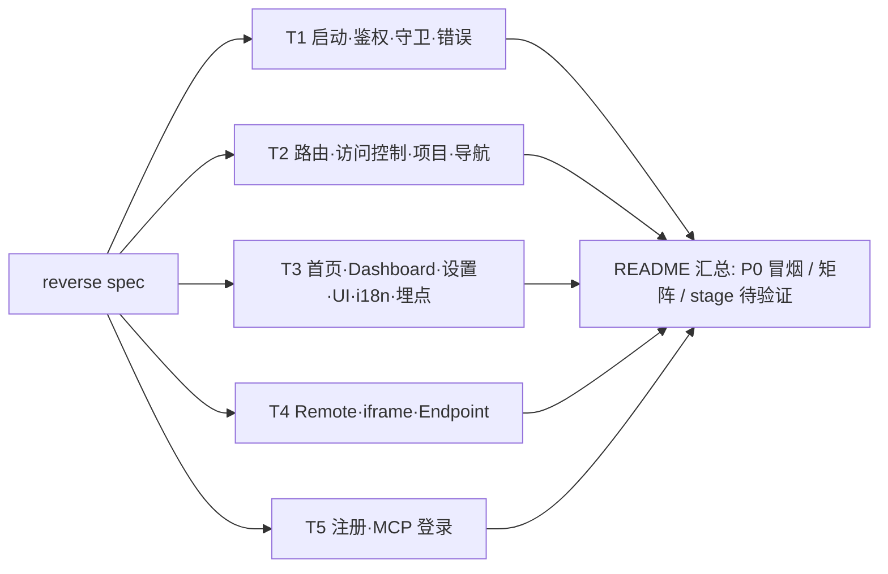

# web-games-account 回归测试：探索计划

> 输入：`../web-games-account_reverse_spec.md`
> 产出：本目录下的 `T*-*.md` 用例文件和 `README.md` 汇总

## 计划版本

| 计划版本 | 日期 | 基于 spec 版本 | 触发原因 | 影响的 track |
|---|---|---|---|---|
| P1 | 2026-10-21 | 0.1.0（853 行） | 初版 | T1–T5 全部 |
| P2 | 2026-10-21 | 0.2.0 | spec review 修正：DASH-001/002/004、I18N-002 事实错误；integrations endpoint 不可达；MCP 注册请求移到 `core/mcp/oauthLogin.ts`；MAG/webpack 行号；ACC-003 去掉 I9；D1 只测了 gold；新增 S-16、S-17 | T3（重点：Dashboard 权限组合、S-16、i18n 改为 SDK [U]）；T4（endpoint 表、S-09 降级、S-17）；T5（MCP 注册请求的追溯与错误分支）；T1、T2 只修正追溯 |

### P3（spec 0.3.0，1147 行）

- 触发原因：72 条勘误全部合入（7 条按核实结果修正了措辞），新增 S-18…S-26、T-01、AC-12、AC-13，§2.4 重画了 SDK guard 效果表。
- 影响范围：T1–T5 全部，但只更新 spec-miner 列出的 OBS 所对应的用例，不重写整个文件。
- 输入：v0.2.0 与 v0.3.0 快照的 diff、spec-miner 的 PARTIAL 修正清单、stage 实测结果（`stage-results-2026-10-21.md`）。
- 用例 ID 保持不变：修改的用例在“追溯”列追加 `[P3]`；新增的用例往后编号；废弃的用例划掉。

| 计划版本 | 日期 | 基于 spec 版本 | 触发原因 | 影响的 track |
|---|---|---|---|---|
| P3 | 2026-10-21 | 0.3.0 | 勘误合入，新增 S-18…S-26、AC-12/13 | T1–T5（定向更新） |

### P12（spec 0.3.9、0.3.10）

| 计划版本 | 日期 | 基于 spec 版本 | 触发原因 | 影响的 track |
|---|---|---|---|---|
| P12 | 2026-10-22 | 0.3.9 / 0.3.10 | 0.3.9：主会话按用户要求修正 OBS-ACC-002（撤回 privileges 401 时先显示 `/forbidden`）。0.3.10：第五轮 review——OBS-AUTH-001 循环需三条件、并发 401 共 2 次导航落地 1 次、`clearSession` 只删已存在的 `pa-original-url`、S-04 行号 | T1：RT-AUTH-006 / 009 / 010 / 014、RT-ERR-006；T2：RT-ACC-003 等（只改行号）。用例数不变（主会话直接修改） |

### P11（spec 0.3.8）

| 计划版本 | 日期 | 基于 spec 版本 | 触发原因 | 影响的 track |
|---|---|---|---|---|
| P11 | 2026-10-22 | 0.3.8 | 合入 stage R1（只读 70+7 条）、R5（写入批次）、QA 执行单 §4 的源码复核。修正 OBS-SET-001、OBS-ROUTE-008、OBS-BOOT-003、OBS-AUTH-001、OBS-REG-003、OBS-DASH-004/005、OBS-ACC-002；新增 S-41…S-46、U-17…U-19；S-39 改为间歇性；S-42 登出不吊销 JWT；S-24 后半段证实；S-20 去掉 [U] | T1–T5 定向更新（agent），依据 0.3.7→0.3.8 diff 与 stage-results-R1/R5 |

### P10（spec 0.3.7）

| 计划版本 | 日期 | 基于 spec 版本 | 触发原因 | 影响的 track |
|---|---|---|---|---|
| P10 | 2026-10-21 | 0.3.7 | 合入 A5b（另一会话用 Playwright 匿名 headless 拦截 `/api/v1/modules`）：证实 OBS-BOOT-002 | T4 RT-MF-002 只补证据，预期不变 |

### P9（spec 0.3.6）

| 计划版本 | 日期 | 基于 spec 版本 | 触发原因 | 影响的 track |
|---|---|---|---|---|
| P9 | 2026-10-21 | 0.3.6 | 只合入 stage Batch A2 的证据（OBS-AUTH-009 无会话规则、S-22 的 BFF 部分、S-02） | 无。用例预期不变，证据见 stage-results §6 |

### P8（spec 0.3.5）

| 计划版本 | 日期 | 基于 spec 版本 | 触发原因 | 影响的 track |
|---|---|---|---|---|
| P8 | 2026-10-21 | 0.3.5 | 合入 stage Batch C1：证实 S-23、S-24 前半段；新增 S-39（语言保存 200 但不持久化）、S-40（`<html lang>` 不更新）、U-16 | T3：RT-I18N-002 改为预期失败项，新增 RT-I18N-009（主会话直接修改） |

### P7（spec 0.3.4）

| 计划版本 | 日期 | 基于 spec 版本 | 触发原因 | 影响的 track |
|---|---|---|---|---|
| P7 | 2026-10-21 | 0.3.4 | 合入 stage Batch A；按 `merchant-sentinel.ts:186-247` 细化 OBS-AUTH-009 的 `0` 哨兵分支；§6 注明 finance 与 support 共用 container | T2 RT-PROJ-009（由主会话直接修改）。T1 RT-MAG-009 已覆盖新分支，无需改动 |

### P6（spec 0.3.3）

| 计划版本 | 日期 | 基于 spec 版本 | 触发原因 | 影响的 track |
|---|---|---|---|---|
| P6 | 2026-10-21 | 0.3.3 | 只更正 §10.3 的适用范围：stage（`c1b5e37`）的 SDK 是更旧的补丁版本，依赖 SDK 的运行时观察降为佐证 | 无。用例预期不变；stage 结果文件 §0 已注明版本差异 |

### P5（spec 0.3.2）

| 计划版本 | 日期 | 基于 spec 版本 | 触发原因 | 影响的 track |
|---|---|---|---|---|
| P5 | 2026-10-21 | 0.3.2 | 合入 stage 结论（§10.3）；新增 S-35（metaframe/gold/link 必崩的根因）、S-36、S-37、S-38、U-14、U-15；第四轮 review 修正 OBS-I18N-002、OBS-PROJ-001、AC-05、OBS-AUTH-002、OBS-AUTH-009、OBS-FRAME-003 | T1（AUTH-002/009、`0` 哨兵 302）、T2（PROJ-001、AC-05、metaframe/gold/link、S-37、S-38）、T3（I18N-002、S-36）、T4（FRAME-003） |

### P4（spec 0.3.1）

| 计划版本 | 日期 | 基于 spec 版本 | 触发原因 | 影响的 track |
|---|---|---|---|---|
| P4 | 2026-10-21 | 0.3.1 | 第三轮 review：整页加载外部 merchant 时显示 HydrationError（S-34、AC-01b）；BFF 302 规则；`pa-v4-token` 的 httpOnly 和 JS cookie 同名；EnterAccountGate 的作用范围；OBS-MF-002 错误文案不止 4 种 | T1（OBS-MAG-002、AUTH-002/008/009）、T2（AC-01、§2.4 表）、T4（MF-002 文案） |

### P2 追加任务

- T3：Dashboard 权限组合扩展到 4 种（AND 两个 metric privilege / 仅 `get_graphics_gross_revenue` / 都没有 / projects 请求失败）。新增 S-16 定向用例。I18N 切换改到 SDK 源码中查实，查不到就转成 stage 验证用例。
- T4：integrations endpoint 标为不可达，不写 stage 用例。新增 S-17 用例。
- T5：补充 MCP 注册请求的非 2xx 和网络失败分支。
- T2：D1 拆成 gold 和 link 两条，link 无自动化覆盖。

## 1. 原则

- spec 只做入口地图。每条 `OBS-*` 都要回到代码中复核，然后继续深入：补全 spec 没写到的分支、错误态和边界。
- 代码基线是 `master@772a320`，与 spec 一致。读代码时用 `git show 772a320:<path>`。如果当前分支 `WASP-2524-migrate-tests-to-apps` 的本地树在同一处行为不同，用例中标注 `[分支差异]`。
- spec 中标为 `[U]` 的条目，如果答案在本地 `node_modules/@accounts-sdk/*` 中，先核对版本与 spec 一致，再读源码关闭它。答案在 BFF 或 backend 中的条目，转成需要在 stage 执行的验证用例。
- §11 的缺陷和可疑点（D1–D2、S-01–S-15）都要转成定向回归用例。目的有两个：确认问题现状，以及修复后防止回归。
- 每条用例都必须能由 QA 在 stage 手工执行，并注明对应的 `OBS-*` / `AC-*` / `S-*` / `U-*`。

## 2. Track 划分



| Track | spec 章节 | 缺陷/可疑点 | 深挖重点 | 产出文件 |
|---|---|---|---|---|
| T1 | 4.1 BOOT、4.2 AUTH、4.3 MAG、4.17 ERR、2.3、2.4、8.1、8.3 | S-04、S-05、S-07、S-14、S-15 | token 刷新与并发 401、logout 去重、无权限 merchant 的跳转、初始化失败页、U-01/U-02 的 SDK 源码 | `T1-boot-auth.md` |
| T2 | 4.4 ROUTE、4.5 ACC、4.8 PROJ、4.9 NAV、§5 | D1、D2 | 逐条覆盖 route inventory、legacy redirect 映射表、权限 × 菜单矩阵、项目作用域缺失时的行为、not-found fallback | `T2-routing-access.md` |
| T3 | 4.6 HOME、4.7 DASH、4.10 SET、4.15 UI、4.16 I18N、4.18 ANA | S-08、S-10 | 首页落地选择、Get Started 各状态、Dashboard 数据态（loading/empty/error）、横幅和聊天开关、locale 切换、埋点事件 | `T3-home-dashboard.md` |
| T4 | 4.13 MF、4.14 FRAME、§6、§7、8.2 | S-01、S-02、S-03、S-09、S-12、S-13 | 每个 remote 的加载与降级、传入的 context、iframe 域名 allowlist、本地 endpoint 的错误码 | `T4-remote-frame.md` |
| T5 | 4.11 REG、4.12 MCP | — | 注册各步骤和法律协议、`/login/mcp` 的 OAuth 参数校验和错误分支 | `T5-registration-mcp.md` |

§9 的 AC 和 §12 的 U 按域名分配到对应 track。

## 3. 用例格式

```
| ID | 场景 | 前置条件（账号/角色/数据） | 步骤 | 预期结果 | 优先级 | 追溯 | 自动化 |
```

- ID：`RT-<域>-NNN`，例如 `RT-AUTH-001`。
- 优先级：P0 = 阻断登录或进入 app；P1 = 核心功能；P2 = 边界或次要分支。
- 追溯：`OBS-*` / `AC-*` / `S-*` / `U-*` + `代码路径:行号`。
- 自动化：已被哪个测试固定（scenario `I*`/`D*` 或测试文件），没有就写 `—`。

## 4. spec 更新时的处理

1. 后台 monitor 发现 spec 新增或更新，并且文件稳定 60 秒后，用 spec 快照做 diff。
2. 把变化的章节映射到受影响的 track。在“计划版本”表中新增一行 P(n+1)，写明 diff 摘要。
3. 只让受影响的 track 重新探索。用例 ID 保持稳定：新增的用例往后编号，删除的用例标为 `~~废弃~~`，不复用编号。
4. 如果出现新的 spec 文件，新增一个 track。
