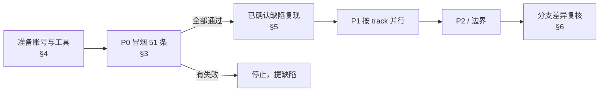

# web-games-account 回归测试

> 依据：`../web-games-account_reverse_spec.md` v0.3.1
> 代码基线：`master@772a320`；当前分支 `WASP-2524-migrate-tests-to-apps` 的行为差异标为 `[分支差异]`
> 生成日期：2026-10-21 · 计划：[00-exploration-plan.md](00-exploration-plan.md)（P4）
> 状态：用例来自阅读源码。2026-10-21 已在 stage 上只读执行阶段 0–3，结果见 [stage-results-2026-10-21.md](stage-results-2026-10-21.md)

## 0. stage 验证结论（2026-10-21）

- 计划：[stage-verification-plan.md](stage-verification-plan.md) · 分类：[stage-verification-appendix.md](stage-verification-appendix.md) · 结果：[stage-results-2026-10-21.md](stage-results-2026-10-21.md)
- **环境**：stage 运行的是 `stage-web-games-20261005-03`（commit `c1b5e37`），比用例基线 `772a320` 落后 52 个 commit。MCP 登录与 ToU 勾选框不在 stage 上。账号为 Xsolla admin。
- **P0（A 类 22 条）**：PASS 16 · FAIL 3 · BLOCKED 1 · N/A 2。失败项：裸 `/for/web-games` 返回 404（RT-BOOT-006）、`/metaframe` 崩溃（RT-ACC-001）、S-01 JWT 可被 JS 读取（RT-SEC-101）。
- **stage 实测的高优先级问题**：
  1. `gc-pa-v4-token` 是 JS 可读的 cookie，值与会话 Bearer token 相同（S-01）。
  2. `/{m}/metaframe` 必定崩溃；崩溃后在 SPA 内跳到任何路由都显示错误页，只能刷新恢复。
  3. Upsell 跳转缺少 basename，落地地址在 stage 上返回 404（S-20）。
- 其余发现见结果文件 §3.2；需要其他账号、写入操作或改写响应的用例见结果文件 §3.3。

## 1. 文件与统计

| 文件 | 范围 | 用例数 | P0 | P1 | P2 | `[分支差异]` |
|---|---|---|---|---|---|---|
| [T1-boot-auth.md](T1-boot-auth.md) | 启动、token/会话、merchant 访问守卫、错误页、安全 | 66 | 13 | 28 | 25 | 16 |
| [T2-routing-access.md](T2-routing-access.md) | 路由清单、legacy redirect、权限 × 菜单矩阵、项目作用域、导航 | 126 | 10 | 68 | 48 | 11 |
| [T3-home-dashboard.md](T3-home-dashboard.md) | 首页分流、Get Started、Dashboard、设置、横幅/聊天、i18n、埋点 | 100 | 9 | 41 | 50 | 23 |
| [T4-remote-frame.md](T4-remote-frame.md) | remote 加载（MF1/MF2/SDK）、iframe、本地 endpoint、cookie 安全 | 105 | 4 | 45 | 56 | 1 |
| [T5-registration-mcp.md](T5-registration-mcp.md) | 注册问卷、邮箱验证、法律协议、`/login/mcp` OAuth | 92 | 15 | 44 | 33 | 5 |
| **合计** | | **489** | **51** | **226** | **212** | **56** |

spec 的 OBS 条目全部有用例覆盖。T1、T2、T4 已按 spec 0.3.1 更新（P4），T3、T5 已按 0.3.0 更新（P3，0.3.1 对它们没有影响）。每个文件末尾都有 “U 项处理结果”、“spec 勘误” 和 “覆盖统计” 三节。

## 2. 执行顺序

- 先执行 P0，P0 全部通过后再执行 P1。P1 可以按 track 分给不同的 QA 并行。
- 用例中的 `{BASE}` 是 stage 的应用根地址 `…/for/web-games/account`，`{m}` 是 merchant id。

## 3. P0 冒烟清单

| Track | 用例 |
|---|---|
| T1 启动·鉴权 | RT-BOOT-001 冷启动请求顺序 · RT-BOOT-006 裸 site URL 规范化 · RT-AUTH-001 无会话深链，登录后回到原地址 · RT-AUTH-003 登录回调 `?token=` · RT-AUTH-005 使用注入 token · RT-AUTH-007 token 扇出与请求头 · RT-AUTH-008 gateway 401 触发注销 · RT-AUTH-014 Sign out · RT-AUTH-016 已登录访问入口页 · RT-MAG-001 打开自己的 org · RT-MAG-002 多 org 深链 · RT-MAG-003 非 admin 打开外部 merchant · RT-SEC-004 会话 cookie 属性 |
| T2 路由·权限 | RT-ROUTE-035 账户根分流 · RT-ACC-001 全权限可进所有 gated 路由 · RT-ACC-004 viewer 访问公司设置 · RT-ACC-005 被拒路由不预取 · RT-ACC-023 liveops 角色落地与拒绝 · RT-PROJ-001 项目页进入 · RT-PROJ-002 未知项目 id 改写 · RT-PROJ-003 无项目可创建 · RT-PROJ-011 切换项目 · RT-NAV-001 owner 完整菜单 |
| T3 首页·Dashboard | RT-HOME-001 有 selection → Dashboard · RT-HOME-002 无 selection → Choose UI · RT-HOME-012 选 Games Portal · RT-HOME-013 选 Additional Services · RT-DASH-001 有交易显示欢迎语 · RT-DASH-002 无交易显示 Ask AI · RT-DASH-005 全权限组合 · RT-SET-001 Company settings 布局 · RT-SET-004 viewer 被拒 |
| T4 Remote·iframe | RT-MF-001 模块列表成功，remote 注册 · RT-MF-002 模块列表失败 · RT-API-004 余额 401 · RT-SEC-101 storefront JWT cookie（S-01） |
| T5 注册·MCP | RT-REG-001 端到端注册 · RT-REG-002 未完成注册深链 · RT-REG-004 已注册再访注册页 · RT-VERIFY-001 signup 后邮箱确认 · RT-VERIFY-006 验证后进入注册 · RT-CONSENT-003 owner 待签 ToU · RT-CONSENT-004 非 owner 待签 ToU · RT-CONSENT-007 同意后回深链 · RT-MCP-001 合法链接渲染 · RT-MCP-002 登录成功 · RT-MCP-008 非法 `client_id` · RT-MCP-010 非法 `redirect_uri` · RT-MCP-013 未注册 redirect_uri · RT-MCP-017 注册密码校验 · RT-MCP-018 MCP 注册成功 |

## 4. stage 准备

### 4.1 统一账号表

各 track 文件使用自己的账号代号，下表给出对应关系。

| 统一代号 | 账号要求 | T1 | T2 | T3 | T4 | T5 |
|---|---|---|---|---|---|---|
| U-OWNER | owner，全部权限，≥2 个项目，有 setup selection，ToU 已签，无 2FA | A1 | owner | A-OWNER | owner 全量 | A3 |
| U-OWNER-EMPTY | owner，0 个项目，有 `project_create`（再准备一份同时持有两个 balance 权限的） | — | owner + 空项目 | A-EMPTY / A-EMPTY-BAL | — | — |
| U-MULTI | 同一用户属于 ≥2 个 merchant | A2 | A/B 双 merchant | A-MULTI | 多 merchant | — |
| U-FOREIGN | 非 admin，不属于 U-OWNER 的 org | A3 | — | — | — | — |
| U-VIEWER | `ROLE_VIEWER`（有 / 无 `role_viewer` feature 各一份） | A4 | viewer | A-VIEWER | viewer | A5 |
| U-ADMIN | Xsolla admin（`user.admin=true`） | A5 | admin | A-ADMIN | admin | A6 |
| U-REG-INCOMPLETE | 注册问卷未完成 | A6 | — | — | — | A2 |
| U-TOU-OWNER / U-TOU-MEMBER | merchant 有 `needs_acceptance=true` 的文档；owner 与非 owner 各一 | A8 / A9 | — | — | — | A4 / A5 |
| U-NEW | 每轮新建的可收信邮箱 | — | — | — | — | A1 |
| U-2FA | 开启两步验证 | — | — | — | — | A7 |
| U-JUNIOR | jr-catalog / jr-liveops / webdev（`ROLE_JUNIOR_DEVELOPER` + feature） | — | 同名 persona | A-JUNIOR | — | — |
| U-DEV | `ROLE_DEVELOPER` / `_PARTIAL` | — | — | A-DEV | — | — |
| U-MISSING-PRIV | 单项缺权限：`transactions_registry`、gross revenue、balance 之一、`merchant_get_api_key`、members/access-log 等 | — | no-finance 等 | A-NOREV / A-REV-ONLY / A-NOKEY | — | — |
| U-GNATION | merchant integration type = `gnation` | — | gnation | A-GNATION | — | — |
| U-SUPPORT | `ROLE_SUPPORT` / accounting 角色 | — | accounting/support | A-SUPPORT | — | — |

如果 `e2e/fixtures/personas.ts` 中的 10 个 persona 已经在 stage 上配置好，可以覆盖其中大部分账号（U-09）。

### 4.2 数据与工具

- 数据：一个不存在的 merchant id；项目数 >100 的 merchant；启用 ontology 的 merchant；tax interview 为 `incomplete` 的 merchant；带 integration guide 的 sales card 和 `utm_campaign`；MCP client `client_id=222410`（需要 Login 团队提供已注册的 `redirect_uri` 列表）；过期 JWT 和签名无效的 JWT。
- 工具：Chrome DevTools（Network request blocking、throttling、Local overrides、Application → Cookies/Storage）；Requestly 或 Proxyman（改状态码、延迟单个 URL）；Redux DevTools。

## 5. 重点缺陷

### 5.1 已在源码中复核（`772a320`）

| 问题 | 证据 | 影响 | 用例 |
|---|---|---|---|
| section 角色可以进入公司设置和成员页 | `src/core/access/sections.ts:76-82,144`：`BLOCKED_MERCHANT_PATHS` 写的是 `/users`、`/company`，`ownsPath` 只匹配相等或 `prefix/` 开头；实际路由是 `/settings/company`、`/settings/members`、`/settings/users` | 越权 | RT-ACC-027 |
| IntegrationFrame allowlist 可以绕过（S-03 扩展） | `src/pages/IntegrationFrame/available-domains.ts:13` 使用 `url.startsWith(key)`；`https://developers.xsolla.com@evil.tld` 和 `https://developers.xsolla.com.evil.tld` 都能通过 | 嵌入任意站点 | RT-FRAME-002 |
| Upsell 跳转丢失 basename | `src/components/Dashboard/UpsellModal/index.tsx:75` 对 `getLinkByStep` 返回的 `/{m}/frame/...`、`/{m}/dashboard?...` 直接调用 `location.replace`，没有 `withAccountBasename` | 跳出 `/for/web-games/account` | RT-DASH-024、RT-FRAME-010、RT-SEC-106 |

### 5.2 agent 报告，待 stage 确认

| 问题 | 来源 |
|---|---|
| 问卷 Step 1 成功后注册即被标为完成：在 Step 2 刷新或点击 Skip 会跳过 ToU（合规风险） | T5 |
| ToU 未勾选时 Finish 不禁用，点击后才报错；AC-06 和 I13 stand-in 都固定了错误预期 | T5 |
| 注册未完成时打开 `/login/mcp` 会被送到 `/registration`，授权链接丢失 | T5 |
| BFF `/logout` 后，另一个 tab 内存中的 JWT 是否仍然可用 | T1 RT-AUTH-015 |
| host 与 SDK 的 401 拦截器对 viewer 的处理不一致 | T1 RT-AUTH-013 |
| storefront 的 `gc-pa-v4-token` cookie JS 可读，登出后仍保留（S-01） | T4 RT-SEC-101/103 |
| funding 页并发加载同一 remote 失败时，一处报错、一处永久 spinner（S-02） | T4 |
| 菜单与路由判定在 13 类情况下不一致（显示但点击后 `/forbidden`）；D2 同时影响菜单 | T2 |
| section 正则区分大小写，大写 URL 可以绕过 | T2 RT-ACC-028 |
| 余额格式丢失 de/fr 的小数逗号；切换语言后 LiveChat 不更新；topbar 改语言失败无提示 | T3 |

## 6. 当前分支差异（WASP-2524）

当前分支是 V2 重写，共 56 条用例的行为与 master 不同。如果 stage 部署的是这个分支，需要按各文件中的 `[分支差异]` 说明执行。以下几处需要产品确认：

- 外部 merchant 改为跳转 `/forbidden`，与 I4 / AC-01 冲突。
- 根路径按 cookie 恢复 site 时多要求 JS 可读的 `pa-v4-token`，httpOnly 会话下不会触发，疑似回归。
- 没选过 setup 方案的用户直接进入 `/dashboard`，AC-07 不成立；viewer 不再被设置页拦截，AC-04 / I15 不成立。
- `/{m}/new-project` 不检查 `project_create`；liveops/catalog 角色的所有项目页都会被拒。
- 路由相关的集成场景 I8–I15、D1、D2 还没迁移到 V2。

## 7. spec 勘误

各 track 共提出 66 条勘误（T1 14、T2 16、T3 12 + N-01…N-05、T4 14、T5 10），分别在各文件的 “spec 勘误” 一节。可以反馈给 spec 作者，合入 spec 的下一个版本。

## 8. 维护

spec 更新时，按 [00-exploration-plan.md](00-exploration-plan.md) §4 处理：diff → 新增计划版本 → 只重跑受影响的 track。用例 ID 保持稳定，不复用编号。
