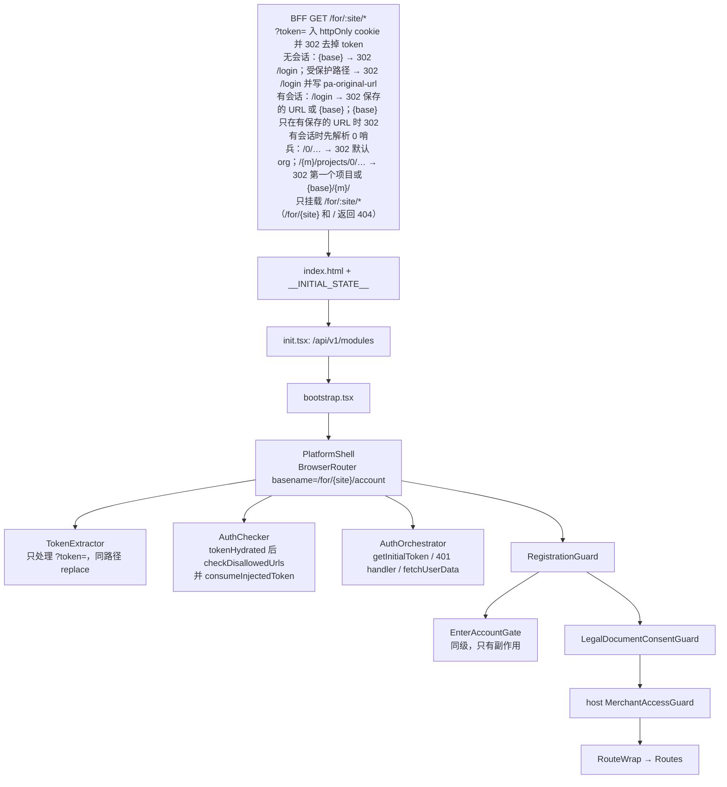

# T1 回归测试用例：启动 · 鉴权 · Merchant 守卫 · 错误

| 项 | 值 |
|---|---|
| Track | T1 启动·鉴权·Merchant 守卫·错误 |
| 基于 spec 版本 | 0.3.8（P11 定向更新，见文末“P11 变更记录”；P5 基于 0.3.2；P4 基于 0.3.1，P3 基于 0.3.0，初版基于 0.2.0） |
| 代码基线 | `master@772a320` |
| 对照分支 | `WASP-2524-migrate-tests-to-apps`（`apps/web-games`，v2 重写） |
| 生成日期 | 2026-10-21 |
| stage 实测版本 | `c1b5e37`（比基线 `772a320` 早 52 个 commit）。标“stage 实测”的预期来自该版本，已与基线代码核对 |
| SDK 源码 | 本地 `node_modules/.pnpm/@accounts-sdk+*` 的 sourcemap `sourcesContent`。版本与 spec 一致：platform-shell 2.22.3、platform-apis 2.29.2、platform-store 1.15.6、platform-components 4.20.3、platform-pages 3.25.2、platform-bff 1.0.0 |

## 阅读约定

- `{host}`：stage 主机。`{base}` = `/for/web-games/account`。`{mid}`：当前账号自己的 merchant id。`{mid2}`：同一账号的第二个 org。`{foreign}`：存在、但当前账号不是成员的 merchant id。
- 基线代码路径相对 repo root，行号以 772a320 为准。SDK 路径写成 `<包>@<版本> src/...`，对应 sourcemap 中的源文件。
- “改写工具”指 Requestly、Charles 或 mitmproxy 这类可以改响应状态码的代理。Chrome DevTools 只能 block 请求，不能改状态码。
- `[分支差异]`：WASP-2524 分支在同一处的行为与基线不同。证据来自子 agent 对 `apps/web-games` 的对比，关键处已抽查。
- 自动化列只写“已有测试固定了什么”，测试没有运行。

## 渲染时实际的 guard 顺序（代码复核结果）

`TokenExtractor`、`AuthChecker`、`AuthOrchestrator` 是副作用组件，不渲染子节点。`EnterAccountGate` 与 `LegalDocumentConsentGuard` 同级；host MerchantAccessGuard 在 LDCG 里面，比它们低一层。SDK guard 对无 host guard 路由的效果见 RT-AUTH-023。

---

## 1. BOOT

覆盖的 OBS：OBS-BOOT-001、002、003、004、005、006、007；S-05；U-05、U-06

| ID | 场景 | 前置条件（账号/角色/数据） | 步骤 | 预期结果 | 优先级 | 追溯 | 自动化 |
|---|---|---|---|---|---|---|---|
| RT-BOOT-001 | 正常冷启动的请求顺序 | A1 已登录 | 1. 打开 DevTools Network，勾选 Preserve log 2. 硬刷新 `{base}/{mid}` | 1. 第一个 gateway 请求是 `GET {platformApiUrl}/api/v1/modules`，没有 `Authorization` header 2. 带 `Authorization` 的请求（`get_init_info?org_id={mid}`、`/api/organization/{mid}/detail`）都在它之后 3. 页面正常渲染 | P0 | OBS-BOOT-001、OBS-BOOT-007；`src/init.tsx:13-28`；`src/bootstrap.tsx:62-74`；platform-shell@2.22.3 `src/AuthOrchestrator.tsx:179-207` | `src/init.test.tsx`（'points the gateway…'、'hands the fetched modules…'）。[分支差异] 分支改用 `initializeRemoteModules` |
| RT-BOOT-002 | 模块列表失败导致白屏 | A1 已登录 | 1. DevTools → Network request blocking，加入 `*/api/v1/modules` 2. 硬刷新 `{base}/{mid}` 3. 变体：DevTools 设为 Offline 后刷新 | **当前**：`#root` 为空，白屏；Console 出现 `Uncaught (in promise) Error: Failed to initialize application: …`；没有重试；不发 `/server/token`，也不发 `get_init_info` **修复后**：显示错误页，并提供重试 | P1 | OBS-BOOT-002；`src/init.tsx:29-31`；`public/index.html:9`（`#root` 为空） | `src/init.test.tsx` 'wraps a module-list failure…'。[分支差异] 分支渲染 `InitializationError` 和 Retry（`apps/web-games/src/init.tsx:50-62`；`tests/initialization-failure.test.tsx`） |
| RT-BOOT-003 | 模块列表返回 200，但 body 是错误格式 | A1 | 用改写工具把 `/api/v1/modules` 的 body 改为 `{"error":"x"}` 或不带 `result` 的 JSON，然后刷新 | 与 RT-BOOT-002 相同：白屏，错误信息包含 `x` 或 `Unknown API response` | P2 | OBS-BOOT-002；platform-apis@2.29.2 `src/apis/module.ts:7-19` | — |
| RT-BOOT-004 | MF 2.0 注册失败不阻断启动 | A1 | 用改写工具改 `/api/v1/modules` 响应，然后刷新： a) 删除 `communication_platform` 条目 b) 保留条目，删除它 `urls` 中的 `stage` URL c) 把它的 stage URL 改成不以 `remoteEntry.js` 结尾的地址 | a/b/c 都是逐个跳过，不抛错：Console 打印一条 `[mf-runtime] skipping remote "communication_platform_v2" (module "communication_platform"): {reason}`，reason 分别是 a) `module not in gateway list`、b) `module has no URL for env "stage"`、c) `remoteEntry URL "…" has no manifest mapping`。全部被跳过时不调用 `registerRemotes`，所以**没有** `remote registration failed` 日志。启动继续，dashboard 正常 只有 runtime 本身抛错（例如 `registerRemotes` 抛错，或 `modules` 不是数组）时，才打印 `[mf-runtime] remote registration failed, MF 2.0 remotes are disabled for this session`，并继续启动。这条分支在 stage 上不易触发，由单测覆盖 `/communication-hub` 的降级由 T4 验证 | P2 | OBS-BOOT-003；`src/mf/index.ts:23-29`；`src/mf/runtime/registerGatewayRemotes.ts:40-77` [P11] | `src/mf/index.test.ts`（'registers nothing and warns…'、'swallows a registration failure…'）。[分支差异] 分支删除了 MF 2.0 注册 |
| RT-BOOT-005 | `__INITIAL_STATE__` 回填 | A1 | 登录后在 Console 执行 `window.__INITIAL_STATE__` | 对象有 `projects` 和 `user` 两个 key。BFF 水合成功时是完整 shape；水合失败时是 `{currentID:null}` / `{id:null,email:null}`。`token` 为 `null`（见 RT-SEC-003） | P2 | OBS-BOOT-004；`src/bootstrap.tsx:43-50`；platform-bff@1.0.0 `src/bff-routes.ts:344-355` | —（分支一致：`apps/web-games/src/bootstrap.tsx:44-51`） |
| RT-BOOT-006 | 裸 site URL 规范化 | A1 | 依次打开：a) `https://{host}/for/web-games`；b) `https://{host}/for/web-games/?a=1#x` | a) **stage 实测**：BFF（Express）返回 404 “Cannot GET”，SPA 不加载。原因：BFF 只挂载 `/for/:site/*`，不带尾斜杠的 `/for/web-games` 匹配不上。spec 0.3.2 已写明：OBS-BOOT-005 在 BFF 部署中不生效，只在没有 BFF（如 dev server）或打开 `/for/{siteId}/` 时生效（§10.3）。a) 返回 404 即符合预期 b) 带尾斜杠时 `/for/:site/*` 可以匹配，BFF 不在 account basename 内，不做守卫，按代码应返回 shell。预期地址栏变为 `/for/web-games/account?a=1#x`，没有第二个 document 请求，然后按会话状态落地（stage 未实测，待确认） | P0 | OBS-BOOT-005、I1、§10.3；`src/core/utils/redirectToAccountRoot.ts:5-16`；platform-bff@1.0.0 `src/bff-routes.ts:115-119`、`:211,231,242,400`、`src/server.ts:4` [P3] [P5] | `redirectToAccountRoot.test.ts`；scenario I1（jsdom 中直接设置 URL，不经过服务器）。[分支差异] v2 删除了 `redirectToAccountRoot`，分支要单独验证 `/for/web-games/` 的结果 |
| RT-BOOT-007 | S-05 定向：短路分支永远不触发 | A1 | 打开 `https://{host}/for/web-games/`（带尾斜杠，RT-BOOT-006b）。不带尾斜杠的 URL 在 stage 上不加载 SPA（RT-BOOT-006a），不能用来验证本用例 | **当前**：`redirectToAccountRoot` 两个分支都返回 `false`，`bootstrap.tsx:54` 的 `return` 永不执行，继续 render，页面正常 **修复后**：如果修复成“匹配时返回 true”，就必须同时改成 `location.replace` 或继续 render，否则 `/for/web-games/` 会白屏。回归点：打开 `/for/web-games/` 后页面能渲染 | P2 | S-05；`redirectToAccountRoot.ts:15`；`bootstrap.tsx:53-60` [P3] | `redirectToAccountRoot.test.ts` 'always returns false…' |
| RT-BOOT-008 | 根路径按 cookie 恢复 site | stage：cookie `account-platform-site-id=web-games`；本地：能在 `/` 提供本 SPA 的 dev server | 1. 打开 `https://{host}/` 2. 变体：删除该 cookie 后再打开 `/` | **stage 实测**：`/` 不由本 SPA 提供，BFF（Express）返回 404 “Cannot GET /”，停留在 `/`。spec 0.3.2 已写明：OBS-BOOT-006 / I2 在 BFF 部署中不生效，只在由其他服务以本 SPA 提供 `/` 时生效 [U]（§10.3）。stage 上返回 404 即符合预期 **本地（SPA 在 `/`）**：1. `location.replace` 到 `/for/web-games/account`，history 中没有 `/` 条目；2. 停留在 `/`，渲染 LoginPage（`checkDisallowedUrls` 对 `/` 直接 return） | P1 | OBS-BOOT-006、I2、§10.3；`src/core/utils/resolveRouteFromCookie.ts:12-25`；platform-apis@2.29.2 `src/utils/checkDisallowedUrls.ts:24-26`；platform-bff@1.0.0 `src/server.ts:4`（只接 `/for/:site/*`） [P3] [P5] | `resolveRouteFromCookie.test.ts`；分支 `tests/resolve-route-from-cookie.test.tsx`。[分支差异] 分支还要求有 JS 可读的 `pa-v4-token` cookie（`packages/@platform-templates/store/src/client/resolve-route-from-cookie.ts:10-12`）。httpOnly 会话下这条跳转不会触发，疑似回归 |
| RT-BOOT-009 | siteID cookie 由谁写、怎么写 | A11 无会话；A1 | 分别在无会话和有会话时打开任意 `{base}` 页面，查看 Application → Cookies | `account-platform-site-id=web-games`：Domain 为 `.xsolla.com` 或 `.srv.local`（按主机），Path `/`，SameSite Lax，有效期 10 天，不是 httpOnly。无会话时也会写入 | P1 | OBS-BOOT-006 补充；platform-shell@2.22.3 `src/AuthOrchestrator.tsx:224-229`；platform-apis@2.29.2 `src/utils/cookie.ts:105-120` | — |
| RT-BOOT-010 | 识别 stage 构建的 APP_ENV（U-06） | A1 | 登录后查看 Console | 出现 `[Gateway] Authenticated request` 日志，说明 `APP_ENV !== 'production'`（`build:stage`）。把结论记入执行记录：它决定 RT-AUTH-008 的 2000 ms 延迟、RT-SEC-001 和 RT-SEC-002 的预期 | P1 | U-06；`src/core/apis/gateway-instance.ts:42-63`；`package.json` 中的 `build:stage` | — |
| RT-BOOT-011 | 模块列表快照（U-05） | A1 | 保存 stage 上 `/api/v1/modules` 的响应 | 记录 `urls` 的 key（`development/stage/production` 还是 `dev/prod`）和 `communication_platform.module` 的值，交给 T4 使用 | P2 | U-05 | — |

---

## 2. AUTH

覆盖的 OBS：OBS-AUTH-001 到 009；AC-02、AC-03；S-22；§2.4；U-01、U-02；S-42、U-17（P11）

| ID | 场景 | 前置条件（账号/角色/数据） | 步骤 | 预期结果 | 优先级 | 追溯 | 自动化 |
|---|---|---|---|---|---|---|---|
| RT-AUTH-001 | 无会话打开深链，并在登录后回到原地址 | A11 无会话（清空 cookie）；A1 的凭据 | 1. 打开 `{base}/{mid}/finance?tab=x` 2. 查看 document 响应 3. 用 A1 登录 | 1. document 请求返回 302，跳到 `{base}/login` 2. Set-Cookie 写入 `pa-original-url={base}/{mid}/finance?tab=x`（非 httpOnly，10 分钟） 3. 登录后回到 `{base}/{mid}/finance?tab=x`，`pa-original-url` 被清除 | P0 | OBS-MAG-006、U-01、U-02；platform-bff@1.0.0 `src/bff-routes.ts:122-156`、`:170-187`；platform-apis@2.29.2 `src/utils/getRedirectUrlAfterAuth.ts:9-29` | e2e `anonymous.smoke.spec.ts` 'a merchant deep link without a session redirects to /login'（只断言跳到 login） |
| RT-AUTH-002 | return URL 拒绝无效目标 | A11；A1 | 1. 无会话打开 `{base}/error`、`{base}/not-found` 2. 手工把 `pa-original-url` 改为 `{base}/login`、`https://evil.example`、`//evil.example`，再登录 3. 构造长度超过 2000 的 URL，无会话打开 | 1. BFF 视为 public，直接返回 shell，不写 cookie（SPA 侧行为见 RT-AUTH-021） 2. 登录后不跳到这些目标，落在 `{base}` 再进入 `/{firstOrg}`；不会离开本站 origin 3. 不写 `pa-original-url` | P2 | platform-bff@1.0.0 `src/bff-routes.ts:36-47`、`:150-152`、`:170-180`；`getRedirectUrlAfterAuth.ts:16-21` | — |
| RT-AUTH-003 | 登录回调 `?token=` 由 BFF 接管 | A1 | 1. 走正常登录（login widget 回跳时带 `?token=`） 2. 手工打开 `{base}/{mid}?token={有效 JWT}` 3. 变体：`?token=abc`（不是 JWT 形状） | 1-2. document 302 到同一 URL 但去掉 `token`，写入 `pa-v4-token`：HttpOnly、Secure、SameSite=Lax、10 天，stage 上 Domain=`.srv.local`。地址栏和 history 里都没有 token 3. 302 去掉 token，但不写 cookie，于是按无会话处理，跳到 login | P0 | OBS-AUTH-002、U-02；platform-bff@1.0.0 `src/bff-routes.ts:107-113`、`:257-263`；`src/config.ts:30-49` | — |
| RT-AUTH-004 | SPA 侧 URL token 分支：无 BFF 的首次加载与客户端导航 | A1；第 1、2 步需要能绕过 BFF 的环境（例如本地无 BFF 的 build）；第 3 步在 stage 上也可执行 | 1. 整页打开 `{base}/{mid}/finance?token={JWT}&a=1` 2. 变体：让 `get_init_info` 返回 500 后重复步骤 1 3. 客户端导航：页面加载完成后，在 Console 执行 `history.pushState({}, '', '{base}/{mid}/finance?token={当前会话的 JWT}&a=1'); dispatchEvent(new PopStateEvent('popstate'))` | 1. 首次加载：host `resolveInitialToken` 用 `replaceState` 从地址栏去掉 `token`。它只在首次加载时运行一次（`AuthOrchestrator` 的 mount-only effect，已有 token 时提前 return）。SDK `TokenExtractor` 写入 **JS 可读** cookie `pa-v4-token`（10 天，域名级，非 httpOnly），并 `dispatch(setToken(urlToken))`；然后对同一路径执行 `history.replace`，只去掉 `token`：地址最终为 `{base}/{mid}/finance?a=1`，深链保留。原因：BrowserRouter 有 basename，`location.pathname` 不含 `/for/{site}`，siteId 正则匹配不上，所以不会跳 `/{merchant}` 2. 变体：`fetchMerchantAndUserDetails` 失败时同样只清理 URL，停留在原路径，不跳 `/login`（同一原因） 3. 客户端导航：`resolveInitialToken` 不运行；由 `TokenExtractor` 去掉 `token`，并执行 `setToken`。token 与当前会话相同时，会话不变。token 不同时会替换会话 token，见 RT-AUTH-025 | P2 | OBS-AUTH-001、OBS-AUTH-002；`src/core/utils/resolveInitialToken.ts:11-22`；platform-components@4.20.3 `src/auth/TokenExtractor/index.tsx:95`、`:98`、`:167-186`、`:188-205`；platform-shell@2.22.3 `src/AuthOrchestrator.tsx:119-153` [P3] [P5] | `resolveInitialToken.test.ts`；`App.test.tsx` 'resolves the initial token from the URL and strips it…'（只覆盖首次加载） |
| RT-AUTH-005 | 使用注入的 token，不请求 `/server/token` | A1 | 硬刷新 `{base}/{mid}` | 没有 `GET {base}/server/token` 请求；`get_init_info?org_id={mid}` 带 Bearer token | P0 | OBS-AUTH-001；`resolveInitialToken.ts:24-28` | `resolveInitialToken.test.ts` 'returns the injected token without asking the BFF' |
| RT-AUTH-006 | `/server/token` 回退和失败 | A1；用 DevTools Local Overrides 让 HTML 里的 `__INITIAL_STATE__` 不带 token（可操作性待确认） | a) 正常加载 b) block `*/server/token` c) 用改写工具让 `/server/token` 返回 401 d) 用改写工具让它延迟超过 8 s | a) `GET {base}/server/token` 带 cookie，返回 200 `{token}` 后正常进入 b/c/d) `resolveInitialToken` 返回 `null`，AuthOrchestrator 调用 `checkDisallowedUrls`，执行 `location.replace({base}/login)`，并写入 SPA 侧的 `pa-original-url`（60 s）。d 在 8 s 时 abort。**注意**：网络失败也会跳到 login，不会像 SDK 注释说的那样留在当前页 **b/c/d 的循环风险（[I]，预期失败项）**：循环需要三个条件同时满足（spec 0.3.10）：①页面没有内联 token；②`/server/token` 也失败（被拦截、8 s 超时或非 2xx）；③BFF 会话仍然有效。会话有效时 BFF 的 `/server/token` 会返回 token（`bff-routes.ts:231-240`），所以 a 不会循环，只有 b/c/d 可能触发。本用例用 Local Overrides 去掉了内联 token，而 A1 的 BFF 会话仍然有效。此时 BFF 会把 `/login` 302 回 SPA 写入的 `pa-original-url`，页面重新加载后又缺 token，于是在 `{base}/{mid}` 与 `{base}/login` 之间无限循环。执行时观察 10 s 内 Network 中的 document 请求，然后关闭 Local Overrides 或清除 cookie 停止循环。**当前**：循环；**修复后**：不循环（停在 login 页或显示错误）。BFF 正常内联 token 时走不到这一步 | P1 | OBS-AUTH-001、U-02；platform-apis `src/utils/checkDisallowedUrls.ts:32-47`；platform-bff `src/bff-routes.ts:173-183`、`:331-345`；`src/core/apis/server.ts:7-11`；`resolveInitialToken.ts:37-49`；platform-shell@2.22.3 `src/AuthOrchestrator.tsx:125-143`；platform-apis@2.29.2 `src/utils/checkDisallowedUrls.ts:20-48` [P11] [P12] | `server.test.ts`（timeout）；`resolveInitialToken.test.ts`（'returns null when the BFF request rejects'）。循环风险没有自动化。[分支差异] 分支没有 8 s abort；非 401/403 的非 ok 响应会 throw 进入错误页（`apps/web-games/src/core/platform/session.ts:36-56`） |
| RT-AUTH-007 | token 扇出和请求头 | A1 | 打开 `{base}/{mid}/dashboard`，在 Network 中分别查看 SDK 请求（`get_init_info`、`privileges`）和本地 endpoint 请求（dashboard、merchant-init-status 等） | 两类请求都带 `Authorization: Bearer <同一个 token>`，并带 `Business-Account-Id: web-games`。这个值是 site id，不是 merchant id | P0 | OBS-AUTH-003、OBS-AUTH-004；`src/App.tsx:74-78`；`src/core/apis/gateway-instance.ts:28-40`；platform-apis@2.29.2 `src/apis/gateway-instance.ts:56-71` | `App.test.tsx` 'syncs a new token…'；`gateway-instance.test.ts`（request interceptor） |
| RT-AUTH-008 | 会话中本地 gateway 返回 401，触发注销 | A1 在 `{base}/{mid}/dashboard` | 用改写工具把一个本地 gateway 请求（例如 dashboard 接口）改为 401，然后刷新页面触发该请求 | 1. stage（非 prod）Console 打印 `[Gateway Auth] Token validation failed`，包含 `tokenPreview` 2. 约 2000 ms 后导航到 `{base}/logout`，再 302 到 `{base}/login` 3. `pa-v4-token`、`pa-original-url`、`pa-merchant-id` 被清除 4. 按后退键不能恢复会话 5. 在跳转前的约 2000 ms 内，Redux 的 user 和 token 保留（host 拦截器不清 store） prod 没有延迟（0 ms） stage 实测（R5，mock balance 401）：1、2、5 符合，约 2043 ms 后只导航 1 次 `/logout`，Balance 显示 “—”；3、4 由 RT-AUTH-014 的真实登出覆盖 | P0 | OBS-AUTH-005、AC-02；`gateway-instance.ts:80-119`；platform-bff@1.0.0 `src/bff-routes.ts:198-218`；§10.3 R5 [P11] | `gateway-instance.test.ts`（'401 handling'）；I6；分支 `http-auth.integration.test.ts`。[分支差异] 分支直接 `location.replace`，没有延迟，也不打印 token |
| RT-AUTH-009 | SDK 请求返回 401（第二个拦截器） | A1 | 用改写工具把 `get_init_info` 或 `/api/account/platform/{mid}/privileges` 改为 401 | 1. Redux 中的 user 和 token 立刻被清空（`clearUserData`），UI 不再显示为已登录 2. 约 2000 ms 后跳到 `/logout`，再到 login 3. 没有 `[Gateway Auth]` 日志（SDK 拦截器不打印） 4. 在跳到 `/logout` 之前的 2000 ms 内查看 Application → Cookies：httpOnly 的 `pa-v4-token` 仍在。SDK 拦截器用 js-cookie 删除同名 cookie，删不掉 httpOnly cookie；会话由 BFF `/logout` 结束 stage 实测（R5，mock privileges 401）：约 0.6 s 时 store 已清空，约 2072 ms 后导航 1 次 `/logout`，没有 `[Gateway Auth]` 日志，跳转前 httpOnly `pa-v4-token` 仍在，与 1–4 一致 **说明**（spec 0.3.9 已修正 OBS-ACC-002，与本用例一致）：R5 review 更正了“privileges 401 时先显示 `/forbidden` 约 2 s”的说法：时间线上 `/logout` 先发起，`/forbidden` 出现在其后，是测试脚本把 `/logout` mock 成 204、页面没有卸载造成的。本用例不把 `/forbidden` 列为预期；真实流程中如果在 `/logout` 之前看到 `/forbidden`，记录时间线 | P1 | OBS-AUTH-005 补充、OBS-AUTH-002、OBS-ACC-002；platform-apis@2.29.2 `src/apis/gateway-instance.ts:101-149`；platform-shell@2.22.3 `src/AuthOrchestrator.tsx:108-112`；platform-bff `src/bff-routes.ts:131-132` [P4] [P11] | — |
| RT-AUTH-010 | 并发 401 时每个拦截器只注销一次 | A1 | 同时让至少 2 个带 token 的请求返回 401，其中本地和 SDK 请求各至少一个 | 每个拦截器各自只排一次 `/logout`。两个一次性 flag 互相独立（spec 0.3.0 已确认），所以 host 与 SDK 拦截器各发起一次 `/logout`，Network 中共 **2 次** document 请求，后一次取代前一次（第 1 次为 `ERR_ABORTED`），最终只落地 1 次 login 页，不形成循环（spec 0.3.10 OBS-AUTH-005 / AC-02） stage 实测（R5，balance + privileges + features 同时 401）：`/logout` 导航请求发起 2 次，第 1 次被第 2 次取代（`ERR_ABORTED`），延迟约 2049 ms；host 日志的 `tokenPreview` 为 `hasToken=false`，因为 SDK 拦截器先清空了 token **附带观察（U-17）**：stage R1 中 token 有效时 gateway 曾 3 次短暂地同时对 detail、privileges、features、项目列表返回 401，每次都导致一次 `/logout`。执行任何用例时如果在未改写响应的情况下出现 401 并登出，记录时间、请求和 JWT `exp`，提交给 gateway | P1 | AC-02、I6、OBS-AUTH-005、U-17；`gateway-instance.ts:10`、`:90-91`；platform-apis `gateway-instance.ts:24-25`、`:130-131` [P3] [P11] [P12] | `gateway-instance.test.ts` 'redirects only once for repeated 401 errors'；I6（真实 SDK 实例与本地实例都跑） |
| RT-AUTH-011 | 403 不注销 | A1 | 用改写工具把任意一个带 token 的请求改为 403 | 不发生导航，会话保留，由页面或路由自己处理 | P1 | OBS-AUTH-006、AC-03、I7；`gateway-instance.ts:77-80`；platform-apis `gateway-instance.ts:108-109` | `gateway-instance.test.ts` 'does not log out on a 403…'；I7；分支 `http-auth.integration.test.ts` |
| RT-AUTH-012 | 匿名请求返回 401 不注销 | A1 | 用改写工具把 `/api/v1/modules`（不带 `Authorization`）改为 401 | 启动失败、白屏（同 RT-BOOT-002），但不导航到 `/logout` | P2 | OBS-AUTH-007；`gateway-instance.ts:84-90` [P11] | — |
| RT-AUTH-013 | viewer 收到 401 时两个拦截器行为不一致 | A4 viewer | 1. 用改写工具把一个 SDK 请求（例如 `privileges`）改为 401 2. 用改写工具把一个本地 gateway 请求改为 401 | **当前**：1 不注销（SDK 对 viewer 跳过 401）；2 注销并跳 `/logout`（host 拦截器没有 viewer 判断） **修复后**：两者行为一致 | P1 | platform-apis@2.29.2 `src/utils/auth-session-context.ts:27-32`、`src/apis/gateway-instance.ts:104-106`；host `gateway-instance.ts:80-90` | —。[分支差异] 分支统一对 viewer 只读请求忽略 401 |
| RT-AUTH-014 | Sign out 按钮 | A1 | 1. topbar 头像 → Sign out 2. 再按后退键、刷新，或打开一个深链 3. 变体：先在 DevTools Request blocking 中加入 `*/logout`，再 Sign out，然后刷新 `{base}/{mid}` | 1. SDK Navigation 依次：发送点击打点；用 js-cookie 删除 `pa-v4-token`；`location.assign({base}/logout)`。BFF 的 httpOnly 会话 cookie 与这个 JS cookie 同名（都是 `pa-v4-token`，Path 都是 `/`，stage Domain 都是 `.srv.local`，prod 都是 `.xsolla.com`），js-cookie 删不掉 httpOnly cookie，所以这一步不结束会话。BFF `/logout` 清除 `pa-v4-token`、`pa-original-url`、`pa-merchant-id`，再 302 到 login。注意：`clearSession` 只删除**已存在**的 `pa-original-url`；R5 登出前没有这个 cookie，所以没有观察到删除。要验证这一点，登出前先确认 Application → Cookies 中有 `pa-original-url`（spec 0.3.10 OBS-AUTH-008）。Redux 状态随页面卸载消失 2. 都没有会话，跳到 login 3. `/logout` 被拦截时，httpOnly `pa-v4-token` 仍在，刷新后仍是已登录状态。这说明真正结束会话的是 BFF `/logout` 4. 登出后 Application → Cookies 中：只有 `pa-v4-token`、`pa-merchant-id`（以及存在时的 `pa-original-url`）被删除；`gc-pa-*`（含 JS 可读的 `gc-pa-v4-token`，见 T4 RT-SEC-103 / S-01）、`network-pa-*`、`sb-pa-*`、`pa-locale` 保留 stage 实测（R5）：1、2、4 符合（`/logout` 302 → `/login`，后退和深链都落到 `/login`）；3 没有执行；登出前没有 `pa-original-url`，无法确认它被清除 | P0 | OBS-AUTH-008、OBS-AUTH-002、§8.1、S-01；platform-components@4.20.3 `src/Navigation/index.tsx:470-479`、`:718`；platform-bff `src/bff-routes.ts:131-132`、`:211-218`、`src/config.ts:6`、`:30-48`；platform-apis `src/utils/cookie.ts:105-120` [P3] [P4] [P11] [P12] | — |
| RT-AUTH-015 | 登出后另一个标签页 | A1，打开两个标签页 | 在 A 页 Sign out，B 页不刷新，继续操作（触发 gateway 请求，例如客户端导航到 `/{mid}/projects`），最后刷新 B | **预期失败项（S-42）** **当前**：BFF `/logout` 只清 cookie，不吊销 JWT。B 内存中的 token 在过期前一直可用：B 的 gateway 请求返回 200，B 不跳转。B 刷新后才 302 到 login **修复后**：B 的下一个 gateway 请求返回 401，然后跳到 login（或 B 通过 `storage` 事件 / BroadcastChannel 同步登出） stage 实测（R5）：与“当前”一致，`project-tags`、`projects/paged/lite` 返回 200，B 的 store 仍有 token；刷新后 302 到 `/login` | P1 | S-42、OBS-AUTH-008；`src/core/apis/axios-instance.ts:12-19`；platform-bff `src/bff-routes.ts:201-218`、`src/authorization.ts:25-30` [P11] | — |
| RT-AUTH-016 | 已登录用户访问入口页 | A2 多 org | 依次整页打开 `{base}/login`、`{base}/signup`、`{base}/`、`{base}/resetting`、`{base}/resetting/confirm`。变体：先写入 `pa-original-url={base}/{mid2}/finance`，再打开 `{base}/` | `/login`：BFF 302 到已保存的 return URL（并清除该 cookie），没有时 302 到 `{base}`，再由 host 守卫 `history.replace('/{firstOrgId}')` `{base}/`：有已保存的 return URL 时 BFF 302 到它（变体落到 `{base}/{mid2}/finance`）；没有时返回 shell，host 守卫 `history.replace('/{firstOrgId}')`，不闪现登录表单 `/signup`：BFF 当作 public，返回 shell，host 守卫 `history.replace('/{firstOrgId}')` `/resetting`、`/resetting/confirm`：**当前**（772a320 代码与 stage 实测一致）跳到 `/{默认 mid}`。host 守卫有意不处理 `/resetting`，但该路由渲染 SDK `LoginPage`，它的 `checkExistingAuth` 在有 token 时调用 `fetchMerchantAndUserDetails()`，然后 `history.replace('/{merchant.id}')`。这与 host 的设计意图（“已登录时修改密码是合法的”）冲突，记为缺陷，owner：accounts-sdk，需产品确认 **修复后**：`/resetting` 不重定向，显示重置密码表单 | P0 | OBS-AUTH-009、I5；`src/routes/useMerchantAccessGuard.ts:63-65`、`:75-105`、`:233-235`；`src/routes.tsx:159-160`；platform-pages@3.25.2 `src/Login.tsx:77`、`:153-197`；platform-bff `src/bff-routes.ts:161-188` [P3] | `useMerchantAccessGuard.test.tsx`（'replaces the entry route…'、'does not treat /resetting…'，只覆盖 host 守卫，不覆盖 SDK LoginPage）；I5 |
| RT-AUTH-017 | 入口页：注册未完成，或没有 org | A6；A7（待确认） | 已登录，打开 `{base}/` | 两种情况都落到 `/registration`：A6 由 RegistrationGuard 处理，A7 由 host 守卫处理 | P1 | OBS-AUTH-009；`useMerchantAccessGuard.ts:90-104`；platform-components `src/auth/RegistrationGuard/index.tsx:23-25` | `useMerchantAccessGuard.test.tsx` 'sends a user without any org to /registration…' |
| RT-AUTH-018 | 加载时 cookie 已过期或是伪造的 | A1 | 在 Application 面板把 `pa-v4-token` 改为：a) `exp` 已过期的 JWT；b) 非 JWT 字符串；c) `exp` 未过期但签名无效的 JWT。然后刷新 `{base}/{mid}` | a/b：BFF 清除 cookie，302 到 login，并写入 return URL c：BFF 放行（只做 heuristic，不校验签名；stage 是否配置了 `verifyToken` 待确认），随后 `get_init_info` 返回 401，SDK 注销，经 `/logout` 到 login，不形成循环 | P1 | U-02；platform-bff@1.0.0 `src/bff-routes.ts:60-75`、`:122-140` | — |
| RT-AUTH-019 | ToU 待签（U-01、I14） | A8 owner；A9 非 owner 成员；A5 admin | 1. 各账号打开 `{base}/{mid}/dashboard` 2. 用改写工具让 consent 接口挂起超过 10 s，再以 A8 打开 | 1. A8 → `/legal-consent`；A9 → `/account-no-access`；A5 直接进入 2. 10 s 后 fail-open，放行进入页面 | P1 | U-01；platform-components@4.20.3 `src/auth/LegalDocumentConsentGuard/index.tsx:40-41`、`:181-260` [P3] | I14 只部分覆盖：它用 host 写的 stand-in（`shellGuards.tsx`），没有超时、admin 分支和 suppress，所以步骤 1 的 A5 和步骤 2 都没有自动化。分支没有测试引用 |
| RT-AUTH-020 | 首次进入账号的 gate | A10 owner，清除该 site/user 的 localStorage key | 打开 `{base}/{mid}` | owner 被导向 `/enter-account`；看过一次后不再跳转；admin 和非 owner 不跳 | P2 | U-01；platform-components@4.20.3 `src/auth/EnterAccountGate/useEnterAccountGate.ts:123-175` | — |
| RT-AUTH-021 | S-22 定向：BFF 与 SPA 的公共路径列表不一致 | A11 无会话 | 依次打开 `{base}/forbidden`、`{base}/not-found`、`{base}/error`，每次查看 Cookies 中的 `pa-original-url` | **当前**：`/forbidden` 和 `/not-found` 先由 BFF 当作 public 返回 shell，然后 SPA `/server/token` 返回 401，`checkDisallowedUrls` 不放行这两个路径，再跳到 login（多加载一次）。`/forbidden` 写入 SPA 侧 `pa-original-url`（60 s），`/not-found` 不写（不可保存的目标）。`/error` 两边都放行，停留在原页 **修复后**：两边的列表一致 | P2 | S-22；platform-bff `src/bff-routes.ts:36-37`；platform-apis `src/constants/allowed-unauthorized-urls.ts:1-15`、`src/utils/checkDisallowedUrls.ts:15-18` [P3] | — |
| RT-AUTH-022 | 没有 token 静默续期 | A1，记下 JWT 的 `exp` | 保持页面打开，跨过 `exp` 后再操作 | 下一个 gateway 请求返回 401，按 RT-AUTH-008 注销。代码中没有任何 refresh 逻辑（host 和 SDK 都 grep 不到） | P2 | OBS-AUTH-005；host 与 SDK 中都没有 refresh 相关代码 | — |
| RT-AUTH-023 | SDK guard 对“无 host guard”路由的效果（spec §2.4 表） | A11 无会话；A6 注册未完成；A8 owner 且 ToU 待签；A10 owner 首次进入（ToU 已签，清除 enter-account 的 localStorage key） | 1. A11 依次整页打开 `{base}/verification`、`{base}/error`、`{base}/login/mcp`、`{base}/account-no-access`、`{base}/enter-account`，查看 document 响应 2. A6 依次打开 `{base}/error`、`{base}/login/mcp` 3. A8 依次打开 `{base}/verification`、`{base}/error` 4. A10 依次打开 `{base}/error`、`{base}/forbidden`、`{base}/not-found` 5. A10 依次打开 `{base}/account-restricted`、`{base}/verification`、`{base}/login/mcp` | 1. 前三个是 BFF public 路径，SPA 也放行，停留在原页。后两个不是 BFF public 路径：document 请求返回 302 到 `{base}/login`，由 BFF 写入 `pa-original-url`（非 httpOnly，10 分钟）。§2.4 表中 SPA 侧的跳转（60 s cookie）只在没有 BFF 或客户端导航时出现 2. 都跳到 `/registration`，包括 `/login/mcp` 3. `/verification` 被当作公开路径，停留；`/error` 跳到 `/legal-consent` 4. 等该 merchant 的 consent 状态加载完成后，都被 `history.replace('/enter-account')`，错误页上也会发生。consent 加载完成前不跳转 5. EnterAccountGate 跳过 `/account-*`、`/enter-account`、`/login*`、`/verification` 等 10 个前缀，都停留在原页 | P1 | §2.4、§2.3、OBS-AUTH-009；U-01；platform-components@4.20.3 `src/auth/RegistrationGuard/index.tsx:21-25`、`src/auth/LegalDocumentConsentGuard/index.tsx:24-31`、`:201`、`src/auth/EnterAccountGate/useEnterAccountGate.ts:20-31`、`:88-93`、`:160-166`；platform-apis@2.29.2 `src/utils/checkDisallowedUrls.ts:4-48`；platform-shell@2.22.3 `src/AuthOrchestrator.tsx:125-137`；platform-bff `src/bff-routes.ts:37`、`:128-154` [P3] [P4] | 无：`EnterAccountGate`、`AuthChecker` 在集成测试中没有替身，§2.4 表中的结果都没有测试覆盖 |
| RT-AUTH-024 | 无会话打开应用根 `{base}` | A11；变体：A1 的 `pa-v4-token` 改为 `exp` 已过期的 JWT | 1. A11 整页打开 `{base}`，查看 document 响应和 Cookies 2. 变体：带过期 cookie 整页打开 `{base}` | 1. document 请求返回 302 到 `{base}/login`，在服务端完成，不先加载 shell 再跳转；不写 `pa-original-url`（只有受保护的非根路径才保存） 2. BFF 先清除失效的 `pa-v4-token`，再 302 到 `{base}/login` | P1 | OBS-AUTH-009、§2.3；platform-bff@1.0.0 `src/bff-routes.ts:128-141` [P4] | — |
| RT-AUTH-025 | 客户端导航带 `?token=` 时替换当前会话 token | A1 已登录；A2 的有效 JWT（从 A2 会话请求的 `Authorization` 头复制）。A2 最好与 A1 同属一个 org，否则后续请求可能返回 403 | 1. A1 整页打开 `{base}/{mid}/dashboard`，记下 gateway 请求的 Bearer token 2. 在 Console 执行 `history.pushState({}, '', '{base}/{mid}/finance?token=<A2 JWT>'); dispatchEvent(new PopStateEvent('popstate'))` 3. 在 SPA 内再点一个菜单，查看后续 SDK 请求和本地 gateway 请求的 `Authorization` 4. 查看 Cookies 中的 `pa-v4-token`；然后整页刷新，再查看 `Authorization` | 2. 地址栏去掉 `token`，没有整页加载；host `resolveInitialToken` 不运行 3. **按 spec 0.3.2**：`TokenExtractor` 执行 `dispatch(setToken(<A2 JWT>))`，经 `onTokenChange` 传到所有 axios 实例，之后 SDK 请求和本地 gateway 请求都带 A2 的 token。topbar 用户和 merchant 数据是否随之切换：记录 4. **推断 [I]**：A1 的 httpOnly `pa-v4-token` 仍在，JS 写入的同名 cookie 不能覆盖它；刷新后 BFF 按 A1 的会话加载，token 回到 A1。记录实际结果 判定：第 3 步成立说明 URL 中的 token 不经过 BFF 就能替换会话 token。作为安全发现提交：任何能让 SPA 内部导航到带 `?token=` 地址的入口，都能切换会话身份 | P2 | OBS-AUTH-002、§8.1 URL token；platform-components@4.20.3 `src/auth/TokenExtractor/index.tsx:84-102`；platform-shell@2.22.3 `src/AuthOrchestrator.tsx:119-153`；`src/App.tsx:74-78` [P5] | — |

---

## 3. MAG

覆盖的 OBS：OBS-MAG-001 到 006；AC-01；S-14；U-04

> 代码复核要点：platform-store 1.15.6 的 `fetchUserData` 会按 URL 中的 merchant 调用 `get_init_info?org_id=`（`src/slices/user.ts:108-160`）。只有遇到 `MerchantAccessDeniedError` 时才退回不带 org 的调用。所以“外部 merchant 回到自己的 org”这条路径，依赖 gateway 对外部 `org_id` 返回 200。
>
> P4（spec 0.3.1，S-34）：回退调用 `fetchMerchantAndUserDetails()` 不带参数，但它会再次从 URL 解析出同一个外部 id（platform-apis `src/apis/merchant.ts:106-107`），所以回退必然再失败。结论：只有**客户端导航**（user 已加载）时才跳回 `/{firstOrgId}`（RT-MAG-003、RT-MAG-004）；**整页加载**（深链或刷新）外部 merchant 时显示 500 HydrationError（RT-MAG-015，预期失败项）。

| ID | 场景 | 前置条件（账号/角色/数据） | 步骤 | 预期结果 | 优先级 | 追溯 | 自动化 |
|---|---|---|---|---|---|---|---|
| RT-MAG-001 | 打开自己的 org | A1 | 硬刷新 `{base}/{mid}` | 可能短暂看到 `data-id="merchant-access-guard-loader"`，然后显示页面；`get_init_info?org_id={mid}` 只请求 1 次；store 中已经是 `{mid}`，不再额外 `switchMerchant` | P0 | OBS-MAG-001；`src/routes/MerchantAccessGuard.tsx:20-22`；`useMerchantAccessGuard.ts:163-176`、`:237-242` | `MerchantAccessGuard.test.tsx`；`useMerchantAccessGuard.test.tsx` 'renders at once and requests nothing when the store already holds the URL merchant' |
| RT-MAG-002 | 多 org 用户用深链打开第二个 org | A2 | 打开 `{base}/{mid2}/dashboard` | URL 保持不变，topbar 公司名为 `{mid2}`，数据也是 `{mid2}` 的 | P0 | OBS-MAG-001；platform-store@1.15.6 `src/slices/user.ts:118-160` | `useMerchantAccessGuard.test.tsx` 'lets a user open an org in their list, with a sub-path…' |
| RT-MAG-003 | 非 admin 客户端导航到外部 merchant | A3，加上 `{foreign}`（A1 的 org） | 1. 整页打开 `{base}/{firstOrgId}/dashboard`，等页面加载完成（user 数据已加载） 2. 在 Console 执行 `history.pushState({}, '', '{base}/{foreign}/finance'); dispatchEvent(new PopStateEvent('popstate'))`，让 router 在不重新加载页面的情况下切到该路径 | URL 变为 `/{firstOrgId}`，子路径被丢弃；不出现 `/forbidden`；没有整页重新加载。整页加载（深链或刷新）的情况见 RT-MAG-015 | P0 | OBS-MAG-002、AC-01（只覆盖客户端导航）、I4；`useMerchantAccessGuard.ts:148-160`；platform-apis@2.29.2 `src/apis/merchant.ts:91-95` [P4] | `useMerchantAccessGuard.test.tsx` 'replaces a foreign id with the first org…'；I4（向 store 注入 persona，只覆盖客户端分支）。[分支差异] 分支跳到 `/forbidden`（`apps/web-games/src/core/platform/AppMerchantAccess.tsx:33-39`），与 I4 冲突 |
| RT-MAG-004 | 非 admin 客户端导航到不存在的 merchant | A3，加上 id `999999999` | 按 RT-MAG-003 的步骤，把目标换成 `{base}/999999999/dashboard` | 与 RT-MAG-003 相同：跳到 `/{firstOrgId}`。整页打开该 URL 的情况见 RT-MAG-015 b) | P1 | OBS-MAG-002、AC-01；同 RT-MAG-003 [P4] | — |
| RT-MAG-005 | admin 打开任意 merchant | A5，加上 `{foreign}` | 打开 `{base}/{foreign}/dashboard` | 不做成员检查，直接显示 `{foreign}` 的数据，URL 不变 | P1 | OBS-MAG-004；`useMerchantAccessGuard.ts:137-139`；platform-apis `merchant.ts:83-97`（admin 视为有权限） | `useMerchantAccessGuard.test.tsx`（admin 相关用例） |
| RT-MAG-006 | admin 打开不存在的 merchant | A5，加上 id `999999999` | 1. 打开 `{base}/999999999/dashboard` 2. 打开 `{base}/999999999` 3. 记录页面数据请求使用的 merchant id | **当前**（stage 实测 1；与 772a320 代码一致）：URL 不变；`get_init_info?org_id=999999999` 返回 200（admin 视为有权限）；`/api/organization/999999999/detail` 返回 404 共 3 次，依次来自 SDK `fetchMerchantAndUserDetails`、`fetchUserData` 和 host 守卫的 `switchMerchant`；store 退回 `get_init_info` 返回的 org（admin 默认 org）；Console 打印 `[useMerchantAccessGuard] merchant hydration failed`；渲染 shell，没有错误提示 判断：fail-open 是为瞬时失败设计的，404 表示 merchant 不存在，此时在 `/999999999` 下显示其他 org 的内容且没有提示，记为疑似缺陷，需产品确认 **修复后（建议）**：detail 返回 404 时显示 not-found 或错误页 | P1 | OBS-MAG-004、OBS-MAG-005、OBS-ERR-002；`useMerchantAccessGuard.ts:170`、`:186-197`；platform-apis@2.29.2 `src/apis/merchant.ts:83-97`、`:177-188`；platform-store@1.15.6 `src/slices/user.ts:120-170`、`src/slices/merchants.ts:40-46` [P3] | — |
| RT-MAG-007 | merchant 水合失败时 fail-open | A5，加上 `{foreign}` | 用改写工具把 `/api/organization/{foreign}/detail` 改为 500，然后打开 `{base}/{foreign}` | **当前**：Console 打印 `[useMerchantAccessGuard] merchant hydration failed`；页面照常渲染，但内容是 admin 默认 org 的数据，URL 仍是 `/{foreign}`（这是有意的取舍） 说明：普通成员首次加载时 store 已经是 URL 中的 merchant，这条路径基本走不到 | P2 | OBS-MAG-005；`useMerchantAccessGuard.ts:186-197`；platform-store `src/slices/user.ts:148-177` [P11] | `useMerchantAccessGuard.test.tsx` 'fails open when the merchant request fails…'。[分支差异] 分支 fail-closed，显示 `RuntimeError` 和重试按钮 |
| RT-MAG-008 | 注册未完成 | A6 | 打开 `{base}/{mid}/dashboard` | URL 变为 `/registration`，显示注册第 1 步 | P1 | OBS-MAG-003、I3；`useMerchantAccessGuard.ts:131-135`；RegistrationGuard `:23-25` | `useMerchantAccessGuard.test.tsx` 'replaces the URL with /registration when the survey is unfinished'；I3 |
| RT-MAG-009 | `/0` sentinel：整页加载与客户端导航 | A1 | 1. 整页打开 `{base}/0/dashboard` 2. 整页打开 `{base}/0` 3. 客户端导航：在 `{base}/{mid}/dashboard` 加载完成后，在 Console 执行 `history.pushState({}, '', '{base}/0/dashboard'); dispatchEvent(new PopStateEvent('popstate'))` | 1-2. 有会话时，BFF 在服务端先于其他规则解析 `0`（§2.3）：302 到 `{base}/{默认 mid}/dashboard`，路径保留（2 为 `{base}/{默认 mid}`），SPA 看不到 `0`。账号没有 org 记录时 302 到 `{base}`。`get_init_info` 失败或时间预算用完时返回 shell。**返回 shell 时（源码推断）**：SDK `fetchUserData` 从 URL 解析出 `0`，按 `org_id=0` 请求；非 admin 的列表中没有 0，回退调用又解析出 0，结果与 RT-MAG-015 相同，是 HydrationError，不是 SPA 守卫改写（S-34）。gateway 对 `org_id=0` 的实际响应待确认 3. 客户端导航不经过 BFF：host 守卫发现 `0` 不在 org 列表中，`history.replace('/{firstOrgId}')`，子路径丢弃（与 RT-MAG-003 同一分支） 项目级 `0`（`/{mid}/projects/0`）的两种入口见 T2 RT-PROJ-009、RT-PROJ-018 | P2 | OBS-AUTH-009、§2.3、S-34；platform-bff@1.0.0 `src/bff-routes.ts:156-167`、`src/merchant-sentinel.ts:164-247`；`useMerchantAccessGuard.ts:148-160`；platform-apis@2.29.2 `src/utils/url.ts:48-59`、`src/apis/merchant.ts:106-107` [P4] [P5] | `useMerchantAccessGuard.test.tsx` 'holds the route for a zero id…'（store 注入，只覆盖客户端分支） |
| RT-MAG-010 | S-14 定向：`/123abc` | A2，令 `{mid}` 为默认 org，`{mid2}` 为非默认 org；A3 | a) A2 打开 `{base}/{mid}abc` b) A2 打开 `{base}/{mid2}abc` c) A3 打开 `{base}/{foreign}abc` | **当前**：a) 跳到 `/not-found`；b) 先把 store 切到 `{mid2}`（会发 detail 请求），再跳 `/not-found`；c) 跳到 `/{firstOrgId}`。三种情况结果不同 **修复后**：守卫正则与路由一致（`^/(\d+)(?:/|$)`），三种情况都跳 `/not-found`，并且不切换 merchant | P2 | S-14；`useMerchantAccessGuard.ts:62`；`src/routes.tsx:56`、`:162`；platform-apis `src/utils/url.ts:48-59` | — |
| RT-MAG-011 | 带前导零的 id | A1 | 打开 `{base}/0{mid}/dashboard` | 守卫用 `Number` 比较，所以会放行；路由 `\d+` 也能匹配，页面渲染。待确认：页面内生成的链接和 API 路径用的是 `0{mid}` 还是 `{mid}` | P2 | `useMerchantAccessGuard.ts:68`、`:240`；`src/routes.tsx:56` | — |
| RT-MAG-012 | 无 token 时守卫放行，但不渲染 merchant 数据 | A11 | 无会话打开 `{base}/{mid}/dashboard`，观察 Network | 在 BFF 302 或 SPA 跳到 login 之前，不发出任何 merchant 数据请求，页面上也不出现 merchant 数据 | P1 | OBS-MAG-006；`src/routes/useMerchantAccessGuard.ts:237-242`；platform-shell `src/AuthOrchestrator.tsx:179-207` | `MerchantAccessGuard.test.tsx` 'renders its children without a session…'；e2e anonymous deep link |
| RT-MAG-013 | 通过 topbar 切换公司 | A2 | topbar 公司下拉 → 选择 `{mid2}` | 整页重新加载到 `{base}/{mid2}`（`window.location.href`），然后 RT-MAG-002 的预期成立 | P1 | platform-components@4.20.3 `src/Navigation/index.tsx:509-513` | —。[分支差异] 分支在 merchant 变化时执行 `history.go(0)` |
| RT-MAG-014 | 非 admin、注册已完成但没有任何 org | A7（是否存在待确认） | 打开 `{base}/{任意 id}` | 跳到 `/registration`（守卫兜底）。如果留在 merchant 页，就显示 HydrationError（零 org 异常） | P2 | `useMerchantAccessGuard.ts:140-146`；`withMerchantRequired.tsx:53-56` | `useMerchantAccessGuard.test.tsx` 'replaces the URL with /registration when a non-admin user has no org' |
| RT-MAG-015 | **S-34 定向**：非 admin 整页加载外部 merchant（深链或刷新） | A3（必须是非 admin），加上 `{foreign}`（A1 的 org）；不存在的 id `999999999`。stage 目前只有 admin 账号，本用例尚未执行（U-15） | a) 在地址栏打开 `{base}/{foreign}/finance`，然后刷新一次 b) 在地址栏打开 `{base}/999999999/dashboard` 每次在 Network 中记录 `get_init_info` 请求的 `org_id` 和状态码（U-04），并查看页面 | **期望（AC-01b）**：URL 变为 `/{firstOrgId}`，子路径被丢弃，不出现 `/forbidden` **当前（源码推断，预期失败项）**：URL 不变，显示 500 HydrationError（`data-id="merchant-required-error"`），不跳回自己的 org。过程：`get_init_info?org_id={id}` 返回 200 但列表中没有该 id，抛出 `MerchantAccessDeniedError`；`fetchUserData` 用不带参数的 `fetchMerchantAndUserDetails()` 重试，它又从 URL 解析出同一个 id，所以 Network 中重试请求仍带 `org_id={id}`，没有不带 `org_id` 的请求；`fetchUserData` reject 后 host 守卫放行，`withMerchantRequired` 显示错误页 gateway 对该 `org_id` 返回其他非 401 错误时，结果同样是 HydrationError；返回 401 时被注销（OBS-AUTH-005） **修复后**：回退调用真正不带 `org_id`，结果满足 AC-01b 说明：stage 上 admin 整页打开 `/999999999/dashboard` 停留在该 URL、`get_init_info` 200、渲染 shell、没有 HydrationError（RT-MAG-006）。那是 admin 跳过成员检查的结果，不能用来否定本用例 | P1 | OBS-MAG-002、AC-01b、S-34、U-04、U-15、OBS-ERR-002、§10.3；platform-store@1.15.6 `src/slices/user.ts:120-137`；platform-apis@2.29.2 `src/apis/merchant.ts:99-141`；`useMerchantAccessGuard.ts:112-119`；`withMerchantRequired.tsx:52-59` [P4] [P5] | 无：I4 直接向 store 注入 persona，不经过 SDK `fetchUserData`，覆盖不到这条路径（spec 建议补一个走真实 `fetchUserData` 的 I4 变体） |

---

## 4. ERR

覆盖的 OBS：OBS-ERR-001、002、003、004；S-04、S-07、S-21；S-35、U-14（P5）

| ID | 场景 | 前置条件（账号/角色/数据） | 步骤 | 预期结果 | 优先级 | 追溯 | 自动化 |
|---|---|---|---|---|---|---|---|
| RT-ERR-001 | 水合失败显示错误页 | A1 | 用改写工具把 `get_init_info` 改为 500，然后打开 `{base}/{mid}/dashboard` | 显示 500 “unexpected” 页面，`data-id="merchant-required-error"`；导航栏是 NavigationLite（未登录样式）；不会自动重试，刷新并恢复接口后正常 | P1 | OBS-ERR-002；`withMerchantRequired.tsx:16-24`、`:41-60`；`useMerchantAccessGuard.ts:112-121` | `withMerchantRequired.test.tsx`（'when hydration has failed for good'）。[分支差异] 分支删除了 HydrationError，改为 `RuntimeError` 和重试按钮 |
| RT-ERR-002 | 错误页的“回到首页”按钮 | 接 RT-ERR-001 | 点击 “To homepage” | 客户端导航到 `/`。此时 user 为 null 且有 `userError`，`entrySettled` 为 true，于是渲染 LoginPage。待确认：已登录用户此时看到的是登录表单还是空白 | P2 | `src/layouts/error/ErrorComponent.tsx:49-59`；`useMerchantAccessGuard.ts:80-85` | — |
| RT-ERR-003 | S-21 定向：错误页忽略 query 参数，且 authorized 恒为 false | A1 | 1. 打开 `{base}/error?status=404&message=<b>x</b>` 2. 已登录时依次打开 `{base}/forbidden`、`{base}/not-found` | 1. 总是显示通用的 500 标题和描述；`status` 和 `message` 不显示（不存在 XSS） **当前**：1 和 2 的三个页面在已登录时导航栏都是 NavigationLite，因为读取的 `state.user.id` 恒为 undefined（id 在 `state.user.user.id`） **修复后**：已登录时显示完整 Navigation | P2 | OBS-ERR-003、OBS-ERR-004、S-21；`src/layouts/error/index.tsx:7-19`、`src/layouts/error/forbidden/index.tsx:17-19`、`src/layouts/error/not-found/index.tsx:17-19`；platform-store@1.15.6 `src/slices/user.ts:58-67`（UserState 中没有 `id`） [P3] | —。[分支差异] 分支已修复（`apps/web-games/src/layouts/error/index.tsx:12-13`） |
| RT-ERR-004 | S-07 定向：outside 布局崩溃 | 触发方式待确认（需要一个能让 outside 页面渲染时抛错的数据） | 让 outside 布局下的页面抛出渲染错误 | **当前**：先 `history.replace(prevLocation)`，再 push `/error?status=...&message=<原始 message>`，其中 `status` 是字面量 `...`，message 没有编码；页面仍是通用 500 **修复后**：`status` 为真实值，message 用 `encodeURIComponent` 编码 | P2 | S-07、OBS-ERR-003；`src/core/utils/error.ts:23-32`；`src/layouts/outside/index.tsx:24-27` | `error.test.ts` 'puts the error message into the query string without encoding it'。[分支差异] 分支已对 message 编码，`status` 仍是占位符 |
| RT-ERR-005 | merchant 布局的 error boundary | A1，有 `project_settings`。S-35 提供了稳定的触发方式 | 1. 整页打开 `{base}/{mid}/metaframe` 2. 展开错误页中的 details | **当前**（stage 实测，§10.3）：`/{m}/metaframe` 必崩（S-35，Redux error #7），错误被包住 `RootLayout` 的 SDK `ErrorBoundary` 捕获。host 没有传 `fallback`，显示默认内容：标题 “Something went wrong”，`
` 中有 `Error: …Minified Redux error #7…`、stack 和 component stack。sidebar 等 `RootLayout` 内的 UI 不再渲染（它们都在 boundary 里面）；topbar 是否保留，记录实际结果。错误没有冒出 boundary 造成整页白屏 观察项：默认 fallback 向用户展示 stack 和 component stack S-35 修复后，本用例需要另一种触发方式（待确认）。崩溃后的恢复见 RT-ERR-008 | P2 | OBS-ERR-001、S-35、§10.3；`src/layouts/RootWithErrorBoundary.tsx:5-9`；`src/routes.tsx:187`；platform-components@4.20.3 `src/ErrorBoundary/index.tsx:34-45` [P5] | `RootWithErrorBoundary.test.tsx` 'contains a root layout render error inside the boundary…' |
| RT-ERR-006 | S-04 定向：权限获取失败导致永久 loading | A1 | 1. 用改写工具把 `/api/account/platform/{mid}/privileges` 改为 500 2. 打开有 privilege 门槛的路由（例如 `{base}/{mid}/tax-interview`、`{base}/{mid}/documents`） 3. 打开 `{base}/{mid}/dashboard` | **当前**：2 一直显示 `data-id="route-privileges-loader"`，整个会话中没有重试；3 不受永久 loader 影响（`/dashboard` 没有 route privilege），但 Dashboard 用空的权限列表自己判断访问，跳到 `/forbidden` **修复后**：2 和 3 都显示可重试的错误态，3 不再误跳 `/forbidden` 注意：如果改成 401，会触发注销（RT-AUTH-009） | P1 | S-04、OBS-ACC-002；`src/core/access/route-access.ts:134-142`；`src/pages/Dashboard.tsx:130-142`；`src/routes/RouteAccessGuard.tsx:38`、`:69-70`；platform-store@1.15.6 `src/slices/privileges.ts:160-170`；`src/routes.tsx:90-136` [P11] | `route-access.test.ts`（awaiting-privileges） |
| RT-ERR-007 | 非 gateway 实例返回 401 时没有全局处理 | A1 | 用改写工具把 chat-api（topbar Communication Hub 状态请求）改为 401 | 不注销，不导航（只有 gateway 实例有 401 拦截器） | P2 | §8.3；`src/App.tsx:46-51` | — |
| RT-ERR-008 | 根级 ErrorBoundary 不随路由变化重置（U-14，**预期失败项**） | A1，有 `project_settings` | 1. 整页打开 `{base}/{mid}/metaframe`，确认显示 “Something went wrong”（RT-ERR-005） 2. 不刷新，在 Console 执行 `history.pushState({}, '', '{base}/{mid}/dashboard'); dispatchEvent(new PopStateEvent('popstate'))`；再用同样方式跳到 `{base}/{mid}/finance`，然后按浏览器 Back 3. 用同样方式跳到 merchant 树之外的 `{base}/not-found`，再跳回 `{base}/{mid}/dashboard` 4. 整页刷新 | **期望**：路由变化后错误态清除，目标页面正常渲染 **当前（stage 实测，预期失败项）**：第 2 步每个 merchant 路由都显示 “Something went wrong”，sidebar 不出现。stage 试了 23 个路由，包括 `/dashboard` 3. **推断 [I]**：boundary 挂在 merchant 根路由上（`routes.tsx:187`）。跳到 `/not-found` 会卸载它，所以 `/not-found` 正常显示；跳回 dashboard 时重新挂载，页面恢复。记录实际结果 4. 刷新后恢复正常 原因（源码复核）：platform-components 4.20.3 的 `ErrorBoundary` 只在 `getDerivedStateFromError` 中把 `hasError` 设为 true，没有 `resetKeys`、location 依赖或 `componentDidUpdate`，挂载期间不会重置。spec 0.3.2 仍把原因记为未核对（U-14） **修复后**：boundary 在 location 变化时重置（例如用 `location.pathname` 作 `key`），第 2 步目标页正常渲染 | P1 | U-14、OBS-ERR-001、S-35、§10.3；`src/layouts/RootWithErrorBoundary.tsx:5-9`；`src/routes.tsx:187`；platform-components@4.20.3 `src/ErrorBoundary/index.tsx` [P5] | 无：`RootWithErrorBoundary.test.tsx` 只测捕获，不测路由变化后的重置 |

---

## 5. Security

覆盖：§8.1（授权模型、token 暴露面、URL token、日志）；S-15、S-29；U-04

| ID | 场景 | 前置条件（账号/角色/数据） | 步骤 | 预期结果 | 优先级 | 追溯 | 自动化 |
|---|---|---|---|---|---|---|---|
| RT-SEC-001 | S-15 定向：stage 开启了 Redux DevTools | A1；安装 Redux DevTools 扩展 | 在 stage 打开扩展 | **当前**：可以看到 store，包括 `user.token` 原文。prod 上应该看不到 **修复后**：只在 development 开启 | P2 | S-15；`src/core/store/index.ts:30` | —。[分支差异] 分支删除了 Redux |
| RT-SEC-002 | stage 在 401 时打印 token 前缀 | A1 | 按 RT-AUTH-008 的步骤触发本地 gateway 401 | **当前**：Console 中有 `tokenPreview`（JWT 前 20 字符）；每个请求都会打印 `[Gateway] Authenticated request`（只有 `tokenLength`，没有 token）。prod 不打印 | P1 | §8.1 日志；`gateway-instance.ts:42-63`、`:97-109` | `gateway-instance.test.ts`（'logs an authenticated request without leaking the token'）。[分支差异] 分支不打印 |
| RT-SEC-003 | 注入的 token 留在全局变量上，直到 AuthChecker 清除 | A1 | 1. 页面加载完成后，Console 执行 `window.__INITIAL_STATE__.token` 2. Elements 中搜索 `__INITIAL_STATE__` 3. 硬刷新，在 Sources 中给 bundle 里 host 读取 `__INITIAL_STATE__.token` 的位置（`resolveInitialToken`）后面打断点，暂停时执行 `window.__INITIAL_STATE__.token` | 1. 结果为 `null`：`tokenHydrated` 之后 SDK `AuthChecker` 通过 `consumeInjectedToken` 清空了它 2. DOM 里已经没有内联的 `<script>`（脚本执行后移除了自己） 3. **当前**：结果仍是原始 JWT。host 直接读取全局变量，不经过 `consumeInjectedToken`，读取本身不清空 **修复后**：host 改用 `consumeInjectedToken`，第一次读取后即为 `null` | P1 | §8.1 token 暴露面、S-29；`src/core/utils/resolveInitialToken.ts:25`；platform-apis@2.29.2 `src/utils/injectedToken.ts:52-92`；platform-components `src/auth/AuthChecker/index.tsx:21-30`、`:53`、`:76`；platform-bff `src/bff-routes.ts:375-377` [P3] | — |
| RT-SEC-004 | 会话 cookie 的属性 | A1 | 1. 查看 Application → Cookies，按名称过滤 `pa-v4-token` 2. 在 Console 执行 `document.cookie` | 1. 只有一条 `pa-v4-token`：HttpOnly、Secure、SameSite=Lax、Path `/`，stage Domain `.srv.local`（prod `.xsolla.com`）。SDK 写的 JS cookie 与它同名，Path 和 Domain 也相同，所以两者不会并存。如果出现第二条非 HttpOnly 的同名 cookie（Domain 或 Path 不同），记录它的属性：下次加载时它可能被 BFF 当作会话读取（RT-SEC-009） 2. `document.cookie` 中没有 `pa-v4-token`。如果出现了，说明 RT-AUTH-004 的 SPA 分支写入了 JS 可读 cookie。storefront 写的是另一个名字 `gc-pa-v4-token`（S-01，见 T4 RT-SEC-101），不在本用例判断范围 | P0 | §8.1、OBS-AUTH-002；platform-bff@1.0.0 `src/config.ts:6`、`:30-48`；platform-bff `src/authorization.ts` 中的 `setToken`；platform-apis `src/utils/cookie.ts:105-120` [P4] | — |
| RT-SEC-005 | `?token=` 不进入 history 和 Referer | A1 | 按 RT-AUTH-003 登录，然后查看浏览器历史，以及后续请求的 `Referer` | 历史记录和 `Referer` 中都没有 `token=` | P1 | §8.1 URL token；platform-bff `src/bff-routes.ts:107-113` | — |
| RT-SEC-006 | 防 session fixation | A11 | 在 Console 执行 `fetch('{base}/x?token=<任意 JWT 形状的值>', {headers:{Accept:'application/json'}})` | 响应中没有 `Set-Cookie: pa-v4-token`（只有带 `Accept: text/html` 的页面导航才会写 cookie） | P2 | platform-bff `src/bff-routes.ts:247-263` | — |
| RT-SEC-007 | 服务端是否做授权（U-04） | A3 的 token，加上 `{foreign}` | 用 A3 的 Bearer token 直接调用 `GET /api/organization/{foreign}/detail`、`GET /api/account/platform/{foreign}/privileges`、`GET /api/account/platform/users/get_init_info?org_id={foreign}` | 期望返回 403，或返回 200 但不含 `{foreign}` 的数据。如果返回了 `{foreign}` 的数据，说明客户端 guard 是唯一的边界，记为高危 | P1 | U-04、§8.1 授权模型；platform-apis `src/apis/organization.ts:157-188`；platform-apis `src/apis/privilege.ts:21-26` | — |
| RT-SEC-008 | prod 的 Console 输出 | prod 只读冒烟（A1） | 在 prod 打开页面，查看 Console | 只有 `React Version` 这一条 log；没有 `[Gateway]` 日志，也没有 token 片段 | P2 | §8.1 日志；`src/bootstrap.tsx:31` | — |
| RT-SEC-009 | JS 写入的同名 cookie 被 BFF 当作会话（spec 标 [I]） | A11；A1 的有效 JWT（从 A1 会话请求的 `Authorization` 头复制） | 1. A11 窗口整页打开 `{base}/login` 2. Console 执行 `document.cookie = 'pa-v4-token=<JWT>; path=/; domain=.srv.local'` 3. 整页打开 `{base}/{mid}/dashboard` | **推断**：BFF 把这个 JS 写入的 cookie 当作会话读取，不 302 到 login，页面以 A1 身份加载。RT-AUTH-004 的 SPA 分支（`TokenExtractor` 写 JS cookie）是同一机制。记录实际结果；若成立，说明会话 cookie 的 httpOnly 只防读取，不防同名写入 | P2 | OBS-AUTH-002、§8.1；platform-bff@1.0.0 `src/config.ts:6`；platform-apis `src/utils/cookie.ts:105-120` [P4] | — |

---

## 6. stage 执行所需账号与数据

| 代号 | 账号类型 | 用于 | 备注 |
|---|---|---|---|
| A1 | owner，只有 1 个 org，注册完成，ToU 已签 | 大部分用例 | 记录 `{mid}` |
| A2 | 多 org 用户（至少 2 个 org，知道哪个是默认 org） | RT-AUTH-016、RT-MAG-002、RT-MAG-010、RT-MAG-013；RT-AUTH-025（只取它的 JWT） | 记录 `{mid}` 和 `{mid2}` |
| A3 | 非 admin 成员，不属于 A1 的 org | RT-MAG-003、RT-MAG-004、RT-MAG-010、RT-MAG-015、RT-SEC-007 | 用 A1 的 org 作为 `{foreign}` |
| A4 | viewer 角色 | RT-AUTH-013 | |
| A5 | Xsolla admin（`user.admin=true`） | RT-MAG-005、RT-MAG-006、RT-MAG-007、RT-AUTH-019 | |
| A6 | 注册未完成（`registration_data.is_completed=false`） | RT-AUTH-017、RT-AUTH-023、RT-MAG-008 | |
| A7 | 注册完成但没有 org | RT-AUTH-017、RT-MAG-014 | 后端说明这种账号不应存在，能否构造待确认 |
| A8 | owner，其 org 有待签 ToU 或 PP | RT-AUTH-019、RT-AUTH-023 | |
| A9 | 非 owner 成员，所属 org 有待签 ToU | RT-AUTH-019 | |
| A10 | owner 首次进入（清除 enter-account 的 localStorage key） | RT-AUTH-020、RT-AUTH-023 | |
| A11 | 无会话（清空 cookie 的无痕窗口） | RT-AUTH-001、RT-AUTH-002、RT-AUTH-021、RT-AUTH-023、RT-AUTH-024、RT-MAG-012、RT-SEC-006、RT-SEC-009 | |

数据与工具：
- 一个不存在的 merchant id（例如 `999999999`）。
- 一个 `exp` 已过期的 JWT，以及一个未过期但签名无效的 JWT（RT-AUTH-018）。
- 改写响应状态码的代理工具（Requestly、Charles 或 mitmproxy）、Redux DevTools 扩展、Chrome DevTools（request blocking、Local Overrides、编辑 Application cookie）。
- U-09：e2e 的 10 个 persona 账号如果在 stage 上配置好，可以直接作为 A1 到 A9 使用（`apps/web-games/tests/integration/personas.ts`）。

---

## 7. U 项处理结果

| U | 结果 | 证据 / 去向 |
|---|---|---|
| U-01 | **已关闭**（SDK 源码，版本一致） | **无 token**：`getInitialToken` 返回 null 时，AuthOrchestrator 调用 `checkDisallowedUrls`，执行 `location.replace(login)`，并写入 `pa-original-url`（60 s）。见 platform-shell `src/AuthOrchestrator.tsx:125-143`、platform-apis `src/utils/checkDisallowedUrls.ts:20-48`。AuthChecker 在 `tokenHydrated` 后做同样的检查（platform-components `src/auth/AuthChecker/index.tsx:50-81`） **ToU 待签**：owner 跳 `/legal-consent`，成员跳 `/account-no-access`，admin 放行，10 s 超时后 fail-open（`LegalDocumentConsentGuard/index.tsx`） **未完成注册**：跳 `/registration`（`RegistrationGuard/index.tsx:23-29`） **401**：SDK 拦截器先清 cookie，再 `setupAxios(null)`，再 `clearUserData`，最后跳 `/logout`；viewer 跳过（platform-apis `src/apis/gateway-instance.ts:101-149`） 对应用例：RT-AUTH-001、006、009、013、019、020 |
| U-02 | **部分关闭**：platform-bff@1.0.0 源码给出了契约，但 stage 部署的 BFF 不在本 repo，版本未知 | 契约：`GET /server/token` → 200 `{token}`，或 401 `{error:'no_session'}`，只做 JWT 形状和 exp 检查；`GET /logout` → 清除 `pa-v4-token`、`pa-original-url`、`pa-merchant-id`，再 302 到 login；`POST /server/logout` → 204；页面导航时由服务端完成 302 判断；`__INITIAL_STATE__` 水合失败时退化为 `{token}`（`src/bff-routes.ts`、`src/fetch-initial-state.ts:18-139`）。转成 stage 验证用例：RT-AUTH-001、003、006、018，RT-BOOT-005 |
| U-03 | **部分关闭（T1 相关部分）** | `fetchModuleList` → `GET /api/v1/modules`；`fetchUserData` → `get_init_info?org_id=`，然后 `/api/organization/{id}/detail`；`switchMerchant` → `/api/organization/{id}/detail`；`loadPrivileges` → `/api/account/platform/{id}/privileges`，失败后不重试。chat-api、discord 等转交 T4 |
| U-04 | **转为 stage 验证** | RT-SEC-007、RT-MAG-003（第 2 步） |
| U-05 | **转为 stage 验证** | RT-BOOT-011 |
| U-06 | **转为 stage 验证（只识别 APP_ENV）** | RT-BOOT-010 |
| U-09 | 记入账号准备 | 见第 6 节 |
| U-07、U-08、U-10 | 不属于 T1 | — |
| U-14（P5） | **转为 stage 验证；源码已给出原因** | platform-components 4.20.3 `src/ErrorBoundary/index.tsx` 没有重置逻辑（无 `resetKeys`、无 location 依赖、无 `componentDidUpdate`），建议 spec 据此关闭 U-14。用例 RT-ERR-008 |
| U-15（P5） | **转为 stage 验证** | 需要非 admin 账号执行 RT-MAG-015；stage 现有记录只覆盖 admin 变体（RT-MAG-006） |
| U-17（P11） | **未关闭，挂到 RT-AUTH-010 记录** | token 有效时 gateway 偶发 401（stage R1 3 次），每次都触发一次 `/logout`。需要 gateway 日志；执行用例时按 RT-AUTH-010 的“附带观察”记录 |

---

## 8. spec 勘误

> 以下 E1–E14 已全部合入 spec 0.3.0。E3、E4、E9 被 spec 作者核实为部分正确（PARTIAL），下表已按核实结果改写。对应关系：E8 → S-21 / OBS-ERR-004，E13 → S-22，E4 → S-29。

| # | 位置 | 问题 | 代码证据 |
|---|---|---|---|
| E1 | OBS-AUTH-008、§11.4 相关 | **写错**。platform-components 4.20.3 的 Sign out 会先删除 JS cookie，再 `location.assign({basename}/logout)`；BFF 清除 httpOnly 会话后 302 到 login。host 中的 TODO 注释引用的是 0.2.7，已经过时 | platform-components@4.20.3 `src/Navigation/index.tsx:470-479` |
| E2 | OBS-AUTH-001 第 4-5 步、§8.3 | **遗漏后果**。`/server/token` 网络失败、超时或非 ok 时，host 的 `resolveInitialToken` 返回 null（从不 reject），于是 AuthOrchestrator 立即跳转 login。SDK 中“网络失败不跳转”的 `.catch` 分支在本 host 中走不到 | `resolveInitialToken.ts:37-49`；platform-shell `src/AuthOrchestrator.tsx:127-140` |
| E3 | OBS-AUTH-002、§8.1 URL token | **遗漏**。有 BFF 的部署中，带 `?token=` 的页面导航先在服务端写入 httpOnly cookie，并 302 去掉 token，SPA 看不到它。SPA 分支还有 spec 没写的副作用：`TokenExtractor` 写 JS 可读 cookie `pa-v4-token`。**P3 修正**：它不会丢掉深链。BrowserRouter 有 basename，siteId 正则匹配不上，所以只对同一路径 `history.replace` 去掉 token | platform-bff `src/bff-routes.ts:107-113`、`:257-263`；platform-components `src/auth/TokenExtractor/index.tsx:95`、`:167-186` |
| E4 | §8.1 token 暴露面 | **不准确**。内联 script 会移除自己。**P3 修正**：`__INITIAL_STATE__.token` 不是第一次读取后就清空。host 直接读取全局变量，不清空；要等 `tokenHydrated` 后由 SDK `AuthChecker` 通过 `consumeInjectedToken` 清空（S-29）。另外遗漏了 `TokenExtractor` 写的 JS cookie | `src/core/utils/resolveInitialToken.ts:25`；platform-apis `src/utils/injectedToken.ts:52-92`；platform-components `src/auth/AuthChecker/index.tsx:21-30`、`:76`；platform-bff `src/bff-routes.ts:375-377` |
| E5 | OBS-AUTH-005、OBS-AUTH-007、§8.3 | **遗漏**。实际有两个 401 拦截器：host 本地的和 SDK `platform-apis` 的，各自有一次性 flag。SDK 拦截器还会清 cookie、`setupAxios(null)`、`clearUserData`，并对 viewer 跳过 401；host 拦截器没有 viewer 判断（RT-AUTH-013） | platform-apis `src/apis/gateway-instance.ts:101-149`；`src/utils/auth-session-context.ts:27-32` |
| E6 | OBS-MAG-002、AC-01 | **前提遗漏**。platform-store 1.15.6 的 `fetchUserData` 按 URL merchant 调用 `get_init_info?org_id=`，只有遇到 `MerchantAccessDeniedError` 才退回不带 org 的调用。gateway 对外部 org 返回错误时，结果是 HydrationError；返回 401 时会注销，而不是跳到自己的 org。host hook 注释中“`fetchUserData(undefined)` 总是解析默认 org”的说法已经过时 | platform-store `src/slices/user.ts:108-160`；platform-apis `src/apis/merchant.ts:99-160` |
| E7 | OBS-MAG-005 | **补充**。普通成员首次加载时，store 已经是 URL 中的 merchant，fail-open 基本走不到。实际可达的场景是 admin 加 detail 接口失败，或客户端内切换 merchant | 同 E6；`useMerchantAccessGuard.ts:170` |
| E8 | OBS-ERR-003、S-07 | **遗漏**。`/error` 页面完全忽略 `status` 和 `message`，所以 S-07 没有 UI 影响。同一页面的 `authorized: !!state.user.id` 恒为 false，因为 UserState 中没有 `id`，已登录时也显示 NavigationLite | `src/layouts/error/index.tsx:7-19`；platform-store `src/slices/user.ts:58-67` |
| E9 | §2.4 guard 分层图 | **不准确**。host 的 MerchantAccessGuard 嵌套在 SDK 的 `RegistrationGuard` → `LegalDocumentConsentGuard` 里面，不在 PlatformShell 的最外层。**P3 修正**：`EnterAccountGate` 与 `LegalDocumentConsentGuard` 同级，host MerchantAccessGuard 在 LDCG 里面，比它们低一层。`AuthOrchestrator` 不是 guard，而是与 `TokenExtractor`、`AuthChecker` 并列的副作用组件 | platform-shell `src/PlatformShell.tsx:193-240`、`:384-424` |
| E10 | S-14 | **补充**。`/123abc` 的结果取决于成员关系：自己的非默认 org 会先切换 merchant 再跳 `/not-found`；外部 org 会跳 `/{firstOrg}`。SDK 的 `getMerchantIdFromUrl` 使用 `(?:/|$)`，与 host 守卫的正则也不一致 | `useMerchantAccessGuard.ts:62`；platform-apis `src/utils/url.ts:48-59` |
| E11 | OBS-AUTH-009 | **遗漏**。有会话时整页打开 `/login`，BFF 先在服务端 302（到保存的 return URL 或 `{base}`）。host hook 只处理 `{base}/`、`/signup` 和客户端导航 | platform-bff `src/bff-routes.ts:189-207` |
| E12 | OBS-BOOT-006 | **遗漏来源**。`account-platform-site-id` 由 SDK AuthOrchestrator 在每次挂载时写入（10 天，域名级），不需要登录 | platform-shell `src/AuthOrchestrator.tsx:224-229` |
| E13 | §8.1、§8.3 | **遗漏**。BFF 的 PUBLIC_PATHS 包含 `/forbidden` 和 `/not-found`，SPA 的 `allowedUnauthorizedUrls` 不包含，导致无会话时多一次跳转（RT-AUTH-021） | platform-bff `src/bff-routes.ts:36`；platform-apis `src/constants/allowed-unauthorized-urls.ts` |
| E14 | §11.2 S-05 的影响 | **补充**。如果把 S-05 直接修成 `return true`，`/for/web-games` 会白屏，因为 bootstrap 会 return 而不 render。修复时必须同时导航或继续渲染（RT-BOOT-007） | `src/bootstrap.tsx:53-56` |
| 注 | 代码注释，不是 spec | `bootstrap.tsx:62-68` 说 SDK 在 handler 注册前就锁住 `hasGatewayAuthHandled`。platform-apis 2.29.2 已改为注册前不锁（“Do not latch before the shell mounts”），注释过时 | platform-apis `src/apis/gateway-instance.ts:124-128` |

---

## 9. 覆盖统计

| 子域 | OBS 总数 | 已覆盖 | 用例数 |
|---|---|---|---|
| BOOT | 7 | 7 | 11 |
| AUTH | 9 | 9 | 25 |
| MAG | 6 | 6 | 15 |
| ERR | 4 | 4 | 8 |
| Security（§8.1） | — | — | 9 |
| **合计** | **26** | **26** | **68** |

| 优先级 | 数量 |
|---|---|
| P0 | 13 |
| P1 | 29 |
| P2 | 26 |

- S 项：S-04 → RT-ERR-006；S-05 → RT-BOOT-007；S-07 → RT-ERR-004；S-14 → RT-MAG-010；S-15 → RT-SEC-001；S-21 → RT-ERR-003；S-22 → RT-AUTH-021；S-29 → RT-SEC-003；S-34 → RT-MAG-015（P4）；S-35 → RT-ERR-005、RT-ERR-008（P5，T1 只测崩溃后的错误页与恢复，路由本身见 T2）。都写明了当前预期和修复后预期。
- 0.3.0 新增条目中与 T1 无关、不在本文件处理的：S-18、S-19、S-20、S-23 到 S-26、T-01、AC-12、AC-13。
- §2.4 SDK guard 效果表 → RT-AUTH-023（P4 补 EnterAccountGate 跳过前缀与 consent 等待）。
- §2.3 BFF 302 规则（OBS-AUTH-009）→ RT-AUTH-001、RT-AUTH-016、RT-AUTH-023、RT-AUTH-024；BFF 与 JS 同名 cookie（OBS-AUTH-002/008、§8.1）→ RT-AUTH-009、RT-AUTH-014、RT-SEC-004、RT-SEC-009。
- 预期失败项（当前代码不满足期望，执行时判“已复现缺陷”）：RT-MAG-015（S-34、AC-01b）、RT-ERR-008（U-14，P5）、RT-AUTH-015（S-42，P11）、RT-AUTH-006 的循环风险变体（OBS-AUTH-001 [I]，P11）。
- P11：S-42 → RT-AUTH-015；U-17 → RT-AUTH-010；OBS-BOOT-003 → RT-BOOT-004；OBS-AUTH-001 循环 → RT-AUTH-006；OBS-ACC-002 收窄 → RT-ERR-006、RT-AUTH-009；S-01 登出残留 → RT-AUTH-014（主用例在 T4 RT-SEC-103）。
- P5：§2.3 `0` 哨兵 → RT-MAG-009（整页与客户端导航分开）；OBS-AUTH-002 客户端导航替换 token → RT-AUTH-004、RT-AUTH-025；U-14 → RT-ERR-008；U-15 → RT-MAG-015；OBS-BOOT-005/006 在 BFF 部署中不生效 → RT-BOOT-006、RT-BOOT-008。
- stage 实测改变了预期的用例：RT-BOOT-006、RT-BOOT-007、RT-BOOT-008、RT-AUTH-016、RT-MAG-006；P5 增加 RT-ERR-005、RT-ERR-008。
- AC：AC-01 → RT-MAG-003、RT-MAG-004（只覆盖客户端导航）；AC-01b → RT-MAG-015；AC-02 → RT-AUTH-008、RT-AUTH-010；AC-03 → RT-AUTH-011。
- 分支差异：共 16 条用例标注了 `[分支差异]`。其中 RT-MAG-003 的预期在 v2 中相反（跳 `/forbidden`），需要产品确认 v2 是否接受这一变化。

---

## P3 变更记录

依据：spec 0.2.0 → 0.3.0 的 diff、spec 作者对 T1 勘误的 PARTIAL 修正、stage（`c1b5e37`）实测，以及 `772a320` 代码和同版本 SDK 源码复核。修改 12 条，新增 1 条，废弃 0 条。

| 用例 | 类型 | 原因 |
|---|---|---|
| RT-BOOT-006 | 修改 | stage 实测：裸 `/for/web-games` 由服务器返回 404 “Cannot GET”，BFF 只挂载 `/for/:site/*`，SPA 侧规范化走不到。b 变体（带尾斜杠）保留原预期，待 stage 确认 |
| RT-BOOT-007 | 修改 | 同上，S-05 的回归点改用 `/for/web-games/` |
| RT-BOOT-008 | 修改 | stage 实测：`/` 不由本 SPA 提供（标题 Error，停留在 `/`）。原预期改为只在本地成立 |
| RT-AUTH-004 | 修改 | T1-E3 修正：`TokenExtractor` 只对同一路径 `history.replace` 去掉 token，保留深链；失败时也不跳 `/login` |
| RT-AUTH-010 | 修改 | OBS-AUTH-005 确认两个一次性 flag 互相独立，`/logout` 出现 1 或 2 次都符合预期，去掉“待确认” |
| RT-AUTH-014 | 修改 | OBS-AUTH-008 重写：补充删除 JS cookie 这一步和 BFF 清除的 cookie，追溯不再引用勘误 E1 |
| RT-AUTH-016 | 修改 | OBS-AUTH-009 拆分了 BFF 和 host 两条路径，补充 return URL 变体。`/resetting` 的预期写错了：基线中 SDK `LoginPage` 会把已登录用户 `history.replace('/{merchant.id}')`，stage 跳 `/{mid}` 不是版本差异。改为“当前跳转 / 修复后不跳转”，记为缺陷（owner：accounts-sdk） |
| RT-AUTH-019 | 修改 | §10.1：I14 的 stand-in 缺少超时、admin 分支和 suppress，自动化列改为“部分覆盖” |
| RT-AUTH-021 | 修改 | 追溯加上 S-22；补充 `/not-found` 不写 `pa-original-url` |
| RT-AUTH-023 | 新增 | §2.4 重画了 SDK guard 效果表：无 host guard 的路由在无 token、注册未完成、ToU 待签、EnterAccountGate 四种情况下的结果，目前没有测试覆盖 |
| RT-MAG-006 | 修改 | stage 实测 admin 打开 `/999999999/dashboard`：URL 不变，detail 404 三次，fail-open 渲染 shell，没有错误提示。基线代码能解释这 3 次 404。它就是本用例的 admin 变体，所以不新增用例；预期改为已确认的当前行为，并记为疑似缺陷 |
| RT-ERR-003 | 修改 | 新增 OBS-ERR-004 / S-21：`/forbidden`、`/not-found` 也有 authorized 恒为 false 的问题 |
| RT-SEC-003 | 修改 | T1-E4 修正：host 读取不清空 token，`tokenHydrated` 后才由 `AuthChecker` 清空（S-29）。增加加载过程中的观察步骤 |

其他改动：头部 spec 版本改为 0.3.0；guard 图按 T1-E9 修正说明层级；第 8 节 E3、E4、E9 按 PARTIAL 修正改写；第 6 节账号表和第 9 节覆盖统计已更新。本文件中没有 N-xx 临时编号，无需替换。

---

## P4 变更记录

依据：spec 0.3.0 → 0.3.1 的 diff（OBS-MAG-002、AC-01/AC-01b、S-34、§2.3、OBS-AUTH-002/008/009、§2.4、§8.1），以及 `772a320` 和同版本 SDK 源码复核（platform-store `src/slices/user.ts:120-137`、platform-apis `src/apis/merchant.ts:99-141`、platform-bff `src/bff-routes.ts:121-188`、`src/config.ts`、platform-components `useEnterAccountGate.ts`）。stage 实测（`c1b5e37`）没有改变本次预期。修改 7 条，新增 3 条，废弃 0 条。

| 用例 | 类型 | 原因 |
|---|---|---|
| RT-AUTH-009 | 修改 | OBS-AUTH-002：SDK 拦截器的 js-cookie 删除删不掉同名 httpOnly cookie，增加跳转前检查 cookie 的步骤 |
| RT-AUTH-014 | 修改 | OBS-AUTH-008、§8.1：写明 BFF cookie 与 JS cookie 同名、同 Path 和 Domain；增加拦截 `/logout` 的变体，验证结束会话的是 BFF `/logout` |
| RT-AUTH-023 | 修改 | §2.3：无会话整页打开 `/account-no-access`、`/enter-account` 由 BFF 302 并写 10 分钟的 `pa-original-url`，不是 SPA 的 60 s cookie。§2.4：EnterAccountGate 也作用于 `/forbidden`，要等 consent 加载完成，并跳过 10 个前缀，增加第 5 步 |
| RT-AUTH-024 | 新增 | §2.3 / OBS-AUTH-009：无会话打开 `{base}` → BFF 302 `{base}/login`，不保存 return URL；失效 cookie 先被清除 |
| RT-MAG-003 | 修改 | S-34：原用例整页打开 `/{foreign}/finance` 并断言跳回 `/{firstOrgId}`，这只在客户端导航时成立。改为客户端导航（AC-01）；整页加载拆到 RT-MAG-015。gateway 状态码记录（U-04）移到 RT-MAG-015 |
| RT-MAG-004 | 修改 | 同上，改为客户端导航到 `/999999999/dashboard`；整页加载拆到 RT-MAG-015 b) |
| RT-MAG-009 | 修改 | S-34：BFF sentinel 解析失败时，整页加载 `/0` 会走同一条重试路径，推断结果是 HydrationError，不是 SPA 守卫改写 |
| RT-MAG-015 | 新增 | S-34、AC-01b：非 admin 整页加载外部或不存在的 merchant。期望跳回 `/{firstOrgId}`，当前显示 500 HydrationError，标为预期失败项。stage admin 结果（RT-MAG-006）不能否定它 |
| RT-SEC-004 | 修改 | OBS-AUTH-002、§8.1：检查只有一条 `pa-v4-token`；去掉“storefront 写入 `pa-v4-token`”的错误说法（storefront 写的是 `gc-pa-v4-token`） |
| RT-SEC-009 | 新增 | OBS-AUTH-002 [I]：没有 BFF 会话时，JS 写入的同名 cookie 会在下次加载时被 BFF 当作会话 |

其他改动：头部 spec 版本改为 0.3.1；guard 图的 BFF 节点按 §2.3 改写；第 3 节代码复核要点补充 S-34；第 6 节 A3、A11 行补充新用例；第 9 节覆盖统计改为 66 条，并新增预期失败项清单。核对后未改：RT-AUTH-001、RT-AUTH-016（预期已与 §2.3 一致，stage 实测 `/login` → 302 `{base}` → `/53105` 也一致）、RT-AUTH-020、RT-MAG-006、RT-MAG-010 c)（`/{foreign}abc` 不匹配 SDK 的 URL 正则，`fetchUserData` 不带 `org_id`，不受 S-34 影响）。

---

## P5 变更记录

依据：spec 0.3.1 → 0.3.2 的 diff（§2.3 / OBS-AUTH-009 的 `0` 哨兵、OBS-AUTH-002、OBS-BOOT-005/006、§10.3、S-35、U-14、U-15），stage 记录 `stage-results-2026-10-21.md`（`c1b5e37`），以及 `772a320` 和同版本 SDK 源码复核（`src/routes.tsx:104-114,187`、`src/layouts/RootWithErrorBoundary.tsx`、`src/routes/useMerchantAccessGuard.ts:139-160`、platform-components `src/ErrorBoundary/index.tsx`、`src/auth/TokenExtractor/index.tsx:84-102`）。修改 6 条，新增 2 条，废弃 0 条。总数 66 → 68。

| 用例 | 类型 | 原因 |
|---|---|---|
| RT-BOOT-006 | 修改 | OBS-BOOT-005 / §10.3：spec 已写明该规则在 BFF 部署中不生效，a) 的 404 由“发现”改为符合预期 |
| RT-BOOT-008 | 修改 | OBS-BOOT-006 / §10.3：同上；stage 结果按 §10.3 改为 BFF 404 “Cannot GET /” |
| RT-AUTH-004 | 修改 | OBS-AUTH-002：`resolveInitialToken` 只在首次加载时运行；`TokenExtractor` 会 `setToken`。拆出首次加载与客户端导航两条路径 |
| RT-AUTH-025 | 新增 | OBS-AUTH-002：客户端导航带不同的 `?token=` 时，会话 token 被替换并传到所有 axios 实例。按安全发现记录 |
| RT-MAG-009 | 修改 | §2.3 / OBS-AUTH-009：补全 BFF 哨兵规则（无 org → `{base}`；失败或超时 → shell）；新增客户端导航步骤（守卫改写为 `/{firstOrgId}`），与整页加载分开判定 |
| RT-MAG-015 | 修改 | U-15：S-34 的非 admin 部分在 stage 上未验证；前置条件写明必须是非 admin |
| RT-ERR-005 | 修改 | S-35 / §10.3：用 `/{m}/metaframe` 作为稳定的触发方式；写明默认 fallback 的内容（含 stack）和 sidebar 消失 |
| RT-ERR-008 | 新增 | U-14：崩溃后 SPA 内导航不恢复，标为预期失败项。源码复核：SDK `ErrorBoundary` 没有重置逻辑；跳出 merchant 树后能否恢复标为 [I] |

其他改动：头部 spec 版本改为 0.3.2；guard 图 BFF 节点补 `0` 哨兵和挂载范围；第 4 节覆盖说明补 S-35、U-14；第 6 节 A2 行补 RT-AUTH-025；第 7 节新增 U-14、U-15；第 9 节覆盖统计（AUTH 25、ERR 8，P1 29、P2 26）和预期失败项。核对后未改：RT-AUTH-003、RT-SEC-004、RT-SEC-009（BFF 路径不变）；RT-MAG-006（与 §10.3 的 admin 结论一致）。

## P11 变更记录（spec 0.3.8）

依据：spec 0.3.7 → 0.3.8 的 diff（OBS-BOOT-003、OBS-AUTH-001、OBS-AUTH-008、OBS-ACC-002、S-42、U-17、§10.3 R1 / R5 / QA §4，以及 OBS-AUTH-007、OBS-MAG-005 的行号修正），`stage-results-R1-readonly.md`、`stage-results-R5-writes.md`（`c1b5e37`），以及 `772a320` 源码复核（`src/mf/index.ts:23-29`、`src/mf/runtime/registerGatewayRemotes.ts:40-77`、`src/pages/Dashboard.tsx:120-142`、`src/core/utils/dashboardAccess.ts`）。修改 10 条，新增 0 条，废弃 0 条。总数 68 不变（P0 13 / P1 29 / P2 26）。

| 用例 | 类型 | 原因 |
|---|---|---|
| RT-BOOT-004 | 修改 | OBS-BOOT-003 改写：缺少模块、没有 URL、URL 没有 manifest 映射时逐个 warn 并跳过，不抛错；只有 runtime 抛错才打印 `remote registration failed`。拆成 a/b/c 三个变体，写出确切日志文本 |
| RT-AUTH-006 | 修改 | OBS-AUTH-001：token 没有内联而 BFF 会话仍有效时，`{base}/{mid}` 与 `/login` 无限循环。本用例的 Local Overrides 正好构成这个条件，所以 b/c/d 补上循环风险，作为预期失败项 |
| RT-AUTH-008 | 修改 | §10.3 R5：补“跳转前 store 保留”这一项和 stage 证据（2043 ms，1 次 `/logout`） |
| RT-AUTH-009 | 修改 | §10.3 R5：补 stage 证据。spec 0.3.8 的 OBS-ACC-002 写“先显示 `/forbidden` 约 2 s”，R5 review 已更正为测试手段造成；spec 0.3.9 已修正，不加入预期 |
| RT-AUTH-010 | 修改 | §10.3 R5：`/logout` 发起 2 次、host 日志 `hasToken=false`；挂上 U-17（token 有效时偶发 401） |
| RT-AUTH-012 | 修改（只改行号） | OBS-AUTH-007 行号改为 `gateway-instance.ts:84-90` |
| RT-AUTH-014 | 修改 | OBS-AUTH-008 / §10.3 R5：登出后只删除 `pa-v4-token`、`pa-merchant-id`；`gc-pa-*`、`network-pa-*`、`sb-pa-*`、`pa-locale` 保留（S-01） |
| RT-AUTH-015 | 修改 | 新增 S-42：登出不吊销 JWT，stage R5 已证实。由“待确认”改为预期失败项，写出当前预期与修复后预期 |
| RT-MAG-007 | 修改（只改行号） | OBS-MAG-005 行号改为 platform-store `user.ts:148-177` |
| RT-ERR-006 | 修改 | OBS-ACC-002 收窄到有权限门槛的路由：`/dashboard` 不永久 loading，而是用空权限列表判断后跳 `/forbidden`（`Dashboard.tsx:130-142`），原预期“3 正常”改掉 |

其他改动：头部 spec 版本改为 0.3.8；第 2 节覆盖说明补 S-42、U-17；第 7 节新增 U-17；第 9 节补 P11 的 S/U 落点和预期失败项。核对后未改：RT-AUTH-011（行号已是 `:77-80`）、RT-SEC-002（R5 PASS，与预期一致）、RT-AUTH-013 / RT-AUTH-022（R5 未执行）。

## P12 变更记录（spec 0.3.10）

- RT-ERR-006 等：S-04 行号改为 route-access.ts:134-142（1 处）
- RT-AUTH-006：写明循环的三个必要条件
- RT-AUTH-010：并发 401 改为确定的 2 次导航请求、落地 1 次
- RT-AUTH-014：补 pa-original-url 只在已存在时才被删除，验证前需先确认该 cookie 存在

用例数量不变。
