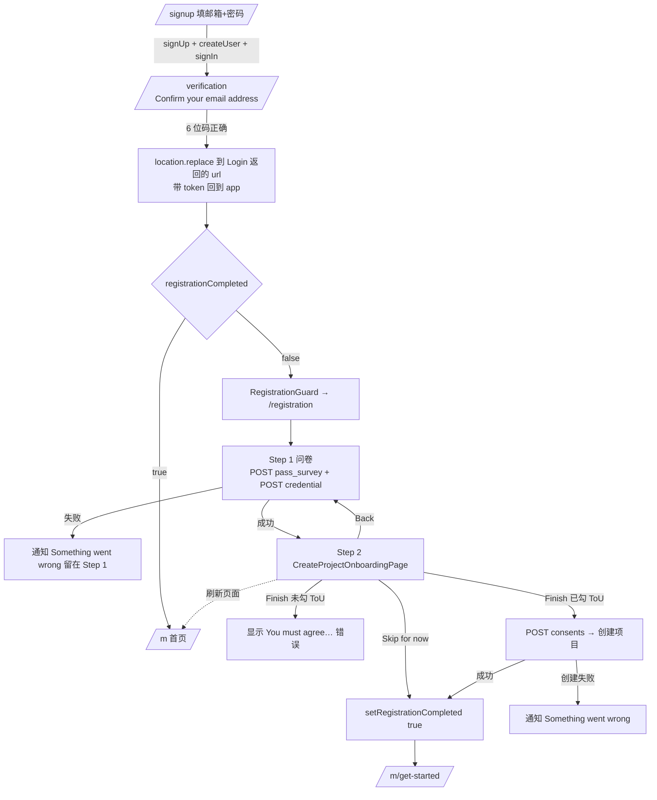
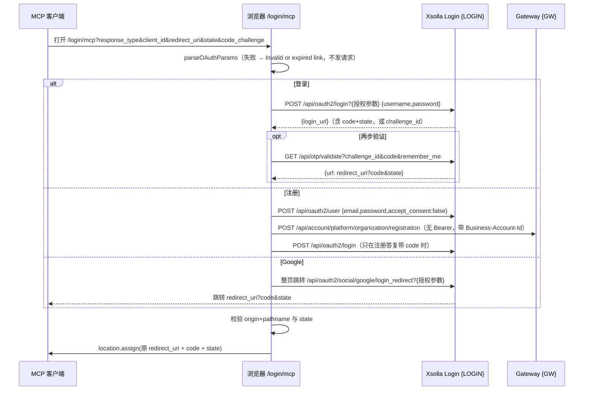

# T5 回归测试用例：注册 · MCP 登录

| 项 | 值 |
|---|---|
| Track | T5 注册·MCP 登录（§4.11 REG、§4.12 MCP、§5/§2.4 outside 路由与 SDK guard 效果表、§7 相关 endpoint、AC-06、AC-09、T-01、S-27/S-28/S-33、U-01/U-03/U-13 相关部分） |
| 基于 spec 版本 | 0.3.0（`web-games-account_reverse_spec.md`；P3 从 0.2.0 定向更新，见文末“P3 变更记录”） |
| 代码基线 | `master@772a320`（`git show 772a320:<path>`） |
| SDK 基线 | 本地 `node_modules/.pnpm` 中的 `platform-shell 2.22.3`、`platform-components 4.20.3`、`platform-pages 3.25.2`、`platform-apis 2.29.2`、`platform-store 1.15.6`、`core 0.9.1`、`platform-locales 2.6.7`。版本与 spec 记录一致。源码从各包 `dist/*.mjs.map` 的 `sourcesContent` 读取 |
| 生成日期 | 2026-10-21 |
| 执行状态 | 本文件只基于源码阅读。用例都没有在 stage 执行过；测试也没有运行 |

## 0. 约定

- `{BASE}` = `https://accounts-sdk-skeleton.nl-k8s-stage.srv.local/for/web-games/account`（stage，只能从内网访问；来源 `e2e/fixtures/env.ts:12,18`）。
- `{LOGIN}` = `https://test-login.xsolla.com`（stage 的 `loginApiUrl`，`src/config.ts`）。
- `{GW}` = stage gateway `platformApiUrl`（`account-platform-gateway.nl-k8s-stage.srv.local`，spec §3.2）。
- `{MCP}` = 合法的 MCP 授权链接。其他 MCP 用例都在它的基础上改一个参数：

```
{BASE}/login/mcp?response_type=code&client_id=222410&redirect_uri=http%3A%2F%2F127.0.0.1%3A33418%2Fcallback&state=qa-t5-state-001&code_challenge=E9Melhoa2OwvFrEMTJguCHaoeK1t8URWbuGJSstw-cM&code_challenge_method=S256
```

- “阻断请求”指 Chrome DevTools → Network → 右键请求 → *Block request URL*。“看网络”指 DevTools Network 面板。
- SDK 源码路径的前缀：`pc/` = `@accounts-sdk/platform-components/src/`，`pp/` = `platform-pages/src/`，`pa/` = `platform-apis/src/`，`ps/` = `platform-store/src/`，`sh/` = `platform-shell/src/`。
- 页面文案取自 `platform-locales 2.6.7` 的 `en` 和 772a320 的 `src/locales/en.json`。
- `[分支差异]` 指当前分支 `WASP-2524-migrate-tests-to-apps`（代码在 `apps/web-games/`）在同一处行为不同。stage 当前部署的版本见下一条。
- **stage 部署版本适用性。** stage 实测部署 `c1b5e37`，比 `772a320` 早 52 个 commit（其中 28 个改动 `src`；`git log --oneline c1b5e37..772a320 -- src`）。本文件的预期按 `772a320` 写，以下差异使部分用例不能在当前 stage 执行：
  - **MCP 登录不在 stage 上。** `c1b5e37` 没有 `src/core/mcp/`、`src/layouts/mcp-login/`，路由中也没有 `/login/mcp`（由 `3a37c8f` 及之后的 MCP 提交加入，`git merge-base --is-ancestor 3a37c8f c1b5e37` 为否）。所有 RT-MCP-* 标 `[stage@c1b5e37 不适用]`。
  - **onboarding 的 ToU 勾选框不在 stage 上。** 勾选框来自 `cfad95a`（BIZA-489，配套 `89a1dd4`），`git merge-base --is-ancestor cfad95a c1b5e37` 为否。stage 的 Step 2 是 host 自己的 `ProjectForm` + Back / Skip for now / Finish：没有 ToU 勾选框，不发 `legal-documents/current` 和 `consents`，Finish 只在提交中或选项加载中禁用，项目由 host 调 `createProject`。完全依赖该勾选框的用例标 `[stage@c1b5e37 不适用]`：RT-CONSENT-001/002、RT-REG-028/029。
  - **部分适用。** 标 `[stage@c1b5e37 部分适用]` 的用例在 stage 上跳过对应步骤，其余步骤照常执行：RT-REG-001/023/025（跳过 ToU 与 consents 部分）、RT-REG-026（stage 注册不提交 consent，ToU 状态转变不发生）、RT-REG-003、RT-CONSENT-014、RT-CONSENT-023（跳过 `/login/mcp` 一项）。
  - **SDK 版本不同。** `c1b5e37` 使用 `platform-components 4.20.1`、`platform-pages 3.25.1`、`platform-shell 2.22.1`、`platform-apis 2.29.0`、`platform-store 1.15.3`、`platform-locales 2.6.5`。本文件的 SDK 行号按 772a320 的版本（4.20.3 等）核对，stage 上 guard 的行为没有按旧版本复核；结果不一致时先对照版本。
  - 仅因本条加标注的用例也在“追溯”列追加 `[P3]`；文末变更记录把“内容修改”和“仅 stage 标注”分开列出。
- 自动化列中的 “772a320 单测” 在当前分支上**已删除**（v1 `src/` 已移除，只剩 `src/__integration__/`）。

## 1. 流程图

### 1.1 注册流程（signup → verification → registration → 落地）



### 1.2 MCP 登录（`/login/mcp`）



## 2. 用例

### 2.1 REG：注册问卷与流程

| ID | 场景 | 前置条件（账号/角色/数据） | 步骤 | 预期结果 | 优先级 | 追溯 | 自动化 |
|---|---|---|---|---|---|---|---|
| RT-REG-001 `[stage@c1b5e37 部分适用]` | 端到端注册（勾选 ToU 并创建项目） | 全新邮箱 A1；打开 DevTools Network | 1. 打开 `{BASE}/signup`，注册 A1。2. 在 `/verification` 输入邮件中的 6 位码。3. 在 `/registration` Step 1 填写全部合法字段，点 Next。4. Step 2 填写项目必填项，勾选 ToU，点 Finish | 依次出现 `/verification` → `/registration`。Step 1 提交时依次发出 `POST {GW}/api/account/platform/organization/{m}/registration/pass_survey` 和 `POST {GW}/api/account/platform/users/{userId}/credential`。Finish 时先发 `POST /mapi/merchant/organizations/{m}/legal-documents/consents`（每份已加载的文档一次），再发 `POST {GW}/api/project/{m}/create`。最后 URL = `{BASE}/{m}/get-started`（AC-06 后半段）。stage@c1b5e37：Step 2 没有 ToU 勾选框，不发 consents，直接创建项目。`[分支差异]` 当前分支在 Step 1 成功后 invalidate init-info 查询（`@platform-templates/store` `useCompleteRegistration`），如果后端此时已返回 `is_completed=true`，RegistrationGuard 可能在 Step 2 之前就跳走，**待确认** | P0 | OBS-REG-001、AC-06、T-01；`src/pages/Registration/Registration.tsx:31-48`、`config.ts:7-9`、`src/core/store/slices/registration.ts:21-63`；`pa/apis/registration.ts:13-28`；`pa/apis/project.ts:286-301` [P3] | I13（772a320，Step 2 用 stand-in，stand-in 的 ToU 规则错误，见 T-01；分支 phase 2c 未开始）；`Registration.test.tsx`、`RegistrationForm.test.tsx`（772a320 单测） |
| RT-REG-002 | 未完成注册的用户深链 merchant 路由 | A2（已注册、问卷未填） | 登录后打开 `{BASE}/{m}/dashboard` | URL 被 replace 为 `{BASE}/registration`，显示 Step 1 标题 “Let's get you set up” | P0 | OBS-MAG-003；`src/routes/useMerchantAccessGuard.ts:131-135`；`pc/auth/RegistrationGuard/index.tsx:23-25` | I3（772a320；分支 phase 2b 未开始） |
| RT-REG-003 `[stage@c1b5e37 部分适用]` | 未完成注册的用户访问其他 outside / top-level 路由 | A2 已登录 | 依次打开 `{BASE}/`、`/login`、`/signup`、`/verification`、`/enter-account`、`/legal-consent`、`/error`、`/forbidden`、`/not-found`、`/account-no-access`、`/account-restricted`、`/login/mcp`（用 `{MCP}`；stage@c1b5e37 跳过此项） | 每个地址都被重定向到 `/registration`（RegistrationGuard 只放行 `/registration`；§2.4 SDK guard 效果表 `registrationCompleted === false` 一行，两列都是 → `/registration`） | P1 | OBS-AUTH-009、OBS-REG-001、§2.4 SDK guard 效果表；`pc/auth/RegistrationGuard/index.tsx:21-25`；`sh/PlatformShell.tsx:193-239` [P3] | — |
| RT-REG-004 | 已完成注册的用户再次访问注册页 | A3（owner，注册完成） | 打开 `{BASE}/registration` | 重定向到 `{BASE}/{m}`，再由首页逻辑落到 `/dashboard` 或 `/get-started`。不渲染问卷 | P0 | OBS-REG-001；`pc/auth/RegistrationGuard/index.tsx:27-29` | — |
| RT-REG-005 | 未登录访问注册页 | 无会话（无痕窗口） | 打开 `{BASE}/registration` | `window.location.replace` 到 `{BASE}/login`。`/registration` 不在免登录白名单中 | P1 | `pa/utils/checkDisallowedUrls.ts`；`pa/constants/allowed-unauthorized-urls.ts:1-15` | — |
| RT-REG-006 | Step 1 布局与文案 | A2 | 打开 `/registration` | 标题 “Let's get you set up”；副标题是占位文案 “Add short description of why you are collecting this information”（已知缺陷 S-27：9 种语言都显示占位文案；切换 locale 抽查 1 种非 en 语言）。字段顺序：First name、Last name、（Other 时出现 Custom job）、Company name、Website（可选，带说明）、Country or region、Job title；按钮 Next。`[分支差异]` 分支改为单一标题 `platform-shared.auth.registration.title`、带步骤指示器、无副标题，Job title 移到 Last name 之后 | P2 | OBS-REG-001、S-27；`Registration.tsx:28-29,71-76`；`src/locales/en.json` `host.pages.registration.step.1.description`；`RegistrationForm.tsx:113-299` [P3] | `Registration.test.tsx`、`RegistrationForm.test.tsx`（772a320） |
| RT-REG-007 | 必填校验 | A2 | 1. 不填任何字段，点 Next。2. 只聚焦后离开 First name | 1. First name、Last name、Company name、Country、Job title 下显示 “Required field”；不发 `pass_survey`。2. 只有被 touched 的字段显示错误 | P1 | OBS-REG-001；`RegistrationForm.tsx:121,145,199,258,284`；`src/core/utils/formValidators.ts:14-25` | `RegistrationForm.test.tsx`（validation，772a320） |
| RT-REG-008 | 只含空白的值 | A2 | First name / Last name / Company name 各输入 3 个空格，点 Next | 三个字段都显示 “Required field”（`required` 先 `trim`） | P1 | `formValidators.ts:14-25` | `RegistrationForm.test.tsx`（772a320） |
| RT-REG-009 | 长度上限 255 | A2 | 分别在 First name、Last name、Company name、Website 输入 255 和 256 个字符（Website 用 `a…a.com` 构造） | 255 通过；256 显示 “Maximum length is 255 characters” | P1 | OBS-REG-001；`RegistrationForm.tsx:121,145,199,231`；`formValidators.ts:31-33` | `RegistrationForm.test.tsx`（Website 255/256，772a320） |
| RT-REG-010 | Job title 选项与 Other | A2 | 1. 展开 Job title。2. 选 Other。3. 不填 Custom job 点 Next。4. 改选 CEO | 1. 9 项依次为 CEO、Game developer、Marketer、Business developer、Product management、Finance、Operations/Monetization、Producer、Other（值 `ceo`…`other`）。2. 出现 Custom job 字段。3. 显示 “Required field”。4. Custom job 字段隐藏 | P1 | `src/pages/Registration/steps/constants.ts:9-57`；`RegistrationForm.tsx:162-187` | `RegistrationForm.test.tsx`（custom job，772a320） |
| RT-REG-011 | Custom job 无长度上限、切走后值是否残留 | A2；Network | 1. 选 Other，Custom job 输入 300 个字符，其余合法，点 Next。2. 另起一次：选 Other 填 “qa”，再改选 CEO，点 Next | 1. 客户端不拦截（`custom_job` 只有 `required`）；后端是否接受**待确认**。2. 检查 `pass_survey` body 是否仍带 `custom_job: "qa"`（final-form 默认卸载字段不清值，**待确认**） | P2 | `RegistrationForm.tsx:170-172` | — |
| RT-REG-012 | Website 合法值 | A2 | 依次填入并点 Next 前观察错误：`example.com`、`https://example.com/path?q=1`、`http://user:pw@example.com`、`example.com:8080`、`ftp://example.com`、`пример.рф`、空值 | 都不显示错误（协议可省略；空值视为可选） | P1 | OBS-REG-002；`src/core/utils/regexp.ts:5-6`；`formValidators.ts:35-36` | `regexp.test.ts`（772a320） |
| RT-REG-013 | Website 非法值 | A2 | 依次填入：`localhost`、`http://127.0.0.1`、`10.0.0.1`、`192.168.1.1`、`172.16.0.1`、`169.254.1.1`、`example.c`、`exa mple.com`、`example.com:8`、` example.com`（前导空格）、`javascript:alert(1)` | 每个值离开字段后显示 “Enter a valid URL” | P1 | OBS-REG-002；`regexp.ts:5-6` | `regexp.test.ts`（772a320） |
| RT-REG-014 | 国家列表加载 | A2；Network；DevTools 节流 Slow 3G | 打开 `/registration` | 列表加载完成前所有字段和 Next 都禁用。请求 `GET /mapi/merchant/current/merchants/{m}/directories/countries`。选项显示国家名，提交值为国家 code | P1 | `RegistrationForm.tsx:58-68,109,310` | `RegistrationForm.test.tsx`（countries，772a320） |
| RT-REG-015 | 国家列表请求失败 | A2；阻断 `directories/countries` | 刷新 `/registration`，尝试选国家 | 预期（代码推断）：Country 下拉为空，无法满足必填，页面没有错误提示，用户无法继续。实际表现**待确认**（缺陷候选） | P2 | `RegistrationForm.tsx:58-68` | — |
| RT-REG-016 | Step 1 提交的请求内容 | A2；Network | 填写合法值（Job title = Finance），点 Next | Next 按钮 loading，字段禁用。`pass_survey` body 为表单值（`first_name`、`last_name`、`job_title`、`company_name`、`country`，可选 `company_website`、`custom_job`）。`credential` body = `{name: "<First> <Last>", job_title: "finance"}`。成功后进入 Step 2 | P1 | `registration.ts:30-57`；`pa/apis/registration.ts:17-28` | `registration.test.ts`（772a320） |
| RT-REG-017 | 问卷提交失败 | A2；阻断 `pass_survey` | 填合法值，点 Next；然后取消阻断再点 Next | 第一次：通知 “Something went wrong. Please try again.”，留在 Step 1，值保留。第二次：进入 Step 2 | P1 | `RegistrationForm.tsx:92-94` | `RegistrationForm.test.tsx`（submit 失败，772a320） |
| RT-REG-018 | 问卷成功但 profile 更新失败 | A2；只阻断 `users/{id}/credential` | 填合法值，点 Next；取消阻断后再点 Next | 第一次：显示同一错误通知，留在 Step 1（此时 `pass_survey` 已成功）。第二次：`pass_survey` **再次发送**。后端对重复提交的处理**待确认**（U-13 未关闭）；若后端此时已置 `is_completed=true`，刷新页面会直接离开 `/registration`（见 RT-REG-020） | P2 | U-13；`registration.ts:28-61`（注释 :12 “flips registration_data.is_completed server-side”） [P3] | `RegistrationForm.test.tsx`（profile 失败，772a320） |
| RT-REG-019 | Step 2 点 Back | A2 已完成 Step 1 | 在 Step 2 点 Back，再点 Next | 回到 Step 1，表单恢复先前填写的值（772a320）。再次 Next 会再次发送 `pass_survey` 和 `credential`。`[分支差异]` 分支删除了 `initialValues` 恢复逻辑，回到 Step 1 时表单为空 | P1 | `Registration.tsx:50-52`；`RegistrationForm.tsx:70-71`；`CreateProjectStep.tsx:46` | `Registration.test.tsx`、`RegistrationForm.test.tsx`（initial values，772a320） |
| RT-REG-020 | Step 2 刷新页面 | A2 已完成 Step 1，停在 Step 2 | 按 F5 | 预期（spec OBS-REG-001 “Refresh during Step 2” [I]，需 stage 确认）：步骤状态只在组件内存中；后端已在 Step 1 置 `is_completed=true`，刷新后 `registrationCompleted=true`，RegistrationGuard 把 `/registration` 重定向到 `/{m}`，**Step 2（项目 + ToU）被跳过**，项目与 consent 都没有提交（S-33）。记录实际落地页和是否出现 `/legal-consent`（同一 tab 内有 signup 抑制标记，见 RT-CONSENT-012） | P1 | OBS-REG-001、S-33、U-13；`Registration.tsx:22-23`；`registration.ts:12,16-19`；`pc/auth/RegistrationGuard/index.tsx:27-29` [P3] | — |
| RT-REG-021 | Step 1 刷新页面 | A2，未提交 | 填一半，F5 | 仍在 `/registration` Step 1，表单清空 | P2 | `Registration.tsx:22-23` | — |
| RT-REG-022 | Step 2 按浏览器后退 | A2 已完成 Step 1 | 在 Step 2 按浏览器 Back | 步骤切换不产生 history 记录，后退会离开 `/registration`。落地页取决于上一条 history 和 RT-REG-020 的服务端状态，**待确认**；不应出现白屏或死循环 | P2 | `Registration.tsx:31-52` | — |
| RT-REG-023 `[stage@c1b5e37 部分适用]` | Step 2 项目必填项 | A2 在 Step 2 | 勾选 ToU（stage@c1b5e37 无勾选框，跳过），不填项目字段，点 Finish | 项目表单显示必填错误（项目类型、名称 `name[en]` ≤255、平台、变现方式、开发阶段，游戏类型还有 genre / engine，以 SDK `ProjectForm` 为准）。不发 consents，也不创建项目 | P1 | `pp/projects/CreateProjectOnboarding.tsx:177-191`；`pc/ProjectForm/index.tsx:275,398-405,605,662,703,757,804` [P3] | — |
| RT-REG-024 | Skip for now | A2 在 Step 2 | 不勾 ToU，点 Skip for now | URL = `/{m}/get-started`。不发 consents，不创建项目。同一 tab 内不被 `/legal-consent` 拦截（见 RT-CONSENT-012） | P1 | OBS-REG-001；`CreateProjectStep.tsx:32-34`；`Registration.tsx:42-45` | `CreateProjectStep.test.tsx`（skip，772a320）；I13 stand-in 有 Skip 按钮但未断言 |
| RT-REG-025 `[stage@c1b5e37 部分适用]` | 项目创建失败 | A2 在 Step 2；阻断项目创建请求 `POST {GW}/api/project/{m}/create` | 填合法项目，勾 ToU，点 Finish；取消阻断后再点 Finish | 第一次：consents 先 POST 成功，然后通知 “Something went wrong”，留在 Step 2（consent 已记录）。第二次：consents 再次 POST，然后项目创建成功，落到 `/{m}/get-started`。stage@c1b5e37：没有 consents 请求，只验证通知和重试 | P1 | OBS-REG-001（Submit order）、S-28；`pp/projects/CreateProjectOnboarding.tsx:125-154`；`pa/apis/project.ts:286-301` [P3] | — |
| RT-REG-026 `[stage@c1b5e37 部分适用]` | 注册完成后不进 `/enter-account` | A1 新注册 owner；清空该站点 localStorage | 完成 RT-REG-001 | 落到 `/{m}/get-started`，不被 EnterAccountGate 替换为 `/enter-account`（ToU 从 needs→accepted 的转变会写入 `ba.web-games.enterAccountSeen.<userId>`）。Skip 路径下 `needsAcceptance=true`，EnterAccountGate 也不跳转。实际结果**待确认** | P1 | `pc/auth/EnterAccountGate/useEnterAccountGate.ts:96-121,149-176` [P3] | — |
| RT-REG-027 | merchant 数据加载失败 | A2；阻断 `/api/account/platform/users/get_init_info` | 刷新 `/registration` | 772a320：显示 500 错误页 “Something went wrong / An unexpected error occurred. Please try again later.”（`data-id=merchant-required-error`），不无限转圈。`[分支差异]` 分支去掉了 `withMerchantRequired`，没有 merchant 时返回 `null`（空白页） | P2 | `src/core/hocs/withMerchantRequired.tsx:41-71`；`Registration.tsx:88` | `Registration.test.tsx`（merchant guard，772a320） |
| RT-REG-028 `[stage@c1b5e37 不适用]` | Step 2 法律文档加载失败 | A2 在 Step 2 之前；Network | 1. 同时阻断 `GET /mapi/merchant/legal-documents/current?type=terms` 和 `type=privacy`，进入 Step 2，填合法项目，勾 ToU，点 Finish 两次。2. 点 Skip for now。3. 另一个 A2：只阻断 `type=privacy`，勾 ToU，点 Finish | 1. 每次点击都显示 “You must agree to the Terms of Use and Privacy Policy”（`legalConsents` 为空），不发 consents，不创建项目。2. 落到 `/{m}/get-started`，Skip 是唯一出路。3. 只 POST 一次 terms 的 consent，然后创建项目 | P2 | OBS-REG-001（Partial or failed legal documents）、S-28；`pp/projects/CreateProjectOnboarding.tsx:111-113,125-135,181-188` | — |
| RT-REG-029 `[stage@c1b5e37 不适用]` | Step 2 consent 提交失败 | A2 在 Step 2；阻断 `POST …/legal-documents/consents` | 填合法项目，勾 ToU，点 Finish；记录页面和 Console；取消阻断后再点 Finish | 第一次：不创建项目（consent 先于项目创建，`await` 失败后不继续），留在 Step 2。spec 推断没有组件级提示 [I]，实际是否有通知、Finish 是否恢复可用**待确认**。第二次：consents 和项目创建都成功，落到 `/{m}/get-started` | P2 | OBS-REG-001、S-28；`pp/projects/CreateProjectOnboarding.tsx:125-135` | — |

### 2.2 VERIFY：邮箱验证 / 两步验证页（`/verification`）

| ID | 场景 | 前置条件（账号/角色/数据） | 步骤 | 预期结果 | 优先级 | 追溯 | 自动化 |
|---|---|---|---|---|---|---|---|
| RT-VERIFY-001 | signup 后进入邮箱确认 | 全新邮箱 A1 | 在 `{BASE}/signup` 填邮箱、密码、确认密码，提交 | URL 变为 `/verification`；标题 “Confirm your email address”；副标题含目标邮箱；6 格验证码输入框；提交按钮为 confirm 文案；有 Keep me logged in 复选框和帮助链接 | P0 | `pp/Login/SignupForm.tsx:244-306`；`pp/Verification.tsx:247`（`from` 含 signup → `title.email`） | e2e `/signup renders the signup form`（只到表单）；`apps/web-games/tests/verification-form.test.tsx`（分支） |
| RT-VERIFY-002 | 验证码错误 | RT-VERIFY-001 之后 | 输入错误 6 位码提交 | 显示 “Incorrect code. Try again.”；停留本页 | P1 | `pp/Verification.tsx:181-193` | `verification-form.test.tsx`（submit errors，分支） |
| RT-VERIFY-003 | 多次输错 | 同上 | 连续输错直到 Login 返回 `300-008` | 显示 “You have entered an incorrect code too many times. Please request a new code and try again. Code was sent to {邮箱}.” | P1 | `pp/Verification.tsx:56,184-188` | — |
| RT-VERIFY-004 | 重新发送验证码 | 同上 | 等待 60 秒倒计时结束，点 Resend | 倒计时期间按钮不可用；点击后输入框清空，邮箱收到新码，新码可通过 | P1 | `pp/Verification.tsx:49,107-116` | `verification-form.test.tsx`（resend，分支） |
| RT-VERIFY-005 | 验证码格式 | 同上 | 输入 5 位、含字母的值 | 校验要求必填、纯数字、正好 6 位；不满足时不能通过（具体提示以页面为准） | P2 | `pp/Verification.tsx:58-62` | — |
| RT-VERIFY-006 | 验证成功后进入注册 | 同上 | 输入正确码 | `window.location.replace` 到 Login 返回的 `url`，带会话回到 app，最终落到 `/registration` Step 1 | P0 | `pp/Verification.tsx:178`；`pa/utils/auth.ts:44-50`；`RegistrationGuard:23-25` | — |
| RT-VERIFY-007 | 登录时的两步验证 | A7（Login 开启 2FA 的已注册账号） | `{BASE}/login` 用 A7 登录 | 跳到 `/verification`，标题 “Two-step verification”；正确码后进入 `/{m}` | P2 | `pp/Login/LoginForm.tsx:5-6`；`pp/Verification.tsx:247-250` | — |
| RT-VERIFY-008 | 直接打开 `/verification` | 无会话 | 打开 `{BASE}/verification` | 不被重定向到 `/login`（白名单）；页面可渲染但没有 `challenge_id`，提交任意码应失败。实际提示**待确认** | P2 | `pa/constants/allowed-unauthorized-urls.ts:2`；`pp/Verification.tsx:94-104` | — |
| RT-VERIFY-009 | signup 使用已存在的邮箱 | A3 的邮箱 | 在 `/signup` 用 A3 邮箱注册 | Email 字段下显示 “User with this email already exists”（gateway `http_status_code=404`）或 Login 返回的 description；不跳转 | P1 | `pp/Login/signupErrors.ts`（404 → `emailExists`；Login `error.description`） | — |

### 2.3 CONSENT：法律协议、enter-account 与其他 outside 路由

| ID | 场景 | 前置条件（账号/角色/数据） | 步骤 | 预期结果 | 优先级 | 追溯 | 自动化 |
|---|---|---|---|---|---|---|---|
| RT-CONSENT-001 `[stage@c1b5e37 不适用]` | Step 2 未勾 ToU 点 Finish | A2 在 Step 2，法律文档已加载，项目字段合法 | 1. 不勾 ToU，观察 Finish 状态，再点击。2. 勾选 ToU，再点 Finish | 1. **Finish 可点击**（只在表单选项加载中、法律文档加载中、提交中禁用；勾选与否不影响）。点击后 ToU 复选框下显示 “You must agree to the Terms of Use and Privacy Policy”（`platform-shared.auth.signup.legalDocumentConsent.required`），不发请求。勾选后错误消失。2. POST consents，创建项目，URL 变为 `/{m}/get-started`。与 AC-06 一致 | P1 | AC-06、OBS-REG-001、T-01；`pp/projects/CreateProjectOnboarding.tsx:106-109,177-191,200-201,273-283` [P3] | I13 stand-in 断言的是“禁用”（`src/__integration__/uiStandIns.tsx:91-108`），是测试资产缺陷 T-01，修正前 I13 不能作为本用例的自动化覆盖 |
| RT-CONSENT-002 `[stage@c1b5e37 不适用]` | Step 2 的 ToU / PP 链接 | A2 在 Step 2；Network | 点 Terms of Use、Privacy Policy 链接 | 新 tab 打开当前版本文档。页面请求 `GET /mapi/merchant/legal-documents/current?type=terms` 和 `type=privacy` | P2 | `pc/LegalDocumentConsent/LegalDocumentConsent.tsx`；`pa/apis/legal-document.ts:44-60` [P3] | — |
| RT-CONSENT-003 | owner 有待签 ToU | A4（owner，merchant 有 `needs_acceptance=true` 的文档） | 新会话登录，打开 `{BASE}/{m}/dashboard` | URL 变为 `/legal-consent`；标题 “This account needs to be set up” 类文案（`accountAccess.noAccess.needsSetup.title`）、复选框、Continue 按钮 | P0 | OBS-REG-003；`pc/auth/LegalDocumentConsentGuard/index.tsx:214-243` | I14（772a320，guard 用 stand-in；分支 phase 2a 未开始） |
| RT-CONSENT-004 | 非 owner 有待签 ToU | A5（A4 merchant 的 viewer / 成员） | 打开 `{BASE}/{m}/dashboard` | URL 变为 `/account-no-access`；显示 needsSetup 文案和 Learn more 按钮（新窗口） | P0 | OBS-REG-003；`LegalDocumentConsentGuard/index.tsx:246-267`；`src/layouts/account-access/no-access/index.tsx:12-17` | I14（772a320） |
| RT-CONSENT-005 | 已全部接受（对照组） | A3 | 打开 `{BASE}/{m}/dashboard` | 直接进入 Dashboard | P1 | `LegalDocumentConsentGuard/index.tsx:282` | I14 control（772a320） |
| RT-CONSENT-006 | `/legal-consent` 页交互 | A4 停在 `/legal-consent` | 1. 文档加载期间观察 Continue。2. 不勾选点 Continue | 1. 文档列表为空时 Continue 和复选框禁用。2. 显示 “You must agree to the Terms of Use and Privacy Policy”，不发请求 | P1 | `pp/LegalConsent.tsx:55-63,105,116` | — |
| RT-CONSENT-007 | 同意后回到原深链 | A4，从 `/{m}/dashboard` 被拦截 | 勾选，点 Continue | 每份待签文档各发一次 `POST /mapi/merchant/organizations/{m}/legal-documents/consents`，然后重新 `GET …/consents/status`。之后重定向回 `state.from`（`/{m}/dashboard`）。刷新后不再被拦截 | P0 | `pp/LegalConsent.tsx:51-75`；`ps/slices/legalDocuments.ts:57-71`；`LegalDocumentConsentGuard/index.tsx:271-280` | — |
| RT-CONSENT-008 | 同意请求失败 | A4；阻断 `legal-documents/consents`（POST） | 勾选，点 Continue | 复选框下显示异常的 `error.message` 原文（如 “Request failed with status code …” 或网络错误文本），不是本地化文案（**文案缺陷候选**）；留在本页 | P2 | `pp/LegalConsent.tsx:69-74` | — |
| RT-CONSENT-009 | 角色与页面不匹配 | A4、A5 | 1. A4 打开 `/account-no-access`。2. A5 打开 `/legal-consent` | 1. A4 被重定向到 `/legal-consent`。2. A5 被重定向到 `/account-no-access` | P1 | `LegalDocumentConsentGuard/index.tsx:223-232,247-256` | — |
| RT-CONSENT-010 | 已无待签时访问同意页 | A3 | 直接打开 `/legal-consent`、`/account-no-access` | 都重定向到 `/{m}` | P1 | `LegalDocumentConsentGuard/index.tsx:271-280` | — |
| RT-CONSENT-011 | Xsolla admin 不受拦截 | A6（`user.admin`），打开 A4 的 merchant | 1. 打开 `{BASE}/{A4 m}/dashboard`。2. 打开 `/legal-consent` | 1. 直接进入，不发 `consents/status`。2. 重定向到 `/{m}` | P1 | `LegalDocumentConsentGuard/index.tsx:137-140,186-198` | — |
| RT-CONSENT-012 | 新注册账号的 ToU 抑制（只在当前 tab 会话） | 用 RT-REG-024 选 Skip 的新账号 | 1. 同一 tab 刷新 `/{m}/dashboard`。2. 查看 sessionStorage `ba.signupLegalSuppress`。3. 关闭 tab，新 tab 登录后打开 `/{m}/dashboard` | 1. 不被拦截。2. 值为 `{m}`（注册期间先写 `pending`，进入 merchant 后改写为 merchant id）。3. 新 tab 没有该键；若后端对 Skip 后的新会话返回 `needs_acceptance`（spec [I]，U-13 未关闭），owner 被拦截到 `/legal-consent`。记录 `consents/status` 的实际返回 | P1 | OBS-REG-001（Skip for now）、OBS-REG-003、U-13；`LegalDocumentConsentGuard/index.tsx:114-127,220-222`；`pa/utils/signupLegalSuppressStorage.ts:26-56` [P3] | I14 stand-in 明确未覆盖该分支（`shellGuards.tsx` 注释） |
| RT-CONSENT-013 | 同意状态请求失败或超时 | A4；阻断 `consents/status` | 打开 `/{m}/dashboard` | fail-open：进入 Dashboard，不拦截（失败时 items 置空）。若请求挂起，最多显示 11 秒 loading，10 秒后放行（挂起场景的复现方式**待确认**） | P2 | `LegalDocumentConsentGuard/index.tsx:41,168-173,209-211`；`ps/slices/legalDocuments.ts:92-96` | — |
| RT-CONSENT-014 `[stage@c1b5e37 部分适用]` | 公开路径不做同意检查 | A4 已登录 | 打开 `{MCP}`（stage@c1b5e37 跳过）、`{BASE}/verification`、`{BASE}/invite/1` | 不被重定向到 `/legal-consent`（`/login`、`/signup`、`/verification`、`/resetting`、`/registration`、`/invite` 按路径段匹配，`/login/mcp` 含 `login` 段；§2.4 SDK guard 效果表 ToU 待签一行） | P1 | OBS-REG-003、§2.4 SDK guard 效果表；`LegalDocumentConsentGuard/index.tsx:24-31,47-50,201-203` [P3] | — |
| RT-CONSENT-015 | `/account-restricted` 文案 | A3 | 打开 `{BASE}/account-restricted` | 显示 restricted 变体文案（与 `/account-no-access` 不同） | P2 | `src/layouts/account-access/no-access/index.tsx:12-17` | `no-access/index.test.tsx`（772a320） |
| RT-CONSENT-016 | 首次进入站点的 enter-account | A3（非 admin owner，ToU 已签）；删除 localStorage `ba.web-games.enterAccountSeen.<userId>` | 刷新 `{BASE}/{m}` | 被 replace 到 `/enter-account`；点 Enter account → `/{m}` → 首页。刷新后不再出现 | P1 | `src/layouts/account-access/enter-account/index.tsx:12-24`；`useEnterAccountGate.ts:149-176`；`pa/utils/enterAccountStorage.ts:5-22` | `enter-account/index.test.tsx`（772a320，只测按钮） |
| RT-CONSENT-017 | enter-account 不对其他角色生效 | A5（viewer）、A6（admin），各自删除对应 localStorage 键 | 打开 `{BASE}/{m}` | 都不跳 `/enter-account` | P2 | `useEnterAccountGate.ts:150-152` | — |
| RT-CONSENT-018 | 已看过时直接访问 `/enter-account` | A3，键已存在 | 打开 `{BASE}/enter-account` | replace 到 `/{m}` | P2 | `useEnterAccountGate.ts:125-147` | — |
| RT-CONSENT-019 | 未登录访问受保护的 outside 页 | 无会话 | 依次打开 `/legal-consent`、`/account-no-access`、`/enter-account`、`/forbidden` | 都跳到 `{BASE}/login`（这些路径不在免登录白名单）。跳转前原路径写入 60 秒 cookie（DevTools → Application → Cookies 查看）。60 秒内登录后是否回到原路径，记录实际结果 | P2 | §2.4 SDK guard 效果表（无 token 一行）；`pa/utils/checkDisallowedUrls.ts:4-48`；`allowed-unauthorized-urls.ts:1-15` [P3] | — |
| RT-CONSENT-020 | `/error` 页 | 1. 无会话。2. A3 已登录，且 localStorage 中已有 `ba.web-games.enterAccountSeen.<userId>`（否则 EnterAccountGate 会把 `/error` 替换为 `/enter-account`，见 RT-CONSENT-023） | 打开 `{BASE}/error` | 1. 不跳登录；显示 “Something went wrong / An unexpected error occurred. Please try again later.” 和 NavigationLite。2. 预期（代码推断）仍显示 NavigationLite 而非完整导航：`authorized` 读 `state.user.id`，而用户数据在 `state.user.user`（**待确认**，单测对应用例为 `it.skip`） | P2 | §2.4 SDK guard 效果表；`src/layouts/error/index.tsx:7-19`；`allowed-unauthorized-urls.ts:3` [P3] | `error/index.test.tsx`（signed-in 用例 `it.skip`，772a320） |
| RT-CONSENT-021 | 未知 outside 路径 | 1. 无会话。2. A3，localStorage 中已有 `ba.web-games.enterAccountSeen.<userId>` | 打开 `{BASE}/qa-unknown-path` | 1. 先到 `/not-found`，再被替换到 `/login`（`/not-found` 不在白名单；`/not-found` 不写入原路径 cookie）。2. 显示 not-found 页 | P2 | §2.4 SDK guard 效果表；`src/routes.tsx:162`；`src/routes/not-found.tsx:4` [P3] | e2e 注释描述了该链路（`anonymous.smoke.spec.ts:88-90`） |
| RT-CONSENT-022 | ToU 待签时访问无 host guard 的 top-level 页 | A4（owner）、A5（非 owner）各自登录 | 依次打开 `{BASE}/error`、`/forbidden`、`/not-found`、`/enter-account` | A4 每次都被重定向到 `/legal-consent`；A5 每次都被重定向到 `/account-no-access`。对照：`/verification` 不被重定向（RT-CONSENT-014） | P2 | OBS-REG-003、§2.4 SDK guard 效果表（ToU 待签一行）；`pc/auth/LegalDocumentConsentGuard/index.tsx:24-31,201` | — |
| RT-CONSENT-023 `[stage@c1b5e37 部分适用]` | EnterAccountGate 在 top-level 页上的效果 | A3（非 admin owner，ToU 已签）；每一步前删除 localStorage `ba.web-games.enterAccountSeen.<userId>` | 分别打开 `{BASE}/error`、`/forbidden`、`/not-found`、`/verification`、`{MCP}`（stage@c1b5e37 跳过） | `/error`、`/forbidden`、`/not-found`：`history.replace` 到 `/enter-account`。`/verification`、`/login/mcp`：不跳转（在 skip 前缀 `/verification`、`/login` 下） | P2 | §2.4 SDK guard 效果表（EnterAccountGate 一行）；`pc/auth/EnterAccountGate/useEnterAccountGate.ts:20-42,149-176` | — |

### 2.4 MCP：`/login/mcp`

参数非法时，页面只显示站点名标题和 “Invalid or expired link”（`platform-shared.auth.invite.invalid-link.title`），没有表单，也**不向 `{LOGIN}` 发任何请求**（AC-09）。下表 MCP-004 至 MCP-010 的“预期”都指这个结果。本节全部用例在 stage@c1b5e37 上不适用（该构建没有 `/login/mcp`，见 §0）。

| ID | 场景 | 前置条件（账号/角色/数据） | 步骤 | 预期结果 | 优先级 | 追溯 | 自动化 |
|---|---|---|---|---|---|---|---|
| RT-MCP-001 `[stage@c1b5e37 不适用]` | 合法链接渲染表单（未登录） | 无会话（无痕） | 打开 `{MCP}` | 不跳 `/login`（`login` 段在免登录白名单）。显示站点名、Sign in / Sign up 切换、Email、Password、Sign in（两项都填前禁用）、Forgot password、Google 按钮、gamer support 链接。`[分支差异]` 标题站点名改由 `useSubSite({siteId})` 获取 | P0 | OBS-MCP-001、§2.4 SDK guard 效果表（无 token 时 `/login/mcp` 放行）；`src/layouts/mcp-login/index.tsx:126-132,376-501`；`allowed-unauthorized-urls.ts:6` [P3] | e2e `/login/mcp renders the MCP login form`（`test.skip`）；`mcp-login/index.test.tsx`（772a320） |
| RT-MCP-002 `[stage@c1b5e37 不适用]` | 账号密码登录成功（无 2FA） | A3 凭据；Network；本机 33418 端口无服务也可 | 在 `{MCP}` 输入 A3 邮箱和密码，点 Sign in | 请求 `POST {LOGIN}/api/oauth2/login?response_type=code&client_id=222410&redirect_uri=…&state=qa-t5-state-001&scope=offline&code_challenge=…&code_challenge_method=S256`，body `{username,password,remember_me:false}`。随后地址栏变为 `http://127.0.0.1:33418/callback?code=<非空>&state=qa-t5-state-001`（连接失败可以接受）。不调用 `{BASE}/server/token`，不写 web-games 会话 | P0 | OBS-MCP-002/003；`src/core/mcp/oauthLogin.ts:105-119,131-163,205-216`；`index.tsx:322-330` [P3] | `oauthLogin.test.ts`（oauthSignIn，772a320） |
| RT-MCP-003 `[stage@c1b5e37 不适用]` | 密码错误 | A3 | 输入错误密码登录 | 表单下显示 Login 的 `error.description`；没有 description 时显示 “Login failed. Please try again.”。表单恢复可用 | P1 | `oauthLogin.ts:112-114`；`index.tsx:363-372` [P3] | `mcp-login/index.test.tsx`（772a320） |
| RT-MCP-004 `[stage@c1b5e37 不适用]` | 缺少全部参数 | 无 | 打开 `{BASE}/login/mcp` | invalid-link，无表单，无 Login 请求 | P1 | AC-09；`oauthLogin.ts:38-46`；`index.tsx:134-143` [P3] | e2e `…without authorize parameters…`（`test.skip`） |
| RT-MCP-005 `[stage@c1b5e37 不适用]` | `response_type` 非法 | 无 | 在 `{MCP}` 中分别：删掉 `response_type`；改为 `response_type=token` | invalid-link | P1 | `oauthLogin.ts:41-43` [P3] | `oauthLogin.test.ts`（772a320） |
| RT-MCP-006 `[stage@c1b5e37 不适用]` | PKCE 方法非法 | 无 | 分别：删掉 `code_challenge_method`；改为 `plain`；改为 `s256`（小写） | invalid-link | P1 | `oauthLogin.ts:44` [P3] | `oauthLogin.test.ts`（772a320） |
| RT-MCP-007 `[stage@c1b5e37 不适用]` | `code_challenge` 非法 | 无 | 分别：删掉；257 个 `a`；含 `%2B`（解码为 `+`）；含 `%3D`（`=`）；含 `%2F`（`/`） | invalid-link。另：恰好 256 个 `a`、含 `.~-_` 的值应**通过** | P1 | `oauthLogin.ts:29,44` [P3] | `oauthLogin.test.ts`（最长值与字符集，772a320） |
| RT-MCP-008 `[stage@c1b5e37 不适用]` | `client_id` 非法 | 无 | 分别：删掉；`client_id=abc`；`client_id=18644`（production 的 id）；21 位数字；`client_id=0222410` | invalid-link（stage 白名单只有 `222410`，且必须是 1–20 位数字） | P0 | AC-09；`oauthLogin.ts:47-52`；`src/config.ts:140-144` [P3] | `oauthLogin.test.ts`（772a320） |
| RT-MCP-009 `[stage@c1b5e37 不适用]` | `state` 非法 | 无 | 分别：删掉；257 个字符；`state=a%20b`；`state=a%2Fb` | invalid-link。256 个字符应通过 | P1 | `oauthLogin.ts:53-55` [P3] | `oauthLogin.test.ts`（772a320） |
| RT-MCP-010 `[stage@c1b5e37 不适用]` | `redirect_uri` 非法 | 无 | `redirect_uri` 分别改为（需 URL 编码）：缺失；`/callback`；`http://example.com/cb`；`http://127.evil.com/cb`；`https://example.com/cb#frag`；`ftp://example.com/cb`；`javascript:alert(1)` | invalid-link（相对地址无法解析；非 loopback 的 http；带 fragment；非 http(s) 协议） | P0 | AC-09；`oauthLogin.ts:30-32,56-67` [P3] | `oauthLogin.test.ts`（772a320） |
| RT-MCP-011 `[stage@c1b5e37 不适用]` | `redirect_uri` 合法变体 | 无 | `redirect_uri` 分别改为：`http://localhost:8080/cb`；`http://[::1]:8080/cb`；`http://127.0.0.5/cb`；`https://example.com/cb?x=1`；`https://example.com/cb#`（空 fragment） | 都渲染登录表单。空 fragment `#` 因 `URL.hash === ''` 也会通过（spec 0.3.0 OBS-MCP-001 与 AC-09 已写明：只拒绝非空 fragment） | P2 | OBS-MCP-001、AC-09；`oauthLogin.ts:62-67` [P3] | `oauthLogin.test.ts`（772a320，无空 fragment 用例） |
| RT-MCP-012 `[stage@c1b5e37 不适用]` | `scope` 默认值与 `audience` 透传 | A3；Network | 1. 用 `{MCP}`（无 scope）登录。2. 加 `&scope=openid&audience=qa-aud` 再登录。3. 加 `&audience=`（空值）再登录 | 1. Login 请求 query 带 `scope=offline`。2. 带 `scope=openid&audience=qa-aud`。3. Login 请求 query 不含 `audience`（只透传非空值）。回调 URL 中的 `redirect_uri` 与原值逐字一致 | P2 | OBS-MCP-001；`oauthLogin.ts:68-79,89-90` [P3] | `oauthLogin.test.ts`（772a320） |
| RT-MCP-013 `[stage@c1b5e37 不适用]` | redirect_uri 未在 Login 客户端注册 | A3；`redirect_uri=https%3A%2F%2Fexample.com%2Fqa-callback` | 打开链接（表单应渲染），用 A3 登录 | 客户端放行，由 Login 服务端拒绝：显示 Login 的错误描述或 “Login failed. Please try again.”，**不跳转**到 example.com。Login 的实际返回**待确认**（spec §8.1 [U]） | P0 | §8.1 MCP；OBS-MCP-001/002；`oauthLogin.ts:12-13,112-114,140-145` [P3] | — |
| RT-MCP-014 `[stage@c1b5e37 不适用]` | 2FA 账号登录成功 | A7；Network | 在 `{MCP}` 用 A7 登录，输入邮件/短信中的码，点 Verify | 出现 “Two-step verification”，副标题含目标邮箱或手机；Verify 在输满 6 位前禁用。请求 `GET {LOGIN}/api/otp/validate?challenge_id=…&code=…&remember_me=false`（码在 query 中）。成功后跳到 `redirect_uri?code&state` | P1 | `oauthLogin.ts:192-202,222-233`；`index.tsx:145-171,232` [P3] | `mcp-login/index.test.tsx`（two-step，772a320） |
| RT-MCP-015 `[stage@c1b5e37 不适用]` | 2FA 码错误 / 次数过多 | A7 | 输入错误码；继续输错直到 `300-008` | 先显示 “Incorrect code. Try again.”，之后显示 “You have entered an incorrect code too many times… Code was sent to {source}.” | P1 | `index.tsx:48,159-169` [P3] | `mcp-login/index.test.tsx`（772a320） |
| RT-MCP-016 `[stage@c1b5e37 不适用]` | 2FA 记住我与重发 | A7；Network | 1. 勾 Keep me logged in 后验证。2. 另一次：等 60 秒后点 Resend | 1. `remember_me=true`。2. `PUT {LOGIN}/api/otp/resend?challenge_id=…`，body `{locale}`；输入清空；失败时显示 Login 的 message 或 “Login failed. Please try again.” | P2 | `index.tsx:46,172-181,247-257`；`oauthLogin.ts:235-237` [P3] | `mcp-login/index.test.tsx`（772a320） |
| RT-MCP-017 `[stage@c1b5e37 不适用]` | 注册密码的本地校验 | 全新邮箱 A1；Network | 切到 Sign up，依次输入密码 `Abc1234`、`abcdefgh1`、`ABCDEFGH1`、`Abcdefgh`、`Abcdefg 1`、`Abcdefg1` 并提交 | 前 5 个分别提示最短 8 位、缺大写、缺小写、缺数字、含不允许字符，且**不发任何请求**。`Abcdefg1`（恰好 8 位）通过校验 | P0 | `index.tsx:50,303-311`；SDK `createPasswordValidator` [P3] | `mcp-login/index.test.tsx`（772a320） |
| RT-MCP-018 `[stage@c1b5e37 不适用]` | MCP 注册成功 | 全新邮箱 A1；Network | Sign up 填 A1 和合法密码，点 Create account | 依次：`POST {LOGIN}/api/oauth2/user`（`username=email`，`accept_consent:false`）；`POST {GW}/api/account/platform/organization/registration`，**无 `Authorization` 头**，带 `Business-Account-Id: web-games`，body `{merchant:{}, user:{email, plainPassword, locale}, extra:{}}`。之后按 Login 答复三选一：(a) 有 code → 再 `POST /api/oauth2/login` 并跳到回调；(b) 有 `challenge_id` → 显示 “Confirm your email address” 与 confirm 按钮；(c) 都没有 → 切回 Sign in 并显示提示 “Confirm your email address”。stage 走哪一支**待确认** | P0 | OBS-MCP-003；`oauthLogin.ts:240-261,330-373`；`index.tsx:331-349` [P3] | `oauthLogin.test.ts`（oauthSignUp，772a320） |
| RT-MCP-019 `[stage@c1b5e37 不适用]` | MCP 注册已存在的邮箱 | A3 的邮箱 | Sign up 用 A3 邮箱注册 | Login 返回 `003-003` 或 `003-004` → 切到 Sign in 标签，提示 “User with this email already exists”，不发 organization registration | P1 | `oauthLogin.ts:287-290`；`index.tsx:355-361`；`src/core/utils/httpResponseCode.ts:12-18` [P3] | `mcp-login/index.test.tsx`（772a320） |
| RT-MCP-020 `[stage@c1b5e37 不适用]` | organization registration 返回非 2xx（字段错误） | 全新邮箱；用 DevTools Local overrides 或代理把 `organization/registration` 改为 400，body 带 `extended_message.property_errors["user.plainPassword"]` | 提交注册 | 表单显示该字段错误的第一条（优先级：`user.plainPassword` → `user.email` → `message` → `error.description`）。没有任何文本时显示 “Sign up failed. Please try again.” | P1 | OBS-MCP-003；`oauthLogin.ts:262-284,360-364`；`index.tsx:352-370` [P3] | `oauthLogin.test.ts`（finishOAuthSignUp，772a320） |
| RT-MCP-021 `[stage@c1b5e37 不适用]` | organization registration 返回 `http_status_code=404` | 同上，把响应改为 4xx，body `{"http_status_code":404}` | 提交注册 | 视为“该邮箱已在平台注册”，**按成功继续**（进入 RT-MCP-018 的 a/b/c 分支）。只有 HTTP 404 而 body 无该字段时按失败处理 | P2 | OBS-MCP-003；`oauthLogin.ts:265-270` [P3] | `oauthLogin.test.ts`（772a320） |
| RT-MCP-022 `[stage@c1b5e37 不适用]` | organization registration 网络失败与重试 | 全新邮箱；阻断 `organization/registration` | 1. 提交注册。2. 取消阻断，用**相同**邮箱和密码再提交。3. 另一次：失败后改密码再提交 | 1. 显示 “Sign up failed. Please try again.”（`RegistrationError` 消息为空）。2. 只重发 `organization/registration`，**不再**调用 `/api/oauth2/user`，然后继续成功流程。3. 改密码后重新走完整注册，Login 返回邮箱已存在 → 切到 Sign in 并提示 “User with this email already exists” | P1 | OBS-MCP-003；`oauthLogin.ts:292-304,351-364`；`index.tsx:103-105,332-339,352-354` [P3] | `mcp-login/index.test.tsx`（retry，772a320） |
| RT-MCP-023 `[stage@c1b5e37 不适用]` | 失败后切换标签会丢弃重试 | RT-MCP-022 第 1 步之后 | 切到 Sign in 再切回 Sign up，用相同凭据提交 | 重新调用 `/api/oauth2/user`（不是只重试 registration）；错误和提示在切换时清空 | P2 | `index.tsx:289-299` [P3] | `mcp-login/index.test.tsx`（772a320） |
| RT-MCP-024 `[stage@c1b5e37 不适用]` | Google 登录 | 无会话；Network | 1. 点 Google 按钮。2. 在 Google 页按浏览器 Back | 1. 按钮立即禁用，整页跳到 `{LOGIN}/api/oauth2/social/google/login_redirect?response_type=code&client_id=222410&redirect_uri=…&state=…&scope=offline&code_challenge=…&code_challenge_method=S256`。2. 从 bfcache 返回时控件恢复可用 | P1 | `oauthLogin.ts:177-179`；`index.tsx:114-124,477-481` [P3] | `oauthLogin.test.ts`、`mcp-login/index.test.tsx`（772a320） |
| RT-MCP-025 `[stage@c1b5e37 不适用]` | Google 完成授权 / 用户在 Google 取消 | Google 测试账号 | 1. 完成 Google 授权。2. 另一次在 Google 同意页点取消 | 1. 最终落到 `redirect_uri?code&state`。2. host 没有授权确认或拒绝界面，取消后的落点和错误参数由 Login 决定，**待确认**（记录实际 URL） | P2 | `oauthLogin.ts:173-179`；§8.1 [U] [P3] | — |
| RT-MCP-026 `[stage@c1b5e37 不适用]` | 已登录 web-games（注册已完成） | A3 已登录；A4 已登录（ToU 待签） | 分别打开 `{MCP}` | 都显示 MCP 表单：不被重定向到 `/{m}`、`/legal-consent` 或 `/enter-account`；不会因已有会话自动签发 code，仍要输入凭据 | P1 | OBS-MCP-003、§2.4 SDK guard 效果表（ToU 待签时 `/login/mcp` 是公开路径；EnterAccountGate 跳过 `/login`）；`useMerchantAccessGuard.ts:65`（`isEntryPath` 不含 `/login/mcp`）；`LegalDocumentConsentGuard:24-31`；`useEnterAccountGate.ts:20-31` [P3] | — |
| RT-MCP-027 `[stage@c1b5e37 不适用]` | 已登录但注册未完成 | A2 已登录 | 打开 `{MCP}` | 被 RegistrationGuard 重定向到 `/registration`，MCP 授权链接丢失，MCP 流程中断。spec 0.3.0 已把它写成 OBS-MCP-003 的 Exception（source-verified，待 stage 运行时确认）：路由注释 “Works with or without a web-games session” 在此情况下不成立（**已知缺陷**） | P1 | OBS-MCP-003（Exception）、§2.4 SDK guard 效果表（`registrationCompleted === false` 一行）；`src/routes.tsx:180-182`；`index.tsx:87-89`；`pc/auth/RegistrationGuard/index.tsx:23-25` [P3] | — |
| RT-MCP-028 `[stage@c1b5e37 不适用]` | Forgot password | 无会话 | 在 MCP 登录页点 Forgot password | 新 tab 打开 `{BASE}/resetting`；原 MCP tab 保留授权参数 | P2 | `index.tsx:447-462` [P3] | `mcp-login/index.test.tsx`（772a320） |
| RT-MCP-029 `[stage@c1b5e37 不适用]` | 标签与按钮状态 | 无会话 | 1. 切到 Sign up。2. 提交登录期间点 Sign up 标签 | 1. 显示 “Sign up for a free account”，密码 autocomplete 为 new-password。2. 请求进行中切换被忽略 | P2 | `index.tsx:289-292,394-400,430` [P3] | `mcp-login/index.test.tsx`（772a320） |
| RT-MCP-030 `[stage@c1b5e37 不适用]` | 埋点中的 PII | A3；Network 过滤 Metrika | 在 MCP 页登录成功 | `ACC_AUTH_USER_SUBMIT` 的 extra 带 `user_email`；`ACC_AUTH_USER_SUCCESS` 的 value 与 `user_id` 是原始邮箱（`resolveSpecUserId(null, email)` 返回 email）。确认是否符合隐私要求 | P2 | OBS-ANA-002、§8.1；`src/core/mcp/analytics.ts:62-72`；`@accounts-sdk/core 0.9.1` `resolveSpecUserId` [P3] | `analytics.test.ts`（772a320） |
| RT-MCP-031 `[stage@c1b5e37 不适用]` | production 白名单（只读） | production，无需账号 | 打开 `https://…/for/web-games/account/login/mcp?…&client_id=222410…` 与 `client_id=18644` 两个链接，不提交 | 222410 显示 invalid-link；18644 显示表单 | P2 | `src/config.ts:140-144` [P3] | — |

## 3. stage 执行所需账号与数据

| 代号 | 用途 | 准备方式 / 状态 |
|---|---|---|
| A1 | 全新邮箱（REG-001、VERIFY-001、MCP-017/018/022） | 每轮新建，可收信。建议 `qa+t5-<时间戳>@<可收信域名>`。stage Login 项目是否要求邮箱确认决定 MCP-018 走哪一支，**待确认** |
| A2 | 已注册、问卷未完成（`registration_data.is_completed=false`） | 用 A1 完成 signup + verification 后停在 Step 1。完成 Step 1 后即失效（见 RT-REG-020），每条用例需要一个新的 A2 |
| A3 | owner，注册完成，ToU 全部已签，无 2FA | 固定账号 |
| A4 | owner，merchant 有 `needs_acceptance=true` 的文档 | 需要后端在 stage 发布新版 ToU，或由 backend 重置该 merchant 的同意记录。方式**待确认**（owner：legal-documents 后端） |
| A5 | A4 merchant 的非 owner 成员（如 viewer） | 由 A4 邀请 |
| A6 | Xsolla admin（`user.admin=true`） | 申请 stage admin 账号 |
| A7 | 开启两步验证的账号 | 在 Login 中为该用户开启 2FA |
| MCP client | stage `client_id=222410`（LOGIN-8962） | 需要 Login 团队确认已注册的 `redirect_uri` 列表；loopback `http://127.0.0.1:<port>/callback` 是否被接受**待确认**。production id `18644` 只用于 RT-MCP-008/031 |
| PKCE 值 | `code_challenge` | 任意 43 位 base64url 均可通过页面校验，示例为 RFC 7636 附录 B 的值。只验证 code 是否出现时，不需要真实 verifier |
| 浏览器工具 | 阻断请求、改响应、存储 | Chrome DevTools：Network request blocking、Local overrides（改 `organization/registration` 响应）、Application → Local/Session Storage |
| 网络 | 访问 `{BASE}` | 内网；可能需要接受内部 CA 证书（`E2E_IGNORE_HTTPS_ERRORS`） |

## 4. U 项处理结果

先核对版本：`node_modules/.pnpm` 中各 `@accounts-sdk/*` 只有一个版本，与 spec 头部和 772a320 `package.json` 一致（shell 2.22.3、components 4.20.3、pages 3.25.2、apis 2.29.2、store 1.15.6、core 0.9.1）。

| U 项 | 结论 | 证据 | 转成的 stage 用例 |
|---|---|---|---|
| U-01（RegistrationGuard 部分） | **关闭**。`registrationCompleted===false` 且不在 `/registration` → `<Redirect to="/registration">`；`registrationCompleted` 为真、有 merchant 且在 `/registration` → `/{merchantId}`；其他情况放行。guard 包住整棵路由树，包括 top-level 路由 | `pc/auth/RegistrationGuard/index.tsx:15-32`；`sh/PlatformShell.tsx:193-239` | RT-REG-003/004、RT-MCP-027 |
| U-01（LegalDocumentConsentGuard 部分） | **关闭**。默认 `activationPath=/legal-consent`、`noAccessPath=/account-no-access`；公开路径按路径段匹配；admin 绕过；状态请求 10 秒超时或失败时放行；新注册账号在当前 tab 会话内抑制；同意后回到 `state.from` | `pc/auth/LegalDocumentConsentGuard/index.tsx:24-283`；`ps/slices/legalDocuments.ts:57-96`；`pa/utils/signupLegalSuppressStorage.ts` | RT-CONSENT-003～014 |
| U-01（无 token 的 outside 路由部分） | **关闭（T5 范围）**。`AuthChecker`/`AuthOrchestrator` 调 `checkDisallowedUrls`：路径段命中白名单（`verification`、`error`、`signin`、`signup`、`login`、`resetting`、`invite` 等）就放行，否则跳 `/for/{site}/account/login` 并在 60 秒 cookie 中保存原路径（`/login`、`/error`、`/not-found` 不保存）。401 部分留给 T1 | `pa/utils/checkDisallowedUrls.ts`；`pa/constants/allowed-unauthorized-urls.ts:1-15`；`pc/auth/AuthChecker/index.tsx` | RT-REG-005、RT-CONSENT-019/021、RT-MCP-001 |
| U-01（EnterAccountGate，spec 未单列） | **关闭**。只对非 admin owner、ToU 已满足、本设备未看过（localStorage `ba.{site}.enterAccountSeen.{userId}`）生效；跳过 `/login*`、`/registration`、`/legal-consent` 等前缀 | `pc/auth/EnterAccountGate/useEnterAccountGate.ts:20-188` | RT-CONSENT-016～018、RT-REG-026 |
| U-03（注册与同意相关的 SDK HTTP 调用） | **部分关闭**。SDK 发出：`POST /api/account/platform/organization/{m}/registration/pass_survey`、`POST /api/account/platform/users/{id}/credential`、`GET /mapi/merchant/organizations/{m}/legal-documents/consents/status`、`POST …/legal-documents/consents`（每份文档一次）、`GET /mapi/merchant/legal-documents/current?type=terms|privacy`；项目创建走 SDK `createProject` → `POST {GW}/api/project/{m}/create`（P3 核对，与 spec 0.3.0 §7.2 一致）。spec 0.3.0 将 U-03 标为部分关闭。其余 SDK 调用留给 T1/T4 | `pa/apis/registration.ts:13-28`；`pa/apis/legal-document.ts:35-84`；`pa/apis/project.ts:286-301` | RT-REG-016/018/025/028/029、RT-CONSENT-007/008 |
| OBS-REG-003 [U] / §10.2 | **关闭**。见 U-01 两行。spec 0.3.0 已采纳（OBS-REG-003 改为 [F]，§10.2 状态 source-verified） | 同上 | RT-CONSENT-003/004/022 |
| U-01（spec 0.3.0 整体状态） | spec 0.3.0 已标为**已关闭（source）**，并在 §2.4 新增 SDK guard 效果表。P3 按该表补充 RT-REG-003、RT-CONSENT-019～023 | spec §2.4 | RT-REG-003、RT-CONSENT-019～023、RT-MCP-001/026/027 |
| U-13（新，spec 0.3.0） | **未关闭**。`pass_survey` 是否在服务端置 `is_completed=true`、Skip 后新会话是否返回 `needs_acceptance` 需要 backend 契约或 stage 观察 | spec §12 U-13、S-33 | RT-REG-018/020、RT-CONSENT-012（观察项） |
| U-02、U-07、U-08 | 不在 T5 范围（spec 0.3.0 已部分关闭 U-02、U-07，关闭 U-08） | — | — |
| §8.1 MCP [U]：`redirect_uri` 注册校验在 Login 服务端 | **未关闭**（证据在 Login 服务端） | `oauthLogin.ts:12-13` | RT-MCP-013、RT-MCP-025 |
| U-04（服务端是否校验） | T5 范围内未关闭：重复 `pass_survey`、超长 `custom_job`、非 owner 直接 POST consents 的服务端行为都不在本 repo | — | RT-REG-011/018（观察项） |

## 5. spec 勘误（针对 v0.2.0）

| # | 位置 | 问题 | 代码证据 |
|---|---|---|---|
| E1 | OBS-REG-001、AC-06 | “Finish stays disabled until the Terms of Use box is ticked” 不成立。真实 SDK 中 Finish 只在 loading、提交中、法律文档加载中禁用；未勾选时点击会显示 “You must agree to the Terms of Use and Privacy Policy”。集成测试 stand-in 把 Finish 写成禁用，固定了错误的行为 | `pp/projects/CreateProjectOnboarding.tsx:177-191,200-201,273-283`；`src/__integration__/uiStandIns.tsx:93-108` |
| E2 | OBS-REG-001 | 遗漏：“Skip for now” 同时跳过项目创建和 ToU 同意。之后当前 tab 会话靠 sessionStorage `ba.signupLegalSuppress` 不拦截，新会话的 owner 会被拦到 `/legal-consent` | `CreateProjectStep.tsx:32-34`；`LegalDocumentConsentGuard/index.tsx:114-127,220-222` |
| E3 | OBS-REG-001 | 遗漏：Step 1 成功后后端已置 `is_completed`，前端只在最后一步设置 `registrationCompleted`。在 Step 2 刷新会跳过 Step 2（[I]，需 stage 确认） | `src/core/store/slices/registration.ts:10-19` |
| E4 | §2.4 图 | `/verification /error /forbidden /not-found /account-* /enter-account /login/mcp → No guard` 不准确。host 的 `MerchantAccessGuard` 和 `RouteAccessGuard` 确实不作用于这些路由，但 SDK 的 RegistrationGuard、EnterAccountGate、LegalDocumentConsentGuard、AuthChecker 包住整棵树。结果：注册未完成的会话访问 `/login/mcp` 会被送去 `/registration`；未登录访问 `/enter-account`、`/account-*`、`/forbidden`、`/not-found` 会被送去 `/login` | `sh/PlatformShell.tsx:193-239`；`pc/auth/RegistrationGuard/index.tsx:23-25`；`pa/utils/checkDisallowedUrls.ts` |
| E5 | OBS-MCP-003 | “Works with or without a web-games session”（源码注释，spec 沿用）对注册未完成的会话不成立，见 E4 与 RT-MCP-027 | `src/layouts/mcp-login/index.tsx:87-89`；`src/routes.tsx:180-182` |
| E6 | OBS-MCP-001 | 遗漏细节：`client_id` 还需匹配 `^\d{1,20}$`；`state` 与 `code_challenge` 使用同一 `^[\w.~-]{1,256}$`；loopback 指 `localhost`、`[::1]` 和字面量 `127.0.0.0/8`；`audience` 可选透传；空 fragment `#` 能通过 | `src/core/mcp/oauthLogin.ts:29-32,47-79` |
| E7 | OBS-MCP-003 / §7 | 遗漏错误分支：organization registration 的 body 为 `{http_status_code:404}` 时视为成功；失败时抛 `RegistrationError`，同一凭据再次提交只重试 registration | `oauthLogin.ts:262-304,351-364`；`index.tsx:332-339` |
| E8 | §7 | 缺少注册与同意相关的 endpoint（由 SDK 发出，但由 host 页面直接触发）：`pass_survey`、`users/{id}/credential`、`legal-documents/consents/status`、`legal-documents/consents`、`legal-documents/current` | `pa/apis/registration.ts:13-28`；`pa/apis/legal-document.ts:35-84` |
| E9 | OBS-REG-003、§10.2、§12 U-01 | 标为 [U]/unknown。本地 `node_modules` 中有同版本 SDK 源码，可以关闭（见 §4）。spec 头部“快照中没有 node_modules”只对 772a320 快照本身成立 | 见 §4 |
| E10 | §4.11 | 遗漏：Step 1 副标题使用占位文案 “Add short description of why you are collecting this information”，会显示给真实用户 | `src/locales/en.json` `host.pages.registration.step.1.description`；`Registration.tsx:72-76` |

v0.2.0 已修正 MCP 注册请求的证据位置（`oauthLogin.ts:240-261`）。本文件的追溯已按新位置填写。

**spec 0.3.0 采纳情况（P3 核对）。** 以上 10 条全部被采纳，用例追溯已改用新编号：

| # | 0.3.0 中的位置 |
|---|---|
| E1 | AC-06 改为“不禁用，点击后报错”；OBS-REG-001 Step 2；T-01（I13 stand-in 测试资产缺陷） |
| E2 | OBS-REG-001 “Skip for now” |
| E3 | OBS-REG-001 “Refresh during Step 2”；S-33；U-13 |
| E4 | §2.4 图重画（“No host guard (SDK guards above still apply)”），新增 SDK guard 效果表 |
| E5 | OBS-MCP-003 Exception；§11.4 注释漂移 |
| E6 | OBS-MCP-001；AC-09 改为“非空 fragment” |
| E7 | OBS-MCP-003 “Signup registration” |
| E8 | §7.2；U-03 部分关闭 |
| E9 | 关闭 U-01、U-08、OBS-REG-003；部分关闭 U-02、U-03、U-07 |
| E10 | OBS-REG-001 Step 1；S-27 |

## 6. 分支差异汇总（WASP-2524，`apps/web-games/`）

| 位置 | 772a320 | 当前分支 | 影响的用例 |
|---|---|---|---|
| `pages/Registration/Registration.tsx` | `withMerchantRequired`（无 merchant 时 loader 或 500 页）；完成时 `dispatch(setRegistrationCompleted(true))`；Step 标题 + Step 1 副标题 | 无 HOC，无 merchant 时返回 `null`；完成时不再 dispatch；单一标题 + 步骤指示器 | RT-REG-001/006/027 |
| `steps/RegistrationForm.tsx` | 本地 thunk `submitRegistrationSurvey`；Back 时恢复值；Job title 在最后 | `useCompleteRegistration`（完成后 invalidate init-info）；不恢复值；Job title 在 Last name 后；i18n key 改为 `platform-shared.auth.registration.*` | RT-REG-001/006/016/019 |
| `layouts/mcp-login/index.tsx` | 站点名来自 `useSiteName()` | 来自 `useSubSite({siteId})` | RT-MCP-001 |
| `layouts/account-access/enter-account` | SDK `EnterAccount`（内部标记已看过） | `EnterAccountLayout`，host 自己调用 `markEnterAccountSeen` | RT-CONSENT-016 |
| 路由 | `routes.tsx` 单文件 | `routes.ts` + `routes/outside/*`；新增 `/:m/new-project` | — |
| 自动化 | `src/**` 单测（`oauthLogin.test.ts`、`mcp-login/index.test.tsx`、Registration 系列等） | 这些单测随 v1 `src/` 删除；I3/I13/I14 的 V2 迁移未开始；新增 `apps/web-games/tests/verification-form.test.tsx`；e2e 的 2 个 MCP 用例仍为 `test.skip` | 自动化列 |

## 7. 覆盖统计

| 分节 | 用例数 | P0 | P1 | P2 |
|---|---|---|---|---|
| 分节 | 用例数 | P0 | P1 | P2 | stage@c1b5e37 不适用 | stage@c1b5e37 部分适用 |
|---|---|---|---|---|---|---|
| REG | 29 | 3 | 17 | 9 | 2 | 5 |
| VERIFY | 9 | 2 | 4 | 3 | 0 | 0 |
| CONSENT | 23 | 3 | 9 | 11 | 2 | 2 |
| MCP | 31 | 7 | 14 | 10 | 31 | 0 |
| **合计** | **92** | **15** | **44** | **33** | **35** | **7** |

废弃用例：0。在 stage@c1b5e37 上能完整执行的用例：50 条。

| spec 条目 | 覆盖用例 |
|---|---|
| OBS-REG-001 | RT-REG-001～029、RT-CONSENT-001/002/012 |
| OBS-REG-002 | RT-REG-012/013 |
| OBS-REG-003 | RT-CONSENT-003～014、022 |
| OBS-MCP-001 | RT-MCP-001、004～012、031 |
| OBS-MCP-002 | RT-MCP-002、012～016、024 |
| OBS-MCP-003 | RT-MCP-002、018～023、026/027 |
| OBS-MAG-003 / OBS-AUTH-009（注册相关部分） | RT-REG-002/003 |
| AC-06 | RT-REG-001、RT-CONSENT-001 |
| AC-09 | RT-MCP-004～011 |
| §2.4 SDK guard 效果表 | RT-REG-003、RT-CONSENT-014、019～023、RT-MCP-001/026/027 |
| T-01（I13 stand-in 缺陷） | RT-REG-001、RT-CONSENT-001 |
| S-27 / S-28 / S-33 | RT-REG-006 / RT-REG-025/028/029 / RT-REG-020 |
| U-13 | RT-REG-018/020、RT-CONSENT-012 |
| §8.1 MCP / PII | RT-MCP-013/014/030 |

未写成 stage 用例、只由单测覆盖的分支：Login 返回的 `login_url` 指向其他 origin 或 path 时拒绝 code、`state` 不匹配时拒绝（`oauthLogin.ts:131-151`）。这两种答复只能伪造 Login 响应才能产生，stage 上无法自然复现，由 `oauthLogin.test.ts`（772a320）固定；当前分支已删除该测试。

## P3 变更记录

spec 0.2.0 → 0.3.0 定向更新（2026-10-21）。范围：OBS-REG-001/003、AC-06、OBS-MCP-001/003、AC-09、§2.4 SDK guard 效果表、T-01、S-27/S-28/S-33、U-13，以及 stage 部署版本适用性。用例 ID 不变，没有复用编号。

| 类别 | 用例 ID | 原因 |
|---|---|---|
| 内容修改 | RT-REG-001 | 项目创建请求改为 `POST {GW}/api/project/{m}/create`；追溯加 T-01（I13 stand-in 缺陷）；标 stage 部分适用 |
| 内容修改 | RT-REG-003 | 按 §2.4 SDK guard 效果表补 `/forbidden`、`/not-found`、`/account-no-access`、`/account-restricted`；标 stage 部分适用 |
| 内容修改 | RT-REG-006 | 占位副标题由“缺陷候选”改为已知缺陷 S-27（9 种语言） |
| 内容修改 | RT-REG-018 | 重复提交的服务端行为改挂 U-13 |
| 内容修改 | RT-REG-020 | 预期改为引用 OBS-REG-001 “Refresh during Step 2” 与 S-33 |
| 内容修改 | RT-REG-025 | 阻断目标改为确定的项目创建路径；追溯加 OBS-REG-001 Submit order、S-28；标 stage 部分适用 |
| 内容修改 | RT-CONSENT-001 | AC-06 已改为“不禁用，点击后报错”，删除“与 spec 不同”；补 AC-06 后半段（勾选后完成）；自动化列注明 T-01；标 stage 不适用 |
| 内容修改 | RT-CONSENT-012 | 新会话被拦截改为条件预期（spec [I]，U-13） |
| 内容修改 | RT-CONSENT-014 | 追溯加 §2.4 SDK guard 效果表；`{MCP}` 一项标 stage 跳过 |
| 内容修改 | RT-CONSENT-019 | 按 §2.4 补“原路径写入 60 秒 cookie” |
| 内容修改 | RT-CONSENT-020/021 | 按 §2.4（EnterAccountGate 在 `/error`、`/not-found` 上生效）补前置条件“已看过 enter-account” |
| 内容修改 | RT-MCP-001 | 追溯加 §2.4（无 token 时 `/login/mcp` 放行） |
| 内容修改 | RT-MCP-011 | 空 fragment 由“待产品确认”改为 OBS-MCP-001 / AC-09 已写明的行为 |
| 内容修改 | RT-MCP-012 | 按 OBS-MCP-001 “只透传非空 audience” 补空值步骤 |
| 内容修改 | RT-MCP-020/021/022 | 追溯加 OBS-MCP-003（Signup registration） |
| 内容修改 | RT-MCP-026 | 追溯加 §2.4 SDK guard 效果表 |
| 内容修改 | RT-MCP-027 | 由“缺陷候选”改为 OBS-MCP-003 Exception 已记录的已知缺陷 |
| 仅 stage 标注 | RT-REG-023、RT-REG-026 | ToU 部分不在 stage@c1b5e37（`cfad95a`），标部分适用 |
| 仅 stage 标注 | RT-CONSENT-002 | 依赖 `cfad95a` 的 ToU 勾选框，标不适用 |
| 仅 stage 标注 | RT-MCP-002～010、013～019、023～025、028～031 | stage@c1b5e37 没有 MCP 登录，标不适用 |
| 新增 | RT-REG-028 | OBS-REG-001 / S-28：法律文档全部或部分加载失败时 Finish 与 Skip 的行为 |
| 新增 | RT-REG-029 | S-28：consent 提交失败时项目不创建、无组件级提示 [I] |
| 新增 | RT-CONSENT-022 | §2.4 SDK guard 效果表：ToU 待签时 `/error`、`/forbidden`、`/not-found`、`/enter-account` 的分流 |
| 新增 | RT-CONSENT-023 | §2.4 SDK guard 效果表：EnterAccountGate 在 `/error`、`/forbidden`、`/not-found` 生效，在 `/verification`、`/login/mcp` 跳过 |
| 废弃 | — | 无 |

其他同步改动：头部 spec 版本与 Track；§0 新增“stage 部署版本适用性”；§2.4 说明加 stage 不适用；§4 U 项表（U-01 整体、U-03 路径、OBS-REG-003、新增 U-13、U-02/07/08 范围说明）；§5 增加 0.3.0 采纳情况表；§7 覆盖统计。
