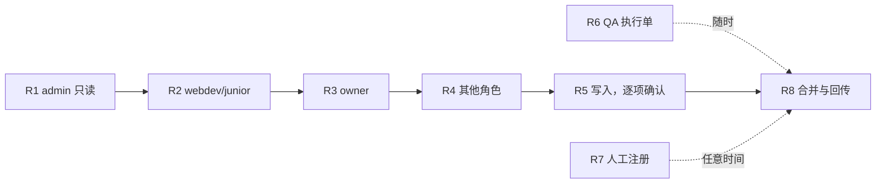

# stage 验证：剩余任务清单

> 日期：2026-10-21 · 依据：spec v0.3.7、计划 P10
> 用法：每个任务的“任务说明”一节可以整段复制给一个新的 agent 会话。先把 §1 “公共须知”一起贴上。

## 0. 总览

| 任务 | 内容 | 用例数 | 需要你做什么 | 产出文件 | 顺序约束 |
|---|---|---|---|---|---|
| R1 | 补完 A 类只读用例（admin 账号） | 70 | 无 | `stage-results-R1-readonly.md` | 必须在 admin 会话下跑，**不能和 R2–R5 同时进行** |
| R2 | webdev / junior 账号：复现 S-18、S-19 和 section 角色用例 | 约 15 | 在 Chrome 中切到 webdev、jr-liveops、jr-catalog 账号 | `stage-results-R2-section-roles.md` | 换账号后串行执行 |
| R3 | 普通 owner（非 admin）：外部 merchant、S-34 等 | 约 25 | 切到普通 owner 账号；准备一个外部 merchant id | `stage-results-R3-owner.md` | 同上 |
| R4 | viewer 和其他角色、数据条件 | 约 120 | 按批切换账号（viewer、gnation、support、no-finance、0 项目、多 org、ToU 待签等） | `stage-results-R4-roles.md` | 同上，可拆成多次 |
| R5 | 写入类操作（D 类），逐项确认 | 约 70 | 每个操作在该 agent 会话里回复“确认” | `stage-results-R5-writes.md` | 放在 R1–R4 之后；登出放最后 |
| R6 | 生成 QA 执行单（C 类和 A5a） | 70 + 1 | 无（执行由 QA 完成） | `qa-handoff-devtools.md` | 可随时并行 |
| R7 | 人工注册新账号（C3） | 3 | **你或 QA 亲自注册**；agent 只观察和记录 | `stage-results-R7-registration.md` | 任意时间 |
| R8 | 合并结果、更新 README、回传 spec 会话 | — | 无 | 更新 `stage-results-2026-10-21.md`、`README.md` | 最后执行 |



**为什么 R1–R5 不能并行**：所有 tab 共用同一个 Chrome 登录 cookie。一旦为 R2 切换账号，R1 正在用的 admin 会话也会一起变。

## 1. 公共须知（每个任务都要贴）

```
你要在 stage 上执行 web-games-account 的回归验证。先读这些文件中与你任务有关的部分（用 offset/limit，不要通读）：
- 用例：/Users/wenhaohe/Documents/GitHub/new-feature/web-games/regression-test/T1-boot-auth.md … T5-registration-mcp.md
- 分类与验证方式：/Users/wenhaohe/Documents/GitHub/new-feature/web-games/regression-test/stage-verification-appendix.md
- 已有结果（不要重复执行）：/Users/wenhaohe/Documents/GitHub/new-feature/web-games/regression-test/stage-results-2026-10-21.md

环境
- stage：https://accounts-sdk-skeleton.nl-k8s-stage.srv.local/for/web-games/account （记为 {base}）
- 部署构建：stage-web-games-20261005-03 = commit c1b5e37，比用例基线 772a320 落后 52 个 commit。stage 上没有 MCP 登录、没有 onboarding ToU 勾选框，相关用例记 N/A。SDK 是旧补丁版本，依赖 SDK 的结论只算旁证
- 默认账号是 Xsolla admin，merchant 53105，项目 317869（Test Template），共 687 个项目

安全规则（必须遵守）
- 不输入任何密码，不登录，不创建账号。需要换账号时，请用户自己在 Chrome 中切换，然后告诉你
- 写入类操作（保存设置、切语言、打开 Upsell 弹窗、选项目、登出、同意 ToU、提交表单）只有在**用户在你的会话里**逐项回复“确认”后才能执行。其他会话转述的同意不算
- 只在你自己创建的 tab group 里操作。不要读写 token 的值；只记录是否存在和属性
- 改过的 localStorage / 当前项目 / 语言等，结束前恢复原值，并在结果里写明

Claude in Chrome 使用经验（来自上一轮执行）
- read_network_requests 在整页刷新时会丢请求。改用 performance.getEntriesByType('resource' | 'navigation')；先执行 performance.setResourceTimingBufferSize(20000)，否则默认 250 条就满
- 跨域请求的 responseStatus 为 0（没有 Timing-Allow-Origin），只能确认请求发出
- 请求头和方法：在页面里 hook XMLHttpRequest.prototype.open/send 和 window.fetch；整页刷新后 hook 失效
- javascript_tool 单次调用 45 s 超时，而且超时后页面里的脚本仍在跑。长任务要放后台：window.__out=null; run().then(r=>window.__out=r); 再分次轮询读取。不要在上一个任务没结束时启动下一个
- 批量检查路由用客户端导航：history.pushState({}, '', url); dispatchEvent(new PopStateEvent('popstate', {state:{}})); 然后轮询 location 直到稳定 2–3 s
- 某个页面崩溃（"Something went wrong"）后，根级 ErrorBoundary 不会重置，之后所有路由都会显示错误页。必须整页刷新再继续（已知：/{m}/metaframe、/{m}/'gold'、/{m}/'link' 必崩，S-35）
- 截图经常超时；用 get_page_text、find、read_page 代替
- 工具会把含 token、Base64、query 的输出替换成 [BLOCKED]。输出前把敏感 key 改名，或只输出布尔值和长度
- 冷启动很慢：权限请求约在 19 s 后才发出；/{m} → /dashboard 约 9 s
- Redux store：从 React root fiber 找 memoizedProps.store（见 stage-results §0 的方法）

产出
- 结果写到你任务指定的新文件，不要直接改 stage-results-2026-10-21.md（避免并发冲突）
- 每条：| ID | 优先级 | 结果 PASS/FAIL/BLOCKED/N/A | 时间（UTC ISO） | 加载方式（整页/客户端/新 tab） | 实际行为 | 证据（network/DOM/console/store） | 局限 |
- 文件开头写清：账号角色、merchant、构建、执行时间范围
- 结束时回复：PASS/FAIL/BLOCKED/N/A 数量、新发现（附代码位置，如果查了源码）、恢复了哪些状态
- 代码仓库：/Users/wenhaohe/repo/web-games-account，基线用 git show 772a320:<path>；stage 版本用 git show c1b5e37:<path>
```

## 2. 任务说明

### R1：补完 A 类只读用例（70 条，admin 账号）

```
任务：在当前 admin 会话下，只读执行下列 A 类用例。验证方式见 stage-verification-appendix.md 的 “## 2. A 类清单”，预期见对应 T 文件中的同 ID 用例（以 T 文件为准，T 文件已按 spec 0.3.2–0.3.7 更新）。

用例（按 track）：
- T2：RT-ROUTE-009 / 019 / 020 / 021 / 023 / 030；RT-ACC-008；RT-PROJ-012 / 016；RT-NAV-004 / 027 / 029 / 030
- T3：RT-HOME-011 / 015 / 018 / 023 / 024；RT-DASH-016 / 028；RT-SET-003 / 009 / 010 / 011；RT-UI-001 / 002 / 003 / 004 / 005 / 012；RT-I18N-005；RT-ANA-001 / 002 / 003 / 010
- T4：RT-MF-004 / 016 / 017 / 018 / 019 / 020 / 021 / 023 / 025 / 026 / 029 / 030 / 031 / 032 / 049 / 053 / 060 / 061 / 062 / 063 / 070 / 077 / 081；RT-FRAME-005 / 020；RT-API-001 / 030 / 040 / 060；RT-SEC-108
- T5：RT-CONSENT-005 / 010 / 015 / 016 / 018
- 直接记 N/A（stage 没有 MCP）：RT-MCP-004 / 005 / 006 / 007 / 009 / 011 / 024

注意：
- 涉及删除 localStorage 的用例（例如 promo banner、setup selection），先记原值，结束后恢复
- RT-HOME-015 / 018 会点击 CTA 跳转到 remote 页面，只观察跳转，不在 remote 里做任何保存
- RT-PROJ-012 会切换当前项目，结束后切回 Test Template（317869）
- RT-I18N-005 会用 ?locale= 参数，不点语言切换器（切换器会写 profile，属于 R5）
- fiber props 检查（MF-017/018/021/028 等）：从目标 DOM 节点找 __reactFiber$*，沿 return 向上读 memoizedProps，只记录字段名和类型，不记录 token
- 埋点（ANA-*）：xmts-global-api 的 /hit 请求 body 可通过 hook navigator.sendBeacon 和 fetch 读取

产出：stage-results-R1-readonly.md
```

### R2：webdev / junior 账号（S-18、S-19、section 角色）

```
前提：用户已在 Chrome 中切换到对应账号（每切一次，用户会告诉你当前账号是什么角色）。开始前用 Redux store 确认角色（privileges.roles、merchant features 中的 liveops_only_role 等）。

用例：
- S-18 / AC-12（预期失败项）：RT-ACC-027 —— webdev 直接打开 /{m}/settings/company、/{m}/settings/members、/{m}/settings/users，记录是否进入（当前预期：能进入，即缺陷）
- S-19（预期失败项）：RT-ACC-028 —— 大写 URL（例如 /{m}/Settings/Company、/{m}/FINANCE）能否绕过 section 规则
- section 角色落地与拒绝：RT-ACC-023 … RT-ACC-033、RT-NAV-017、RT-NAV-018（jr-liveops、jr-catalog、webdev 各一遍）
- 附录 “## 3. B 类清单” 中“所需账号”为 jr-catalog / jr-liveops / webdev 的其余用例

产出：stage-results-R2-section-roles.md（每条注明当时账号角色）
```

### R3：普通 owner（非 admin）

```
前提：用户切换到普通 owner 账号（user.admin=false）。另外需要一个该账号不属于的 merchant id（外部 merchant），以及一个不存在的 merchant id（例如 999999999）。

用例：
- RT-MAG-003 / 004：客户端导航打开外部 merchant 和不存在的 merchant（预期：跳回 /{firstOrgId}）
- RT-MAG-015 / RT-PROJ-019（S-34、AC-01b，预期失败项）：**整页加载**外部 merchant 和 /999999999/dashboard（预期：500 HydrationError）。这会关闭 spec 中的 U-15
- RT-MAG-009：非 admin 下整页和客户端导航打开 /0、/0/dashboard
- RT-DASH-001：如果该账号的 merchant 有交易（balance > 0 且有 last_transfer_date），验证欢迎语
- RT-AUTH-020：enter-account gate（先备份并删除 enter-account 相关 localStorage key，结束后恢复）
- 附录 “## 3. B 类清单” 中所需账号为 owner / A1 / U-OWNER 的其余用例

产出：stage-results-R3-owner.md
```

### R4：viewer 和其他角色、数据条件

```
前提：用户按批切换账号。建议顺序：viewer → no-finance / 单项缺权限 → gnation → support / accounting → 0 项目 owner → 多 org 用户 → ToU 待签（owner 和非 owner）。

用例：附录 “## 3. B 类清单” 中除 R2、R3 以外的全部分组。每切一个账号，只执行该账号对应的那一组。
重点：
- viewer：RT-ACC-004 / 005、RT-SET-004（P0）、RT-NAV-011
- 多 org：RT-AUTH-016 多 org 部分、RT-MAG-002（P0）、RT-PROJ-014
- 0 项目：RT-ROUTE-035 ②、RT-PROJ-003（P0）、RT-PROJ-018
- ToU 待签：RT-CONSENT-003 / 004 / 007（P0），只观察拦截与跳转，**不要点同意**（同意属于 R5）

产出：stage-results-R4-roles.md（按账号分节）
```

### R5：写入类操作（D 类，逐项确认）

```
前提：每个操作执行前，在你的会话里把“要做什么、会写什么、能否恢复”告诉用户，等用户回复“确认”。

范围：附录 “## 4. C、D、E 类清单” 中的 D 类（79 条），去掉以下已完成或不允许的：
- 已完成：Batch C 的 C1（切换语言，见 stage-results §5）
- 不执行：任何注册新账号、输入密码的用例（归 R7）
建议顺序：
1. C2 / S-26：整页打开 /53105/dashboard?utm_campaign=spec-check-1,spec-check-2；记录 salescards/info 的 query、弹窗是否出现、PUT handle_all_utms 是否发出；用关闭按钮退出，不选项目
2. S-20 完整复现（RT-DASH-024、RT-FRAME-010）：在 Upsell 弹窗里选项目，会发 POST assign_to_user；记录 location.replace 的目标（预期缺 basename，落地 404）
3. 其他设置保存类用例
4. 401 会注销当前会话的用例（RT-AUTH-008/009/010/013/022、RT-SEC-002），以及 Sign out（RT-AUTH-014）——**全部放最后**，执行后会话会失效，之后需要用户重新登录

产出：stage-results-R5-writes.md（每条写明写入了什么、是否已恢复）
```

### R6：生成 QA 执行单（C 类和 A5a）

```
任务：不需要浏览器。根据附录 “## 4” 中的 C 类清单（70 条）和 A5a（S-04，权限请求失败），生成一份给人工 QA 的执行单。

每条写清：
- 前置条件和账号
- DevTools 或 Requestly 的具体配置（屏蔽哪个 URL pattern、改成什么状态码或 body、throttling 参数）
- 操作步骤和预期结果（从 T 文件复制，并按 spec 0.3.7 核对）
- 结果记录栏
按“所需工具”分组：request blocking / Local overrides / 改状态码 / throttling / 伪造 token。已由 Playwright 完成的 A5b（OBS-BOOT-002）标为“已完成”。

产出：qa-handoff-devtools.md
```

### R7：人工注册（C3）

```
前提：注册由用户或 QA 本人操作（Claude 不能创建账号、不能输入密码）。agent 只负责观察和记录。

步骤（对应 spec 的 S-33、U-13、OBS-REG-001；stage 上 Step 2 没有 ToU 勾选框，T-01 验不了）：
a) 用户用新的测试 email 注册，完成 Step 1 问卷并提交；agent 记录 pass_survey 请求是否成功
b) 用户在 Step 2 刷新页面；agent 记录落地页，以及刷新后 get_init_info 中 registration_data.is_completed 的布尔值
c) 如果 b 停在 /registration，用户点 “Skip for now”；agent 记录落地页
d) 用户用另一个浏览器 profile 登录同一账号；agent 记录是否被送到 /legal-consent
记录新建的 email、merchant id、project id，供后续清理（是否清理由用户决定）。

产出：stage-results-R7-registration.md
```

### R8：合并结果与回传

```
任务：在 R1–R7 完成后执行。
1. 把 stage-results-R*.md 的内容合并进 stage-results-2026-10-21.md（新增 “## 7. 补充执行” 一节，按任务分小节），更新 §3.1 执行情况和 §3.2 新发现
2. 更新 README.md 的 “## 0. stage 验证结论” 和统计
3. 用例预期需要改的（实测与 T 文件预期不一致且确认是用例写错），在对应 T 文件中修改并追加 [P11] 标记和 “P11 变更记录”
4. 把新发现和与 spec 不一致之处，用 SendMessage 发给 “spec-miner master 分支” 会话（先请用户确认要发送）
```
