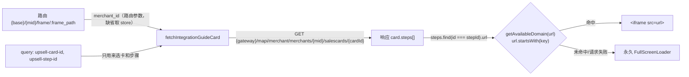
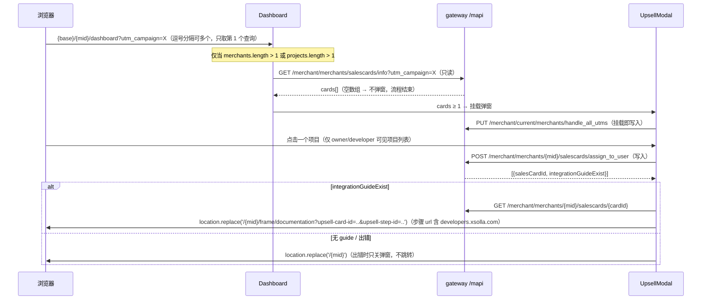

# Stage 验证附录：回归用例按“stage 上怎么验证”分类

| 项 | 值 |
|---|---|
| 输入 | T1-boot-auth.md、T2-routing-access.md、T3-home-dashboard.md、T4-remote-frame.md、T5-registration-mcp.md（共 471 条 `RT-` 用例） |
| 验证者 | Claude（Claude in Chrome 扩展，操作用户已登录的 Chrome；当前会话假设为 owner，至少 1 个 merchant 和项目） |
| 代码基线 | `master@772a320`；对照分支 `WASP-2524-migrate-tests-to-apps`（`apps/web-games`） |
| 生成日期 | 2026-10-21 |

## 0. 约定与判定口径

- 占位符沿用各 track：`{host}` = stage 主机，`{base}` = `/for/web-games/account`，`{mid}` = 当前 owner 的 merchant id，`{p}` = 该 merchant 下的项目 id，`{m}` 同 `{mid}`。
- 类别（每条只归一类，取能完整执行该用例所需的最小类别）：
  - **A**：当前 owner 账号只读即可。只导航、观察 UI、看 network/console/storage。
  - **B**：只读，但需要其他账号或特定数据。用户在 Chrome 中切到对应会话后，Claude 也能执行。
  - **C**：需要改写响应、屏蔽请求、模拟网络失败/超时，或伪造/过期 token。人工 QA 用 DevTools/Requestly。
  - **D**：有写入或不可逆操作。需要用户逐项确认，或由 QA 执行。
  - **E**：无法在 stage 验证。
- 口径细则：
  - 只改 localStorage / sessionStorage / 非 httpOnly cookie 中纯前端、可恢复的 key，仍算 A；验证方式中写明“验证后恢复”。改 token / 鉴权 cookie 算 C。
  - 改写响应后结果是“注销当前会话”（401 → `/logout`）的用例归 **D**，不归 C：Claude 不能重新登录，注销不可逆。
  - 弹出 UpsellModal 的用例归 D：弹窗挂载即发 `PUT …/handle_all_utms`（写入）。
  - 语言切换用例归 D：topbar 切语言发 `POST users/location`，写入用户 profile。
  - Claude 没有 React DevTools / Redux DevTools。需要看组件 props 的 A 类用例，改为执行 JS 读 DOM 节点的 `__reactFiber$*` → `memoizedProps`；只能看 Redux 内部状态的归 E 或 B。
  - 部分 A 类用例要求 owner 有 ≥2 个项目或特定数据（验证方式中已注明）。当前账号不满足时，该用例改按 B 处理。
  - `需先确认部署版本 = 是`：用例标了 `[分支差异]`，master 与 WASP-2524 分支的预期不同。执行前先向用户或部署记录确认 stage 当前部署的是哪个构建，再选对应预期。

## 1. 分类统计

### 1.1 全部用例（track × 类别）

| Track | A | B | C | D | E | 合计 |
|---|---|---|---|---|---|---|
| T1 启动·鉴权·Merchant 守卫·错误 | 17 | 20 | 13 | 8 | 4 | 62 |
| T2 路由·访问控制 | 47 | 71 | 4 | 1 | 0 | 123 |
| T3 首页·Dashboard·设置 | 31 | 35 | 9 | 21 | 0 | 96 |
| T4 Remote·Frame·API | 37 | 15 | 40 | 8 | 2 | 102 |
| T5 注册·MCP | 15 | 27 | 4 | 41 | 1 | 88 |
| **合计** | **147** | **168** | **70** | **79** | **7** | **471** |

### 1.2 P0 用例（track × 类别）

| Track | A | B | C | D | E | P0 合计 |
|---|---|---|---|---|---|---|
| T1 启动·鉴权·Merchant 守卫·错误 | 6 | 5 | 0 | 2 | 0 | 13 |
| T2 路由·访问控制 | 4 | 6 | 0 | 0 | 0 | 10 |
| T3 首页·Dashboard·设置 | 7 | 2 | 0 | 0 | 0 | 9 |
| T4 Remote·Frame·API | 2 | 0 | 1 | 1 | 0 | 4 |
| T5 注册·MCP | 3 | 4 | 0 | 8 | 0 | 15 |
| **合计** | **22** | **17** | **1** | **11** | **0** | **51** |

A 类中需先确认 stage 部署版本的用例共 21 条：RT-BOOT-001、RT-BOOT-006、RT-BOOT-008、RT-ERR-003、RT-ROUTE-012、RT-ROUTE-021、RT-ROUTE-027、RT-HOME-001、RT-HOME-002、RT-HOME-015、RT-DASH-028、RT-SET-001、RT-UI-001、RT-UI-002、RT-UI-003、RT-UI-004、RT-UI-005、RT-I18N-005、RT-ANA-010、RT-MF-070、RT-CONSENT-016。

## 2. A 类清单（当前 owner 账号只读验证）

### T1 启动·鉴权·Merchant 守卫·错误（17 条）

| ID | 场景 | 优先级 | 验证方式 | 需先确认部署版本？ |
|---|---|---|---|---|
| RT-BOOT-001 | 冷启动请求顺序：modules 先于鉴权请求 | **P0** | 硬刷新 {host}{base}/{mid}；读 network：首个 gateway 请求为 GET …/api/v1/modules(200)，get_init_info?org_id={mid}、GET /api/organization/{mid}/detail 均在其后；页面正常渲染。header 不可见，只验顺序 | **是** |
| RT-BOOT-005 | __INITIAL_STATE__ 回填 shape | P2 | 打开 {host}{base}/{mid}；执行 JS 读 window.__INITIAL_STATE__：有 projects 和 user 两个 key，token 为 null；记录 projects/user 是完整 shape 还是 null 占位 | 否 |
| RT-BOOT-006 | 裸 site URL 规范化 | **P0** | 依次打开 https://{host}/for/web-games 与 https://{host}/for/web-games/?a=1#x；读 location.href 应为 {base}（b 带 ?a=1#x）；看 network 是否只有 1 个 document 请求或先 302；页面渲染 | **是** |
| RT-BOOT-007 | S-05：短路分支不触发、不白屏 | P2 | 打开 https://{host}/for/web-games；确认落到 {base} 后页面有内容（读页面文本，#root 非空），console 无未捕获错误 | 否 |
| RT-BOOT-008 | 根路径按 site cookie 恢复 | P1 | 打开 https://{host}/：应 replace 到 {base}，history.length 不增；再执行 JS 删除 cookie account-platform-site-id 后打开 /，应停留 / 并显示登录页；验证后恢复该 cookie | **是** |
| RT-BOOT-010 | stage 构建 APP_ENV 识别 | P1 | 打开 {host}{base}/{mid}/dashboard；读 console：出现 [Gateway] Authenticated request 即 APP_ENV≠production；把结论记入执行记录 | 否 |
| RT-BOOT-011 | 模块列表响应快照 | P2 | 在 {host}{base}/{mid} 页面执行 JS fetch 同一 GET …/api/v1/modules URL（取自 network）；记录 urls 的 key 名和 communication_platform.module 值 | 否 |
| RT-AUTH-005 | 注入 token，不请求 /server/token | **P0** | 硬刷新 {host}{base}/{mid}；读 network：不存在 GET {base}/server/token；存在 get_init_info?org_id={mid} 且 200 | 否 |
| RT-AUTH-007 | token 扇出与请求头 | **P0** | 在 {base}/{mid} 执行 JS hook XMLHttpRequest.setRequestHeader 记录 header，再点侧栏进入 dashboard；确认 SDK 与本地请求同一 Authorization: Bearer，且 Business-Account-Id=web-games | 否 |
| RT-AUTH-020 | 首次进入账号 gate | P2 | 执行 JS 列出 localStorage 找 enter-account 相关 key 并备份后删除；打开 {host}{base}/{mid}，URL 应变为 …/enter-account；验证后恢复 key。admin/非 owner 分支不验 | 否 |
| RT-MAG-001 | 打开自己的 org | **P0** | 硬刷新 {host}{base}/{mid}；可能短暂出现 data-id=merchant-access-guard-loader；network 中 get_init_info?org_id={mid} 只 1 次（200），无额外 /api/organization/{mid}/detail 重复切换；页面渲染 | 否 |
| RT-MAG-004 | 非 admin 打开不存在 merchant | P1 | 打开 {host}{base}/999999999/dashboard；URL 应变为 {base}/{mid}；记录 get_init_info?org_id=999999999 状态码；200 外的 403/404/5xx/401 记缺陷 | 否 |
| RT-MAG-009 | /0 sentinel 服务端 302 | P2 | 打开 {host}{base}/0/dashboard，URL 应为 {base}/{mid}/dashboard；再开 {base}/0 应为 {base}/{mid}；network 看 document 302，SPA 无 org_id=0 请求 | 否 |
| RT-MAG-011 | 带前导零的 merchant id | P2 | 打开 {host}{base}/0{mid}/dashboard；页面应渲染；记录 network 中 API 路径和页面链接 href 用 0{mid} 还是 {mid} | 否 |
| RT-ERR-003 | /error 忽略 query 且 NavigationLite | P2 | 打开 {host}{base}/error?status=404&message=<b>x</b>；页面显示通用 500 标题，不显示 404 与 x，无 <b> 渲染；master 下导航为未登录样式 NavigationLite | **是** |
| RT-SEC-003 | 注入 token 读后清空 | P1 | 打开 {host}{base}/{mid} 后执行 JS：window.__INITIAL_STATE__.token 应为 null；document.querySelectorAll('script') 中无内联含 __INITIAL_STATE__ 的脚本 | 否 |
| RT-SEC-004 | 会话 cookie 属性 | **P0** | 在 {host}{base}/{mid} 执行 JS 读 document.cookie，不应含 pa-v4-token（HttpOnly）；页面已登录且 get_init_info 200 证明会话 cookie 存在 | 否 |

### T2 路由·访问控制（47 条）

| ID | 场景 | 优先级 | 验证方式 | 需先确认部署版本？ |
|---|---|---|---|---|
| RT-ROUTE-001 | 顶层路由先于 merchant 树匹配 | P1 | 开 {base}/forbidden、/not-found、/error、/account-no-access、/account-restricted、/enter-account、/verification；URL 不变无 sidebar | 否 |
| RT-ROUTE-002 | 顶层页只做 exact 匹配 | P2 | 打开 /forbidden/x、/error/x、/account-no-access/x、/enter-account/x、/login/mcp/x，均应变 /not-found；/not-found/x 保持 URL 显示 404 | 否 |
| RT-ROUTE-004 | merchant/project 子树 not-found | P1 | 开 /{mid}/unknown、/dashboard/x、/settings、/settings/foo、/settings/company/x、/projects/abc、P/unknown、P/sdk/x；均变 /not-found | 否 |
| RT-ROUTE-005 | merchant id 后紧跟非分隔符 | P2 | 打开 {host}{base}/{mid}abc；确认 URL 变 /not-found，未渲染 /{mid} 的 merchant 页面 | 否 |
| RT-ROUTE-006 | 尾部斜杠等价 | P1 | 打开 {host}{base}/{mid}/dashboard/、/settings/company/、/projects/{pid}/、/{mid}/；确认渲染与无斜杠版本相同，URL 不变 /not-found | 否 |
| RT-ROUTE-007 | /support/ 尾斜杠不默认跳转 | P2 | 打开 {host}{base}/{mid}/support，确认 URL 变 /support/transactions；再开 /{mid}/support/，确认 URL 不变并渲染 support remote，记录显示内容 | 否 |
| RT-ROUTE-008 | 路由大小写不敏感 | P2 | 打开 {host}{base}/{mid}/DASHBOARD、/{mid}/Settings/Company；确认两页渲染非 /not-found，对比小写版内容区 padding 并记录差异 | 否 |
| RT-ROUTE-009 | // 合并并丢 query/hash | P1 | 打开 {host}{base}/{mid}//dashboard?x=1#h；确认 URL 变 /{mid}/dashboard 且无 ?x=1#h；后退，确认不回到含 // 的地址 | 否 |
| RT-ROUTE-010 | query 内 // 不触发合并 | P2 | 打开 {host}{base}/{mid}/dashboard?u=https://a.b；确认 location.href 不变，页面正常渲染 | 否 |
| RT-ROUTE-011 | support-hub 别名跳转 | P1 | 打开 {host}{base}/{mid}/support-hub；确认 URL 变 /{mid}/communication-hub，渲染 Communication Hub，sidebar 不存在 | 否 |
| RT-ROUTE-012 | support-hub 子路径与 query | P2 | 打开 {host}{base}/{mid}/support-hub/inbox?x=1；记录 URL：master 应为 /{mid}/communication-hub（子路径与 query 丢失），V2 应为 /not-found | **是** |
| RT-ROUTE-013 | analytics 旧产品路径保留 query/hash | P1 | 打开 /{mid}/analytics/products/site-builder?period=7d#top；确认 URL 变 /{mid}/analytics/web-shop?period=7d#top，渲染 Web shop | 否 |
| RT-ROUTE-014 | login 旧产品映射 | P2 | 打开 {host}{base}/{mid}/analytics/products/login?d=1；确认 URL 变 /{mid}/analytics/engagement?d=1 | 否 |
| RT-ROUTE-015 | 未映射产品与大小写 | P2 | 打开 /{mid}/analytics/products/foo?d=1 与 /analytics/products/Site-Builder?d=1；确认都落到 /{mid}/analytics/payments 且无 query | 否 |
| RT-ROUTE-016 | analytics 默认跳转 | P1 | 打开 {host}{base}/{mid}/analytics、/analytics/、/analytics/main-info/overview?x=1；确认都落到 /{mid}/analytics/payments 且无 query | 否 |
| RT-ROUTE-017 | Chargeback registry 不被兜底吞 | P1 | 打开 /{mid}/analytics/main-info/afs/chargeback-registry；确认 URL 不变、渲染 Chargeback registry，sidebar Anti-fraud 高亮 | 否 |
| RT-ROUTE-018 | support 默认 tab 与子路径 | P1 | 打开 /{mid}/support?x=1，确认 URL 变 /support/transactions 且无 query；再开 /{mid}/support/tickets，确认 URL 不变并渲染 remote | 否 |
| RT-ROUTE-019 | documents 路由数据预取 | P2 | 打开 {host}{base}/{mid}/documents；读 network，确认布局加载后有 1 次 finance documents URL 请求（2xx），页面渲染 | 否 |
| RT-ROUTE-020 | 只改 query 不重新预取 | P2 | 在 /{mid}/documents 用 JS pushState 到 ?x=1 并派发 popstate；读 network，确认无第二次 documents URL 请求 | 否 |
| RT-ROUTE-021 | PUSH 滚动复位 | P2 | 在 /{mid}/dashboard 用 JS 滚到底后点 sidebar 项，scrollY 应为 0；在 /projects/{pid}/storefront/virtual-currency/packages 切子页与后退，不复位 | **是** |
| RT-ROUTE-022 | chrome 显隐（sidebar/topbar） | P1 | 开 /{mid}/marketplace、/communication-hub、/settings/company、/settings/api_key、/profile 无 sidebar；editor 无 topbar；删 selection 验 get-started | 否 |
| RT-ROUTE-023 | finance 内容区 padding | P2 | 打开 {host}{base}/{mid}/finance、/finance/、/finance/reports；用 JS 读内容区容器的 computed padding，确认前两个为 0、reports 有 padding | 否 |
| RT-ROUTE-024 | merchant 级 funding 只能直达 | P2 | 打开 {host}{base}/{mid}/funding、/{mid}/funding/requests/1；确认渲染 funding remote；读 sidebar 链接，确认无指向 /{mid}/funding 的入口 | 否 |
| RT-ROUTE-025 | frame 路由 | P2 | 打开 {host}{base}/{mid}/frame/reports，确认渲染 IntegrationFrame；再开 /{mid}/frame，确认 URL 变 /not-found | 否 |
| RT-ROUTE-026 | D1 merchant 级 gold | P1 | 打开 {host}{base}/{mid}/gold；记录结果：当前缺陷现状应为 /not-found，修复后应渲染 Xsolla Gold remote | 否 |
| RT-ROUTE-027 | D1 merchant 级 link | P1 | 打开 {host}{base}/{mid}/link；记录结果：master 当前为 /not-found，V2 应渲染 Xsolla Link remote | **是** |
| RT-ROUTE-028 | D1 字面引号路径可达 | P2 | 在地址栏打开 {host}{base}/{mid}/'gold' 与 /{mid}/'link'；记录 location.href 是否被编码为 %27，以及分别渲染 Gold/Link 还是 /not-found | 否 |
| RT-ROUTE-029 | profile 路由 | P1 | 点 topbar Profile，确认 URL 为 /{mid}/profile、渲染 ProfilePage 且无 sidebar；再打开 /{mid}/profile/x，确认 URL 变 /not-found | 否 |
| RT-ROUTE-030 | tax-interview FAQ 路由 | P1 | 打开 {host}{base}/{mid}/tax-interview，点 FAQ，确认 URL 为 /tax-interview/faq 并渲染；关闭 FAQ，确认回到 /{mid}/tax-interview | 否 |
| RT-ROUTE-033 | /verification/x 渲染 | P2 | 打开 {host}{base}/verification/x；记录是否渲染 VerificationPage 或 /not-found，URL 是否变化，console 有无报错 | 否 |
| RT-ACC-001 | 全权限账号可进 gated 路由 | **P0** | 逐个直接打开 §2 #13–#17、#19–#21、#25、#33–#35、#37–#49 对应 {host}{base}/{mid}/... URL；确认 URL 不变为 /forbidden，页面或 remote 渲染 | 否 |
| RT-ACC-008 | 角色值大小写敏感 | P2 | 打开 {host}{base}/{mid}/dashboard；读 network 中返回用户角色的响应（如 user/permissions），记录 role 字段实际大小写；不验证放行逻辑 | 否 |
| RT-ACC-022 | 父子路由权限都通过 | P2 | 打开 {host}{base}/{mid}/finance/payouts；确认 URL 不变为 /forbidden，渲染 Payouts 页面 | 否 |
| RT-PROJ-001 | 项目页正常进入 | **P0** | 打开 {host}{base}/{mid}/projects/{pid}；确认先有 loader，后渲染项目页；读 Tools 菜单 href，确认都含 /projects/{pid}/ | 否 |
| RT-PROJ-002 | 未知项目 id 改写 | **P0** | 打开 /{mid}/projects/999/storefront/promotions?tab=a#x；确认 URL 被 replace 为 /projects/{当前或首个pid}/同子路径，query/hash 保留 | 否 |
| RT-PROJ-009 | /projects/0 改写 | P1 | 打开 {host}{base}/{mid}/projects/0/sdk；确认 URL 被改写为 /{mid}/projects/{pid}/sdk | 否 |
| RT-PROJ-010 | 前导零项目 id | P2 | 打开 {host}{base}/{mid}/projects/0{pid}；确认 URL 不被改写，记录页面内容是否正常、console 有无报错 | 否 |
| RT-PROJ-011 | 项目页切换项目 | **P0** | 需≥2 项目。在 /{mid}/projects/{p1}/storefront/promotions?x=1 用 topbar 切到 {p2}；URL id 变 {p2} 保留 ?x=1，Tools/Settings 指 {p2} | 否 |
| RT-PROJ-012 | 非项目页切换项目 | P1 | 需 ≥2 项目。在 {host}{base}/{mid}/get-started 用 topbar 切到另一项目；确认 URL 不变，Tools 与 bottom Settings href 改为新项目 id | 否 |
| RT-PROJ-016 | 刷新后快速点 Tools | P1 | 在 /{mid}/projects/{pid}/sdk 刷新后立即点 Cloud gaming；确认 URL 为 /projects/{pid}/cloud-gaming，不含 undefined、非 /not-found | 否 |
| RT-PROJ-017 | 项目设置子页 | P1 | 打开 /{mid}/projects/{pid}/edit、/edit/advanced、/edit/webhooks、/edit/event-api；确认均在设置壳内渲染对应 tab，URL 不变 /not-found | 否 |
| RT-NAV-002 | 内部链接前缀 | P1 | 在 {host}{base}/{mid}/dashboard 读 sidebar 内部菜单项 a 的 href；确认均为 {host}{base}/{mid}/... 格式 | 否 |
| RT-NAV-003 | 外链安全（展开态） | P1 | 在项目页展开 sidebar，读 Receipt/Email customizer 链接 target=_blank、rel=noopener noreferrer；点击后在新标签 JS 确认 window.opener===null | 否 |
| RT-NAV-004 | 折叠态外链与内链 | P1 | 折叠 sidebar，点 Email customizer 图标，确认新标签打开且 window.opener===null；点 SDK 图标，确认 URL 为 /{mid}/projects/{pid}/sdk | 否 |
| RT-NAV-027 | 菜单高亮规则 | P2 | 开 chargeback-registry、/saved-payout-methods、P/storefront/virtual-items/x、P/edit；高亮依次 Anti-fraud、Billing center、All items、Settings | 否 |
| RT-NAV-029 | 聊天按钮跳转 | P1 | 在 /{mid}/dashboard 点 topbar 聊天按钮；确认 URL 为 /{mid}/communication-hub，无 support-hub 中间跳转，sidebar 隐藏 | 否 |
| RT-NAV-030 | 403 页导航 | P2 | 打开 {host}{base}/forbidden；读 header 结构（是否 NavigationLite、有无登录态元素）；点 To homepage，确认 URL 为 {host}{base}/{mid} | 否 |

### T3 首页·Dashboard·设置（31 条）

| ID | 场景 | 优先级 | 验证方式 | 需先确认部署版本？ |
|---|---|---|---|---|
| RT-HOME-001 | 有访问且有 selection 进 Dashboard | **P0** | 执行 JS 设置 localStorage `web-games:setup-selection:web-games:{mid}`=gamesPortal（记原值，验证后恢复）；打开 {host}{base}/{mid}；URL 应变为 /{mid}/dashboard 且 Dashboard 渲染 | **是** |
| RT-HOME-002 | 无 selection 落到 Choose UI | **P0** | 执行 JS 删除 key `web-games:setup-selection:web-games:{mid}`（验证后恢复）；打开 {host}{base}/{mid}；期望 URL=/{mid}/get-started，两张卡（Games Portal 在前），无 topbar/shell sidebar/promo banner；分支上会进 /dashboard | **是** |
| RT-HOME-011 | 非法 selection 值视为未选 | P2 | 执行 JS 把 key `web-games:setup-selection:web-games:{mid}` 设为 foo（验证后恢复）；打开 {host}{base}/{mid}/get-started；应显示 Choose UI，topbar/sidebar 隐藏 | 否 |
| RT-HOME-012 | 选择 Games Portal | **P0** | 先 JS 删除 selection key（验证后恢复）进 {base}/{mid}/get-started；点 Games Portal 的 Choose；查 key=gamesPortal、URL 不变、后退不回 Choose UI、topbar/sidebar 恢复、toast “Your Web Games account is ready” | 否 |
| RT-HOME-013 | 选择 Additional Services | **P0** | 先 JS 删除 selection key（验证后恢复）进 {base}/{mid}/get-started；点 Additional Services 的 Choose；查 key=additionalServices，显示 Additional Services 引导和 toast | 否 |
| RT-HOME-014 | Switch setup 清除选择 | P1 | 在 {base}/{mid}/get-started 任一引导页点 “Switch setup”；JS 查 selection key 已删除、URL 不变、显示 Choose UI、topbar/sidebar/promo banner 隐藏；验证后恢复 key | 否 |
| RT-HOME-015 | Games Portal CTA 跳转 | P1 | selection=gamesPortal 打开 {base}/{mid}/get-started；点 step1 CTA 应到 /{mid}/projects/{p}/player-platform，返回点 step2 应到 .../payments/configuration；step3 无按钮；What's next 三卡禁用带锁 | **是** |
| RT-HOME-018 | Additional Services CTA 跳转 | P1 | selection=additionalServices 打开 {base}/{mid}/get-started；点 step1→.../projects/{p}/payments/configuration；Login→.../login；Web Shop/Offerwall/Backpack→site-builder、offerwall、storefront/catalog-management/connectors | 否 |
| RT-HOME-023 | CTA 使用当前项目 | P2 | 需 owner 有 ≥2 项目；先进第 2 个项目页，再经 sidebar 回 {base}/{mid}/get-started，点 payments CTA；URL 中 {p} 应为当前项目 id，无当前项目时为列表第一个 | 否 |
| RT-HOME-024 | Enter account 后分流 | P2 | 执行 JS 删除 enter-account 标记 key（验证后恢复），打开 {base}/{mid}；在 Enter account 页点按钮；应跳 /{mid} 后按 HOME 规则分流到 dashboard 或 get-started | 否 |
| RT-DASH-001 | 有交易显示欢迎语 | **P0** | 打开 {base}/{mid}/dashboard；network GET .../analytics/metrics/balance 200 且 value>0、有 last_transfer_date；标题 “Welcome, {name}”；无 [data-id=ask-ai-banner] | 否 |
| RT-DASH-005 | 全部权限显示余额与 board | **P0** | 打开 {base}/{mid}/dashboard；balance GET 200；看 “Performance” 标题、Balance 带币种和两位小数、Last/Next payout 日期、XAA board 渲染、header 与 board 间分隔线 | 否 |
| RT-DASH-016 | XAA 收到的上下文 props | P2 | 打开 {base}/{mid}/dashboard；JS 从 board DOM 节点的 __reactFiber$ 向上找 RemoteModuleComponent 读 memoizedProps；查 name=xaa_widgets、componentName=DashboardWebGames、merchantId 为字符串、locale、currencyISO、siteId=web-games | 否 |
| RT-DASH-028 | S-08 utm_campaign 未编码 | P2 | 需 owner ≥2 项目；打开 {base}/{mid}/dashboard?utm_campaign=spring%26x%3D1 和 ?utm_campaign=a%23b；network 看 GET salescards/info 的 URL 是否编码；若弹 modal 立即停止（会发 PUT） | **是** |
| RT-SET-001 | Company settings 布局 | **P0** | 打开 {base}/{mid}/settings/company；看 settings 侧边栏顶部 merchant 名、“Back to account” 按钮；无 shell sidebar 和 promo banner；内容区顶部有 PAInfoBanner | **是** |
| RT-SET-003 | Back to account 跳首页 | P1 | 在 {base}/{mid}/settings/company 点 “Back to account”；URL 先到 /{mid}，再按 HOME 规则落到 dashboard 或 get-started | 否 |
| RT-SET-009 | Members 嵌套 URL | P2 | 打开 {base}/{mid}/settings/members/anything；页面仍渲染 Members 列表，不跳 /not-found，保留 shell sidebar | 否 |
| RT-SET-010 | user-activity 只匹配精确路径 | P2 | 打开 {base}/{mid}/settings/user-activity/x；URL 应变为 /not-found 或显示 not-found 页面 | 否 |
| RT-SET-011 | profile 页的 chrome | P2 | 点 topbar 头像菜单 Profile；URL=/{mid}/profile；无 shell sidebar 也无 settings 侧边栏；promo banner 未关闭时显示（分支已删 banner） | 否 |
| RT-UI-001 | Promo banner 默认显示 | P1 | JS 删除 localStorage wg-pa-promo-banner-dismissed（验证后恢复）；打开 {base}/{mid}/dashboard；看 “Can't find something in Business Accounts?” 横幅；JS 读 #app-root 的 --app-notice-banner-height 等于横幅高度 | **是** |
| RT-UI-002 | 横幅按钮新标签打开 | P2 | 横幅未关闭时点 action 按钮；应新开标签 https://publisher-client.srv.local（需内网），原页面 URL 不变 | **是** |
| RT-UI-003 | 关闭横幅并持久化 | P1 | 点横幅 ×；JS 查 localStorage wg-pa-promo-banner-dismissed="1"、--app-notice-banner-height=0px；刷新后仍不显示；验证后恢复 key | **是** |
| RT-UI-004 | 非 "1" 存储值仍显示 | P2 | JS 设置 localStorage wg-pa-promo-banner-dismissed="true"（验证后恢复）；刷新 {base}/{mid}/dashboard；横幅仍显示 | **是** |
| RT-UI-005 | 特定页面不显示横幅 | P1 | 横幅未关闭；依次打开 /{mid}/settings/company、无 selection 的 /get-started、/select-project、site-builder editor（id 从列表取）；都无横幅；回 Dashboard 再显示 | **是** |
| RT-UI-010 | LiveChat 注入一次 | P1 | 打开 {base}/{mid}/dashboard；JS 计数 script[data-id="xsolla-chat-script"] 与 #livechat 均为 1；读 window.LiveChatWidget.type="bap"、visitor 字段、customFields.role；sidebar 有 Chat 启动器 | 否 |
| RT-UI-012 | LiveChat 跨页面不重复 | P2 | Dashboard→/{mid}/communication-hub→后退，重复 3 次，再折叠/展开 sidebar；JS 计数 script[data-id="xsolla-chat-script"] 与 #livechat 均为 1，Chat 启动器只一个 | 否 |
| RT-I18N-005 | ?locale= 参数处理 | P2 | 打开 {base}/{mid}/dashboard?locale=fr；查地址栏 locale 参数被移除；最终界面语言为 en；JS 读 cookie pa-locale 和 localStorage i18nextLng；验证后恢复为 en | **是** |
| RT-ANA-001 | stage 使用计数器 900023 | P1 | 需内网；打开 {base}/{mid}/dashboard；network 过滤 xmts-global-api 应有请求且 payload 含 900023；console 无 [xsollaAnalytics] 日志 | 否 |
| RT-ANA-002 | Choose 埋点 | P1 | JS 删除 selection key 进 Choose UI（验证后恢复）；点 Choose；network 过滤 xmts-global-api，payload 含 acc_setup-switcher_click、ev choose、selected_goal=Games Portal/Add Xsolla | 否 |
| RT-ANA-003 | Get Started 点击埋点 | P1 | 在 {base}/{mid}/get-started 依次点 Switch setup、各 step CTA 和 What's next 卡；每次 network 过滤 xmts-global-api 有 1 个 acc_get-started_page_click，ev/exv 符合 6.1；禁用卡不发 | 否 |
| RT-ANA-010 | S-10 Datadog business_account_id | P2 | 打开 {base}/{mid}/dashboard；network 过滤 browser-intake 看 payload，或 JS 读 window.DD_RUM?.getGlobalContext()/getInternalContext()；business_account_id 应为 web-games；无 RUM 请求则记录 | **是** |

### T4 Remote·Frame·API（37 条）

| ID | 场景 | 优先级 | 验证方式 | 需先确认部署版本？ |
|---|---|---|---|---|
| RT-MF-001 | 模块列表成功并注册 remote URL | **P0** | 打开 {host}{base}/{mid}/dashboard；network 仅 1 次 GET …/api/v1/modules 200 且早于业务请求；JS 查 Array.isArray(window.__modules)、window.APP_ENV==='stage'、window.ontologyModuleUrl 以 ?uuid 结尾 | 否 |
| RT-MF-004 | 记录 stage 模块列表快照 | P1 | 打开 {host}{base}/{mid}/dashboard；JS 读 window.__modules，记录每条 module_id/scope/module/urls 的 key；确认 communication_platform 的 module 与 gateway-only remote 是否齐全 | 否 |
| RT-MF-011 | cloud-gaming 加载 | P1 | 打开 {host}{base}/{mid}/projects/{pid}/cloud-gaming；network GET remoteEntry…?v= 200；UI spinner 后渲染；console 无 setting 'loaded' 报错；JS 遍历 __reactFiber$ 查含 basename 的 props | 否 |
| RT-MF-013 | player-platform 加载 | P1 | 打开 {host}{base}/{mid}/projects/{pid}/player-platform；network GET remoteEntry.js?v= 200；remote UI 渲染；JS 读 window.pa_games_portal 存在；fiber props 含 siteId='web-games' | 否 |
| RT-MF-014 | sdk-integration 加载与 S-17 | P1 | 打开 {host}{base}/{mid}/projects/{pid}/sdk/integration；network remoteEntry 200，主机为 gateway 或 *.nl-k8s-stage.srv.local，不是 sdk-intergration-widget.web.app | 否 |
| RT-MF-015 | 旧 launcher OldApp | P1 | 打开 {host}{base}/{mid}/projects/{pid}/launchers；network launcherModule remoteEntry 200；UI 渲染；JS 遍历 __reactFiber$ 查 exposedModule='./OldApp'、props 含 privileges/messages/state | 否 |
| RT-MF-016 | 新旧 launcher 共用 container | P2 | 打开 {host}{base}/{mid}/projects/{pid}/new-launcher；点击侧边栏进入 launchers（不刷新）；network 第 2 步无新 remoteEntry 请求；JS 查 window.launcherModule 存在 | 否 |
| RT-MF-017 | storefront 加载与 identity gate | P1 | 打开 {host}{base}/{mid}/projects/{pid}/storefront；network 无 GET /merchant/v3/users/init，remoteEntry 200；fiber props merchantId 为字符串、preferences.catalogVersion='new'（admin 角色部分跳过） | 否 |
| RT-MF-018 | payments 加载 | P1 | 打开 {host}{base}/{mid}/projects/{pid}/payments；network remoteEntry 200；UI 渲染；JS 遍历 __reactFiber$ 查 props merchant_id/project_id 为字符串，含 merchantDetails、privilegesList | 否 |
| RT-MF-019 | webhooks 各页签 remote | P1 | 打开 {host}{base}/{mid}/projects/{pid}/edit/webhooks，依次点 6 个页签和 event-api；network GET currency/list 仅 1 次；fiber 查各 exposedModule，webhookSecrets=[] | 否 |
| RT-MF-020 | support 加载并默认跳转 | P1 | 打开 {host}{base}/{mid}/support；URL 变为 …/support/transactions；network support remoteEntry 200；fiber props merchant_id 为 number | 否 |
| RT-MF-021 | support subscriptions | P1 | 打开 {host}{base}/{mid}/support/subscriptions；network subscriptions remoteEntry 200；JS 查 window.subscriptions_publisher_account；fiber 查 exposedModule='./support'、project_id=null | 否 |
| RT-MF-023 | xsolla-gold 项目级加载 | P2 | 打开 {host}{base}/{mid}/projects/{pid}/gold；network remoteEntry 200；fiber props 有 loginToken、rootUrl，无 locale；再开 {host}{base}/{mid}/gold，URL 变为 not-found | 否 |
| RT-MF-025 | metaframe 商户级与项目级 | P2 | 打开 {host}{base}/{mid}/metaframe 与 {host}{base}/{mid}/projects/{pid}/metaframe；network 同一 remoteEntry；fiber 查商户级 projectId 为 NaN；记录 remote 是否报错 | 否 |
| RT-MF-026 | site-builder 与 sb-pa cookie | P2 | 打开 {host}{base}/{mid}/projects/{pid}/site-builder；JS await cookieStore.getAll() 查 sb-pa-* 的 domain/path/sameSite/expires；切到另一项目 site-builder，UI 重新 loading | 否 |
| RT-MF-028 | subscriptions 加载 | P1 | 打开 {host}{base}/{mid}/projects/{pid}/subscriptions；network remoteEntry 200；fiber props 同时含 merchantId/projectId（字符串）与 merchant_id/project_id（number），isSeparatedDevMode=false | 否 |
| RT-MF-029 | xaa_widgets Dashboard 与 analytics | P1 | 打开 {host}{base}/{mid}/dashboard 与 …/analytics/payments 及其他板块，页签用点击切换；network xaa remoteEntry 仅 1 次；fiber 查 componentName 值 | 否 |
| RT-MF-030 | disputes chargeback registry | P1 | 打开 {host}{base}/{mid}/analytics/main-info/afs/chargeback-registry；network remoteEntry 200；fiber 查 exposedModule='./app'，props 仅 locale/token/merchant_id/basename | 否 |
| RT-MF-031 | finance pane 保活与 reports | P1 | 打开 {host}{base}/{mid}/finance，点 payouts 页签再切回；network 无重复 remoteEntry；再开 …/finance/reports，fiber 查 rootURL=/{mid}/finance | 否 |
| RT-MF-032 | funding nav 与 App 同 container | P1 | 打开 {host}{base}/{mid}/funding 与 …/projects/{pid}/funding；network funding remoteEntry 每次页面加载仅 1 次；UI 只 1 个 spinner；fiber 查 nav 的 root | 否 |
| RT-MF-049 | uuid 缓存击穿与 container 复用 | P2 | 打开 {host}{base}/{mid}/projects/{pid}/storefront 记 v=；点侧边栏离开再返回，network 无新 remoteEntry；硬刷新后 v= 变化，JS 查 performance 条目 transferSize>0 | 否 |
| RT-MF-053 | 同页并发成功只请求一次 | P1 | 打开 {host}{base}/{mid}/funding；network funding remoteEntry 仅 1 次 200；UI nav 与 App 都渲染 | 否 |
| RT-MF-060 | 非 exact 路由子路径透传 | P1 | 逐个打开 {host}{base}/{mid}/projects/{pid}/storefront/promotions 等子路径；URL 不变、不跳 not-found；network 对应 remoteEntry 200；fiber 查 rootURL 为 remote 根；link 需 admin 可跳过 | 否 |
| RT-MF-061 | 刷新后深链接 | P1 | 在 RT-MF-060 各子路径硬刷新；network 文档请求 200 HTML，随后 GET /api/v1/modules 与 remoteEntry（新 v=）；URL 保持子路径，remote 渲染 | 否 |
| RT-MF-062 | sdk/integration exact 不透传 | P2 | 打开 {host}{base}/{mid}/projects/{pid}/sdk/integration/step-2；URL 变为 not-found；network 无 sdk-integration remoteEntry 请求 | 否 |
| RT-MF-063 | analytics 旧链接带 query 跳转 | P2 | 打开 {host}{base}/{mid}/analytics/products/site-builder?from=2026-01-01；URL 变为 …/analytics/web-shop?from=2026-01-01；fiber 查 componentName='WebShopWebGames' | 否 |
| RT-MF-070 | MF2 Communication Hub 正常加载 | P1 | 打开 {host}{base}/{mid}/communication-hub；network GET …/v2/mf-manifest.json 200，无 MF1 communication_platform remoteEntry；console 无 [mf-runtime] 警告；manifest 不存在则记为待确认 | **是** |
| RT-MF-077 | support-hub 旧路径重定向 | P2 | 打开 {host}{base}/{mid}/support-hub；URL 变为 {host}{base}/{mid}/communication-hub | 否 |
| RT-MF-081 | S-17 stage 不受影响 | P2 | 打开 {host}{base}/{mid}/projects/{pid}/sdk/integration；network remoteEntry 主机不是 *.web.app | 否 |
| RT-FRAME-005 | frame 缺少 query 参数 | P2 | 依次打开 {host}{base}/{mid}/frame/documentation、?upsell-card-id=1、?upsell-step-id=1；UI 保持全屏 loader，无 iframe；network 无 salescards 请求 | 否 |
| RT-FRAME-020 | marketplace iframe | P2 | 打开 {host}{base}/{mid}/marketplace；JS 读 iframe 的 title、src='https://xsolla.partnerpage.io/integrations'，无 sandbox；再开 …/marketplace/x，URL 变为 not-found | 否 |
| RT-API-001 | 余额请求成功 | P1 | 打开 {host}{base}/{mid}/dashboard；network GET …/analytics/metrics/balance 200；UI 先骨架后显示货币+两位小数与上次/下次 payout 日期；请求头不可见，跳过 header 检查 | 否 |
| RT-API-030 | webhooks 死 endpoint 不发请求 | P2 | 打开 {host}{base}/{mid}/projects/{pid}/edit/webhooks 点遍页签；network 无 payment_url/project_key/ipn_enabled/webhook_secrets 请求；fiber 查 webhookSecrets=[] | 否 |
| RT-API-040 | currency 列表成功与缓存 | P2 | 打开 {host}{base}/{mid}/projects/{pid}/edit/webhooks 点 payments、dispute，再侧边栏切另一项目 payments；network GET currency/list 仅首次 1 次 | 否 |
| RT-API-060 | S-06 与死 endpoint 不发请求 | P2 | 浏览 {host}{base}/{mid}/dashboard、finance、webhooks 页；network 无 marketing-balance、payment_provider/profile、analytics/metrics?、gross_revenue、togglers、project-analytic | 否 |
| RT-SEC-101 | S-01 storefront JWT 可读 cookie | **P0** | 打开 {host}{base}/{mid}/projects/{pid}/storefront；JS document.cookie 含 gc-pa-v4-token；cookieStore.get 查 secure/sameSite/domain；与 fetch {base}/server/token 的 token 比对（跳过清 cookie 步骤） | 否 |
| RT-SEC-108 | remote token 与 gateway 一致 | P2 | 打开 {host}{base}/{mid}/projects/{pid}/payments；JS 遍历 __reactFiber$ 读 remote token prop，与 fetch {base}/server/token 返回 token 比对 | 否 |

### T5 注册·MCP（15 条）

| ID | 场景 | 优先级 | 验证方式 | 需先确认部署版本？ |
|---|---|---|---|---|
| RT-REG-004 | 已完成注册再访问注册页 | **P0** | 导航 {host}{base}/registration；期望 URL 被替换为 /{mid}，再落到 /{mid}/dashboard 或 /get-started；不出现 “Let's get you set up” 问卷 | 否 |
| RT-CONSENT-005 | ToU 已全部接受对照组 | P1 | 导航 {host}{base}/{mid}/dashboard；期望停留在该 URL 并渲染 Dashboard；GET legal-documents/consents/status 返回 200；不跳 /legal-consent | 否 |
| RT-CONSENT-010 | 无待签时访问同意页 | P1 | 分别导航 {host}{base}/legal-consent 与 {host}{base}/account-no-access；期望都被替换为 {host}{base}/{mid}（再到首页）；不渲染同意表单 | 否 |
| RT-CONSENT-015 | /account-restricted 文案 | P2 | 导航 {host}{base}/account-restricted；读页面文本，期望为 restricted 变体文案，与 {host}{base}/account-no-access 的文案不同（若后者被重定向，则对照源码文案） | 否 |
| RT-CONSENT-016 | 首次进入站点的 enter-account | P1 | JS 删 localStorage 键 ba.web-games.enterAccountSeen.<userId>，刷新 {base}/{mid}；期望跳 /enter-account；点按钮回 /{mid}；刷新不再跳 | **是** |
| RT-CONSENT-018 | 已看过时访问 /enter-account | P2 | 确认 localStorage 有 ba.web-games.enterAccountSeen.<userId>（无则 JS 设置后恢复）；打开 {base}/enter-account；期望跳 /{mid} | 否 |
| RT-MCP-004 | MCP 缺少全部参数 | P1 | 导航 {host}{base}/login/mcp；期望只显示站点名和 “Invalid or expired link”，无表单；network 中无 test-login.xsolla.com 请求 | 否 |
| RT-MCP-005 | response_type 非法 | P1 | 导航 {MCP} 去掉 response_type、再改为 response_type=token；期望都显示 “Invalid or expired link”，无表单，无 test-login.xsolla.com 请求 | 否 |
| RT-MCP-006 | PKCE 方法非法 | P1 | 导航 {MCP} 分别删 code_challenge_method、改 plain、改 s256；期望 “Invalid or expired link”，无表单，无 test-login.xsolla.com 请求 | 否 |
| RT-MCP-007 | code_challenge 非法 | P1 | 导航 {MCP} 替换 code_challenge 为删除/257 个 a/含 %2B %3D %2F，期望 invalid-link；256 个 a、含 .~-_ 渲染表单；无 Login 请求 | 否 |
| RT-MCP-008 | client_id 非法 | **P0** | 导航 {MCP} 分别删 client_id、改 abc、18644、21 位数字、0222410；期望都显示 “Invalid or expired link”，无表单，无 test-login.xsolla.com 请求 | 否 |
| RT-MCP-009 | state 非法 | P1 | 导航 {MCP} 分别删 state、257 字符、a%20b、a%2Fb，期望 invalid-link；256 字符时渲染表单；无 test-login.xsolla.com 请求 | 否 |
| RT-MCP-010 | redirect_uri 非法 | **P0** | 导航 {MCP} 替换 redirect_uri 为 7 个非法值（URL 编码）；期望都显示 “Invalid or expired link”，无表单，无 test-login.xsolla.com 请求 | 否 |
| RT-MCP-011 | redirect_uri 合法变体 | P2 | 导航 {MCP} 替换 redirect_uri 为 5 个合法值（含空 fragment #）；期望都渲染 Email/Password/Sign in 表单，不出现 invalid-link | 否 |
| RT-MCP-024 | MCP Google 登录跳转 | P1 | 打开 {MCP} 点 Google；期望按钮禁用，整页跳 test-login.xsolla.com/api/oauth2/social/google/login_redirect（client_id=222410）；即后退，控件恢复；到 Google 页后立即后退，不要选择 Google 账号（否则可能签发 code，等于完成授权） | 否 |

## 3. B 类清单（只读，需其他账号或特定数据）

P0 用粗体。每条用例的具体子要求见对应 track 的“stage 执行所需账号与数据”一节。

| 所需账号 / 数据 | 数量 | 用例 |
|---|---|---|
| ToU 待签（owner + 非 owner 两种） | 1 | RT-CONSENT-009 |
| ToU/PP 待签（owner） | 4 | **RT-CONSENT-003**, RT-CONSENT-006, RT-CONSENT-014, RT-MCP-026 |
| ToU 待签（非 owner） | 1 | **RT-CONSENT-004** |
| viewer 角色 + Xsolla admin | 1 | RT-CONSENT-017 |
| viewer 角色 | 19 | RT-ROUTE-031, **RT-ACC-004**, **RT-ACC-005**, RT-ACC-006, RT-ACC-007, RT-ACC-019, RT-ACC-036, RT-ACC-040, RT-PROJ-004, RT-PROJ-015, RT-NAV-006, RT-NAV-008, RT-NAV-011, RT-NAV-015, RT-HOME-019, **RT-SET-004**, RT-SET-007, RT-MF-027, RT-MF-033 |
| Xsolla admin | 10 | RT-MAG-005, RT-MAG-006, RT-ACC-010, RT-ACC-011, RT-ACC-037, RT-NAV-028, RT-SET-006, RT-MF-024, RT-MF-080, RT-CONSENT-011 |
| 多 org 账号 | 8 | **RT-AUTH-016**, **RT-MAG-002**, RT-MAG-010, RT-MAG-013, RT-PROJ-014, RT-NAV-005, RT-HOME-010, RT-FRAME-034 |
| 外部 merchant id（非成员） | 2 | **RT-MAG-003**, RT-SEC-007 |
| section/junior 角色（jr-catalog / jr-liveops / webdev） | 14 | **RT-ROUTE-035**, **RT-ACC-023**, RT-ACC-024, RT-ACC-025, RT-ACC-026, RT-ACC-027, RT-ACC-028, RT-ACC-029, RT-ACC-032, RT-ACC-033, RT-NAV-016, RT-NAV-017, RT-NAV-018, RT-HOME-006 |
| 非 owner 成员（特定角色或缺特定权限） | 17 | RT-ACC-013, RT-ACC-041, RT-PROJ-013, RT-NAV-013, RT-NAV-021, RT-HOME-003, RT-HOME-007, RT-HOME-017, RT-HOME-020, RT-HOME-022, RT-HOME-025, RT-DASH-007, RT-DASH-010, RT-DASH-014, RT-SET-005, RT-SET-008, RT-API-005 |
| 单项缺权限账号（自定义角色） | 13 | RT-ACC-014, RT-ACC-015, RT-ACC-016, RT-ACC-017, RT-ACC-018, RT-ACC-020, RT-ACC-021, RT-ACC-039, RT-NAV-009, RT-NAV-010, RT-NAV-019, RT-NAV-020, RT-NAV-025 |
| 未登录会话（用户提供无痕窗口/自行登录） | 17 | RT-BOOT-009, **RT-AUTH-001**, RT-AUTH-002, **RT-AUTH-003**, RT-AUTH-021, RT-MAG-012, RT-SEC-005, RT-SEC-006, RT-ROUTE-003, RT-ROUTE-034, RT-REG-005, RT-VERIFY-008, RT-CONSENT-019, RT-CONSENT-020, RT-CONSENT-021, **RT-MCP-001**, RT-MCP-028 |
| 注册未完成账号（只浏览、不提交） | 13 | RT-AUTH-017, RT-MAG-008, **RT-REG-002**, RT-REG-003, RT-REG-006, RT-REG-007, RT-REG-008, RT-REG-009, RT-REG-010, RT-REG-012, RT-REG-013, RT-REG-021, RT-MCP-027 |
| 注册完成但无 org | 1 | RT-MAG-014 |
| 开启 2FA 的账号 | 1 | RT-VERIFY-007 |
| 0 项目账号 | 8 | **RT-PROJ-003**, RT-NAV-022, RT-HOME-004, RT-HOME-005, RT-HOME-016, RT-DASH-006, RT-DASH-008, RT-DASH-027 |
| >100 项目账号 | 2 | RT-PROJ-007, RT-PROJ-008 |
| 特定项目数量（仅 1 个 merchant、1 个项目） | 1 | RT-DASH-018 |
| 无交易 owner（显示 Ask AI 横幅） | 5 | **RT-DASH-002**, RT-UI-006, RT-UI-007, RT-UI-009, RT-ANA-004 |
| 特定 balance 数据 | 1 | RT-DASH-009 |
| gnation merchant（integration_type=GNATION） | 6 | RT-ROUTE-032, RT-ACC-009, RT-ACC-012, RT-NAV-007, RT-NAV-014, RT-HOME-021 |
| 特定 merchant id（386410 / 276256） | 1 | RT-NAV-026 |
| 特定 feature / remote / 项目类型 | 12 | RT-ACC-030, RT-ACC-034, RT-ACC-035, RT-ACC-038, **RT-NAV-001**, RT-NAV-012, RT-NAV-023, RT-NAV-024, RT-MF-012, RT-FRAME-030, RT-FRAME-031, RT-API-050 |
| 特定 sales card / campaign 数据 | 5 | RT-FRAME-001, RT-FRAME-008, RT-FRAME-009, RT-FRAME-040, RT-SEC-107 |
| 特定账号（指定 user.id、email、迁移用户） | 4 | RT-DASH-012, RT-DASH-013, RT-SET-002, RT-ANA-006 |
| Redux DevTools 扩展（人工操作面板） | 1 | RT-SEC-001 |

## 4. C、D、E 类清单

### C 类：需改写响应 / 屏蔽请求 / 伪造 token（人工 QA 用 DevTools / Requestly）（70 条）

| ID | 场景 | 优先级 | 原因 / 所需工具或确认 |
|---|---|---|---|
| RT-BOOT-002 | modules 请求失败导致白屏 | P1 | 需 block */api/v1/modules 或 Offline，DevTools/Requestly；Claude 可用 JS 改写 fetch 近似模拟，但不可靠（请求在启动时发出） |
| RT-BOOT-003 | modules 返回错误格式 body | P2 | 需把 GET /api/v1/modules 的 body 改为 {"error":"x"} 或去掉 result，Requestly/Charles |
| RT-BOOT-004 | MF 2.0 注册失败不阻断启动 | P2 | 需改写 /api/v1/modules 响应、删除 communication_platform 条目，Requestly/Charles |
| RT-AUTH-006 | /server/token 回退与失败 | P1 | 需 Local Overrides 去掉 HTML 内 token，再 block/改 401/延迟 >8s /server/token，DevTools+Requestly；Claude 可用 JS 改写 fetch 近似模拟，但不可靠 |
| RT-AUTH-011 | 403 不注销 | P1 | 需把任意带 token 请求改为 403，Requestly/Charles |
| RT-AUTH-012 | 匿名请求 401 不注销 | P2 | 需把 /api/v1/modules 改为 401，Requestly/Charles |
| RT-AUTH-018 | 加载时 cookie 过期或伪造 | P1 | 需在 DevTools Application 改 httpOnly cookie pa-v4-token 为过期/非 JWT/错签 token，JS 无法改；c 会注销 |
| RT-AUTH-019 | ToU 待签跳转与 10s fail-open | P1 | 需 ToU 待签 owner/非 owner/admin 三账号，另需让 consent 接口挂起 >10s，Requestly/Charles |
| RT-MAG-007 | merchant 水合失败 fail-open | P2 | 需 admin 账号，并把 GET /api/organization/{foreign}/detail 改为 500，Requestly/Charles |
| RT-ERR-001 | 水合失败显示错误页 | P1 | 需把 get_init_info 改为 500，Requestly/Charles |
| RT-ERR-002 | 错误页回到首页按钮 | P2 | 依赖 RT-ERR-001 的 get_init_info 500 改写，Requestly/Charles |
| RT-ERR-006 | S-04：权限失败永久 loading | P1 | 需把 GET /api/account/platform/{mid}/privileges 改为 500，Requestly/Charles |
| RT-ERR-007 | 非 gateway 实例 401 不全局处理 | P2 | 需把 chat-api 状态请求改为 401，Requestly/Charles |
| RT-ACC-002 | 权限加载期间 loader | P1 | 需 DevTools Network 限速 Slow 3G 才能稳定观察 route-privileges-loader；Claude 无法限速 |
| RT-ACC-003 | 权限请求失败永久 loading | P1 | 需屏蔽 */privileges 并中途取消，DevTools/Requestly；Claude 可用 JS 改写 fetch 近似模拟，但不可靠 |
| RT-ACC-031 | features 未就绪时 section 放行 | P2 | 需 jr-liveops 账号，且对 features 请求限速，DevTools/Requestly；Claude 无法限速 |
| RT-PROJ-006 | 项目列表加载失败与 Retry | P1 | 需屏蔽 lite 项目列表请求并在中途取消，DevTools/Requestly；Claude 可用 JS 改写 fetch 近似模拟，但不可靠 |
| RT-HOME-008 | projects 请求失败落到 get-started | P2 | 需 Block SDK 项目列表请求（URL 待确认）并硬刷新，DevTools/Requestly；Claude 可用 JS 改写 fetch 近似模拟，但不可靠（硬刷新会丢失改写） |
| RT-HOME-009 | 慢网下不提前跳转 | P2 | 需 DevTools Network throttling（Slow 3G），Claude 无法限速 |
| RT-DASH-003 | balance 请求失败 | P1 | 需 Block GET .../analytics/metrics/balance 后刷新，DevTools/Requestly；Claude 可用 JS 改写 fetch 近似模拟，但不可靠 |
| RT-DASH-004 | balance 加载中显示欢迎语 | P2 | 需 DevTools Slow 3G throttling 观察加载态，Claude 无法限速 |
| RT-DASH-011 | projects 失败时只看角色 | P2 | 需 Block 项目列表请求（Requestly），且需 A-NOREV、A-JUNIOR 账号；Claude 可用 JS 改写 fetch 近似模拟，但不可靠 |
| RT-DASH-015 | XAA remote 失败不影响页面 | P1 | 需 Block xaa_widgets remoteEntry 后刷新，DevTools/Requestly；Claude 可用 JS 改写 fetch 近似模拟，但不可靠（MF 用 script 加载） |
| RT-UI-011 | LiveChat 脚本失败 | P1 | 需 Block livechat-iframe.js 后刷新，DevTools/Requestly；脚本由 script 标签加载，JS 改写 fetch 无法模拟 |
| RT-UI-014 | LiveChat 等待应用加载 | P2 | 需 DevTools Slow 3G throttling 观察加载期，Claude 无法限速 |
| RT-ANA-007 | 3002 初始化失败后重试 | P2 | 需 Block xmts-global-api 再取消，Requestly；Claude 可用 JS 改写 fetch 近似模拟，但不可靠；另需无交易 owner |
| RT-MF-002 | 模块列表失败时白屏 | **P0** | 需把 GET /api/v1/modules 改 500、改 200+错误 body、屏蔽，Requestly/DevTools；启动请求早于页面 JS，Claude 无法用 JS 拦截 |
| RT-MF-003 | 模块列表慢无超时 | P1 | 需对 /api/v1/modules 加 60 s 延迟，DevTools throttling 或 Requestly Delay |
| RT-MF-034 | xaa 失败不影响余额区 | P1 | 需屏蔽 xaa_widgets remoteEntry，DevTools request blocking；Claude 可用 JS 改写 fetch 近似模拟，但不可靠（script 注入不经 fetch） |
| RT-MF-040 | remote 不可达 | P1 | 需屏蔽 remoteEntry URL，DevTools request blocking；Claude 可用 JS 改写 fetch 近似模拟，但不可靠 |
| RT-MF-041 | remote 返回 404 | P1 | 需覆盖 GET /api/v1/modules 响应改 urls.stage，Local overrides/Requestly |
| RT-MF-042 | 脚本 200 但 container 不符 | P2 | 需覆盖 GET /api/v1/modules 改 storefront urls.stage，Local overrides/Requestly |
| RT-MF-043 | remote 加载超时无机制 | P1 | 需对 remoteEntry 加 120 s 延迟，DevTools throttling 或 Requestly Delay |
| RT-MF-044 | 缺条目回退静态 URL | P1 | 需覆盖 GET /api/v1/modules 删除 cloud-gaming 等条目，Local overrides/Requestly |
| RT-MF-045 | scope 为占位值回退静态 | P2 | 需覆盖 GET /api/v1/modules 把 scope 改为 "string" 与 ""，Local overrides/Requestly |
| RT-MF-046 | gateway-only 缺条目永久 spinner | P1 | 需覆盖 GET /api/v1/modules 删除 funding 等条目，Local overrides/Requestly |
| RT-MF-047 | 条目无 stage key | P2 | 需覆盖 GET /api/v1/modules 把 urls 改为仅 dev key，Local overrides/Requestly |
| RT-MF-048 | 失败后离开再返回重试 | P2 | 依赖 RT-MF-040 的屏蔽状态再取消，DevTools request blocking；Claude 可用 JS 改写 fetch 近似模拟，但不可靠 |
| RT-MF-050 | S-02 funding 并发加载失败 | P1 | 需屏蔽 funding remoteEntry，DevTools request blocking；Claude 可用 JS 改写 fetch 近似模拟，但不可靠 |
| RT-MF-051 | S-02 轮询定时器泄漏 | P2 | 需保持屏蔽 funding remoteEntry 并用 Performance 面板录制，DevTools；Claude 可用 JS 改写 fetch 近似模拟，但不可靠 |
| RT-MF-052 | 两个 tab 并发加载同一 remote | P2 | 第 2 步需在 tab A 屏蔽 remoteEntry，DevTools request blocking；Claude 可用 JS 改写 fetch 近似模拟，但不可靠 |
| RT-MF-054 | webhooks payments 并发挂载 | P2 | 需屏蔽 payments remoteEntry，DevTools request blocking；Claude 可用 JS 改写 fetch 近似模拟，但不可靠 |
| RT-MF-071 | manifest 不可达回退 MF1 | P1 | 需屏蔽 */v2/mf-manifest.json，DevTools request blocking；Claude 可用 JS 改写 fetch 近似模拟，但不可靠 |
| RT-MF-072 | MF2 manifest 挂起无超时 | P2 | 需仅延迟 mf-manifest.json 120 s，Requestly Delay |
| RT-MF-073 | MF2 remoteEntry 超时回退 | P2 | 需仅延迟 manifest 中的 remoteEntry 60 s，Requestly Delay |
| RT-MF-074 | URL 非 remoteEntry.js 跳过注册 | P2 | 需覆盖 GET /api/v1/modules 改 communication_platform URL，Local overrides/Requestly |
| RT-MF-075 | MF2 与 MF1 都不可达 | P2 | 需同时屏蔽 manifest 与 MF1 remoteEntry，DevTools request blocking；Claude 可用 JS 改写 fetch 近似模拟，但不可靠 |
| RT-MF-076 | v2 渲染报错回退 MF1 | P2 | 需用 Local overrides 改写 v2 remote chunk 使其抛错，DevTools |
| RT-FRAME-002 | S-03 后缀/userinfo 绕过 | P1 | 需覆盖 GET …/salescards/C 响应改 step url，Local overrides/Requestly；另需 sales card 数据 |
| RT-FRAME-003 | 非 allowlist 域名 | P1 | 需覆盖 GET …/salescards/C 响应改 url 为 example.com，Local overrides/Requestly |
| RT-FRAME-004 | 大写主机或 http 误拒 | P2 | 需覆盖 GET …/salescards/C 响应改 url 大小写与协议，Local overrides/Requestly |
| RT-FRAME-007 | 步骤不存在或无 url | P2 | 需覆盖 salescards 响应去掉步骤 url，Local overrides/Requestly；另需 sales card 数据 |
| RT-FRAME-021 | marketplace 不可达 | P2 | 需屏蔽 xsolla.partnerpage.io，DevTools request blocking；Claude 可用 JS 改写 fetch 近似模拟，但不可靠（iframe 导航不经 fetch） |
| RT-FRAME-032 | ontology URL 缺失或非 https | P2 | 需覆盖 GET /api/v1/modules 删除或改 ontology 条目，Local overrides/Requestly |
| RT-FRAME-033 | ontology 依赖请求失败 | P2 | 需屏蔽 accounts/subsite 请求，DevTools request blocking；Claude 可用 JS 改写 fetch 近似模拟，但不可靠 |
| RT-FRAME-041 | Tax interview exitConfirmed 协议 | P2 | 需在跨域 tax iframe 上下文伪造 parent.postMessage，Claude 无法进入；人工用 DevTools Console 上下文切换；另需 tax 状态 incomplete |
| RT-FRAME-042 | boxnet 上传消息埋点 | P2 | 需在跨域 boxnet iframe 上下文伪造 parent.postMessage，Claude 无法进入；人工用 DevTools Console 上下文切换 |
| RT-API-002 | 余额 4xx 显示占位 | P1 | 需把 GET …/metrics/balance 改为 403/404，Requestly |
| RT-API-003 | 余额 5xx/网络失败 | P1 | 需把 GET …/metrics/balance 改为 500 或屏蔽，Requestly/DevTools request blocking |
| RT-API-010 | 国家列表成功与失败 | P2 | 需注册未完成账号，并把 GET …/directories/countries 改 500 及改响应形状，Requestly |
| RT-API-021 | UTM 查询失败/单项目不请求 | P2 | 需把 GET salescards/info 改 500，Requestly；另需 1 merchant 1 项目账号 |
| RT-API-022 | handle_all_utms 失败 | P2 | 需把 PUT handle_all_utms 改 500，Requestly；另需 sales card/utm 数据 |
| RT-API-041 | currency 列表失败不缓存 | P2 | 需把 GET currency/list 改 500，Requestly |
| RT-API-051 | store features 失败隐藏菜单 | P2 | 需把 GET …/admin/features 改 403/500/401 或屏蔽，Requestly |
| RT-SEC-102 | S-01 每次 render 重写 cookie | P1 | 需删除 token cookie gc-pa-v4-token 后触发重渲染；属鉴权 cookie，DevTools Application 手动删除 |
| RT-SEC-105 | S-03 钓鱼 iframe 影响 | P1 | 需覆盖 salescards 响应把 url 改为 userinfo 形式，Local overrides/Requestly；另需 sales card 数据 |
| RT-REG-014 | 国家列表加载与禁用态 | P1 | 需 A2 且用 DevTools Slow 3G 节流观察加载中禁用；Claude 可用 JS 改写 fetch 近似延迟，但不可靠 |
| RT-REG-015 | 国家列表请求失败 | P2 | 需 A2 且屏蔽 GET directories/countries（DevTools）；Claude 可用 JS 改写 fetch 近似模拟，但不可靠 |
| RT-REG-027 | init-info 加载失败 | P2 | 需 A2 且屏蔽 GET users/get_init_info（DevTools）；Claude 可用 JS 改写 fetch 近似模拟，但不可靠 |
| RT-CONSENT-013 | 同意状态请求失败或超时 | P2 | 需 A4 且屏蔽/挂起 GET consents/status，DevTools；Claude 可用 JS 改写 fetch 近似模拟，但不可靠 |

### D 类：有写入或不可逆操作（需用户逐项确认或 QA 执行）（79 条）

| ID | 场景 | 优先级 | 原因 / 所需工具或确认 |
|---|---|---|---|
| RT-AUTH-008 | 本地 gateway 401 触发注销 | **P0** | 同时需改写响应（C）；结果是注销当前会话，Claude 无法重新登录，属不可逆，需用户确认或 QA 执行。需把 dashboard 接口改为 401，Requestly/Charles；结果会注销 A1 会话，需用户重新登录 |
| RT-AUTH-009 | SDK 请求 401 触发注销 | P1 | 同时需改写响应（C）；结果是注销当前会话，Claude 无法重新登录，属不可逆，需用户确认或 QA 执行。需把 get_init_info 或 privileges 改为 401，Requestly/Charles；结果会注销，需用户重新登录 |
| RT-AUTH-010 | 并发 401 只注销一次 | P1 | 同时需改写响应（C）；结果是注销当前会话，Claude 无法重新登录，属不可逆，需用户确认或 QA 执行。需同时把本地和 SDK 各 ≥1 个请求改为 401，Requestly/Charles；结果会注销 |
| RT-AUTH-013 | viewer 401 两拦截器不一致 | P1 | 同时需改写响应（C）；结果是注销当前会话，Claude 无法重新登录，属不可逆，需用户确认或 QA 执行。需 viewer 账号，并把 privileges 与本地 gateway 请求分别改为 401，Requestly/Charles；结果会注销 |
| RT-AUTH-014 | Sign out 按钮 | **P0** | 点击 topbar Sign out 会登出，不可逆；需用户确认并重新登录，或 QA 执行 |
| RT-AUTH-015 | 登出后另一标签页 | P1 | 需在 A 页点击 Sign out 登出，不可逆；需用户确认并重新登录，或 QA 执行 |
| RT-AUTH-022 | 无 token 静默续期 | P2 | 同时需改写响应（C）；结果是注销当前会话，Claude 无法重新登录，属不可逆，需用户确认或 QA 执行。需等待 JWT exp 过期或用过期 token 替换 httpOnly cookie（DevTools）；JS 读不到 exp；结果会注销 |
| RT-SEC-002 | stage 401 时打印 token 前缀 | P1 | 同时需改写响应（C）；结果是注销当前会话，Claude 无法重新登录，属不可逆，需用户确认或 QA 执行。需按 RT-AUTH-008 把本地 gateway 请求改为 401，Requestly/Charles；结果会注销 |
| RT-PROJ-005 | 空状态创建项目 | P1 | 需 0 项目 owner；点 Create project 并提交表单会创建项目（不可逆），需用户确认或 QA 执行 |
| RT-DASH-017 | 余额数字本地化格式 | P2 | 需 topbar 切 en/de/fr，会 POST users/location 写入用户 profile；需用户确认并测后切回 en；另需 balance ≥1000 带小数 |
| RT-DASH-019 | UTM 单卡片弹窗 | P1 | 需配置 1 张 sales card；modal 挂载即发 PUT handle_all_utms（后端写入），需用户确认或 QA 执行 |
| RT-DASH-020 | UTM 多卡/无卡/失败 | P2 | 需 0/2 张卡数据和 Block salescards/info；有卡时 modal 挂载发 PUT handle_all_utms 写入，需用户确认或 QA 执行 |
| RT-DASH-021 | UTM 多个 campaign | P2 | 需观察 assign body，须在 modal 点项目发 POST assign_to_user（写入）；modal 挂载也发 PUT handle_all_utms；需用户确认 |
| RT-DASH-022 | UTM 非 owner 角色 access-denied | P1 | 需非 owner/developer 角色账号和卡片数据；modal 挂载发 PUT handle_all_utms 写入，需 QA 执行 |
| RT-DASH-023 | UTM 项目搜索与排序 | P2 | 需 ≥8 项目含禁用项目与卡片数据；打开 modal 即发 PUT handle_all_utms 写入，需用户确认 |
| RT-DASH-024 | UTM 选项目后跳转 | P1 | 点项目发 POST assign_to_user 写入并跳转，modal 挂载发 PUT handle_all_utms；需带 guide 的卡片数据，需用户确认 |
| RT-DASH-025 | UTM assign 失败 | P2 | 需 Block assign_to_user（Requestly）；modal 挂载仍发 PUT handle_all_utms 写入；需用户确认或 QA 执行 |
| RT-DASH-026 | UTM modal 关闭方式 | P2 | 需卡片数据；每次打开 modal 都发 PUT handle_all_utms 写入，需用户确认或 QA 执行 |
| RT-UI-008 | 快捷 chip 与语言 | P1 | 需 topbar 切 zh，会 POST users/location 写 profile，需用户确认并测后切回；另需无交易 owner |
| RT-UI-013 | 切换语言后聊天语言 | P2 | 需 topbar 切 de，会 POST users/location 写 profile，需用户确认并测后切回 en |
| RT-I18N-001 | topbar 切换语言 | P1 | 选语言会 POST users/location 写入用户 profile；需用户确认并测后切回 en |
| RT-I18N-002 | 刷新后保持语言 | P1 | 依赖 RT-I18N-001 的 profile 写入（POST users/location）；需用户确认并测后切回 |
| RT-I18N-003 | 语言持久化失败 | P2 | 需 Block users/location（Requestly），且切语言会改 cookie 与界面；取消 Block 后流程可能写 profile，需 QA 执行 |
| RT-I18N-004 | Profile 页切换语言 | P2 | Profile 页保存语言是设置写入，第 2 步还需 Block users/location；需用户确认或 QA 执行 |
| RT-I18N-006 | 空译文回退英文 | P1 | 需 topbar 切 de，会 POST users/location 写 profile；需用户确认并测后切回 en |
| RT-I18N-007 | host 文案逐语言抽查 | P1 | 需逐个切 9 种语言，每次 POST users/location 写 profile；需用户确认并测后切回 en |
| RT-I18N-008 | payout 日期本地化 | P2 | 需 topbar 切 ja/de，会 POST users/location 写 profile；需用户确认并测后切回 en |
| RT-ANA-005 | Ask AI chip 埋点 | P1 | 需 topbar 切 zh，会 POST users/location 写 profile，需用户确认；另需无交易 owner |
| RT-ANA-008 | 语言切换埋点 | P2 | 选语言会 POST users/location 写 profile；需用户确认并测后切回 en |
| RT-ANA-009 | MCP 成功事件带 email | P2 | 需完成 /login/mcp 登录与 MCP 授权（不可逆授权），需用户执行；email 上报需隐私负责人确认 |
| RT-FRAME-006 | card 请求 4xx/5xx/401 | P1 | 需 Requestly 改 salescards 状态码；401 子项会跳 {base}/logout 清会话，属不可逆，需用户确认或 QA 执行 |
| RT-FRAME-010 | Upsell 跳转丢失 basename | P1 | 弹窗挂载发 PUT handle_all_utms，点项目发 POST assign_to_user，均为写入，需用户确认；另需 sales card/utm 数据 |
| RT-API-004 | 余额 401 跳 logout | **P0** | 需 Requestly 把 balance 改 401；结果跳 {base}/logout 清会话，属不可逆，需用户确认或 QA 执行 |
| RT-API-020 | UTM 卡片查询与弹窗 | P2 | 弹窗挂载即发 PUT handle_all_utms（写入），需用户确认；另需 sales card/utm 数据与多 merchant 或多项目 |
| RT-API-023 | 卡片分配失败与无权限 | P2 | 弹窗挂载发 PUT handle_all_utms 写入，需用户确认；另需 Requestly 改 assign_to_user 为 500 与非 owner 角色 |
| RT-API-042 | currency 列表 401 跳 logout | P2 | 需 Requestly 把 currency/list 改 401；结果跳 {base}/logout 清会话，需用户确认或 QA 执行 |
| RT-SEC-103 | S-01 登出后 cookie 残留 | P1 | 步骤含 UI 登出（BFF /logout），不可逆，需用户确认或 QA 执行 |
| RT-SEC-106 | Upsell 开放跳转 | P1 | 点项目发 POST assign_to_user 并整页跳转，属写入，需用户确认；另需 Local overrides 改 salescards 响应 |
| RT-REG-001 | 端到端注册（ToU+创建项目） | **P0** | signup 创建账号、提交 Step 1 问卷、同意 ToU 并创建项目均为写入；需用户提供新邮箱并逐步确认或 QA 执行 |
| RT-REG-011 | Custom job 超长与切换残留 | P2 | 两步都以合法值点 Next 提交 pass_survey（写入且使 A2 失效）；需用户确认或 QA 执行 |
| RT-REG-016 | Step 1 提交的请求内容 | P1 | 点 Next 提交 pass_survey 与 credential（写入且使 A2 失效）；需用户确认或 QA 执行 |
| RT-REG-017 | 问卷提交失败后重试 | P1 | 需屏蔽 pass_survey（DevTools），取消屏蔽后再次提交问卷为写入；需用户确认或 QA 执行 |
| RT-REG-018 | 问卷成功但 profile 更新失败 | P2 | 需屏蔽 credential，pass_survey 实际写入且重复提交；需用户确认或 QA 执行 |
| RT-REG-019 | Step 2 点 Back 再 Next | P1 | 进入 Step 2 需提交 Step 1，再 Next 会重复提交 pass_survey/credential；需用户确认或 QA 执行 |
| RT-REG-020 | Step 2 刷新页面 | P1 | Step 2 只存在于内存，需先提交 Step 1 问卷（写入）；需用户确认或 QA 执行 |
| RT-REG-022 | Step 2 浏览器后退 | P2 | 到达 Step 2 需先提交 Step 1 问卷（写入）；需用户确认或 QA 执行 |
| RT-REG-023 | Step 2 项目必填校验 | P1 | 到达 Step 2 需先提交 Step 1 问卷（写入）；需用户确认或 QA 执行 |
| RT-REG-024 | Step 2 Skip for now | P1 | 需提交 Step 1，Skip 结束注册向导（不可逆）；需用户确认或 QA 执行 |
| RT-REG-025 | 项目创建失败后重试 | P1 | 需屏蔽项目创建；consents POST 与项目创建均为写入；需用户确认或 QA 执行 |
| RT-REG-026 | 注册完成后不进 enter-account | P1 | 需完整执行 RT-REG-001（注册、同意 ToU、创建项目）；需用户确认或 QA 执行 |
| RT-VERIFY-001 | signup 后进入邮箱确认 | **P0** | 在 /signup 提交注册即创建账号（不可逆），需新邮箱和密码；需用户确认或 QA 执行 |
| RT-VERIFY-002 | 验证码错误 | P1 | 前置需 signup 创建账号并提交验证码；需用户确认或 QA 执行 |
| RT-VERIFY-003 | 多次输错验证码 | P1 | 前置需 signup 创建账号，多次提交错误码触发锁定；需用户确认或 QA 执行 |
| RT-VERIFY-004 | 重新发送验证码 | P1 | 前置需 signup 创建账号；Resend 发送新邮件；需用户确认并查收邮件 |
| RT-VERIFY-005 | 验证码格式校验 | P2 | 前置是 signup 后的 /verification 状态，需创建账号；需用户确认或 QA 执行 |
| RT-VERIFY-006 | 验证成功后进入注册 | **P0** | 需 signup 创建账号并提交邮件中的正确验证码；需用户确认或 QA 执行 |
| RT-VERIFY-009 | signup 使用已存在邮箱 | P1 | 需在 /signup 提交注册表单（含密码）；虽预期失败，仍属注册提交；需用户确认或 QA 执行 |
| RT-CONSENT-001 | Step 2 未勾 ToU 点 Finish | P1 | 到达 Step 2 需先提交 Step 1 问卷（写入）；需用户确认或 QA 执行 |
| RT-CONSENT-002 | Step 2 的 ToU/PP 链接 | P2 | 到达 Step 2 需先提交 Step 1 问卷（写入）；之后只点链接；需用户确认或 QA 执行 |
| RT-CONSENT-007 | 同意后回到原深链 | **P0** | 勾选并 Continue 会 POST legal-documents/consents（同意 ToU，不可逆）；需 A4 用户确认 |
| RT-CONSENT-008 | 同意请求失败 | P2 | 需屏蔽 POST consents 且点 Continue 提交同意；屏蔽失效即写入；需 A4 用户确认或 QA 执行 |
| RT-CONSENT-012 | 新注册账号 ToU 抑制 | P1 | 前置需走注册并 Skip（RT-REG-024，创建账号），之后还需重新登录；需用户确认或 QA 执行 |
| RT-MCP-002 | MCP 账号密码登录成功 | **P0** | 需输入 A3 密码并 Sign in，签发 OAuth code（MCP 授权）；需用户本人执行 |
| RT-MCP-003 | MCP 密码错误 | P1 | 需提交登录（Claude 不能输密码），失败登录计入 Login 计数；需用户本人执行 |
| RT-MCP-012 | scope 默认值与 audience 透传 | P2 | 需用 A3 密码登录两次，签发 OAuth code（MCP 授权）；需用户本人执行 |
| RT-MCP-013 | redirect_uri 未注册 | **P0** | 需输入 A3 密码提交登录；若服务端未拒绝会把 code 发到 example.com；需用户本人执行 |
| RT-MCP-014 | 2FA 账号 MCP 登录成功 | P1 | 需 A7 本人输入密码与验证码，完成 MCP 授权签发 code；需用户本人执行 |
| RT-MCP-015 | 2FA 码错误/次数过多 | P1 | 需 A7 提交登录并多次输错码触发 300-008 锁定；需用户本人执行 |
| RT-MCP-016 | 2FA 记住我与重发 | P2 | 需 A7 提交登录、Verify 完成授权，Resend 发送新码；需用户本人执行 |
| RT-MCP-017 | MCP 注册密码本地校验 | **P0** | 前 5 个只做本地校验，但最后 Abcdefg1 提交会创建账号；需用户确认或 QA 执行 |
| RT-MCP-018 | MCP 注册成功 | **P0** | Create account 创建 Login 用户与 organization（不可逆）；需用户确认或 QA 执行 |
| RT-MCP-019 | MCP 注册已存在邮箱 | P1 | 需提交 Sign up（POST oauth2/user，含密码）；虽预期失败仍属注册提交；需用户确认 |
| RT-MCP-020 | org registration 返回 400 字段错误 | P1 | 需改写 organization/registration 响应（Local overrides），且 oauth2/user 已真实创建用户；需 QA 执行 |
| RT-MCP-021 | org registration 返回 404 body | P2 | 需改写响应，且注册流程真实创建 Login 用户并可能签发 code；需 QA 执行 |
| RT-MCP-022 | org registration 网络失败与重试 | P1 | 需屏蔽请求，oauth2/user 已创建用户，重试会完成注册；需 QA 执行 |
| RT-MCP-023 | 失败后切换标签丢弃重试 | P2 | 前置是 RT-MCP-022 第 1 步（已创建用户），再提交注册；需 QA 执行 |
| RT-MCP-025 | Google 完成授权/取消 | P2 | 需用 Google 测试账号完成或取消 OAuth 授权（MCP 授权）；需用户本人执行 |
| RT-MCP-029 | MCP 标签与按钮状态 | P2 | 第 2 步需在登录请求进行中切换，须提交凭据（Claude 不能输密码）；需用户本人执行 |
| RT-MCP-030 | MCP 埋点中的 PII | P2 | 需在 MCP 页用 A3 密码登录成功（签发 OAuth code）；需用户本人执行 |

### E 类：无法在 stage 验证（7 条）

| ID | 场景 | 优先级 | 原因 / 所需工具或确认 |
|---|---|---|---|
| RT-AUTH-004 | SPA 侧 URL token 分支 | P2 | 需绕过 BFF 的环境（本地无 BFF build）；stage 上 BFF 先拦截 ?token=，该分支不可达 |
| RT-ERR-004 | S-07：outside 布局崩溃 | P2 | 无已知触发 outside 页面渲染异常的数据或方式；当前只有 error.test.ts 单测覆盖 |
| RT-ERR-005 | merchant 布局 error boundary | P2 | 无已知触发 merchant 页面渲染异常的方式；当前只有 RootWithErrorBoundary 单测覆盖 |
| RT-SEC-008 | prod Console 输出 | P2 | 用例要求在 prod 验证，不属于 stage；需在 prod 只读冒烟中执行 |
| RT-FRAME-035 | ontology 无 session 文案 | P2 | 需 feature 已启用但 token 为空，stage 上 guard 拦截无法构造，仅单测覆盖 |
| RT-SEC-104 | S-01 token 为 null 写入 "null" | P2 | stage 上 guard 拦截，无法构造 storefront 渲染时 token 为空的状态 |
| RT-MCP-031 | production client_id 白名单 | P2 | 用例只针对 production 环境的白名单，stage 无法验证；可在 production 只读打开两个链接 |

## 5. 3 个已确认缺陷的 stage 复现步骤

通用约定：`{host}` 为 stage 主机，`{base}` = `/for/web-games/account`，`{mid}` 为当前 merchant id。代码证据以 `master@772a320` 为准；WASP-2524 分支（`apps/web-games`）在三处的缺陷代码都还在，所以复现步骤不依赖 stage 部署的是哪个版本（缺陷 1 的分支实现不同，见下文）。

| 缺陷 | 当前 owner 账号能否只读复现 | 缺什么 |
|---|---|---|
| 1. RT-ACC-027 | 不能 | 需要 webdev 角色会话（`ROLE_JUNIOR_DEVELOPER` + `external_webdev_role` feature + `get_merchant_users`）。有这个会话后即可只读复现 |
| 2. RT-FRAME-002 | 不能（只能拿到静态证据） | 目标 URL 来自 salescards API 响应，拼 URL 无法注入。需要改写响应（C 类），或后端存在一张步骤 url 为恶意域名的卡（需写入数据） |
| 3. RT-DASH-024 / RT-FRAME-010 | 不能（只能拿到静态证据和落地页证据） | 需要一个能查到真实 sales card 的 `utm_campaign`；而且弹窗挂载即发 `PUT handle_all_utms`，点项目发 `POST assign_to_user`，两步都是写入，需用户逐项确认（D 类）；否则只能用 JS 改写响应（C 类） |

### 5.1 RT-ACC-027：section 角色能进入 `/settings/company` 和 `/settings/members`

**根因**（`src/core/access/sections.ts:71-83,143-144`、`src/core/access/route-access.ts:74-99`）：

- `resolveSectionAccess` 把 pathname 去掉 `/{mid}` 前缀，得到 merchant 相对路径，例如 `/settings/company`。
- 只有 webdev section 带 `keepsMerchantPages: true`。对它，非项目路径的判定是 `!isMerchantPathBlockedForSections(merchantPath)`。
- `BLOCKED_MERCHANT_PATHS` 是 `/marketplace`、`/ontology`、`/finance`、`/saved-payout-methods`、`/users`、`/company`，按整段前缀匹配。`/settings/company`、`/settings/users`、`/settings/members` 都不以这些前缀开头，所以放行。
- 本 host 的公司页和成员页实际路由是 `/settings/company`、`/settings/members`、`/settings/users`（`src/routes/inside/settings.ts:37-54`）。`/company` 和 `/users` 在本 host 不是路由。
- items-catalog、liveops 两个 section 没有 `keepsMerchantPages`，所有 merchant 级页面都直接 `/forbidden`，不受这个缺陷影响。受影响的只有 webdev。
- WASP-2524 分支：`apps/web-games/src/routes/useSectionBasedRouteGuard.ts:61` 的 `blockedPaths` 同样是 `/company`、`/users`，`/settings/*` 同样放行（另外分支还屏蔽了 merchant 根路径 `/`，与 master 不同，但与本缺陷无关）。

**只读复现前提**：用户在 Chrome 中切到 webdev 账号的会话（T2 第 5 节的 `webdev` persona：`ROLE_JUNIOR_DEVELOPER` + `external_webdev_role`，并持有 `get_merchant_users`）。当前 owner 会话无法复现：`allowedSections` 为空时 `resolveSectionAccess` 直接 ALLOW，看不出差别。

**步骤（Claude，只读）**：

1. 确认会话是 webdev。打开 `{host}{base}/{mid}/projects/{p}`（`{p}` 为该 merchant 下任一项目）。期望地址栏被改到 `{host}{base}/{mid}/projects/{p}/site-builder`，侧边栏只剩 site builder 相关入口。这是 webdev section 的特征行为；不满足就停止，告诉用户会话不是 webdev。
2. 对照组。打开 `{host}{base}/{mid}/finance`。期望地址栏变为 `{base}/forbidden`（或渲染 Forbidden 页）。这证明 section 守卫已生效、features 已加载。
3. 依次打开以下 URL，每次等页面稳定（network 中 features 请求已返回、无全屏 loader）后，用 `read_page` 读 accessibility tree，并记录 `location.pathname`：
   - `{host}{base}/{mid}/settings/company`
   - `{host}{base}/{mid}/settings/members`
   - `{host}{base}/{mid}/settings/users`
4. **判定已复现**：三个地址的 `location.pathname` 都保持原路径，没有变成 `/forbidden`，并渲染了公司设置表单 / 成员列表；network 中能看到对应的数据请求（如成员列表请求，状态 200）。
5. 只看，不点“保存”、不邀请、不改角色。

**修复后期望**：第 3 步三个地址都进入 `/forbidden`（需产品确认，见 RT-ACC-027 原文）。

### 5.2 RT-FRAME-002：IntegrationFrame 的 allowlist 用 `startsWith`

**目标 URL 的来源**（`git show 772a320:src/pages/IntegrationFrame/index.tsx`）：



- 路由参数 `frame_path`（如 `documentation`）不参与取 URL。
- query 只有 `upsell-card-id`、`upsell-step-id` 两个数字，用来定位卡片和步骤，`Number()` 转换，不能携带 URL。
- iframe 的 `src` 只来自 salescards API 响应的 `steps[].url`。allowlist 为 `https://developers.xsolla.com`、`https://xsollapa.typeform.com`、`https://docs.unrealengine.com`、`https://docs.unity3d.com`，判定是 `url.startsWith(key)`（`available-domains.ts:12-13`）。分支 `apps/web-games/src/pages/IntegrationFrame/available-domains.ts:13` 相同。

**结论**：只靠拼 URL 不能复现。必须让 `GET .../salescards/{cardId}` 返回的步骤 url 是 `https://developers.xsolla.com.example.org/x` 这类值：要么改写响应（C 类），要么后端真的存在这样一张卡（需要在后台创建/编辑卡片，属于写入，且不在本 app 内）。

**只读能拿到的证据（静态，不是运行时复现）**：

1. 打开 `{host}{base}/{mid}/frame/documentation?upsell-card-id=1&upsell-step-id=1`。期望：全屏 loader 一直存在；network 中有 `GET …/mapi/merchant/merchants/{mid}/salescards/1`（多半 4xx）。这条只证明“URL 来自 API、query 不能注入”。
2. 在页面执行 JS，在已加载的 JS 资源中找 allowlist 代码：
   ```js
   const urls = performance.getEntriesByType('resource').map(e => e.name).filter(u => /\.js(\?|$)/.test(u));
   for (const u of urls) { const t = await (await fetch(u)).text(); const i = t.indexOf('xsollapa.typeform.com'); if (i >= 0) console.log(u, t.slice(i - 200, i + 400)); }
   ```
   期望在输出片段中看到 `.startsWith(`，没有 `new URL(`/`hostname` 比较。IntegrationFrame 在 master 是同步 import，在主 bundle 中；如果没找到，说明 stage 部署的构建不同，记录下来。
3. 在 console 中对三个样例跑同一判定，记录结果都命中 `https://developers.xsolla.com`：
   ```js
   const keys = ['https://developers.xsolla.com','https://xsollapa.typeform.com','https://docs.unrealengine.com','https://docs.unity3d.com'];
   ['https://developers.xsolla.com.example.org/x','https://developers.xsolla.com@example.org/x','https://developers.xsolla.comexample.org/x'].map(u => [u, keys.find(k => u.startsWith(k)) || null, new URL(u).hostname]);
   ```
   第三列的 hostname 分别为 `developers.xsolla.com.example.org`、`example.org`、`developers.xsolla.comexample.org`，与 allowlist 不符。

**运行时复现还缺**：改写 `GET …/salescards/{cardId}` 响应的能力（人工 QA 用 Requestly “Modify Response” 或 DevTools Local overrides，按 RT-FRAME-002 原步骤执行）。

**若用户同意 C 类近似（Claude 用 JS 改写 XHR，不发出写请求，但不可靠）**：gateway 请求走 axios（XHR adapter）。在任一已加载的 app 页面（例如 `{host}{base}/{mid}/settings/company`）执行 JS：包装 `XMLHttpRequest.prototype.open/send`，对 URL 匹配 `/salescards/9001$` 的请求不发出，直接回 200 和 `{"id":9001,"activeStepId":1,"steps":[{"id":1,"url":"<样例 url>"}]}`；然后执行 `history.pushState({}, '', '{base}/{mid}/frame/documentation?upsell-card-id=9001&upsell-step-id=1'); dispatchEvent(new PopStateEvent('popstate'))` 触发 React Router 客户端导航（不能整页刷新，否则补丁丢失）。期望 `document.querySelector('iframe[title="integration-guide"]')?.src` 等于样例 url，即已复现。三个样例各做一次，每次先导航到别的页面再回来，让组件重新挂载。

### 5.3 RT-DASH-024 / RT-FRAME-010：UpsellModal 的 `location.replace` 没有 basename

**触发链**（`src/pages/Dashboard.tsx:50-53,91-120,179-186`；`src/components/Dashboard/UpsellModal/index.tsx:47-92`；`src/core/utils/upsell.ts:19-45`；`src/core/apis/upsell.ts`）：



- 触发参数是 dashboard 的 query `utm_campaign`（`readUtmCampaigns`）。
- `getLinkByStep`/`getIntegrationGuideLink` 返回的都是 `/{mid}/...` 这种根相对路径。`closeModal` 直接 `window.location.replace(url)`，绕过 React Router basename，也没有调用 `withAccountBasename`（`src/core/utils/url.ts:38-41` 已有此工具）。所以浏览器去的是 `https://{host}/{mid}/frame/documentation?...`，离开了 `{base}` 应用。
- 步骤 url 不含 `developers.xsolla.com` 时，跳转目标是 `step.url?upsell-card-id=..`（外部绝对 URL 不受影响；但无 url 时回落为 `/{mid}/dashboard?...`，同样缺 basename）。
- WASP-2524 分支：`apps/web-games/src/core/utils/upsell.ts:25` 和 `UpsellModal/index.tsx:73` 相同。

**在没有真实 sales card 的情况下能否只读复现**：不能。`GET salescards/info` 返回空数组时弹窗不会出现，后续流程都不会走到。即使有真实卡：弹窗挂载就发 `PUT handle_all_utms`，点击项目发 `POST assign_to_user`，都是写入。

**只读能做的部分（Claude）**：

1. 确认触发条件。当前 owner 需要有 ≥2 个项目或 ≥2 个 merchant（否则 dashboard 不查 UTM）。
2. 用一个确定不存在的 campaign 验证触发入口：打开 `{host}{base}/{mid}/dashboard?utm_campaign=rt-nonexistent-campaign`。期望 network 中有 `GET …/mapi/merchant/merchants/salescards/info?utm_campaign=rt-nonexistent-campaign`（200，空数组），没有弹窗，**没有** `PUT …/handle_all_utms`。不要用真实的 campaign 名直接导航，否则弹窗挂载即写入。
3. 静态证据：同 5.2 第 2 步的 JS，在已加载 JS 中搜索 `frame/documentation?`，确认附近是 `` `/${…}/frame/documentation?upsell-card-id=` `` 且调用处为 `location.replace(`，前面没有拼接 `/for/web-games/account`。
4. 落地页证据（缺陷后果）：直接打开缺 basename 的目标 `https://{host}/{mid}/frame/documentation?upsell-card-id=1&upsell-step-id=1` 和 `https://{host}/{mid}`，记录实际落到哪个应用/页面（404、主机根应用或重定向）。再打开带 basename 的正确目标 `{host}{base}/{mid}/frame/documentation?upsell-card-id=1&upsell-step-id=1`，期望是本 app 的 IntegrationFrame（全屏 loader）。两者不同即证明缺 basename 会离开应用。

**完整复现还缺**：

- 一个能查到真实卡的 `utm_campaign`，且卡的 `integrationGuideExist=true`、当前步骤 url 含 `developers.xsolla.com`（向 QA / 后端要）。Claude 无法只读地预先探测某个 campaign 是否有卡：gateway 请求用的 Bearer token 只在模块内存中（`getAuthToken()` 读 `authTokenCache`），`window.__INITIAL_STATE__.token` 按 RT-BOOT-005 预期为 null，JS 拿不到 token；而直接导航带真实 campaign 的 dashboard 会立刻挂载弹窗并写入。
- 用户对两次写入逐项确认：`PUT handle_all_utms`（弹窗挂载即发）和 `POST assign_to_user`（把卡分配给所选项目）。确认后的步骤：打开 `{host}{base}/{mid}/dashboard?utm_campaign=<值>` → 弹窗出现 → 点一个项目 → 记录最终 `location.href`。期望（缺陷）为 `https://{host}/{mid}/frame/documentation?upsell-card-id=…&upsell-step-id=…`，不含 `{base}`。

**若用户同意 C 类近似（不发写请求，但不可靠）**：同 5.2 的 XHR 包装法，对 `salescards/info` 回 `[{"id":9001,"title":"RT","image_url":""}]`，对 `PUT …/handle_all_utms` 回 200 空体且不发出，对 `POST …/assign_to_user` 回 `[{"salesCardId":9001,"integrationGuideExist":true}]` 且不发出，对 `GET …/salescards/9001` 回 `{"id":9001,"activeStepId":1,"steps":[{"id":1,"url":"https://developers.xsolla.com/x"}]}`；然后用 `history.pushState` + `popstate` 客户端导航到 `{base}/{mid}/dashboard?utm_campaign=rt`，在弹窗中点一个项目，读最终 `location.href`。补丁必须拦在 `send` 之前，任何未匹配的写请求都要放行前先停下确认。
