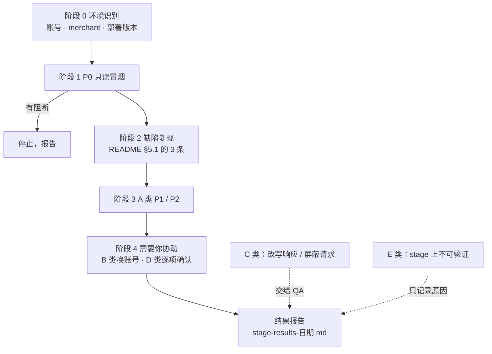

# stage 验证计划

> 执行者：Claude（通过 Claude in Chrome 操作你已登录的 Chrome）
> 用例来源：[README.md](README.md) 与 T1–T5，共 471 条（spec v0.2.0，代码基线 `master@772a320`）
> 用例分类明细：[stage-verification-appendix.md](stage-verification-appendix.md)
> 日期：2026-10-21 · 状态：计划，尚未执行

## 1. 目标

1. 在 stage 上确认核心路径可用：P0 冒烟中，凡是能用你当前账号只读执行的部分。
2. 在 stage 上复现源码中已确认的 3 个缺陷（README §5.1），并收集证据。
3. 用 stage 的实际行为，判定 spec 中的推断条目，以及 agent 报告、尚未确认的问题（README §5.2）。
4. 不能由我执行的用例，明确交给谁执行、需要什么条件。

## 2. 我会做什么，不会做什么

| 会做（只读） | 不会做，除非你在对话中逐项确认 | 无论如何都不做 |
|---|---|---|
| 打开 URL、点击导航和菜单、读取页面文本和 accessibility tree | 登出、同意 ToU、保存设置、创建项目、提交表单、MCP 授权 | 输入密码、登录其他账号、创建账号 |
| 读取 network 请求的 URL、方法、状态码和顺序 | 用 JS 改写 `fetch` 来模拟失败（只在当前 tab 生效，刷新后失效） | 绕过验证码或 bot 检测 |
| 用 JS 读取 `document.cookie`、`localStorage`、`sessionStorage` | 清除 storage 键（例如 enter-account、setup selection） | 把 token 或 cookie 的值写进报告或聊天 |
| 读取 console 错误 | | |

- 所有操作都在我自己建的 tab group 中进行，不碰你已打开的 tab。
- 读到的 token 和 cookie 只记录**是否存在和属性**，不记录值。

## 3. 阶段



### 阶段 0：环境识别（约 5 分钟）

| 步骤 | 怎么做 | 产出 |
|---|---|---|
| 0.1 打开 stage | 你提供 `{BASE}`（形如 `https://<stage-host>/for/web-games/account`），我在新 tab 中打开 | 确认会话有效，没有被送到登录页 |
| 0.2 识别账号 | 读当前 URL 中的 `{m}`；读 network 中的 `get_init_info` 和权限请求的响应，记录角色、`user.admin`、merchant 数量、项目数量 | 账号画像：对应统一账号表中的哪个代号（README §4.1） |
| 0.3 识别部署版本 | 打开 `{BASE}/{m}/new-project`：master 没有这个路由，会走 not-found fallback；V2 分支会渲染独立的 NewProject 页 | 决定使用 master 预期，还是 `[分支差异]` 预期 |
| 0.4 基线 | 记录首页加载时的 console 错误和失败请求 | 区分已有噪音和新问题 |

账号画像如果不是 owner，阶段 1 和阶段 3 的用例集合要按附录重新筛选。

### 阶段 1：P0 只读冒烟

- 范围：附录 A 类中的 P0 用例。
- 顺序：T1 启动·鉴权 → T2 路由·权限 → T3 首页·Dashboard → T4 remote 加载。T5 的 P0 大多需要新邮箱或注册流程，归入阶段 4。
- 任何一条 P0 失败，就先停下，向你报告。由你决定是继续执行还是先提缺陷。

### 阶段 2：缺陷复现

| 缺陷 | 用例 | stage 复现方式 |
|---|---|---|
| section 角色能进入公司设置和成员页 | RT-ACC-027 | 需要 webdev / junior 账号（B 类）。用当前账号只能确认 `/settings/company`、`/settings/members` 的路由存在 |
| IntegrationFrame 域名 allowlist 可以绕过 | RT-FRAME-002 | 见附录 §5 |
| Upsell 跳转丢失 basename | RT-DASH-024、RT-FRAME-010 | 见附录 §5 |

每个缺陷的证据包括：复现 URL、相关的 network 请求、最终落地 URL。只有页面显示本身就是证据时，才保存截图。

### 阶段 3：A 类 P1 / P2

按附录 A 类清单逐条执行，重点如下：
- T2 route inventory 的可达性表、legacy redirect 映射表，逐条打开 URL，记录最终落地页。
- D1：`/{m}/gold`、`/{m}/link` 落到 `/not-found`。
- 大小写、尾部斜杠、未知子路径。
- T4：各 remote 的 `remoteEntry` 请求状态，以及 remote 是否挂载成功。
- S-01：storefront 页面上，JS 是否能读到 `gc-pa-v4-token`。

### 阶段 4：需要你协助

| 类别 | 你需要做什么 | 我做什么 |
|---|---|---|
| B 类：其他账号 | 在同一个 Chrome profile 中切换到对应账号（viewer、junior、admin、多 org、ToU 待签等），然后告诉我 | 用该会话执行对应的只读用例 |
| D 类：写入或不可逆 | 对每个操作回复“确认” | 执行该操作并记录结果。登出放在最后执行 |
| C 类：改写响应 | 交给 QA，用 DevTools / Requestly 执行 | 在报告中列出清单和每条所需的工具配置 |

## 4. 验证方法与工具对应

| 要验证的内容 | 工具 | 判定依据 |
|---|---|---|
| 落地页和重定向 | `navigate` 后读取当前 URL 和页面标题 | 最终 URL 与预期一致 |
| 菜单显示或隐藏 | `read_page`（只看可交互元素） | 菜单项是否存在 |
| 请求顺序、状态码、请求头 | `read_network_requests` | URL、状态码、是否带 `Authorization`、`Business-Account-Id` |
| cookie 和 storage | `javascript_tool` 读 `document.cookie`、`localStorage` 的 key | 只判断 key 是否存在和属性。httpOnly cookie 读不到，这类用例交给 QA 在 DevTools 中看 |
| 运行时错误 | `read_console_messages` | 与阶段 0 的基线对比，找出新增错误 |
| 视觉和样式 | 截图（只在必要时） | 文案、布局 |

## 5. 结果记录

结果写到 `stage-results-<日期>.md`，每条用例一行：

```
| ID | 结果 | 实际行为 | 证据 | 备注 |
```

- 结果取值：`PASS` / `FAIL` / `BLOCKED`（缺账号、数据或工具）/ `N/A`（部署版本不适用）。
- `FAIL` 的条目附上复现 URL 和关键请求，并标明是新问题，还是已知缺陷（D*/S*/N*）。
- 报告末尾汇总：P0 通过率、新发现的问题、需要回写 spec 或用例的差异。

## 6. 开始前需要你提供

1. stage 地址 `{BASE}`。
2. 当前登录账号的角色。不确定也可以，阶段 0 会自动识别。
3. 是否同意阶段 4 中的写入操作，可以执行时再逐项确认。
4. 如果要执行 B 类：可以切换哪些账号。
