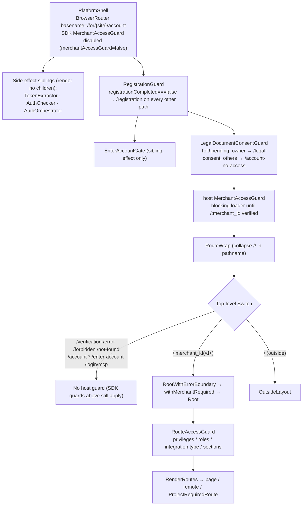
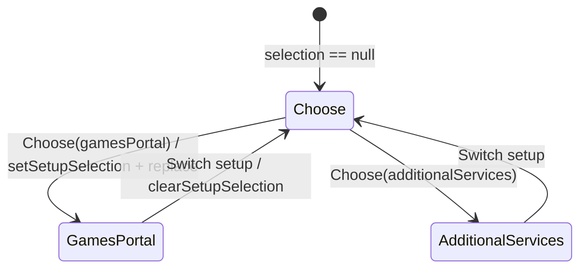

# Reverse-Engineered Specification: web-games-account（Web Games 发行商账户 Host）

> Status: draft（只读源码得出；未在运行时验证）
> Document version: 0.3.7
> Last updated: 2026-10-21
> Evidence snapshot:
> - Host 代码：`web-games-account` `master` @ `772a320dc6010323957e3d536495f5a0868fada0`（commit time 2026-10-20T09:57:39Z，"Merge branch 'BIZA-524-add-v-1-contract-baselines-for-the-v-2-upgrade'"）。
> - SDK 代码：本地 pnpm store 中与该 commit 的 `package.json` 版本完全一致的包，即 `@accounts-sdk/platform-shell 2.22.3`、`platform-apis 2.29.2`、`platform-store 1.15.6`、`platform-pages 3.25.2`、`platform-components 4.20.3`、`platform-bff 1.0.0`、`core 0.9.1`。原始源码取自各包 `dist/*.mjs.map` 的 `sourcesContent`。
> - 其他依赖：`react 16.14`、`react-router 4.3.1`、`@xsolla/xui-b2b-sidebar 0.206.1`、`@module-federation/runtime-core 2.9.0`、`@micro-frontend/bridge 0.0.2`。
> 勘误与回归用例记录（外部审计记录，不属于本文）：`regression-test/spec-errata-v0.2.0.md` 与同目录 `T1`–`T5` 文件。
> 运行时记录（外部审计记录）：`regression-test/stage-results-2026-10-21.md`。注意：观察时 stage 部署的是 `stage-web-games-20261005-03`，即 commit `c1b5e37`，比本文的 host 快照落后 52 个 commit。§10.3 只引用两类结论：本文已用源码核对过的，以及相关文件在两个 commit 之间没有变化的。

## 变更历史

| 版本 | 日期 | 变更 | 依据 |
|---|---|---|---|
| 0.1.0 | 2026-10-21 | 初版。从 master 源码、测试、配置反向提取 | master @ 772a320 |
| 0.2.0 | 2026-10-21 | 按独立 review 修正：OBS-DASH-001/002/004 与 OBS-I18N-002 的事实错误；integrations endpoint 的 base 与可达性；webpack、MCP 注册请求与 MerchantAccessGuard 的路径和行号；sdk-integration 的 dev URL；I9 与 D1 的 scenario 归属；测试文件计数。新增 S-16 与 S-17 | master @ 772a320 |
| 0.3.0 | 2026-10-21 | 合入两类修正：回归测试探索提出的 72 条勘误（T1–T5，逐条核实，0 条驳回，7 条按核实结果修正措辞），以及第二轮独立 review 的 7 条。改动：<br>• 用同版本 SDK 源码关闭 U-01、U-08、OBS-REG-003，部分关闭 U-02、U-03、U-07<br>• 重写 OBS-AUTH-008（Sign out 会走 BFF）、OBS-REG-001 与 AC-06（Finish 不因 ToU 禁用）、OBS-ACC-005（sidebar 也不读 visibility）、§2.4 guard 分层<br>• §7 标出不可达的 endpoint，并补充 SDK 发出的 endpoint<br>• 新增 S-18 到 S-33、T-01，以及 §11.4 的过时注释清单 | master @ 772a320 + 同版本 SDK |
| 0.3.1 | 2026-10-21 | 按第三轮独立 review 修正（6 条全部核实成立）：<br>• OBS-MAG-002 / AC-01：整页加载外部 merchant 会出现 HydrationError，不会跳回自己的 org。新增 AC-01b、S-34<br>• §2.3 与 OBS-AUTH-009：BFF 的 302 规则<br>• OBS-AUTH-002/008、§8.1：BFF 会话 cookie 与 JS cookie 同名 `pa-v4-token`<br>• §2.4：EnterAccountGate 跳过的路径前缀<br>• OBS-MF-002：错误文案不止 4 种<br>• LocaleProvider 的证据路径；恢复 §6 中 ontology 依赖 cookie 的说明，以及 §13 中"不向用户暴露 remote URL"的建议 | master @ 772a320 + 同版本 SDK |
| 0.3.2 | 2026-10-21 | 两类输入：<br>（1）第四轮独立 review 的 5 条，全部按可执行路径核实成立：<br>　• OBS-I18N-002：`?locale=` 在用户数据加载后会被 profile 覆盖<br>　• OBS-PROJ-001：`getProjectRouteRedirectId` 的完整分支，以及"不可访问"触发的改写<br>　• §2.3 / OBS-AUTH-009：BFF 在服务端解析 `0` 哨兵 ID<br>　• OBS-AUTH-002：客户端导航时 URL token 会替换会话 token<br>　• OBS-FRAME-003：DocumentCenter 的 message 监听只上报 analytics<br>（2）stage 运行时记录：新增 §10.3；新增 S-35（metaframe 必崩）、S-36、S-37、S-38；BFF 只挂载 `/for/:site/*` 带来的影响（OBS-BOOT-005/006、S-20）；关闭 U-12；新增 U-14 | master @ 772a320 + 同版本 SDK；stage `c1b5e37` 观察 |
| 0.3.3 | 2026-10-21 | 更正 §10.3 的适用范围：stage（`c1b5e37`）的 SDK 是更旧的补丁版本，host 的差异也比 0.3.2 所写的多；依赖 SDK 的运行时观察降为佐证 | `git diff c1b5e37 772a320` |
| 0.3.4 | 2026-10-21 | 合入 stage Batch A：执行 5 项，未执行 3 项。U-05 在 stage 上关闭；证实 S-21、OBS-ROUTE-003/005/006 与 BFF 的 `/0/…` 分支；按 `bff:merchant-sentinel.ts:186-247` 细化 OBS-AUTH-009 的哨兵分支（包括预算不足和请求超时）；§6 补充 finance 与 support 共用 container | master @ 772a320 + 同版本 SDK；stage `c1b5e37` 观察 |
| 0.3.5 | 2026-10-21 | 合入 stage Batch C 的 C1（切换语言，已恢复）：证实 S-23，证实 S-24 的前半段；新增 S-39（语言保存返回 200 但不持久化）、S-40（`<html lang>` 不更新）、U-16；补充 OBS-I18N-002 的保存接口 | master @ 772a320 + 同版本 SDK；stage `c1b5e37` 观察 |
| 0.3.6 | 2026-10-21 | 合入 stage Batch A2（用页面内方法补做 A3、A4）：证实 OBS-AUTH-009 的无会话规则和有会话访问 `/login` 的规则、S-22 的 BFF 一半、S-02；A5a、A5b 未执行 | master @ 772a320 + 同版本 SDK；stage `c1b5e37` 观察 |
| 0.3.7 | 2026-10-21 | 合入 A5b（Claude Code CLI，Playwright 匿名 headless 拦截 `/api/v1/modules`）：证实 OBS-BOOT-002，abort 和 500 两种失败都白屏、不进入 bootstrap；§10.3 新增 A5b 表，Batch A2 表中该行只保留 S-04 | master @ 772a320；stage `c1b5e37` 观察（`init.tsx`、`index.html` 两版相同） |

## 0. 阅读约定

- **路径**：host 文件路径相对 repo root，行号以 772a320 为准。
- **SDK 路径前缀**：`sh:` platform-shell、`pc:` platform-components、`pp:` platform-pages、`pa:` platform-apis、`ps:` platform-store、`bff:` platform-bff。前缀后面是 sourcemap 中的原始源码路径；注明 `index.mjs` 的，指 dist 文件的行号。
- **证据标签**：
  - **[F]**：直接读到的 source、test 或 config（host 或同版本 SDK）。
  - **[I]**：基于多处观察的推断。
  - **[U]**：未知，原因是需要 backend、remote、部署环境或运行时观察。
- **Requirement ID**：格式为 `OBS-<域>-<序号>`。被集成测试固定的条目注明 scenario ID（`I1`…`I15`、`D1`、`D2`，定义在 `src/__integration__/scenarios.ts`）。
- **证据类型**：本文结论只来自 source reading，测试只读未执行。唯一的例外是核实路由匹配时，在本地执行过 react-router 4.3.1 的 `matchPath`。CI 结果、部署版本和浏览器行为都没有观察。

---

## 1. Overview

`@account-platform/web-games-account` 是 Xsolla "Web Games" 站点（`site_id: web-games`）的发行商账户 **host SPA**，部署在 `/for/web-games/account` 下，由 BFF（`@accounts-sdk/platform-bff`）提供 HTML 和会话 cookie。它是 micro-frontend 容器，主要职责有四项：

1. 启动阶段从 gateway 拉取 module 列表，并注册 remote URL（MF1 window var 与 MF 2.0 manifest）。
2. 解析会话 token，并把它注入多套 axios 实例和 Redux store。
3. 在 SDK `PlatformShell` 的 guard（注册、法律同意、进入账户）之内，对 merchant 级 URL 做客户端访问控制：org 成员校验、privilege、role、integration type、section。
4. 在统一 chrome（Navigation、Sidebar、LiveChat、Banner）内渲染页面。页面来源有三类：
   - `@accounts-sdk/platform-pages` 提供的页面；
   - 本地页面（Dashboard、Get Started、Registration 等）；
   - 约 20 个 Module Federation remote 或 iframe。

本 repo 不包含 BFF（dev server 只是挂载它）、SDK 包、remote，也不包含 backend。[F] `pnpm-workspace.yaml`、`tsconfig.json:31`、`webpack.base.config.ts:14` 引用了 `../../`，说明它设计上位于 accounts-sdk monorepo 内的 `apps/<x>` 位置 [I]。

---

## 2. Architecture

### 2.1 Technology stack

| 层 | 技术 | 证据 |
|---|---|---|
| 语言 | TypeScript 4.9.5（`strict: false`、`allowJs: true`）、少量遗留 Flow `.js` | `package.json`、`tsconfig.json` |
| UI | React 16.14、react-router(-dom) 4.3.1、react-intl 2.x、redux-form、final-form | `package.json:52-107` |
| 状态 | Redux Toolkit 1.9（`configureStore`）+ RTK Query（`gcApi`）+ SDK `rootReducer`；`react-query` 已声明但没有任何 import | `src/core/store/index.ts`、`src/core/store/reducer.ts:13-26` |
| 平台 SDK | `@accounts-sdk/platform-{shell,apis,store,pages,components,ui,locales,bff}`、`@platform-base/{api,store}` | `package.json` |
| 微前端 | webpack 5 `ModuleFederationPlugin`（MF1，host 名 `main`，不 expose 任何模块）+ `@module-federation/runtime` 2.x（MF 2.0，实例名 `web_games_account`）+ `@micro-frontend/bridge` | `webpack.base.config.ts:265-331`、`src/mf/index.ts:9` |
| 构建 | webpack 5、ts-loader、PostCSS；pnpm 8.9.2；Node ≥18.20.4；生产 `publicPath = ${CDN_URL}/for/${DEFAULT_SITE_ID}/` | `package.json:27-30`、`webpack.base.config.ts:107` |
| 测试 | Vitest 3（jsdom）、Testing Library、MSW 2；Playwright 1.62.1（`e2e/` 是独立 npm 包） | `vitest.config.ts`、`e2e/package.json` |
| CI | GitLab CI：`localization`、`build`、`test` 三个 stage；没有 deploy job | `.gitlab-ci.yml` |

### 2.2 Module structure

```text
src/
├── index.tsx            # 只有 import('./init')，让 MF 先初始化 shared singleton
├── init.tsx             # 拉取 module 列表 → 注册 remote URL → import('./bootstrap')
├── bootstrap.tsx        # locale data、__INITIAL_STATE__ backfill、URL 预重定向、ReactDOM.render
├── App.tsx              # Redux Provider + PlatformShell + MerchantAccessGuard + 路由树
├── config.ts            # 按 APP_ENV 选择的外部 URL 常量
├── routes.tsx           # 顶层路由表（top-level / merchant / outside）
├── routes/              # 路由基础设施、guard、inside/* 子路由表
├── layouts/             # Root（merchant chrome）、Outside、各功能 layout（多数挂载 remote）
├── pages/               # 本地页面（Dashboard、GetStarted、Registration、IntegrationFrame…）
├── components/          # Navigation、DynamicHome、Banner、LiveChat…
├── modules/             # MF1 remote 加载器（RemoteModule、loadModule、静态 module config）
├── mf/                  # MF 2.0 runtime 与 gateway remote 注册
├── core/
│   ├── access/          # 路由 / 导航访问判定（privilege、role、integration type、section）
│   ├── apis/            # 本地 axios 实例与 endpoint（SDK 没有提供的部分）
│   ├── store/           # Redux store、gcApi、本地 slice
│   ├── hocs/ hooks/     # withMerchantRequired、useSiteId、useOntologyAccess…
│   ├── mcp/             # /login/mcp 的 OAuth 参数校验、Login API 调用与 analytics
│   └── utils/           # token 解析、cookie、setup 选择、upsell、validator…
├── locales/             # en + 8 种语言 JSON（host.* / app.*）
└── __integration__/     # v1 行为基线集成测试（I1–I15、D1、D2）
```

### 2.3 启动序列

```mermaid
sequenceDiagram
    participant B as Browser
    participant BFF as BFF (platform-bff)
    participant I as init.tsx
    participant GW as Gateway /api/v1/modules
    participant BS as bootstrap.tsx
    participant SH as PlatformShell (SDK)
    participant G as host MerchantAccessGuard
    participant R as Routes / Root

    B->>BFF: GET document
    Note over BFF: ?token → set httpOnly cookie, 302 without token<br/>no session on {base} or a protected path → 302 {base}/login (save pa-original-url)<br/>session: a 0 merchant/project segment is resolved first (302)<br/>session on /login → 302 saved URL or {base}; session on {base} → 302 only if a saved URL exists<br/>only /for/:site/* is mounted (/for/{site} and / get 404)<br/>otherwise serve the shell with __INITIAL_STATE__ (script removes itself)
    BFF-->>B: HTML
    B->>I: import('./init')
    I->>I: setupGatewayAxios(platformApiUrl)
    I->>GW: fetchModuleList()
    GW-->>I: modules[]
    I->>I: initModuleUrls / registerMfRemotes (best effort)
    I->>BS: import('./bootstrap')
    BS->>BS: backfill __INITIAL_STATE__.projects/user
    BS->>BS: redirectToAccountRoot() (replaceState, always returns false)
    BS->>B: resolveRouteFromCookie() → location.replace (may end the flow)
    BS->>SH: ReactDOM.render(<App/>)
    SH->>SH: AuthOrchestrator: write account-platform-site-id cookie, register 401 handler
    SH->>SH: getInitialToken = host resolveInitialToken({stripUrlToken:true})
    SH->>BFF: (only when no URL / injected token) GET {basename}/server/token
    SH->>SH: null token → checkDisallowedUrls → may location.replace(login)
    SH->>SH: onTokenChange → setupAxios + setupLocalAxios + setToken
    SH->>SH: AuthChecker (after tokenHydrated) → consumeInjectedToken (clears global)
    SH->>G: RegistrationGuard → LegalDocumentConsentGuard → children
    G->>R: release the route tree once the URL merchant is verified
    R->>R: RouteAccessGuard → RenderRoutes → fetchData
```

### 2.4 渲染时的 guard 分层

[F] `sh:src/PlatformShell.tsx:193-240,282-283,364-424`、`src/App.tsx:70-100`



SDK guard 对"无 host guard"路由的实际效果。[F] `pc:auth/RegistrationGuard/index.tsx:21-25`、`pc:auth/LegalDocumentConsentGuard/index.tsx:24-31,201`、`pa:utils/checkDisallowedUrls.ts:4-48`、`pa:constants/allowed-unauthorized-urls.ts:1-15`、`sh:AuthOrchestrator.tsx:125-137`

| 条件 | `/verification` `/error` `/login/mcp` | `/forbidden` `/not-found` `/account-*` `/enter-account` |
|---|---|---|
| 无 token | 放行 | → `/for/{site}/account/login`（原路径写入 60 s cookie；`/not-found` 除外） |
| `registrationCompleted === false` | → `/registration`（包括 `/login/mcp`） | → `/registration` |
| 已登录且 ToU 待签、未被 suppress | `/verification`、`/login/mcp` 被当作公开路径；`/error` 时 owner → `/legal-consent`，其他人 → `/account-no-access` | owner → `/legal-consent`，其他人 → `/account-no-access` |
| EnterAccountGate（只在 `/for/{site}/` 下生效，且要等该 merchant 的 consent 状态加载完成；跳过 `/enter-account`、`/legal-consent`、`/account-no-access`、`/account-restricted`、`/login*`、`/signup`、`/resetting`、`/registration`、`/invite`、`/verification` 前缀，见 `pc:auth/EnterAccountGate/useEnterAccountGate.ts:20-31,88-93,160-166`） | 只影响 `/error`：非 admin owner 若 ToU 已满足、尚未见过 enter-account 页，会被 `history.replace('/enter-account')`。`/verification`、`/login/mcp` 被跳过 | 只影响 `/forbidden`、`/not-found`（规则同左）。`/account-*`、`/enter-account` 被跳过 |

---

## 3. Configuration and environments

### 3.1 环境变量

| 变量 | 用途 | 进入浏览器 bundle？ | 证据 |
|---|---|---|---|
| `APP_ENV` | `development \| stage \| production`，决定所有 URL 和若干行为 | 是（DefinePlugin，默认 `development`） | `webpack.base.config.ts:224-235` |
| `LIVECHAT_WIDGET_URL` | 覆盖 LiveChat widget host | 是 | 同上；`src/config.ts:84` |
| `METRIKA_COMMUNICATION_HUB_COUNTER_ID` | 覆盖 Communication Hub Metrika counter。未设置时为 `3002`；设为 `''` 表示禁用 | 是 | `src/config.ts:153-156`、`webpack.base.config.ts:231-234` |
| `PA_V4_TOKEN`、`DEFAULT_MERCHANT_ID`、`DEFAULT_PROJECT_ID`、`MARKETING_BALANCE_URL` | `config.ts` 读取这些变量 | **否**，运行时恒为 undefined（`process` 来自 `process/browser`）。前三个在 `config.ts` 之外没有读取方；`MARKETING_BALANCE_URL` 只服务死代码。因此**没有运行时影响**（S-06） | `src/config.ts:3-7,113,170-173` |
| `DEFAULT_SITE_ID`（默认 `web-games`）、`CDN_URL` | 生产 `publicPath = ${CDN_URL}/for/${DEFAULT_SITE_ID}/` | 构建期 | `webpack.base.config.ts:107` |
| `GATEWAY_PROXY_TARGET`、`GAMES_CATALOG_PROXY_TARGET` | dev server proxy 目标（`/api`、`/mapi`、`/xsolla_login`、`/games-catalog`） | dev 专用 | `webpack.dev.config.ts` |
| `NPM_TOKEN`、`ACCOUNTS_SDK_ACCESS_TOKEN`、`MICRO_FRONTEND_ACCESS_TOKEN` | 私有 registry 认证 | 安装期 | `.npmrc.example:2-4` |

### 3.2 外部服务 URL（`src/config.ts`）

| Key | production | stage / development |
|---|---|---|
| `platformApiUrl`（gateway） | `https://business-accounts.xsolla.com` | stage: `account-platform-gateway.nl-k8s-stage.srv.local`；dev: `window.location.origin`（经 dev proxy） |
| `loginApiUrl` | `https://login.xsolla.com` | `https://test-login.xsolla.com` |
| `chatApiUrl` / `livechatWidgetUrl` | `chat.xsolla.com` | `chat.nl-k8s-stage.srv.local` |
| `externalAnalyticsApiUrl` | `external-analytics.xsolla.com` | `aea-configuration-api.nl-k8s-stage.srv.local` |
| `marketingBalanceUrl` | `marketing-balance.xsolla.com` | `marketing-balance.nl-k8s-stage.srv.local` |
| `storeApiUrl` | `store.xsolla.com/api/v2` | `store-api.nl-k8s-stage.srv.local/v2` |
| `customizatorAppUrl` | `product-themes.xsolla.com` | `product-themes.nl-k8s-stage.srv.local` |
| `discordBotApiUrl` | `prod.xsollapi.com/api` | `dev.xsollapi.com/api` |
| `mcpLoginClientIds` | `['18644']` | `['222410']` |
| `metrikaServerUrl` | `minimetrika.xsolla.com` | `xmts-global-api.nl-k8s-stage.srv.local` |
| 静态 remote URL | login、player-platform、sdk-integration、cloud-gaming、offerwall、disputes（见 §6） | stage host（dev 也指向 stage）。例外：sdk-integration 的 development URL 等于 production URL（`config.ts:52`），与第 47 行注释 "Dev points at stage" 不符（S-17） |

---

## 4. Observed functional requirements（EARS）

### 4.1 BOOT：启动

**OBS-BOOT-001** 先拿到模块列表再渲染。[F] `src/init.tsx:13-28`
The host shall set the gateway base URL, fetch the module list (`fetchModuleList`), register MF1 window URLs and MF 2.0 remotes, and only then import `bootstrap`.

**OBS-BOOT-002** 模块列表失败即终止。[F] `src/init.tsx:29-31`
If `fetchModuleList` rejects, the host shall throw `Failed to initialize application` and shall not render the app. There is no error UI and no retry; the user sees a blank page [I].

**OBS-BOOT-003** MF 2.0 注册失败不阻断启动。[F] `src/mf/index.ts:23-29`
If MF 2.0 remote registration throws, the host shall log a warning and continue booting with MF 2.0 disabled.

**OBS-BOOT-004** 回填 `__INITIAL_STATE__`。[F] `src/bootstrap.tsx:43-50`
Where `window.__INITIAL_STATE__` exists, the host shall default its `projects` to `{currentID:null}` and its `user` to `{id:null,email:null}` when they are missing.

**OBS-BOOT-005** 规范化裸 site URL。[F] `src/core/utils/redirectToAccountRoot.ts:5-16` · I1
When the path matches `^/for/{siteId}/?$`, the host shall `history.replaceState` to `/for/{siteId}/account` and keep query and hash, without a reload.
**Where it applies.** The BFF only mounts `/for/:site/*` (`bff:bff-routes.ts:211,231,242,400`), so a bare `/for/{siteId}` without a trailing slash never reaches the SPA in a BFF deployment. On stage it returned Express 404 "Cannot GET" (§10.3). This rule therefore only takes effect without a BFF, e.g. the dev server, or for `/for/{siteId}/`.

**OBS-BOOT-006** 根路径按 cookie 重定向。[F] `src/core/utils/resolveRouteFromCookie.ts:12-25`、`sh:AuthOrchestrator.tsx:224-229` · I2
When the path is `/` and the cookie `account-platform-site-id` is non-empty, the host shall `location.replace('/for/{siteId}/account')` and shall not render.
The SDK `AuthOrchestrator` writes this cookie on every mount under `/for/{site}/...`. The cookie lives 10 days, is set at xsolla domain level, and does not require login.
**Where it applies.** For the same reason as OBS-BOOT-005, the host root `/` is not served by the BFF; it returned 404 on stage (§10.3). This rule only takes effect when something else serves `/` with this SPA [U].

**OBS-BOOT-007** 鉴权推迟到挂载后。[F] `src/bootstrap.tsx:62-74`
The host shall not issue any authenticated request before `ReactDOM.render`. All token resolution happens in `PlatformShell.getInitialToken`.
（`bootstrap.tsx:62-68` 的注释说 SDK 在 handler 注册前就锁住 flag，这已过时，见 §11.4。）

### 4.2 AUTH：Token 与会话

**OBS-AUTH-001** Token 优先级。[F] `src/core/utils/resolveInitialToken.ts:8-50`、`src/core/apis/server.ts:7-11`、`sh:AuthOrchestrator.tsx:125-143`
The host shall resolve the initial token in this order:
1. `?token=` URL parameter;
2. `window.__INITIAL_STATE__.token`, read directly (not through the SDK's `consumeInjectedToken`);
3. development only: the `pa-v4-token` cookie;
4. `GET {basename}/server/token` with `credentials:'include'` and an 8 s abort;
5. `null`.

Step 4 never rejects. Any failure — network error, timeout, non-2xx or JSON error — becomes `null`.
When the result is `null`, the SDK `AuthOrchestrator` shall call `checkDisallowedUrls`. If the path is not `/` and not in `allowedUnauthorizedUrls`, it shall `location.replace` to the login page. The SDK's "network failure does not redirect" branch cannot run in this host.

**OBS-AUTH-002** URL token。[F] `bff:bff-routes.ts:107-113,257-263`、`pc:auth/TokenExtractor/index.tsx:95,167,183-186`、`resolveInitialToken.ts:16-20`
- **Full-page navigation with a BFF.** When the request is to an account route, accepts HTML and carries a JWT-shaped `?token=`, the BFF shall store the token in an httpOnly cookie and 302 to the same URL. The BFF strips any `?token=` in this 302, JWT-shaped or not. In this case the SPA never sees the token.
- **Client navigation or a deployment without a BFF.** When the SPA sees `?token=`:
  - The SDK `TokenExtractor` shall write the JS-readable cookie `pa-v4-token` (10 days, domain level, not httpOnly) and `history.replace` the same path without `token`, keeping the deep link.
  - The SDK `TokenExtractor` shall also `dispatch(setToken(urlToken))` (`pc:auth/TokenExtractor/index.tsx:98`). On client navigation this **replaces** the current session token: through `onTokenChange` it reaches every axios instance.
  - The host `resolveInitialToken` strips `token` from the address bar only on the initial page load. It runs once, from `AuthOrchestrator`'s mount-only effect, which returns early when a token already exists (`sh:AuthOrchestrator.tsx:119-153`), so it never runs on client navigation.
- **Same cookie name.** The BFF httpOnly session cookie and the SDK JS cookie are both named `pa-v4-token`, with the same path `/` and, in prod, the same domain `.xsolla.com` (`bff:config.ts:6,30-48`; `pa:utils/cookie.ts:105-120`). Consequences:
  - The BFF comment says js-cookie cannot delete httpOnly cookies (`bff:bff-routes.ts:131-132`), so the SDK's JS removals do not end a BFF session; the BFF `/logout` does.
  - Without a BFF session, a JS-written `pa-v4-token` is what the BFF reads as the session on the next page load [I].

**OBS-AUTH-003** Token 扇出。[F] `src/App.tsx:74-78`
When the shell reports a token change, the host shall update all three: the SDK axios interceptors (`setupAxios`), the local `authTokenCache` (`setupLocalAxios`), and the Redux store (`setToken`).

**OBS-AUTH-004** 本地 gateway 请求头。[F] `src/core/apis/gateway-instance.ts:28-40`
The local `gatewayInstance` shall send `Authorization: Bearer <token>` and a `Business-Account-Id` header taken from the `/for/{id}` URL segment.

**OBS-AUTH-005** 两个 401 拦截器。[F] `src/core/apis/gateway-instance.ts:74-124`、`pa:apis/gateway-instance.ts:101-149`、`pa:utils/auth-session-context.ts:27-32`、`sh:AuthOrchestrator.tsx:108-112` · I6
The host has two separate axios instances, and each has its own one-shot flag:

| | Host local `gatewayInstance` | SDK `gatewayInstance` |
|---|---|---|
| Used by | endpoints in `src/core/apis/*` | most SDK thunks, e.g. `get_init_info` |
| Triggers on | 401 on a request that carried `Authorization` | same |
| Viewer role | no check; viewers are also logged out | skipped (`shouldSkipAuthLogoutForStatus`) |
| Actions | navigate once to `{basename}/logout` | remove the `pa-v4-token` cookie, `setupAxios(null)`, call the shell handler (`clearUserData`), then navigate once to `{basename}/logout` |
| Skipped when | already on a login page | already on `/login` |
| Delay | 0 ms in production, 2000 ms elsewhere | 0 ms in production, 2000 ms elsewhere |

I6 runs this rule against both the real SDK instance and the local instance.

**OBS-AUTH-006** 403 不注销。[F] `gateway-instance.ts:77-79`、`pa:apis/gateway-instance.ts:108-109` · I7
When a gateway request gets a 403, neither interceptor shall log out or navigate.

**OBS-AUTH-007** 匿名 401 不注销。[F] `gateway-instance.ts:85-89`
When a 401 response belongs to a request without an `Authorization` header, neither interceptor shall log out.

**OBS-AUTH-008** Sign out。[F] `pc:Navigation/index.tsx:470-479`、`bff:bff-routes.ts:211-218`
When the user clicks Sign out, the SDK Navigation shall:
1. send the click analytics event;
2. remove the `pa-v4-token` cookie through js-cookie. This does not delete the httpOnly BFF cookie of the same name (OBS-AUTH-002);
3. `location.assign({basename}/logout)`.

The BFF then clears the session cookie, the return-URL cookie and the merchant cookie, and 302s to `{basename}/login`. The Redux state disappears with the page unload.
（host `src/components/Navigation/index.tsx:29-40` 的 TODO 引用的是 SDK 0.2.7，已经过时。）

**OBS-AUTH-009** 已登录用户访问入口页。[F] `bff:bff-routes.ts:161-188`、`src/routes/useMerchantAccessGuard.ts:75-105` · I5
- **`0` sentinel, live session, before every other rule**（`bff:bff-routes.ts:156-167`、`bff:merchant-sentinel.ts:164-247`）. The BFF shall resolve a `0` merchant or project segment on the server:

  | Request | Result |
  |---|---|
  | `/0/…` | 302 to the default org, keeping the path |
  | `/0/…`, `get_init_info` failed or the time budget is spent | serves the shell; the SPA resolves the merchant |
  | `/0/…`, no org on record | 302 to `{base}` |
  | `/{m}/projects/0/…` | 302 to the first project |
  | `/{m}/projects/0/…`, the time budget is spent, the list request failed or timed out (`AbortSignal.timeout`), or there are no projects | 302 to `{base}/{m}/`, dropping the path |

  The cases are from `bff:merchant-sentinel.ts:186-247`. On stage, an account with 687 projects was sent from `/{m}/projects/0/edit` to `/{m}/`. The code does not tell which of the last row's causes applied [I] (§10.3).

- **Full-page request with a live session**（`bff:bff-routes.ts:169-188`）:
  - `/login`: the BFF shall 302 to the saved return URL (`pa-original-url`, which it then clears), or else to `{basename}`.
  - `{basename}`: the BFF shall 302 to the saved return URL if one exists; otherwise it serves the shell.
  - `/signup` is public and is not bounced on the server side.
- **Full-page request without a live session**（`bff:bff-routes.ts:128-154`）:
  - `{basename}`: the BFF shall 302 to `{basename}/login`.
  - A non-public path: the BFF shall save the original URL in `pa-original-url` and 302 to `{basename}/login`.
  - A dead cookie is cleared first.
- **Client navigation, or a full page at `/signup` or `{basename}`.** When a user with a token lands on `/`, `/login` or `/signup`, and registration is not incomplete, the host hook shall report the social-auth callback and `history.replace` to `/{firstOrgId}`. A user without an org goes to `/registration`.

### 4.3 MAG：Merchant 访问守卫

**OBS-MAG-001** 阻塞式校验。[F] `src/routes/MerchantAccessGuard.tsx`、`src/App.tsx:93`
While a token exists and the `/{merchantId}` in the URL is not yet verified or passed, the host shall render a full-screen loader (`merchant-access-guard-loader`) instead of the route tree.

**OBS-MAG-002** 外部 merchant：客户端导航回到自己的 org，整页加载出错。[F] `useMerchantAccessGuard.ts:108-119,148-160`、`ps:slices/user.ts:108-137`、`pa:apis/merchant.ts:91-160,226-228`、`src/core/hocs/withMerchantRequired.tsx:52-59` · I4（只覆盖客户端分支）

- **Client navigation, user data already loaded.** When a non-admin user navigates in the app to `/{id}`, and `id` is not in the user's organizations, the host shall `history.replace('/{organizations[0].id}')`, drop the sub-path, and not redirect to `/forbidden`.
- **Full-page load, deep link or reload, of a foreign `/{id}`** — current behaviour, suspected defect S-34:
  1. The SDK `fetchUserData` calls `get_init_info?org_id={id}`. The gateway returns a merchant list without `id`, which raises `MerchantAccessDeniedError`.
  2. `fetchUserData` then retries with `fetchMerchantAndUserDetails()` and no argument. That function resolves the id from the URL again (`merchant.ts:106-107`), so the retry requests the same foreign `id` and raises the same error. The retry is outside the `try`.
  3. `fetchUserData` rejects and sets `user.error`. The host guard then releases the tree (`useMerchantAccessGuard.ts:112-119`), and `withMerchantRequired` renders the 500 `HydrationError` (OBS-ERR-002).
- **No redirect.** The redirect does not happen when `hasMerchantAccess` returns true: the user is an admin, has registration incomplete, or has an empty organization list (`merchant.ts:91-95`).
- **Other gateway responses.** Any non-401 error ends in the same HydrationError. A 401 triggers the SDK logout (OBS-AUTH-005).

（`useMerchantAccessGuard.ts:34-42,168-169` 说 "`fetchUserData(undefined)` always resolves the default org"，与当前 SDK 不符，见 §11.4。）

**OBS-MAG-003** 注册未完成。[F] `useMerchantAccessGuard.ts:131-135` · I3
When `registrationCompleted === false`, the host shall replace the URL with `/registration`. The SDK `RegistrationGuard` applies the same rule to every path (§2.4).

**OBS-MAG-004** Admin 跳过成员检查。[F] `useMerchantAccessGuard.ts:137-139`
Where the user is an admin, the host shall skip the organization-membership check and only perform `switchMerchant`.

**OBS-MAG-005** Hydration 失败时放行（fail-open）。[F] `useMerchantAccessGuard.ts:170,186-197`、`ps:slices/user.ts:148-170`
If `switchMerchant` or merchant hydration fails, the host shall log the error and render the tree anyway. The tree may then show the default org's data under the URL id.
A normal member's first load seldom reaches this branch, because the SDK has already put the URL merchant into the store. The reachable cases are an admin whose merchant-detail request failed, and an in-app merchant switch whose `switchMerchant` failed.

**OBS-MAG-006** 无 token 时放行。[F] `src/routes/useMerchantAccessGuard.ts:237-242`
While there is no token, the guard shall render the tree without verification. The SDK `AuthOrchestrator` and `AuthChecker` handle the redirect to login (OBS-AUTH-001).

### 4.4 ROUTE：路由

**OBS-ROUTE-001** 三棵顶层路由树，按顺序匹配。[F] `src/routes.tsx:185-192`
The host shall evaluate routes in this order: top-level routes, then the merchant root `/:merchant_id(\d+)`, then the outside root `/`. The first match wins.

**OBS-ROUTE-002** 自动 not-found。[F] `src/routes/createRoute.ts:29-38`、`routes.tsx:149,162`、`src/routes/defaultRedirect.tsx:8-13`
When a route has child `routes` and `disabledNotFound` is not set, `createRoute` shall append a `*` → `/not-found` child, mutating the passed array. Where it is effective:
- **`/verification`, `/projects`**: effective. For example, `/123/projects/abc` → `/not-found`.
- **merchant and outside arrays**: unreachable. Both already end with an explicit `*`.
- **`/support`**: unreachable. `/support/*` takes every sub-path, including `/support/`. The bare `/support` goes to the empty-path `defaultRedirect` → `/support/transactions`.

**OBS-ROUTE-003** 双斜杠规范化。[F] `src/routes/RouteWrap.tsx:13-16`、`RouteWrap.test.tsx:66-80`
When the pathname contains `//`, the host shall redirect to the collapsed pathname. The redirect drops search and hash. A `//` that appears only in the query is ignored.

**OBS-ROUTE-004** 路由数据预取。[F] `src/layouts/Root.tsx:77-156`
When the merchant layout is not loading and the path changes, the host shall dispatch `fetchData` for every matched route that is not access-denied. The params are `{...match.params, searchQuery, isExact}`. The fetch is skipped when `location.state.fromModal` is set.
The host passes each entry to `dispatch` without checking that it is an action creator. `M/metaframe`, ``M/'gold'`` and ``M/'link'`` list `fetchProjectsLite`, which is a plain async API function from `pa:apis/project.ts:41`, not a thunk or action creator. Dispatching its Promise throws Redux error #7 ("Actions must be plain objects"), and these pages always crash. Stage observation matches (S-35, §10.3).

**OBS-ROUTE-005** Support Hub 别名。[F] `src/routes.tsx:64-66,102`、`pc:index.mjs:2273-2280` · I11
When the user opens `/{m}/support-hub`, or any sub-path of it (the route is non-exact), the host shall redirect to `/{m}/communication-hub` and drop sub-path, query and hash.
The SDK Navigation chat button pushes `/communication-hub` directly, so this alias only serves old links.（`routes.tsx:59-63` 的注释已过时。）

**OBS-ROUTE-006** Analytics 旧路径。[F] `src/layouts/advanced-analytics/index.tsx:89-123`、`src/routes/inside/advanced-analytics.ts:73-80` · I12
- When the user opens `/{m}/analytics/products/{product}` with a mapped product, the host shall redirect to the mapped board and keep query and hash. The mappings are `site-builder` → `web-shop` and `login` → `engagement`.
- An unmapped product shall fall through to `/{m}/analytics/payments`, and the query is dropped.

**OBS-ROUTE-007** 滚动复位。[F] `Root.tsx:145-150`
When a PUSH navigation changes the pathname, the host shall scroll to the top, except under `/storefront/virtual-currency/packages` and `/storefront/pay2play`.

**OBS-ROUTE-008** Chrome 显隐规则。[F] `src/layouts/Root.tsx:158-236`
- The host shall hide the sidebar on these paths: `/marketplace`, the template creators, `/communication-hub`, `/support-hub`, `/select-project`, settings-layout paths (`/settings/company`, `/settings/api_key`, `/settings/administration`, `/profile`), and the setup Choose page.
- The host shall hide the topbar on these pages: select-project, the site-builder editor, and the Choose page.
- The host shall remove content padding on the listed full-bleed paths and on the exact path `/{m}/finance`.

The settings and profile checks use substring `includes`.

### 4.5 ACC：路由访问控制

**OBS-ACC-001** 等待权限加载。[F] `src/core/access/route-access.ts:125-149`、`src/routes/RouteAccessGuard.tsx:38`
While any matched merchant route declares privileges and the privilege list is not settled (that is, not non-empty and idle), the host shall render `route-privileges-loader`.

**OBS-ACC-002** 权限获取失败时永久 loading。[F] `route-access.ts:136-139`
If the privileges fetch fails (settled empty), the host shall keep the loader for the rest of the session. The SDK does not retry. See S-04.

**OBS-ACC-003** 拒绝 → `/forbidden`。[F] `route-access.ts:47-67`、`pa:index.mjs:2890` · I15
When any matched route is denied, the host shall `<Redirect>` (replace) to `/forbidden` and shall not dispatch that route's `fetchData`. A route is denied when at least one of these holds:
- **(a) integration type**: the type is in `disallowedIntegrationTypes` and the user is not an admin. An unloaded type (null) passes. Only the state value is lowercased before comparison; the list is not.
- **(b) privileges**: the user does not hold every required privilege (AND, case-sensitive, no admin bypass).
- **(c) role**: the role is disallowed. An unloaded role passes.

**OBS-ACC-004** Section 限定角色。[F] `src/core/access/sections.ts:39-85,143-144`、`useAllowedSections.ts:18-41`、`route-access.ts:74-116,144-148`、`RouteAccessGuard.tsx:43`
Where the merchant role is in `PROJECT_ONLY_ROLES` and a section feature flag is granted (`items_catalog_only_role`, `liveops_only_role`, `external_webdev_role`), the host shall apply these rules:
- Allow `/{m}`, `/{m}/projects`, and project paths inside a granted section.
- Redirect a bare `/projects/{id}` to the first section's landing path.
- Send everything else to `/forbidden`. Exception: `webdev` keeps the merchant pages that are not in `BLOCKED_MERCHANT_PATHS`.

As-built details, several of them suspected defects:
1. `BLOCKED_MERCHANT_PATHS` contains `/users` and `/company`. The real routes are `/settings/users`, `/settings/members` and `/settings/company`, and `ownsPath` matches by segment prefix, so these routes are not blocked. A webdev role can therefore open company settings, and members pages if it holds `get_merchant_users` (S-18).
2. The section regexes and literals are case-sensitive, but routes match case-insensitively. An upper-case URL bypasses the block for webdev and wrongly denies liveops or items-catalog pages (S-19).
3. While features are not settled, section rules allow everything.
4. Route rules run before section rules. A user without `project_get` on a bare `/projects/{id}` gets `/forbidden`, not the landing redirect.

**OBS-ACC-005** `visibility` 未被强制。[F] `createRoute.ts:39-50`、`filter-accessible-nav-items.ts:30-51`、`core/hooks/useOntologyAccess.ts:41,77` · **D2**
The host does not enforce `visibility` anywhere:
- `createRoute` drops `route.visibility`.
- The v1 sidebar does not read nav-item `visibility` either. It is data only: `filterAccessibleNavItems` ignores it, the SDK's `filterSidebarItemsByVisibility` is never imported, and platform-ui 0.10.0 and xui-b2b-sidebar 0.206.1 never read it.

The only consumer of the subsite's `visibilityModules` is `useOntologyAccess`. A URL or nav entry for a module that is not enabled shows whenever the privileges allow.

**OBS-ACC-006** 覆盖范围。[F] `Root.tsx:279`
`RouteAccessGuard` shall apply only to merchant routes. Top-level and outside routes have no host-side access guard; the SDK guards in §2.4 still apply.

### 4.6 HOME：Merchant 首页与 Get Started

**OBS-HOME-001** 首页分流。[F] `src/components/DynamicHome/index.tsx:45-79`、`src/core/constants/roles.ts:67-70`
When the user opens `/{m}` and merchant, privileges and projects are settled, the host shall redirect:
- a `PROJECT_ONLY_ROLES` role (`ROLE_JUNIOR_DEVELOPER`, `ROLE_JUNIOR_DEVELOPER_PARTIAL`, `ROLE_DEVELOPER_PARTIAL`) → `/{m}/projects`;
- no dashboard access, or projects request error, or no setup selection → `/{m}/get-started`;
- otherwise → `/{m}/dashboard`.

**OBS-HOME-002** Dashboard 访问规则。[F] `src/core/utils/dashboardAccess.ts:14-30`
The host shall grant dashboard access when the user holds `get_graphics_gross_revenue` (the merchant has projects) or `project_create` (no projects), and the role is not one of the two junior developer roles.
`ROLE_DEVELOPER_PARTIAL` is not in the hidden set. That role is sent from `/{m}` to `/projects`, but it can still open `/{m}/dashboard` by URL (S-31).

**OBS-HOME-003** Setup 选择持久化。[F] `src/core/utils/setupSelection.ts:5-17`
The host shall store the setup choice in localStorage under `web-games:setup-selection:{siteId||'default'}:{merchantId}`. Valid values are `gamesPortal` and `additionalServices`; any other value reads as `null`.

**OBS-HOME-004** Get Started 状态机。[F] `src/pages/GetStarted/index.tsx:24-37`、`src/pages/LaunchProject/index.tsx:74-89`



While the selection is null, the host shall render the Choose UI with `NavigationLite` and shall hide the topbar and sidebar.

**OBS-HOME-005** Setup 引导 CTA 门控。[F] `src/core/access/setup-guide-access.ts`、`src/pages/GamesPortalSetup/index.tsx:36-52,73,141-146`、`src/pages/AdditionalServicesSetup/index.tsx:53-56,109-140`
The host shall show a setup CTA only when a project id resolves and the matching gate passes:

| Setup | CTA | Gate |
|---|---|---|
| Games Portal | step 1 "set up game" | `player-platform` is in the project nav |
| Games Portal | step 2 "pay station" | `project_settings` |
| Games Portal | What's next cards | always disabled |
| Additional Services | pay station | `project_settings` |
| Additional Services | login | not viewer, and login is in the nav |
| Additional Services | Web Shop | `site-builder` is in the nav (gnation excluded) |
| Additional Services | Offerwall | `offerwall` is in the nav |
| Additional Services | Backpack | the 4 storefront privileges |

### 4.7 DASH：Dashboard

**OBS-DASH-001** 访问拒绝。[F] `src/pages/Dashboard.tsx:135-143`
If the user lacks dashboard access (OBS-HOME-002), the host shall redirect to `/forbidden`.
If the projects request failed, the host shall apply only the junior-developer role check (`isDashboardHiddenForRole`), so a user without the privilege is not sent to `/forbidden`.

**OBS-DASH-002** 会计演示模式。[F] `Dashboard.tsx:123`、`src/core/utils/isAccountingPresentMode.ts:4-12`
When `user.id` equals `474648`, the host shall redirect the dashboard to `/{m}/finance`.
The list also holds 3 email addresses, but the caller passes only `user.id`, so the email entries never match (S-16).

**OBS-DASH-003** 头部。[F] `Dashboard.tsx:86-89`、`src/core/store/api/dashboard.ts:106`
- While the balance is loading or refetching (for example after a merchant switch), the host shall render the welcome heading.
- Otherwise, when the merchant has no transactions (balance ≤ 0, or no `last_transfer_date`), the host shall render `AskAiBanner`. A failed balance request counts as no transactions, including a 403 for a user without balance privileges.

**OBS-DASH-004** 余额与图表。[F] `Dashboard.tsx:44-45,65,82-84,159-177`、`store/api/dashboard.ts:105`
- Once `merchantId` is known, the host shall request the balance **unconditionally**. This includes accounting-demo users and users who will be redirected to `/forbidden` (S-26). `DashboardBalance` shares the same RTK cache entry.
- Where the user holds **both** `get_metric_balance` **and** `get_metric_transactions_count` (`checkPrivileges` is AND), the host shall show balance and last/next payout. On error it shows "—".
- Where the user holds those two privileges, **or** `get_graphics_gross_revenue`, the host shall embed the `xaa_widgets` remote board `DashboardWebGames` inside an ErrorBoundary.
- Otherwise the host shall render only the header.

The balance number replaces every `,` with a space. In de, es, pt, fr and ru the decimal comma therefore becomes a space, for example `1.234.567 50` (S-23).

**OBS-DASH-005** UTM upsell。[F] `Dashboard.tsx:50,97-121,159-186`、`src/components/Dashboard/UpsellModal/index.tsx:56-88`、`src/core/utils/upsell.ts:19-45`、`src/core/apis/upsell.ts`
When `utm_campaign` is present and the user has more than one merchant or more than one project:
1. The host shall `GET salescards/info` with **only the first** campaign. This effect runs before every access check, so users who are redirected or have no dashboard privileges also send it (S-26).
2. The modal shall render only in the branch for users with dashboard privileges. On mount it calls `PUT handle_all_utms`.
3. Only owner and developer roles may pick a project. A pick sends `POST assign_to_user` with all campaigns.
4. The host shall then `location.replace` to the link from `getIntegrationGuideLink`:
   - no card → `/{m}`;
   - a step URL containing `developers.xsolla.com` (substring) → `/{m}/frame/documentation?upsell-card-id=…&upsell-step-id=…`;
   - otherwise `{step.url || /{m}/dashboard}?upsell-card-id=…`. A URL that already has a query gets a second `?` (S-30).

   The in-app links get no `withAccountBasename`, so under `/for/{site}/account` the navigation leaves the app (S-20). An absolute `step.url` is unaffected.
5. On failure the modal closes without navigating.

### 4.8 PROJ：项目作用域路由

**OBS-PROJ-001** 必须存在项目。[F] `src/routes/ProjectRequiredRoute.tsx:81-114,153-163`、`pc:index.mjs:1260-1314` · I8, I9, I10
While a route under `/projects/:project_id(\d+)` is mounted:
1. The host shall show a loader until merchant, privileges and the lite project list are ready.
2. If the list fails, the host shall show `ProjectLoadError` with Retry.
3. The SDK `getProjectRouteRedirectId` decides the URL rewrite (`pc:index.mjs:1260-1290`). The host re-exports it unchanged (`src/routes/project-route.ts:5-8`). It checks these conditions in order:

   | # | Condition | Result |
   |---|---|---|
   | 1 | requested id equals `currentProjectId` and the project is not inaccessible | no rewrite |
   | 2 | requested id is in the list | no rewrite |
   | 3 | the list is incomplete and the project is not inaccessible | no rewrite |
   | 4 | the list is empty | rewrite to `/projects/0`, unless the id is already `0` |
   | 5 | otherwise | rewrite to `currentProjectId` if it is in the list, else `projects[0]`; search and hash are kept |

   For an id not in the list, the host fetches the project detail (`ProjectRequiredRoute.tsx:98-114`). A 403 or 404 there marks the id inaccessible (`ps:slices/projects.ts:553-566,1168-1171`), and conditions 1 and 3 then no longer stop the rewrite. On stage, an unloaded list left `/projects/0/…` unrewritten, while an inaccessible `/projects/999/…` was rewritten (§10.3).
   A full-page reload of `/{m}/projects/0/…` never reaches this logic: the BFF sentinel answers it first (OBS-AUTH-009).
4. When there are no projects, the host shall render `NoProjectPage` if the user holds `project_create`, and otherwise redirect to `/forbidden` (I9).

**OBS-PROJ-002** 创建后的跳转。[F] `src/pages/projects/NoProjectPage.tsx`
When a project is created from the empty state, the host shall refetch the list, set the current project, and replace the URL with `/{m}`.

### 4.9 NAV：导航与侧边栏

**OBS-NAV-001** 统一过滤。[F] `src/core/access/filter-accessible-nav-items.ts:30-51`
The host shall show a nav item only if it is not hidden, (all its privileges are held OR its `customRole` matches), and the integration type is allowed. A group with no remaining children and no own target shall disappear.

**OBS-NAV-002** 三组导航来源。[F] `src/layouts/sidebar/{merchant,project,bottom}-sidebar-v2/nav-items-config.tsx`、`project-sidebar-v2/nav-items-config.tsx:68-84,444,482-506`、`project-sidebar-v2/index.tsx:145-147`
The sidebar shall compose three groups: merchant items, project "Tools" items, and bottom items (Billing center, Document center, Settings).
- Section rules (`restrictToAllowedSections`) filter only the project Tools group. Merchant items such as Get started stay visible to section roles. For a section role that is not webdev, clicking them leads to `/forbidden`.
- Module `visibility` filters nothing (OBS-ACC-005).
- The no-project fallback (BIZA-370: Marketplace and Ontology) takes effect only in the collapsed sidebar. The expanded `ProjectSidebarV2` returns `null` when there is no project id.

**OBS-NAV-003** 外链安全。[F] `src/layouts/sidebar/uim-link/index.tsx:143-161`、`sidebar/index.tsx:60-89`
In both the expanded and the collapsed state, the host shall render external nav items through `UIMLink` as `<a href target="_blank" rel="noopener noreferrer">`. Internal paths get the `/{merchantId}` prefix.
The `window.open(..., 'noopener,noreferrer')` branch in `sidebar/index.tsx` is unreachable with xui-b2b-sidebar 0.206.1, because collapsed leaves are rendered as `div[data-id]`, not `button` (§11.3).

**OBS-NAV-004** 防止 401 注销的预检。[F] `bottom-sidebar-v2/nav-items-config.tsx:242-312`、`pa:index.mjs:1945,2006`
The host shall send `GET /mapi/merchant/current/projects/{p}/webhook_storage_integration` only when all of these hold:
- the feature `webhookless_integration` is enabled;
- privileges are not loading, and the user holds `ProjectSettings` and `ProjectWebhookStorageIntegrationGet`;
- a project id is ready.

The integration-type entry ("Webhooks" or "API calls") stays hidden until the answer for that project arrives.

### 4.10 SET：设置

**OBS-SET-001** 设置页的独立 chrome。[F] `src/routes/inside/settings.ts:36-61`、`src/layouts/settings/index.tsx:45-73`、`pp:Administration.tsx:114,272-275`
The host shall render these pages in `SettingsLayout`:

| Page | Gate |
|---|---|
| `/settings/company` | viewer disallowed |
| `/settings/api_key` | `merchant_get_api_key`, viewer disallowed |
| `/settings/administration` | none at route level; the SDK page sends non-admins to `/{m}/settings/company` and skips data fetching |

The layout has its own sidebar and a "Back to account" button that goes to `/{m}`. On `/settings/company`, the host shall force-show `PAInfoBanner` to users who did not migrate from PA.
`/profile` is in `settingsLayoutPaths`, so the shell sidebar is hidden there, but `/profile` is not rendered in `SettingsLayout` and has no "Back to account" button.

**OBS-SET-002** Members 与 Activity。[F] `settings.ts`
The host shall route `/settings/members` and `/settings/users` (`get_merchant_users`), and `/settings/user-activity` (`merchant_get_access_logs`), to SDK pages without the settings layout. A bare `/settings` falls through to `/not-found`.

### 4.11 REG：注册

**OBS-REG-001** 两步注册。[F] `src/pages/Registration/**`、`pp:projects/CreateProjectOnboarding.tsx:125-201,225,273-283`、`pa:apis/legal-document.ts:31-85`、`pa:apis/project.ts:286-301` · I13（使用 stand-in，见 T-01）
When an authenticated user with incomplete registration opens `/registration`, the host shall run two steps.

**Step 1 — survey (host).**
- Fields:
  - required: `first_name`, `last_name`, `company_name` (each max 255), `country`, `job_title` (9 values);
  - `custom_job` is required when the job is `other`;
  - `company_website` is optional, max 255, and must match the URL regex.
- Submit calls `pass_survey`.
- The subtitle shows the placeholder text "Add short description of why you are collecting this information" in all 9 locales (S-27).

**Step 2 — SDK `CreateProjectOnboardingPage` with `enableLegalConsent`.**
- **Finish availability.** Finish is disabled only while the form options are loading, the legal documents are loading, or the form is submitting. Ticking the Terms of Use box plays no part.
- **Finish without ToU.** If the box is not ticked, or no legal document loaded (`legalConsents` is empty), clicking Finish shows `platform-shared.auth.signup.legalDocumentConsent.required` and submits nothing.
- **Partial or failed legal documents.** If only one document loads, only that consent is posted. If both terms and privacy fail to load, Finish can never succeed, and Skip is the only way forward (S-28).
- **Submit order.** On submit, the consents are posted first, then `POST /api/project/{m}/create`. If the project creation fails, the consents are already recorded.
- **"Skip for now".** It skips both project creation and the ToU consent. In the same tab the LegalDocumentConsentGuard is suppressed through sessionStorage `ba.signupLegalSuppress`. In a new session, if the backend reports `needs_acceptance`, an owner goes to `/legal-consent` [I].

**Completion.** After the last step the host shall set `registrationCompleted=true` and push `/{m}/get-started`.
**Refresh during Step 2.** The backend has already marked the survey complete, so a refresh during Step 2 lands on `/{m}` and skips Step 2 [I; needs stage confirmation] (S-33).

**OBS-REG-002** URL 校验。[F] `src/core/utils/regexp.ts:5`
The website validator shall reject private and loopback IP addresses and require a TLD of at least 2 letters. The protocol is optional.

**OBS-REG-003** 法律同意分流。[F] `pc:auth/LegalDocumentConsentGuard/index.tsx:41,88-283` · I14（使用 stand-in）
When a logged-in user's Terms of Use are pending:
- The shell shall send an owner to `/legal-consent` with `state.from`, and a non-owner to `/account-no-access`.
- Admins bypass the gate, and are bounced off the consent pages.
- The status request has a 10 s timeout and fails open.
- The guard shows `AuthLoading` until the check finishes.
- After consent the user returns to `state.from` or `/{m}`.
- A just-signed-up account is suppressed for the rest of that tab's session.

Public paths match by segment: `login`, `signup`, `verification`, `resetting`, `registration`, `invite`.

### 4.12 MCP：`/login/mcp` OAuth 登录

**OBS-MCP-001** 参数校验。[F] `src/core/mcp/oauthLogin.ts:29-32,38-81`
When `/login/mcp` loads, the host shall require all of these, and otherwise show a generic "invalid link" error:
- `response_type=code`;
- `code_challenge_method=S256`;
- `code_challenge` and `state`, both matching `^[\w.~-]{1,256}$`;
- `client_id` matching `^\d{1,20}$` and listed in `config.mcpLoginClientIds`;
- `redirect_uri` that is HTTPS, or HTTP for `localhost`, `[::1]` or a literal `127.0.0.0/8` address only, and has no fragment. An empty `#` passes.

`scope` defaults to `offline`. A non-empty `audience` is passed through. `redirect_uri` is kept verbatim.

**OBS-MCP-002** 回调构造。[F] `oauthLogin.ts:131-163`
When Login returns an authorization result, the host shall require the returned `login_url` to have the same origin and pathname as `redirect_uri`, and `state` to match. It then navigates to the **original** `redirect_uri` with `code` and `state` appended.

**OBS-MCP-003** 不建立 host 会话。[F] `src/layouts/mcp-login/index.tsx`、`oauthLogin.ts:240-304,351-364`、`index.tsx:332-339`
- **Login calls.** The MCP login page shall call Xsolla Login APIs directly: `/api/oauth2/login`, `/api/oauth2/user`, `/api/otp/*`, and the Google social redirect. It shall not create or use a web-games session token.
- **Signup registration.** On signup the host shall also post the organization registration (raw `fetch`, no Bearer, with `Business-Account-Id`). A non-2xx response whose body is `{http_status_code:404}` counts as success. Any other failure, including a network error, raises `RegistrationError`. Resubmitting the same credentials retries only the registration.
- **Exception.** When the browser already has a web-games session with `registrationCompleted===false`, the SDK `RegistrationGuard` redirects `/login/mcp` to `/registration` and the MCP flow breaks. The code comment "Works with or without a web-games session" does not hold in this case.

### 4.13 MF：Remote 加载

**OBS-MF-001** MF1 加载。[F] `src/modules/RemoteModule.tsx:50-133`、`src/modules/loadModule.ts:14-96`
When a layout mounts `RemoteModule name=X`, the host shall:
1. Take X's config from the gateway module list. If it is missing or a placeholder, use the static config. Only 6 modules have one: login, player-platform, sdk-integration, cloud-gaming, offerwall, disputes.
2. If neither exists (`moduleConfig=null`), send no request, show no error, and keep the spinner until the module list changes. With `loadingFallback={null}` the area stays blank. This applies to every remote that has only a gateway entry, including `xaa_widgets` and the MF1 fallback `communication_platform`.
3. Pick `urls[APP_ENV]`.
4. Inject `<script async src=url?v=uuid>`, unless the container already exists.
5. Initialize the shared scope and call `container.get(exposedModule || config.module || './App')`.
6. Render the component with the caller props plus `basename=getAccountBasename()`.

**OBS-MF-002** MF1 失败。[F] `RemoteModule.tsx:97-121`、`loadModule.ts:33-35,53-56,74-76`
If loading fails, the host shall render an unstyled, unlocalized `<p>` with the raw error message (`RemoteModule.tsx:88-101`). The messages include:
- `No component exported from {scope}/{module}`;
- any raw `Error` message thrown by `container.init`, `container.get` or the module factory;
- `Failed to load: {url}` — the URL without `?v=`;
- `Remote URL not found for scope: X`;
- `Remote container 'X' not found`;
- `Unknown error`, only when the thrown value is not an `Error`.

There is no timeout and no retry.

**OBS-MF-003** MF 2.0 + 回退。[F] `src/mf/runtime/registerGatewayRemotes.ts:28-62`、`createRemoteApp.tsx:19,45-59`、`bridge@0.0.2 RemoteAppWrapper:253,323-336`、`runtime-core@2.9.0 SnapshotHandler.js:140-170`、`sdk@2.9.0 dom.js:19`
For `communication_platform`, the host shall derive `…/v2/mf-manifest.json` from the gateway `remoteEntry.js` URL and register the remote `communication_platform_v2`.
The host shall fall back to MF1 `RemoteModule name=communication_platform` when the remote fails to load:
- the manifest is unreachable (the manifest fetch has **no timeout**);
- the v2 `remoteEntry` script times out after 20 s;
- the export is missing;
- `provider.render` throws synchronously.

The remote renders in its own React root, so whether a render error inside the remote's tree triggers the fallback is [U].

**OBS-MF-004** Shared singleton。[F] `webpack.base.config.ts:304-330`、`src/mf/runtime/shared.ts:29-44`
The host shall share `react`, `react-dom`, `react-router`, `react-router-dom` and `react-intl` as eager singletons in both the MF1 and MF 2.0 runtimes.

### 4.14 FRAME：iframe 页面

**OBS-FRAME-001** 集成引导 iframe。[F] `src/pages/IntegrationFrame/index.tsx:22-28`、`available-domains.ts:6-13`
- When `/{m}/frame/:frame_path` has `upsell-card-id` and `upsell-step-id`, the host shall fetch the guide card. It iframes the step URL only if the URL **starts with** one of `https://developers.xsolla.com`, `https://xsollapa.typeform.com`, `https://docs.unrealengine.com`, `https://docs.unity3d.com`.
- The prefix check does not validate the origin, so it can be bypassed with userinfo (`…xsolla.com@evil.tld`), a concatenated host (`…xsolla.comevil.tld`), a suffix sub-domain or a port (S-03).
- `:frame_path` is ignored.
- If merchant, card or step is missing, no request is sent. If the domain is rejected or the fetch fails, the full-screen loader stays forever.

**OBS-FRAME-002** Ontology iframe。[F] `src/layouts/ontology/index.tsx:19-45`、`core/hooks/useOntologyAccess.ts:65-71`
The ontology page shall have four states:

| State | Result |
|---|---|
| loading | blank |
| feature or subsite module not enabled, including a failed accounts or subsite request | `Redirect /{m}` |
| no token | hard-coded English text "You need to sign in…" |
| URL missing or not https | hard-coded English text "Ontology is not available right now." |

Otherwise the page iframes the gateway-provided URL with `?merchantId=`.

**OBS-FRAME-003** postMessage。[F] host grep；`pp:index.mjs:94-111,7810-7932`
- The host source shall not register any `message` listener.
- SDK pages mounted by host routes contain iframes and register `message` listeners that check `evt.origin === new URL(iframeUrl).origin`:

  | SDK page | Route | Listener effect |
  |---|---|---|
  | `TaxInterviewPage` | `/{m}/tax-interview` | `exitConfirmed` → reloads the iframe (`setIframeKey`) |
  | `DocumentCenterDocuments` | `/{m}/documents` and `/{m}/finance/boxnet` | upload success / error messages → analytics only (`pp:index.mjs:7875-7912`) |

- No iframe has a `sandbox` attribute.

### 4.15 UI：横幅与聊天

**OBS-UI-001** Promo banner。[F] `src/components/PublisherAccountPromoBanner/index.tsx:22`
The host shall show the Publisher Account promo banner until it is dismissed. Dismissal is stored in localStorage as `wg-pa-promo-banner-dismissed=1`. The banner is not shown when the topbar is hidden or on `/settings/company`.

**OBS-UI-002** Ask AI。[F] `src/components/AskAiBanner/index.tsx:51-77`
When the user sends a non-empty question or clicks a chip, the host shall:
- write sessionStorage `aiAssistantQuestion` = JSON `{type:'custom'|'sample', enText}`. `enText` is the canonical English text for a chip (`sample`) and the raw typed text for `custom`;
- push `/{m}/communication-hub` with router state `{aiQuestion}`, which holds the displayed (localized) text.

**OBS-UI-003** LiveChat。[F] `src/components/LiveChat/LiveChat.tsx:78-125,183`
When the app is not loading and user, merchant, token and the sidebar slot all exist, the host shall:
- configure `window.LiveChatWidget`, including `visitor.jwt` = the raw JWT, readable by every script on the page;
- inject `{livechatWidgetUrl}/livechat-iframe.js` once;
- show disabled Chat buttons if the script fails.

While the same slot stays provisioned, locale and token changes are ignored (`:86` returns early). They take effect again only after the slot remounts or the page reloads (S-24).

### 4.16 I18N：国际化

**OBS-I18N-001** 语言与回退。[F] `src/locales/index.ts:27-75,81-86`
The host shall support en, de, es, fr, ja, ko, pt, ru and zh. Messages are layered, later layers win:
1. SDK en;
2. SDK localized;
3. host en;
4. host localized.

Layers 2 and 4 go through `pickBy`, so empty values do not override earlier layers.

**OBS-I18N-002** 切换语言。[F] `src/App.tsx:73`、`ps:providers/LocaleProvider.tsx:24-52`、`pa:utils/locale.ts:91-117`、`pc:LanguageSwitcher.tsx:28-43`、`ps:slices/locale.ts:22-27`
The host passes `getTranslationsData` to `PlatformShell`; the SDK owns locale resolution and switching:
- **Switching.** The topbar LanguageSwitcher updates the locale optimistically and writes cookie and localStorage. It saves the profile locale only when there is a `merchantId`, via `POST /api/account/platform/{orgId}/users/location` (`pa:apis/profile.ts:25,41`). A save failure only goes to `console.error`, with no UI (S-25).
On stage the save returned 200, yet after a reload `get_init_info` still returned the old profile locale, so the language reverted (S-39, U-16).
Neither the host nor the SDK sets `<html lang>` (S-40).
- **On load**（`ps:providers/LocaleProvider.tsx:33-67`、`pa:apis/merchant.ts:216`）:
  1. `?locale=` applies only until user data loads. A mount effect strips the parameter with `replaceState`. When `user.locale` arrives later, `hasUrlLocale` is already false, so the profile locale wins.
  2. The SDK fills a missing profile locale with `'en'`. After user data loads, the profile locale or `'en'` therefore always overrides cookie, localStorage and URL.

  The SDK comment says "A ?locale= deep link … outranks the profile"; the behaviour does not match (S-36).

The host's own `src/core/providers/LocaleProvider.tsx` has no importer, so it is dead code (§11.3).

### 4.17 ERR：错误处理

**OBS-ERR-001** Merchant 布局的 error boundary。[F] `src/layouts/RootWithErrorBoundary.tsx`
The merchant layout shall be wrapped in the SDK `ErrorBoundary`. The fallback UI is owned by the SDK [U].

**OBS-ERR-002** Hydration 错误页。[F] `src/core/hocs/withMerchantRequired.tsx`
If user or merchant hydration failed, or the user has zero organizations, the host shall render a 500 `HydrationError` (`merchant-required-error`).

**OBS-ERR-003** Outside 布局崩溃。[F] `src/core/utils/error.ts:31`、`src/layouts/error/index.tsx:7-19`
When the outside layout catches a render error, the host shall push `/error?status=...&message={error.message}`. `status` is a literal placeholder and the message is not encoded. The `/error` page hard-codes 500 and ignores the query, so this has no UI impact (S-07).

**OBS-ERR-004** 错误页的导航。[F] `src/layouts/error/{index,forbidden/index,not-found/index}.tsx:17-19`、`ps:index.mjs:582-600`
The `/error`, `/forbidden` and `/not-found` pages compute `authorized: !!state.user.id`. The SDK user slice keeps the id at `state.user.user.id`, so `authorized` is always false, and signed-in users see `NavigationLite` instead of the full Navigation (S-21).

### 4.18 ANA：Analytics

**OBS-ANA-001** Counter。[F] `src/core/utils/analytics/index.ts:12-15`、`src/config.ts:153-156`、`communication-hub.ts:40-41,125-132`
- The host shall report to Metrika counter 900023 in production and stage. Development has no host counter.
- The Communication Hub events go to counter 3002, except in development:
  - `METRIKA_COMMUNICATION_HUB_COUNTER_ID` can override the counter, and an empty string disables it;
  - outside production, including stage, every event is also printed with `console.info`;
  - in development the events are logged only, not sent.

**OBS-ANA-002** 事件内容。[F] `src/core/mcp/analytics.ts:62-91`、`src/core/utils/analytics/communication-hub.ts:22-27,48-56,154-159`
The host shall send:
- **MCP auth events**, with the raw email as event value.
- **Two Ask AI events**, both carrying `merchant_id` and `user_id` (the email for `@xsolla.com` users, otherwise the numeric id):
  - `ss_dashboard_prompt_click` with `prompt`, the canonical English chip text;
  - `ss_dashboard_send-question_click` with `question`, the raw typed text.

---

## 5. Route inventory（merchant 树）

记号：`M = /:merchant_id(\d+)`，`P = M/projects/:project_id(\d+)`。权限使用 privilege 的字符串值。"—" 表示没有 route 级 gate。`visibility` 在运行时不生效（OBS-ACC-005），所以本表不列。react-router 4 的匹配不区分大小写。

| 路径 | 组件 / 来源 | Gate | 证据 |
|---|---|---|---|
| `M`（exact） | DynamicHome → 分流 | — | `routes.tsx:80` |
| `M/dashboard` | 本地 Dashboard（页面内校验） | 页面内 dashboard 规则 | `:81` |
| `M/get-started` | 本地 GetStarted | — | `:82` |
| `M/finance` 及子路由 `boxnet`、`reports`、`payouts`、catch-all | finance remote + SDK | `transactions_registry`；子路由分别要求 `get_merchant_boxnet_url`、`get_reports`、`get_transfers`。catch-all 只受父级 gate | `routes/inside/finance.ts:40-88` |
| `M/saved-payout-methods` | SDK | 只要 `get_transfers`，不继承 `/finance` 的 `transactions_registry` | `finance.ts:31-38` |
| `M/frame/:frame_path` | IntegrationFrame（`:frame_path` 被忽略） | — | `:86` |
| `M/support` | Support layout | `transaction_search_section` | `:89-100` |
| `M/support/subscriptions` | subscriptions remote | 另需 `recurrent_subscription_get_all` | 同上 |
| `M/support/*` | support remote（包括尾斜杠 `M/support/`） | 父级 gate | 同上 |
| 裸 `M/support` | → `M/support/transactions` | 父级 gate | 同上 |
| `M/communication-hub` | MF 2.0 remote | — | `:101` |
| `M/support-hub`（non-exact） | → communication-hub；丢弃子路径、query、hash | — | `:102` |
| `M/funding` | funding remote | — | `:103` |
| `M/metaframe` | metaframe remote。**必定崩溃**（S-35） | `project_settings` | `:104` |
| ``M/'gold'`` | xsolla-gold remote | `project_settings`。路径含字面引号：只有 URL 字面带引号时才能匹配，正常的 `/123/gold` 落到 not-found（D1）。项目级 `P/gold` 正常 | `:108` |
| ``M/'link'`` | xsolla-link remote | 无 privilege。路径同样含字面引号，正常的 `/123/link` 落到 not-found（推断，未测试）。项目级 `P/link` 正常 | `:112` |
| `M/marketplace` | 常量 iframe | — | `:117` |
| `M/ontology` | ontology iframe | 页面内 feature 检查 | `:118` |
| `M/analytics/*`（9 个 board、legacy 重定向、默认重定向） | `xaa_widgets` remote、disputes remote | — | `routes/inside/advanced-analytics.ts:31-81` |
| `M/agreement` | SDK AgreementsPage | — | `:120` |
| `M/tax-interview`、`/faq` | SDK（含 iframe 与 message 监听） | `transactions_registry` + `legal_onboarding_get_tax_interview_link` | `:121-133` |
| `M/documents` | SDK DocumentCenterDocuments（含 iframe 与 message 监听） | `get_merchant_boxnet_url` | `:134` |
| `M/projects` | SDK ProjectsPage | `client_show_project_list` | `routes/inside/projects.ts:79-85` |
| `M/projects/create` | SDK | `project_create`，不允许 `gnation` | 同上 |
| `P`（`requiresProject`） | SDK detail | `project_get`，不允许 `gnation`；**不要求** `client_show_project_list` | `projects.ts:148-154,237-239` |
| `P/edit/api_key` | SDK | `project_settings` + `api_key_list`，不允许 `gnation` | `projects.ts` |
| `P/edit`（non-exact） | SDK `ProjectSettingsLayoutPage`，含 SDK 子路由 `advanced`、`webhooks`、`event-api` | `project_settings`，不允许 `gnation` | `projects.ts:162-170` |
| `P/storefront` | storefront remote | `store_virtual_currency_get_list` + `store_virtual_item_get_by_sku` + `game_delivery_get_games` + `project_settings` | `inside/storefront.ts:7-12` |
| `P/payments`、`P/funding`、`P/discord-bot` | remote / SDK | `project_settings` | `projects.ts` |
| `P/subscriptions` | subscriptions remote | `project_settings`，不允许 `gnation` | `inside/subscriptions.ts` |
| `P/cloud-gaming` | remote | `cloud_gaming_access` | `projects.ts` |
| `P/network`、`P/login` | remote | 不允许 `ROLE_VIEWER` | `inside/network.ts`、`projects.ts` |
| `P/integrations`、`/sdk`、`/sdk/integration`、`/launchers`、`/new-launcher`、`/player-platform`、`/offerwall`、`/site-builder`、`/metaframe`、`/gold`、`/link` | SDK / remote | — | `projects.ts:219-223` 等 |
| 其他 `M/projects/<非数字>` | → `/not-found`（`createRoute` 追加的 `*`） | — | OBS-ROUTE-002 |
| `M/settings/*`、`M/profile` | 见 OBS-SET-001/002 | — | `inside/settings.ts`、`:144` |
| 裸 `M/settings`、其他未匹配路径 | → `/not-found` | — | `:149` |

---

## 6. Remote 与 iframe inventory

URL 来源："gateway" 指 `GET /api/v1/modules` 返回的 `urls[APP_ENV]`。"+static" 指 gateway 没有给出条目时，回退到 `src/modules/config.ts` 中的静态配置。只有 gateway 来源的 remote，若 gateway 列表里没有它，会一直转圈（OBS-MF-001）。

| Layout | Module id / expose | URL 来源 | Token prop | 其他上下文与副作用 |
|---|---|---|---|---|
| cloudgaming | `cloud-gaming` / `./App` | gateway+static | `token` | — |
| offerwall | `offerwall` / `./App` | gateway+static | `token` | `isMarketingBalanceEnabled=false`（写死） |
| player-platform | `player-platform` / `./App` | gateway+static | `token` | — |
| sdk-integration | `sdk-integration` / `./App` | gateway+static | `token` | — |
| launcher（旧） | `launcher` / `./OldApp` | gateway | `token` | — |
| launcher-new | `launcher` / default | gateway | `token` | — |
| storefront | `storefront` / default | gateway | `token` | **render 期间**写 cookie `gc-pa-v4-token`（只设 `secure`）、`gc-pa-locale`、`gc-pa-merchant-id`、`gc-pa-project-id`（S-01） |
| network | `network` / default | gateway | 只传 `token` | merchant、project、locale 通过 **render 期间**写入的 cookie `network-pa-*`（默认选项）传递 |
| SiteBuilder | `site-builder` / default | gateway | `token` | 在 effect 中写 `sb-pa-*`。cookie 域名按 hostname 决定：`.xsolla.com` / `xsolla.com` / `.srv.local`，否则只限当前 host（`getCookieParams`，`cookie.ts:101-118`） |
| payments | `payments` / default | gateway | `token` | — |
| webhooks-store（经 project-settings） | storefront、subscriptions、payments 的多个 expose | gateway | `token` | `webhookSecrets` 恒为 `[]`，因为 webhooks slice 的 thunk 从未被 dispatch（§11.3）；货币列表来自 `/mapi/merchant/current/currency/list` |
| Support | `support` / default、`subscriptions` / `./support` | gateway | `token` | — |
| CommunicationHub | `communication_platform_v2/SupportHubV2`（MF 2.0），回退 MF1 `communication_platform` | gateway（派生 manifest） | `token` | MF1 回退使用 gateway 中该 module 的默认 expose。stage 的 module 列表中它是 `./SupportHubV2`，入口文件为 `remoteEntry.js`（§10.3） |
| xsolla-gold | `xsolla-gold` / default | gateway | `loginToken` | 项目级 `P/gold` 可达；merchant 级不可达（D1） |
| xsolla-link | `xsolla-link` / default | gateway | `token` | 对非 admin 在 **render 中** `history.push('/forbidden')`；项目级 `P/link` 可达 |
| metaframe | `metaframe` / default | gateway | `token` | — |
| subscriptions | `subscriptions` / default | gateway | `token` | — |
| advanced-analytics、Dashboard | `xaa_widgets` / default（用 `componentName` 选 board） | gateway | `tokenJWT` | — |
| ChargebackRegistry | `disputes` / `./app` | gateway+static | `token` | — |
| finance | `finance` / default | gateway | `token` | stage 的 module 列表中，`finance` 与 `support` 共用 `scope=transactions_publisher_account` 和同一个入口文件 `transactions_publisher_account.js`，所以两者共享一个 MF1 container。funding 的入口文件为 `funding-developer-account.js`。这三个都不是 `remoteEntry.js`，所以 MF 2.0 的 manifest 派生不适用于它们（§10.3） |
| Funding | `funding` / default + `./nav` | gateway | `token` | 两个入口同 scope 同时挂载，是 S-02 的稳定复现路径 |
| login（project） | `login` / `./App` | gateway+static | `token` | — |

| iframe 页面 | src | 校验 | message 监听 |
|---|---|---|---|
| marketplace | 常量 `https://xsolla.partnerpage.io/integrations` | — | 无 |
| ontology | gateway `ontologyModuleUrl` + `?merchantId=`。登录依赖共享的 `pa-v4-token` cookie（`layouts/ontology/index.tsx:17-18`） | 只允许 https（`@platform-base/api`） | 无 |
| IntegrationFrame | 后端 guide step URL | `startsWith` 前缀（S-03） | 无 |
| SDK `TaxInterviewPage`（`M/tax-interview`） | 后端下发 URL | — | 有，校验 origin |
| SDK `DocumentCenterDocuments`（`M/documents`、`M/finance/boxnet`） | 后端下发 URL | — | 有，校验 origin |

Remote 的 prop 契约（命名包括 `rootURL` / `rootUrl`、`merchantId` / `merchant_id`）由各 remote 自己定义。本 repo 只能证明 host 发送了什么，不能证明 remote 接受了什么 [U]。

---

## 7. HTTP endpoint 清单

### 7.1 本 repo 代码直接发起的请求

认证方式：
- **gateway**（`platformApiUrl`，local `gatewayInstance`）：Bearer + `Business-Account-Id` header，`withCredentials:false`，401 时触发 OBS-AUTH-005。
- **其他实例**：只有 Bearer，没有 401 处理。

| Method | Path | Base / 实例 | 可达性 | 证据 |
|---|---|---|---|---|
| GET | `/mapi/merchant/current/merchants/{m}/analytics/metrics/balance` | gateway | **可达**（Dashboard 无条件请求） | `src/core/store/api/dashboard.ts`、`pages/Dashboard.tsx:65` |
| GET | `…/analytics/metrics`、`…/analytics/graphics/gross_revenue` | gateway | 不可达：只被死代码 `components/Dashboard/Sales` 调用 | `core/apis/dashboard.ts:60-71` |
| GET | `/mapi/merchant/current/merchants/{m}/directories/countries` | gateway | 可达（注册表单） | `directories.ts:49` |
| GET | `/api/payment_provider/profile`（`Merchant-ID` header） | gateway | 不可达：`getMerchantInitStatus` 没有调用方 | `merchant-init-status.ts:14-18` |
| GET | `/mapi/merchant/merchants/salescards/info?utm_campaign=`（未编码） | gateway | 可达 | `upsell.ts:35` |
| PUT / POST / GET | `handle_all_utms`、`{m}/salescards/assign_to_user`、`{m}/salescards/{id}` | gateway | 可达 | `upsell.ts:40-60` |
| GET / PUT / POST / DELETE | `/mapi/merchant/current/projects/{p}`（及 `payment_url`、`project_key`、`ipn_enabled`、`webhook_secrets*`） | gateway | 不可达：webhooks slice 的 7 个 thunk 没有 dispatch 方 | `webhooks.ts:10-70` |
| GET | `/mapi/merchant/current/currency/list` | gateway | 可达（webhooks-store） | `layouts/webhooks-store/webhookRemotes.tsx:148` |
| POST | `pass_survey`；`users/{id}/credential` | SDK `gatewayInstance`，由 host thunk 直接调用 | 可达（注册 Step 1） | `src/core/store/slices/registration.ts:30,48`；`pa:apis/registration.ts:13-28` |
| GET / PUT | `/merchant/current/projects/{p}/togglers*`（没有 `/mapi` 前缀） | `integrationsAxios`：以 `platformApiUrl` 为绝对前缀，只带 Bearer，没有 `Business-Account-Id`，没有 401 处理 | 不可达：只被死代码 `layouts/Projects/Integrations` 调用 | `integrations/index.ts:29-36,120-133` |
| GET / POST / PUT | `/api/v1/admin/project/{p}/project-analytic*`、`/api/v1/admin/event-type` | `externalAnalyticsApiUrl`（`integrationsAxios`） | 不可达：同上 | `integrations/index.ts:44-114` |
| GET | `/api/v1/balance/{m}` | `marketingBalanceUrl` | 不可达：只被死代码 `MarketingBanner` 调用 | `marketingBalance.ts:29` |
| GET | `/project/{p}/admin/features` | `storeApiUrl` | 可达 | `storeFeatures.ts:26` |
| GET (fetch) | `{basename}/server/token` | 同源 BFF，cookie，8 s abort | 可达 | `server.ts:7-11` |
| 导航 | `{basename}/logout` | 同源 BFF | 可达 | `server.ts:21` |
| POST / GET / PUT | `/api/oauth2/login`、`/api/oauth2/user`、`/api/otp/validate`（OTP 放在 query 中）、`/api/otp/resend` | `loginApiUrl` | 可达（`/login/mcp`） | `src/core/mcp`、`src/layouts/mcp-login` |
| POST | `/api/account/platform/organization/registration` | `platformApiUrl` 上的原生 `fetch`：无 Bearer，带 `Business-Account-Id` | 可达（MCP 注册） | `src/core/mcp/oauthLogin.ts:240-304` |

### 7.2 由 host 页面或 host 配置触发、SDK 发出的请求（选列）

| Method | Path | 触发方 | 证据 |
|---|---|---|---|
| GET | `/api/v1/modules` | `init.tsx`（`fetchModuleList`） | `src/init.tsx:15` |
| GET | `get_init_info?org_id={m}` | SDK `fetchUserData`（URL merchant） | `ps:slices/user.ts:108-160`、`pa:apis/merchant.ts:99-160` |
| GET / POST | `legal-documents/consents/status`、`legal-documents/consents`（每份文档一个 POST）、`legal-documents/current?type=` | LegalDocumentConsentGuard、注册 Step 2 | `pa:apis/legal-document.ts:31-85` |
| POST | `/api/project/{m}/create` | 注册 Step 2 | `pa:apis/project.ts:286-301` |
| GET | `/mapi/merchant/current/projects/{p}/webhook_storage_integration` | 底部 sidebar（OBS-NAV-004） | `pa:index.mjs:1945,2006` |
| GET | `/api/v2/support-hub/{m}/notifications/status` | Topbar 的 Communication Hub 通知点 | `src/config.ts:86-94` |

SDK 发出的完整清单仍见 U-03。

---

## 8. Observed non-functional requirements

### 8.1 Security

| 主题 | 观察 | 标签 |
|---|---|---|
| 授权模型 | 本 repo 和 SDK 中的访问控制都在客户端：org 成员、privilege、role、section。backend 是否重复校验，本 repo 无法证明（U-04） | [F] / [U] |
| Token 暴露面 | 下列位置都能拿到原始 token（S-01、S-29）：<br>• **`__INITIAL_STATE__.token`**：BFF 内联 script 执行后会删除自己（`bff:bff-routes.ts:375-377`）。但 host 直接读取这个全局变量，没有用 `consumeInjectedToken`；直到 `tokenHydrated` 之后 SDK `AuthChecker` 才把它清空（`pc:AuthChecker/index.tsx:21-30,53,76`），在此之前它一直留在全局中。<br>• **内存中的副本**：Redux store、`authTokenCache`、各 remote 的 prop。<br>• **`window.LiveChatWidget.visitor.jwt`**。<br>• **JS 可读 cookie**：`TokenExtractor` 写入的 `pa-v4-token`，以及 storefront 写入的 `gc-pa-v4-token`。<br>BFF 的 httpOnly 会话 cookie 与 SDK 写的 JS cookie **同名**（都是 `pa-v4-token`，prod 下 domain 与 path 也相同）。JS 无法删除 httpOnly cookie；没有 BFF 会话时，JS 写入的 cookie 在下次加载时会被 BFF 当作会话读取 [I]（OBS-AUTH-002） | [F] |
| URL token | 有 BFF 时，整页导航中的 `?token=` 由服务端写入 httpOnly cookie，并 302 去掉 token。SPA 只有在客户端导航或没有 BFF 时才会看到它，此时 SDK 会写入 JS 可读 cookie（OBS-AUTH-002） | [F] |
| Merchant 校验 | hydration 失败时放行（OBS-MAG-005）；admin 跳过成员检查；整页加载外部 merchant 时出现 HydrationError，而不是跳回自己的 org（S-34） | [F] |
| Section 限定角色 | blocked path 与实际路由不一致，且大小写敏感，webdev 可以进入公司设置和成员页（S-18、S-19） | [F] |
| 未 gate 的敏感路由 | `/settings/administration`（SDK 页面内对非 admin 重定向）和 `/ontology`（页面内检查）没有 route gate；`site-builder`、`gold`、`link`、`funding` 等也没有 route gate；`visibility` 不生效 | [F] |
| iframe | IntegrationFrame 用前缀匹配，有 4 种绕过方式（S-03）；`step.url` 的 developers 判断用的是子串（S-30）；所有 iframe 都没有 `sandbox`。SDK 的两个 iframe 页面在 message 监听中校验 origin | [F] |
| 跳转 | UpsellModal 会 `location.replace` 到 backend 返回的 `step.url`（open redirect 面），而站内相对链接没有加 basename（S-20） | [F] / [I] |
| 公开路径不一致 | BFF 的 `PUBLIC_PATHS` 包含 `/forbidden`、`/not-found`，SPA 的 `allowedUnauthorizedUrls` 不包含，导致无会话访问时多一次跳转（S-22） | [F] |
| MCP | 客户端只检查 `client_id` allowlist，`redirect_uri` 的注册校验依赖 Xsolla Login 服务端；OTP 放在 GET query 中；注册未完成的会话会打断 MCP 流程（OBS-MCP-003） | [F] / [U] |
| XSS | 没有 `dangerouslySetInnerHTML`、`eval`、`new Function`。唯一的 `innerHTML` 是 DOM 内部复制 | [F] |
| 日志 | 非 production（包含 stage）在 401 时记录 JWT 前 20 字符；dev 下 `redux-logger` 输出完整 state；production 有 `console.log('React Version')`；非 production 环境每次 Communication Hub 事件都打印 `console.info` | [F] |
| PII → analytics | MCP 事件携带原始 email；Ask AI 事件携带用户输入的自由文本 | [F] |
| Registry | `.npmrc.example` 使用 `strict-ssl=false` | [F] |

### 8.2 Performance 与加载

| 观察 | 证据 |
|---|---|
| module 列表请求阻塞首屏，没有超时 | `init.tsx` |
| BFF token 请求有 8 s abort；任何失败都视为无会话 | `src/core/apis/server.ts:7-11`，调用点 `resolveInitialToken.ts:38` |
| MF1 remote：script onload 后固定等待 100 ms；没有超时和重试；每次加载都加 `?v=uuid`，绕过缓存 | `loadModule.ts:41-50` |
| S-02：首个加载**进行中**挂载的并发调用者每 50 ms 轮询，永不 reject；首个加载失败后，它们一直转圈。轮询在卸载后也不清理，持续失败时会泄漏。失败之后才挂载的调用者会正常重试。funding 页（`./nav` 与 App 同 scope）可以稳定复现 | `loadModule.ts:22-31,54-57`；`Funding/index.tsx:118-130` |
| MF 2.0：manifest fetch 没有超时；v2 `remoteEntry` 脚本默认 20 s 超时 | `runtime-core@2.9.0 SnapshotHandler.js:140-170`；`sdk@2.9.0 dom.js:19` |
| gateway 中没有条目、也没有静态配置的 remote：一直转圈，不发请求 | `RemoteModule.tsx:65-68` |
| 翻译文件静态打包，不懒加载；切换 locale 由 SDK shell 负责 | `locales/index.ts` |
| `gcApi` 使用 RTK 默认 `keepUnusedDataFor` 60 s；只有 `countries` endpoint 设为 3600 s | `core/store/api.ts:50-60`；`core/store/api/directories.ts:25` |
| LegalDocumentConsentGuard 的状态请求超时 10 s，超时后放行 | `pc:auth/LegalDocumentConsentGuard/index.tsx:41,168` |

### 8.3 Error handling

| 条件 | 行为 | 证据 |
|---|---|---|
| module 列表失败 | 抛错，白屏 | OBS-BOOT-002 |
| `/server/token` 失败或超时 | 与无会话相同。路径不在 `allowedUnauthorizedUrls` 中时 `location.replace` 到 login，不保留当前页重试 | OBS-AUTH-001 |
| 无会话访问 `/forbidden`、`/not-found` | BFF 放行，SPA 再跳 login | S-22 |
| gateway 401（带 token） | 两个拦截器各自一次性跳转 BFF `/logout`；SDK 拦截器对 viewer 跳过 | OBS-AUTH-005 |
| gateway 403 | 交给调用方；路由层负责跳 `/forbidden` | OBS-AUTH-006 |
| 非 gateway 实例的 401 | 没有全局处理 | [F] |
| privilege 获取失败 | 永久 loader | OBS-ACC-002 |
| merchant hydration 失败 | 放行渲染 | OBS-MAG-005 |
| user / merchant 缺失 | 500 HydrationError | OBS-ERR-002 |
| project 列表失败 | ProjectLoadError + Retry | OBS-PROJ-001 |
| remote 没有配置 | 永久 spinner，没有错误提示 | OBS-MF-001 |
| remote 脚本或容器失败 | 未本地化的 `<p>` 原始错误 | OBS-MF-002 |
| remote 渲染异常 | `@accounts-sdk/core` ErrorBoundary；MF 2.0 在部分情况下回退 MF1 | OBS-MF-003 |
| IntegrationFrame 参数缺失或获取失败 | 永久 loader | OBS-FRAME-001 |
| ontology 不可用 | 硬编码英文文案，未国际化（S-32） | OBS-FRAME-002 |
| 法律文档全部加载失败 | 注册 Finish 永远报错，只能 Skip | OBS-REG-001 |
| 语言保存失败 | 只有 `console.error`，刷新后回退 | OBS-I18N-002 |
| thunk / RTK 错误 | 归一化为 `{message,status}` | `core/store` |

### 8.4 Maintainability

- 类型宽松：`strict:false`，`allowJs` 允许遗留 Flow 文件。
- 有大量死代码（§11.3），多处注释已与当前 SDK 版本不符（§11.4）。
- README 与 `PLATFORM_PACKAGES_GUIDE.md` 中的架构和路由描述已经过时。
- ESLint 没有启用 `react-hooks` 插件。

---

## 9. Inferred acceptance criteria

已被集成测试固定的条目标注 scenario ID。标注"stand-in"的场景，被测对象是 host 写的 SDK 替身，不是真实 SDK。

**AC-01（I4，OBS-MAG-002；只覆盖客户端导航）**
Given a non-admin user who belongs only to org 123, with user data already loaded,
When the user navigates in the app to `/999/anything`,
Then the URL becomes `/123`, and no `/forbidden` page shows.

**AC-01b（OBS-MAG-002；期望行为，当前不满足，S-34）**
Given the same user, with no app loaded yet,
When the user opens `/for/web-games/account/999/anything` as a full page (deep link or reload),
Then the URL should become `/123`. Per source, the current code shows the 500 HydrationError instead.

**AC-02（I6，OBS-AUTH-005）**
Given an authenticated session,
When two gateway requests with `Authorization` both return 401 (on either the SDK instance or the local instance),
Then exactly one navigation to `{basename}/logout` happens.

**AC-03（I7，OBS-AUTH-006）**
Given an authenticated session,
When a gateway request returns 403,
Then no navigation happens.

**AC-04（I15，OBS-ACC-003）**
Given a viewer,
When the viewer opens `/settings/company` or `/documents`,
Then the URL becomes `/forbidden`, and the guarded route sends no API request.

**AC-05（I8，OBS-PROJ-001）**
Given an owner whose merchant has no projects,
When the owner opens `/123/projects/45`,
Then the URL becomes `/123/projects/0`, and the empty-state page renders.
This holds for client navigation only. A full-page reload of `/123/projects/0` is redirected by the BFF sentinel to `/123/` (OBS-AUTH-009).

**AC-06（OBS-REG-001；I13 固定的是错误行为，见 T-01）**
Given a user with incomplete registration on Step 2, with the legal documents loaded,
When the user clicks Finish without ticking the Terms of Use box,
Then the error `platform-shared.auth.signup.legalDocumentConsent.required` shows and no request is sent.
When the user then ticks the box and clicks Finish,
Then the consents are posted, the project is created, and the URL becomes `/123/get-started`.

**AC-07（OBS-HOME-001）**
Given an owner with dashboard access and a stored setup selection,
When the owner opens `/123`,
Then the URL becomes `/123/dashboard`. Without a selection, it becomes `/123/get-started`.

**AC-08（OBS-ACC-004）**
Given a junior developer with only `liveops_only_role`,
When the user opens `/123/projects/45`,
Then the URL becomes `/123/projects/45/storefront/promotions`.
When the user opens `/123/finance`,
Then the URL becomes `/forbidden`.

**AC-09（OBS-MCP-001/002）**
Given `/login/mcp` with a `client_id` that is not in the allowlist, or a `redirect_uri` with a non-empty fragment,
When the page loads,
Then the generic invalid-link error shows, and no Login API call is made.

**AC-10（OBS-FRAME-001；期望行为，当前不满足）**
Given a guide step URL `https://developers.xsolla.com.attacker.tld/x` or `https://developers.xsolla.com@attacker.tld/x`,
When IntegrationFrame resolves it,
Then the frame should not render. Current code renders it (S-03).

**AC-11（OBS-MF-003）**
Given that the MF 2.0 manifest for `communication_platform` is unreachable,
When `/123/communication-hub` opens,
Then the MF1 remote renders. There is no automated test for this: `createRemoteApp.test.tsx` contains only `it.todo`.

**AC-12（OBS-ACC-004；期望行为，当前不满足）**
Given a junior developer with only `external_webdev_role`,
When the user opens `/123/settings/company`,
Then the URL should become `/forbidden`. Current code allows it (S-18).

**AC-13（OBS-DASH-005；期望行为，当前不满足）**
Given the app is served under `/for/web-games/account`, and an upsell card whose step URL is on `developers.xsolla.com`,
When the user picks a project in the upsell modal,
Then the browser should land on `/for/web-games/account/123/frame/documentation?…`. Current code navigates to `/123/frame/documentation?…`, outside the basename (S-20).

---

## 10. Verification coverage

### 10.1 当前 repo 内可执行的 gate

| Gate | 证明了什么 | 不能证明什么 | 证据 |
|---|---|---|---|
| CI `unit-test`（`vitest run`，阻塞） | 218 个 colocated 测试文件和 3 个集成测试文件（共 221 个）的断言成立。I1–I15、D1、D2 在 jsdom 中用 MSW 模拟 HTTP。<br>I6/I7（`http-auth.integration.test.ts`）没有任何 `vi.mock`，直接跑真实的 `platform-apis` gateway 和本地 gateway | 其余集成测试大量 `vi.mock` 了 SDK：<br>• I13 和 I14 使用 host 写的 stand-in（`uiStandIns.tsx`、`shellGuards.tsx`）。I13 的 Finish 规则与真实 SDK 相反（T-01）。I14 缺少超时、admin 分支和 suppress。<br>• `EnterAccountGate`、`AuthChecker` 没有替身，所以 §2.4 表格中的结果都没有被测试覆盖。<br>• 没有 coverage 阈值 | `.gitlab-ci.yml`、`vitest.config.ts:35-42` |
| CI `type-check`、`eslint`、`stylelint`（阻塞） | 只覆盖 `src` 的静态规则 | `e2e/` 不在范围内；`strict:false` | `package.json` |
| CI `commitlint` | 只检查 HEAD commit message | 其余 commit | `.gitlab-ci.yml:68` |
| CI `e2e-smoke`（**非阻塞**，`allow_failure`） | 匿名访问的 4 个场景，以及自动健康断言（没有 error boundary、remoteEntry 返回 200、没有原始 i18n key） | 所有登录后的区域都是 `test.fixme`；persona 账号是否已配置 [U]。`e2e/tests/smoke-areas.ts` 中有 5 个路径不属于 v1：`/new-project`、`/api-key`、`/members`、`/user-activity`、`/anti-fraud`；v1 实际是 `/projects/create`、`/settings/api_key`、`/settings/members`、`/settings/user-activity`、`/analytics/anti-fraud` | `e2e/tests/*.spec.ts`、`smoke-areas.ts:28-35` |
| `translatelint` | 发现缺失、多余或空的翻译 key | **不在 CI 中**。当前 8 个 locale 的 `host.layouts.analytics.antiFraud.tab.blocklist` 都是空值（例如 `src/locales/de.json:101`） | `tools/scripts/translatelint.js` |
| pre-push hook | 推送前跑 `pnpm test` | 可以被绕过；没有 pre-commit hook | `.husky/pre-push` |
| 单元测试的错误前提 | — | `sidebar/index.test.tsx:36-39` mock platform-ui 时假设"每个折叠项都是 `button[data-id]`"，与 xui-b2b-sidebar 0.206.1 不符，所以折叠态点击测试测的是不可达的分支 | §11.3 |

被跳过的测试：5 个 `it.skip`，每个都带 `TODO(product-defect)`，用来固定已知产品缺陷（`upsell.test.ts:79`、`useAuthorizationMiddleware.test.tsx:243`，以及三个 error 页测试）；另有 8 个 `it.todo`（`src/mf/runtime/createRemoteApp.test.tsx:12-19`）。

### 10.2 跨边界验证矩阵

只收录证据跨越本 repo 边界的高风险条目。"source-verified" 表示 host 与同版本 SDK 的源码都已核对，但没有运行时证据。

| Requirement ID | Owner/boundary | Source/contract | Automated test | Runtime/negative evidence | Evidence snapshot | Status | Gap/closure owner |
|---|---|---|---|---|---|---|---|
| OBS-AUTH-001/002 | Host → SDK shell → BFF | `resolveInitialToken.ts`；`sh:AuthOrchestrator.tsx`；`bff:bff-routes.ts` | `resolveInitialToken.test.ts` | unknown | 772a320 + SDK | source-verified | 需要 stage 上 hard reload、`?token=` 深链和 `/server/token` 失败三种观察（记录 build id 和时区）；owner：host 团队 |
| OBS-AUTH-005 | Host 拦截器 + SDK 拦截器 → BFF `/logout` | `gateway-instance.ts`；`pa:apis/gateway-instance.ts:101-149` | I6/I7：真实 SDK 实例 + 本地实例，MSW | unknown | 772a320 + SDK | source-verified；单实例已测 | 同一 app 内两个拦截器面对同一个 401 的交互，以及 viewer 被 host 拦截器注销的情况；owner：host 团队 + accounts-sdk |
| OBS-MAG-002/005 | Host → SDK `fetchUserData` → gateway | `useMerchantAccessGuard.ts`；`ps:slices/user.ts:108-137`；`pa:apis/merchant.ts:91-160` | I4 直接向 store 注入 persona，不经过 SDK `fetchUserData`，只覆盖客户端分支 | unknown | 772a320 + SDK | suspected defect（整页加载分支，S-34） | 需要 SDK 修复回退调用；在 stage 上观察外部 `org_id` 的深链；确认 backend 是否拒绝跨 org 数据；owner：accounts-sdk + gateway / backend |
| OBS-ACC-003/004 | Host（客户端）↔ backend 授权 | `route-access.ts`、`sections.ts` | I15 | unknown | 772a320 | partial（只有客户端）；ACC-004 是 suspected defect（S-18、S-19） | backend 对同一 privilege 的负向测试；section 路径修正；owner：backend + host 团队 |
| OBS-ACC-005 | Host + SDK sidebar | `createRoute.ts`、`filter-accessible-nav-items.ts`；xui-b2b-sidebar 0.206.1 | D2（固定缺陷） | — | 772a320 + SDK | suspected defect | 需要产品决定 visibility 在路由和导航中是否生效；owner：host 团队 + 产品 |
| OBS-REG-001 | Host → SDK `CreateProjectOnboarding` → gateway | `pp:projects/CreateProjectOnboarding.tsx` | I13 stand-in 规则错误（T-01） | unknown | 772a320 + SDK | source-verified；测试资产有缺陷 | 修正 stand-in 与 I13 断言；在 stage 确认 Step 2 刷新与 Skip 后的新会话行为（S-33）；owner：host 团队 |
| OBS-REG-003 | SDK LegalDocumentConsentGuard | `pc:auth/LegalDocumentConsentGuard/index.tsx` | I14 stand-in（缺少超时、admin、suppress） | unknown | 772a320 + SDK | source-verified；runtime unknown | 让 stand-in 与 SDK 对齐，或改用真实 guard；owner：host 团队 |
| OBS-MF-001/002 | Host ↔ gateway module list ↔ remote | `RemoteModule.tsx`、`loadModule.ts` | 单元测试（mock） | e2e 健康断言只覆盖匿名场景 | 772a320 | partial | 登录后加载每个 remote 的 e2e；gateway 缺少条目时的负向测试；owner：host 团队 |
| OBS-MF-003 | Host ↔ chat remote（MF 2.0 manifest） | `registerGatewayRemotes.ts`；`bridge@0.0.2` | 只有 `it.todo` | unknown | 772a320 + deps | source-verified（加载阶段）；remote 内部渲染错误 [U] | MF1 fallback 测试（stage 的默认 expose 已确认为 `./SupportHubV2`，§10.3）；prod 的 module 列表；owner：host 团队 + chat 团队 |
| OBS-MCP-001/002/003 | Host ↔ Xsolla Login ↔ SDK RegistrationGuard | `oauthLogin.ts`；`pc:auth/RegistrationGuard` | `oauthLogin.test.ts` | e2e 的 2 个测试为 `test.skip`（stage build 早于该路由） | 772a320 + SDK | partial | Login 服务端的 `redirect_uri` 注册证据；注册未完成会话的 MCP 流程；owner：Login 团队 + host 团队 |
| OBS-FRAME-001 | Host ↔ upsell backend 数据 | `available-domains.ts` | 有 7 个负向用例（`available-domains.test.ts:38-68`）和 loader 用例，但没有绕过用例 | — | 772a320 | suspected defect | 见 S-03；owner：host 团队 |
| OBS-DASH-005 | Host ↔ 部署 basename | `UpsellModal/index.tsx:71-75`、`core/utils/upsell.ts` | 单元测试断言的是无 basename 的 `'/42'` | stage：不带 basename 的地址返回 BFF 404（§10.3） | 772a320；stage `c1b5e37` | suspected defect（运行时后果已观察） | 修复后在 stage 回归；owner：host 团队 |
| OBS-ROUTE-004 | Host ↔ SDK API 函数 | `routes.tsx:104-114`；`pa:apis/project.ts:41` | 无 | stage：`M/metaframe` 必崩，Redux error #7（§10.3） | 772a320；stage `c1b5e37` | suspected defect（S-35） | 修正 `fetchData` 条目，并补路由级测试；owner：host 团队 |

### 10.3 运行时证据摘要（外部记录）

完整记录见 `regression-test/stage-results-2026-10-21.md`，其中有时间戳、账号与会话细节、原始响应。本节只列结论和边界。

- **环境**：stage，部署 `stage-web-games-20261005-03`（commit `c1b5e37`），观察日期 2026-10-21。
- **账号**：Xsolla admin，所以涉及成员校验的结论只适用于 admin 变体。
- **操作性质**：只读浏览。
- **适用范围**：只采纳满足以下任一条件的观察：本文已用 772a320 源码核对过对应逻辑；或相关文件在 `c1b5e37` 与 772a320 之间没有变化。
- **版本差异**：
  - **SDK**：stage 上 7 个 SDK 包都是更旧的补丁版本，即 `platform-apis 2.29.0`、`platform-components 4.20.1`、`platform-pages 3.25.1`、`platform-shell 2.22.1`、`platform-store 1.15.3`、`platform-ui 0.9.4`、`platform-locales 2.6.5`。因此下表中依赖 SDK 行为的观察（OBS-PROJ-001、OBS-MAG-002 的 admin 分支、OBS-ERR-001）只证明旧补丁版本的行为，在 772a320 上只算佐证。
  - **host**：非测试代码的差异集中在 MCP 登录、注册 Step 2、AskAiBanner 与 Communication Hub analytics、`config.ts`、storefront、sidebar 的 site-id 与 host-base、webhooks-store、`routes.tsx`。下表中的 host 结论不依赖这些文件。

| 关联 ID | 观察结论（有边界） | 对本文的影响 |
|---|---|---|
| OBS-BOOT-005/006 | 裸 `/for/web-games` 和主机根 `/` 返回 BFF（Express）404 "Cannot GET" | 与 BFF 只挂载 `/for/:site/*` 的源码一致；两条规则在 BFF 部署中不生效 |
| OBS-MAG-002、S-34 | **admin** 整页打开外部 `/999999999/dashboard`：URL 不变，`get_init_info?org_id=…` 返回 200，shell 渲染，没有 HydrationError；`/api/organization/{id}/detail` 返回 404 三次 | 与 OBS-MAG-002 的"admin 不跳转"分支一致。**S-34（非 admin）未验证**，需要非 admin 账号（U-15） |
| OBS-ROUTE-004、S-35 | `M/metaframe` 整页加载和客户端导航都必定崩溃（ErrorBoundary，Redux error #7）；`/{m}/'gold'`、`/{m}/'link'` 能匹配路由，但同样崩溃 | 证实 S-35；D1 路由在字面引号下可达，但不可用 |
| OBS-ERR-001 | 崩溃后，SPA 内跳到任何路由（包括 `/dashboard`）仍显示错误页，只有刷新才能恢复 | 根级 SDK `ErrorBoundary` 不随路由变化重置；原因未从源码核对（U-14） |
| OBS-PROJ-001 | 列表未加载完（账号有 687 个项目）时，`/projects/0/…` 不被改写，按项目 0 渲染；`/projects/999/…` 被标为不可访问并改写 | 与 `getProjectRouteRedirectId` 的条件 3、5 一致 |
| S-01 | `gc-pa-v4-token`：host-only、`Path=/`、`Secure`、`SameSite` 未设置（浏览器默认 Lax）、会话级；值与当前 Bearer token 相同，在 dashboard 上也能读到 | 证实 S-01 的暴露面 |
| S-20、U-12 | 缺少 basename 的落地地址 `https://{host}/{m}/dashboard?…` 返回 BFF 404 | 证实 S-20 的后果；关闭 U-12 |
| S-37 | Email customizer 外链在 stage 上也指向生产域名 | 证实 S-37 |
| S-38 | `/{m}/Settings/Company` 渲染时显示 shell sidebar，小写路径不显示 | 证实 S-38 |
| OBS-MCP-*、OBS-REG-001 | stage build 中没有 `/login/mcp` 路由，也没有 onboarding 的 ToU 勾选框 | 这些需求在 stage 上暂时无法验证 |

**Batch A（spec 0.3.3 发起；admin 账号，只读）**

| 关联 ID | 观察结论（有边界） | 对本文的影响 |
|---|---|---|
| U-05、OBS-MF-003、§6 | 20 个模块的 `urls` key 都是 `development/stage/production`。`communication_platform`：`module=./SupportHubV2`、`scope=communication_platform`，入口以 `remoteEntry.js` 结尾。`xaa_widgets`、`funding`、`finance`、`support` 都存在。funding、finance、support 的入口不是 `remoteEntry.js`；finance 与 support 共用 scope `transactions_publisher_account` | stage 的 U-05 已关闭（prod 仍未观察）。MF1 回退能挂载正确的模块 |
| OBS-AUTH-009 | 整页打开 `/{m}/projects/0/edit`：一次重定向，落地 `/{m}/`，路径丢失，随后 SPA 进入 `/dashboard`。整页打开 `/0/dashboard`：落地 `/{m}/dashboard`，路径保留。工具看不到响应头，没有拿到 Location | `/0/…` 分支证实。项目哨兵落到"预算不足、列表失败或超时"分支，具体原因 [I]。BFF 版本两边相同，结论直接适用于 772a320 |
| S-21、OBS-ERR-004 | 已登录用户在 `/forbidden`、`/not-found` 上，客户端导航和整页加载都显示 NavigationLite：静态 merchant 名称，没有切换器、用户菜单和语言切换 | 证实 S-21 |
| OBS-ROUTE-003/005/006 | `//` 规范化丢掉 query 和 hash；`/support-hub/abc?x=1` → `/communication-hub`，子路径和 query 都丢掉；`/products/login?period=7d#k` → `/engagement?period=7d#k`；未映射的产品 → `/payments`，query 丢掉 | 全部证实 |
| OBS-I18N-002、S-36（旁证） | `?locale=de` 约在 2.2 s 被删掉，早于 `get_init_info`（2.8–3.6 s）。4.6 s 首次出现可见文字时已经是 `en`，30 s 内没有变化 | 结论不确定：观察不到"先 de 再回 en"的过程，也不能排除旧版 SDK 根本没有应用 URL 中的语言。仍以源码结论为准 |
| 未执行 | A3（无会话的 BFF 规则）、A4（S-02）、A5（S-04、OBS-BOOT-002）：工具不能开无痕窗口、不能屏蔽请求，也不能输入密码 | A3、A4 已改用页面内的方法在 Batch A2 中补做；S-04、OBS-BOOT-002 仍只有源码证据 |

**Batch A2（用页面内方法补做；admin 账号；只读，每项结束后整页刷新恢复）**

| 关联 ID | 方法 | 观察结论（有边界） | 对本文的影响 |
|---|---|---|---|
| OBS-AUTH-009、S-22 | 页面内 `fetch`，带 `Accept: text/html`。用 `credentials:'omit'` 模拟无会话，`include` 作对照。只有 HTML 请求才会触发 BFF 守卫（`bff:bff-routes.ts:253,267`） | 无会话访问 `{base}` 和 `{base}/{m}/dashboard?tab=x`：被重定向，最终都是 `{base}/login`（200，返回 shell）。无会话访问 `/forbidden`、`/not-found`：没有重定向，200，返回 shell。有会话访问 `/login`：重定向到 `{base}`（当时没有保存的 return URL） | 无会话规则和有会话访问 `/login` 的规则证实；S-22 的 BFF 一半证实，SPA 之后那一次跳转在这种方法下看不到。BFF 版本相同，结论直接适用于 772a320。看不到 Set-Cookie，所以 `pa-original-url` 是否写入、登录后能否回到原地址，都没有验证 |
| S-02 | 先确认 `window.funding` 未定义，再在页面内拦截 `appendChild` / `insertBefore`，把 funding 入口脚本换成无效地址，然后客户端导航到 `/projects/{p}/funding` | 3 s 到约 60 s 之间，注入次数始终是 1；页面上有 1 处 `Failed to load: …funding-developer-account.js`，另有 1 个元素一直在转圈。离开再回来，注入次数变为 2，再次失败，仍是 1 处报错加 1 个转圈 | 证实 S-02：第二个调用者不再注入、一直转圈，之后才挂载的调用者会重试。报错和转圈分别对应 nav 区和 App 区，这是推断 [I]，没有核对。离开后定时器是否泄漏，无法观察。`loadModule.ts` 与 `Funding` 在两个 commit 之间没有变化 |
| S-04 | 未执行 | A5a 需要切换到其他 merchant，会改写 merchant 相关的 cookie，超出只读范围 | 仍只有源码证据。OBS-BOOT-002（A5b）已另行执行，见下方 A5b 表 |

**A5b（Claude Code CLI 执行；Playwright Chromium，匿名、headless、只读；入口 `/for/web-games/account/login`）**

`src/init.tsx` 与 `public/index.html` 在 `c1b5e37` 与 772a320 之间没有变化，所以结论直接适用于 772a320。

| 关联 ID | 方法 | 观察结论（有边界） | 对本文的影响 |
|---|---|---|---|
| OBS-BOOT-002 | 每个用例用新的匿名 context，以 `page.route` 拦截 `GET …/api/v1/modules`：（1）`abort('failed')`；（2）`fulfill({status: 500})`；（3）对照，不拦截。整页加载后等待 20 s（对照 12 s），检查 pageerror、`#root` 子节点、密码框和 `/server/token` 请求 | 两种失败都抛出 `Failed to initialize application: AxiosError: …`；`#root` 为空（0 个子节点，没有文字）；没有登录表单；没有 `/server/token` 请求，即没有进入 bootstrap；等待期内 modules 请求只出现 1 次，没有重试。对照用例渲染登录表单，modules 返回 200 | 证实 OBS-BOOT-002：失败即白屏，没有错误 UI，没有重试。边界：只覆盖登录页入口和匿名会话；是请求拦截，不是真实的网络或后端故障，没有覆盖超时和慢响应；只在 stage 上运行 |

**Batch C · C1（用户在执行会话中直接确认；admin 账号；会改 profile 语言，已恢复为 `en`）**

`DashboardBalance` 与 `LiveChat` 的源码在 `c1b5e37` 与 772a320 之间没有变化（只增加了测试），所以 S-23、S-24 的结论直接适用于 772a320。

| 关联 ID | 观察结论（有边界） | 对本文的影响 |
|---|---|---|
| S-23 | 切到 de 和 fr 时，Balance 显示为 `$ \| 0 00`，小数逗号被换成空格；同页 Gross revenue 的格式正确（de `0,00`，fr `0,00 $US`）。余额为 0，没有观察到千位分隔符 | 证实 S-23，且问题只在 Balance 组件 |
| S-24 | 切换语言后，`window.LiveChatWidget.language` 一直是 `en`。iframe 跨域，看不到里面的文案；"刷新后更新"因 S-39 无法验证 | 证实 S-24 的前半段 |
| S-39、U-16 | `POST …/users/location` 在 `{"locale":"de"}` 和 `{"locale":"fr"}` 时都返回 200，store 当场更新；整页刷新后 `get_init_info` 返回的 profile 语言仍是 `en`，页面和 `pa-locale` cookie 都回到英语 | 新可疑点：保存成功但不持久化。原因在后端或字段映射 [U]。SDK 2.29.2 用的是同一接口 |
| S-40 | 切换语言后 `<html lang>` 始终是 `en` | 与源码一致（host 与 SDK 中都没有设置它的代码） |

---

## 11. 缺陷、可疑点与死代码

### 11.1 已被测试固定的已知缺陷与测试资产缺陷

| ID | 描述 | 证据 |
|---|---|---|
| D1 | `M/'gold'` 和 `M/'link'` 的路径含字面单引号。react-router 4.3.1 使用 path-to-regexp 1.x，把引号当字面量匹配，所以只有 URL 字面带引号时才能匹配，正常的 `/123/gold`、`/123/link` 落到 `/not-found`。D1 只测试了 `/123/gold`；`/123/link` 按同一逻辑推断 [I]，没有测试。没有导航链接指向这两个 merchant 级路径；项目级路由正常 | `routes.tsx:108,112`；`scenarios.ts:233-241` |
| D2 | `visibility` 在路由层和 sidebar 都不生效（OBS-ACC-005） | `createRoute.ts:39-50`；`scenarios.ts:243-250` |
| T-01 | I13 把错误的 SDK 行为固定成了预期：<br>• stand-in 写的是"ToU 未勾选时 Finish 禁用"，真实 SDK 是允许点击、点击后报错；<br>• 同样的错误说法还出现在 `CreateProjectStep.tsx:17-18` 的注释和 `__integration__/README.md:41`。<br>结果：SDK 的真实行为变化时，I13 不会失败 | `uiStandIns.tsx:91-108`；`app.integration.test.tsx:397-400`；`pp:projects/CreateProjectOnboarding.tsx:197-201,273-283` |

### 11.2 可疑点（源码证实，未在运行时验证）

| ID | 描述 | 严重度 [I] | 证据 |
|---|---|---|---|
| S-01 | storefront 在 **render 期间**把原始 JWT 写进 JS 可读 cookie `gc-pa-v4-token`：只设 `secure`，没有 `sameSite`；token 为 null 时按 js-cookie 默认行为写入 `"null"` [I] | 高 | `layouts/storefront/index.tsx:12-17` |
| S-02 | MF1 加载器：首个加载进行中挂载的并发调用者在首个失败后永久轮询，interval 不清理；funding 页可以稳定复现。stage 已用页面内拦截复现（§10.3 Batch A2） | 中 | `modules/loadModule.ts:22-31`；`Funding/index.tsx:118-130` |
| S-03 | IntegrationFrame 的域名 allowlist 用 `startsWith` 前缀匹配，userinfo、拼接主机、后缀子域、端口四种形式都能绕过（需要能控制后端 card 数据） | 中 | `pages/IntegrationFrame/available-domains.ts:12-13` |
| S-04 | 权限获取失败时整个会话永久 loading | 中 | `core/access/route-access.ts:136-139` |
| S-05 | `redirectToAccountRoot` 两个分支都返回 `false`，所以 `bootstrap.tsx:54` 的短路永远不会触发（当前无害）。修复时不能只改成 `return true`，否则 bootstrap 会 return 而不 render，导致白屏；必须同时导航或继续渲染 | 低 | `redirectToAccountRoot.ts:15`；`bootstrap.tsx:53-56` |
| S-06 | `config.ts` 读取的 4 个环境变量不在 DefinePlugin 中，而且都没有运行时读取方。没有运行时影响，属于清理项 | 低 | `config.ts:3-7,113` |
| S-07 | `componentErrorHandler` 的 `status=...` 是字面占位符，message 未编码；`/error` 页忽略 query，所以没有 UI 影响 | 低 | `core/utils/error.ts:31`；`layouts/error/index.tsx:7-19` |
| S-08 | `utm_campaign` 拼进 query 时没有 `encodeURIComponent` | 低 | `core/apis/upsell.ts:35` |
| S-09 | integrations togglers 的路径缺少 `/mapi` 前缀。调用方只在死代码中，当前不可达 | 低 | `core/apis/integrations/index.ts:120-133` |
| S-10 | `App.tsx` 把 `accountId` 设为 `'skeleton-test'`，与 `site_id: web-games` 不一致（像是模板残留） | 待确认 | `src/App.tsx:58` |
| S-11 | `tsconfig.json` 设置了 `ignoreDeprecations: "6.0"`，但 TypeScript 是 4.9.5 | 待确认 | `tsconfig.json:11` |
| S-12 | `MODULE_MAPPINGS` 中 `gold` / `link` 的名字和大小写与实际不一致。`initModuleUrls` 写入的 window 变量只被未使用的 webpack remotes 读取（另有 ontology），所以没有运行时影响；若恢复静态 remote import 则需修正（与 S-13 相关） | 低 | `modules/config.ts:67-86`；`layouts/ontology/index.tsx:12-15` |
| S-13 | webpack `remotes` 声明了 16 个 remote，但 src 中没有静态 `import('<remote>/…')`，这些声明在运行时实际未使用 | 低 | `webpack.base.config.ts:267-286` |
| S-14 | MerchantAccessGuard 用 `^/(\d+)`，SDK 与路由都要求分隔符。`/123abc` 的结果取决于成员关系：<br>• 自己的默认 org → `/not-found`；<br>• 自己的非默认 org → 先切换 merchant，再 `/not-found`；<br>• 外部 org → `/{firstOrg}` | 低 | `useMerchantAccessGuard.ts:62`；`pa:utils/url.ts:48-59` |
| S-15 | Redux devTools 在 stage 环境也开启 | 低 | `core/store/index.ts:9-35` |
| S-16 | 会计演示模式名单里有 3 个 email，但调用方只传入 `user.id`，所以这 3 项永远匹配不上 | 低 | `core/utils/isAccountingPresentMode.ts:4-12`；`pages/Dashboard.tsx:123` |
| S-17 | sdk-integration 的 development URL 指向 production remote，与代码注释不符 | 低 | `config.ts:47-53` |
| S-18 | `BLOCKED_MERCHANT_PATHS` 中的 `/users`、`/company` 匹配不上 `/settings/users`、`/settings/members`、`/settings/company`，所以 webdev section 角色可以进入公司设置和成员页 | 中 | `core/access/sections.ts:76-85,143-144`；`routes/inside/settings.ts:37-54` |
| S-19 | section 路径判断区分大小写，而路由匹配不区分。大写 URL 可以让 webdev 绕过阻止，也会让 liveops / items-catalog 的合法页面被误拒 | 中 | `sections.ts`；`route-access.ts` |
| S-20 | Upsell 选完项目后，`location.replace` 的站内目标（`/{m}`、`/{m}/frame/documentation`、`/{m}/dashboard`、相对 `step.url`）都没有加 `withAccountBasename`，在任何 `/for/{site}/account` 部署下都会离开应用。根级 `/{m}` 返回什么是 [U]；`withAccountBasename` 在 `server.ts:21` 中有正确用法 | 中 | `UpsellModal/index.tsx:71-75`；`core/utils/upsell.ts:20-45`；`core/utils/url.ts:41-44` |
| S-21 | `/error`、`/forbidden`、`/not-found` 读取 `state.user.id`，所以 `authorized` 恒为 false，已登录用户也看到 NavigationLite；应读取 `state.user.user?.id` | 低 | `layouts/error/*/index.tsx:17-19` |
| S-22 | BFF 的 `PUBLIC_PATHS` 包含 `/forbidden`、`/not-found`，SPA 的 `allowedUnauthorizedUrls` 不包含，无会话访问时多一次跳转。stage 已证实 BFF 对这两个路径放行（§10.3 Batch A2） | 低 | `bff:bff-routes.ts:36-37`；`pa:constants/allowed-unauthorized-urls.ts:1-15` |
| S-23 | 余额数字把所有 `,` 替换为空格，de、es、pt、fr、ru 的小数逗号变成空格，所有金额都受影响。stage 已复现（§10.3 C1） | 低 | `components/Dashboard/DashboardBalance/index.tsx:67-72` |
| S-24 | LiveChat 在同一 slot 存续期间不响应 locale 和 token 的变化。stage 已复现前半段（§10.3 C1） | 低 | `components/LiveChat/LiveChat.tsx:86,183` |
| S-25 | SDK LanguageSwitcher 乐观更新语言：没有 `merchantId` 时不保存，保存失败只打 `console.error`，刷新后语言回退（owner：accounts-sdk） | 低 | `pc:LanguageSwitcher.tsx:28-43`；`ps:providers/LocaleProvider.tsx:24-52` |
| S-26 | Dashboard 在任何权限判断之前就请求 balance 和 `salescards/info`，即将被重定向的用户和没有权限的用户也会发出请求 | 低 | `pages/Dashboard.tsx:65,97-121` |
| S-27 | 注册 Step 1 的副标题是占位文案，9 种语言都会显示给真实用户 | 低 | `src/locales/en.json:33`；`Registration.tsx:72-76` |
| S-28 | 注册 Step 2（SDK）：<br>• terms 和 privacy 都加载失败时，Finish 永远报错，只能 Skip；<br>• consent 先于项目创建提交，项目创建失败时 consent 已记录，重试会再次提交；<br>• consent 提交失败时没有组件级提示 [I] | 低 | `pp:projects/CreateProjectOnboarding.tsx:125-154,181` |
| S-29 | host 直接读取 `__INITIAL_STATE__.token`，绕过了 SDK 的一次性读取 `consumeInjectedToken`，token 在全局变量上留到 `AuthChecker` 清除为止（SDK 文档注释明确说不要这样做） | 低 | `resolveInitialToken.ts:25`；`sh:AuthOrchestrator.tsx:60-66` |
| S-30 | `getLinkByStep`：<br>• 用子串 `includes('developers.xsolla.com')` 决定是否走内嵌页；<br>• 已有 query 的 URL 会被再拼一个 `?`，出现两个 `?` | 低 | `core/utils/upsell.ts:24-29` |
| S-31 | `ROLE_DEVELOPER_PARTIAL` 从 `/{m}` 被送到 `/projects`，却能直接打开 `/dashboard`，两处规则不一致 | 低 | `DynamicHome/index.tsx:54-56`；`dashboardAccess.ts:14-15` |
| S-32 | ontology 页的两条用户可见文案是硬编码英文，未国际化 | 低 | `layouts/ontology/index.tsx:19-45` |
| S-33 | 注册 Step 2 刷新后跳过 Step 2，项目与 ToU consent 都没有提交 [I]，需要 stage 确认 | 低 | `core/store/slices/registration.ts:10-19`；`ps:slices/user.ts:199` |
| S-34 | 整页加载外部 merchant URL 时出现 500 HydrationError，而不是跳回自己的 org。原因：SDK `fetchUserData` 遇到 `MerchantAccessDeniedError` 后用不带参数的 `fetchMerchantAndUserDetails()` 重试，而该函数会再次从 URL 解析出同一个外部 id，所以重试必然再失败。SDK 注释里"回退到 session 默认 org"的设计被 WASP-2144 加入的 URL 解析抵消了。I4 直接向 store 注入数据，覆盖不到这条路径。owner：accounts-sdk | 中 | `ps:slices/user.ts:120-137`；`pa:apis/merchant.ts:99-141`；`useMerchantAccessGuard.ts:112-119` |
| S-35 | `M/metaframe`、``M/'gold'``、``M/'link'`` 的 `fetchData` 是 `fetchProjectsLite`，它是普通 async API 函数，不是 action creator。`Root.fetchRouteData` 把它的 Promise 当 action dispatch，触发 Redux error #7，页面必崩。崩溃后 SPA 内导航无法恢复（U-14）。stage 已观察到 | **高** | `routes.tsx:104-114`；`layouts/Root.tsx:105-113`；`pa:apis/project.ts:41` |
| S-36 | SDK `LocaleProvider` 注释说 `?locale=` 优先于 profile，但挂载时就删掉了该参数，用户数据加载后 profile（缺省为 `'en'`）覆盖 URL、cookie 与 localStorage。owner：accounts-sdk | 低 | `ps:providers/LocaleProvider.tsx:30-67`；`pa:apis/merchant.ts:216` |
| S-37 | Email customizer 外链写死为生产域名 `https://sitebuilder.xsolla.com/...`，stage 上也指向生产 | 低 | `layouts/sidebar/project-sidebar-v2/nav-items-config.tsx:413` |
| S-38 | chrome 显隐规则用小写子串 `includes` 匹配，区分大小写，而路由不区分。大写 URL（如 `/Settings/Company`）会显示本应隐藏的 shell sidebar（与 S-19 同类） | 低 | `layouts/Root.tsx:158-236` |
| S-39 | 切换语言的保存请求 `POST /api/account/platform/{orgId}/users/location` 返回 200，但刷新后 `get_init_info` 仍返回旧的 profile 语言，切换不能跨会话保留。只在 stage 上观察到；可能是后端没有保存，或写入的字段与 `get_init_info` 读取的不同（U-16）。owner：backend + accounts-sdk | 中 | `pa:apis/profile.ts:25,41`；§10.3 C1 |
| S-40 | 切换语言时 `<html lang>` 不更新（host 与 SDK 中都没有设置它的代码），影响屏幕阅读器和浏览器翻译 | 低 | host / SDK grep；§10.3 C1 |

### 11.3 死代码（grep 确认：除测试外没有 import 方，或不会被执行）

- **遗留 Flow 文件**：`src/routes/inside/{antifraud,select-project}.js`、`routes/inside/support/{disputes,free-orders}.js`、`routes/outside/{first-project,registration}.js`，且引用了不存在的 alias。
- **路由与守卫**：
  - `src/routes/RedirectLogin.tsx`、`core/hocs/{withSiteValidation,withSiteInitialization,withDefaultSiteId}.tsx`、`core/hooks/useAuthorizationMiddleware.ts`。
  - `core/utils/{checkDisallowedUrls,routes,projectFormMappings,scc-notification}.ts`、`core/constants/{allowed-unauthorized-urls,integration-types}.ts`、`core/configs/scc-applicable-ids.ts`。
- **Provider**：`core/providers/LocaleProvider.tsx`。locale 由 `PlatformShell` 处理。
- **组件**：`components/{TermsOfUseDrawer,AgreementPreviewDrawer}`、`components/Dashboard/{Sales,MarketingBanner,StatisticCard}`。由此 `/metrics`、`/graphics/gross_revenue` 与 marketing balance API 都不可达。
- **API 与 store**：
  - `core/apis/merchant-init-status.ts`（`getMerchantInitStatus` 没有调用方）。
  - `core/store/slices/webhooks.ts` 的 7 个 thunk 没有 dispatch 方，`core/apis/webhooks.ts` 只被它们引用。
- **`layouts/Projects/Integrations/**`**：经 `layouts/Projects/index.ts:3` re-export，`routes/inside/projects.ts` 也会 `import * as layout`，所以会被打包，但从未被路由渲染。project 路由使用的是 SDK `IntegrationsPage`。由此 `core/apis/integrations` 的全部 endpoint 当前都不可达。
- **Sidebar**：
  - `sidebar/index.tsx:60-89` 的折叠态点击 handler（`history.push`、`window.open`）不可达，原因是 xui-b2b-sidebar 0.206.1 把折叠叶子渲染成 `div[data-id]`。对应测试建立在错误前提上（§10.1）。
  - LiveOps 子项的 `hidden: isSupportRole` 永远不起作用，因为 support 角色已被 `PROJECTS_HIDDEN_ROLES` 提前返回 `[]`（`project-sidebar-v2/nav-items-config.tsx:273-319,478-480`）。
- **依赖与配置**：依赖 `react-query`、`lint-staged`；配置 `.eslintrc.localization.js`。

### 11.4 文档与注释漂移

**仓库文档**
- **README.md**：Architecture 和 Routing 两节引用了不存在的文件（`core/apis/{login,account,module,merchant}.ts`、`pages/{Login,Sites,…}.tsx`），列出的路由模型也与实际 basename `/for/web-games/account` 不符。
- **PLATFORM_PACKAGES_GUIDE.md**：说 `src/pages/*` 是 3 行 re-export shim，与实际不符；还遗漏了 `MICRO_FRONTEND_ACCESS_TOKEN`。
- **docs/LOCALIZATION_GUIDE.md**：说 `translatelint` 在 MR 上自动运行，但 CI 中没有这个 job。

**与 SDK 2.x 不符的过时代码注释**

| 位置 | 过时说法 | 实际情况 |
|---|---|---|
| `src/components/Navigation/index.tsx:29-40` | Sign out 不走 BFF（引用 SDK 0.2.7） | 会走 BFF（OBS-AUTH-008） |
| `src/bootstrap.tsx:62-68` | SDK 在 handler 注册前就锁住 `hasGatewayAuthHandled` | 2.29.2 已改为注册前不锁（`pa:apis/gateway-instance.ts:124-128`） |
| `src/core/apis/gateway-instance.ts:77-79` | SDK 拦截器混淆了 401 与 403 | SDK 拦截器只处理 401 |
| `src/routes/useMerchantAccessGuard.ts:34-42,168-169` | `fetchUserData` 落到默认 org | 对有权访问的 URL org 落到该 org；对外部 org 则 reject（OBS-MAG-002、S-34） |
| `src/routes.tsx:59-63` | Navigation 的聊天按钮 push `/support-hub` | 直接 push `/communication-hub` |
| `src/pages/Registration/steps/CreateProjectStep.tsx:17-18`、`src/__integration__/uiStandIns.tsx:93`、`src/__integration__/README.md:41` | ToU 未勾选时 Finish 禁用 | 不禁用，点击后报错（T-01） |
| `src/config.ts:47` | "Dev points at stage" | sdk-integration 的 dev URL 指向 production（S-17） |
| `src/layouts/mcp-login/index.tsx:87-89` | "Works with or without a web-games session" | 注册未完成的会话不成立（OBS-MCP-003） |

**测试资产**：`e2e/tests/smoke-areas.ts` 中有 5 个路径不属于 v1（§10.1）。

---

## 12. Uncertainties and questions

| ID | 问题 | 状态 | 答案或关闭条件 | Owner |
|---|---|---|---|---|
| U-01 | PlatformShell 的 guard 怎么处理无 token、注册未完成、ToU 待签和 401？ | **已关闭（source）** | 见 §2.4、OBS-AUTH-001/005、OBS-REG-003。剩余的只是运行时确认 | — |
| U-02 | BFF `/server/token`、`/logout` 与 `__INITIAL_STATE__` 的契约是什么？ | 部分关闭 | 已核对 `bff:bff-routes.ts` 中 token 剥离、整页 `/login` 302、`/logout`、`PUBLIC_PATHS` 与内联 script 自删。仍需 hydration 失败时注入内容的源码核对，以及一次 stage hard reload 观察（记录 build id 和时区） | platform-bff 维护者 |
| U-03 | SDK 包自己发起的 HTTP 调用有哪些，错误怎么处理？ | 部分关闭 | 注册、consent、项目创建、`get_init_info`、webhook storage 已列入 §7.2；完整清单仍需 SDK API 清单 | accounts-sdk |
| U-04 | backend 是否在服务端校验 privilege、role、merchant 成员关系？客户端 guard 是 UX 还是安全边界？ | 未关闭 | gateway 授权文档，或直接调用 API 的负向测试 | gateway / backend |
| U-05 | gateway module 列表的 `urls` key 是哪种形状？`communication_platform` 的默认 expose 是什么？ | **stage 已关闭**；prod 未观察 | stage：key 是 `development/stage/production`，`communication_platform.module=./SupportHubV2`（§10.3）。prod 仍需一份响应快照 | host 团队 |
| U-06 | 发布流程是什么？CI 没有 deploy job，`release` 脚本来自 `@accounts-sdk/release-account` | 未关闭 | 发布 pipeline 文档与 CDN 路径 | host 团队 / DevOps |
| U-07 | `/settings/administration` 与 `/ontology` 的拒绝逻辑放在页面内，是否足够？ | 部分关闭 | administration：SDK 页面对非 admin 重定向到 `/settings/company`，并跳过数据请求。是否需要 route 级 gate 仍待产品决定 | host 团队 + 产品 |
| U-08 | sidebar 折叠状态是否持久化？ | **已关闭（source）** | 不持久化。`ps:slices/globalSettings.ts` 的 `sidebarCollapsed` 只在内存中切换，刷新后恢复展开 | — |
| U-09 | e2e persona 账号何时在 stage 配置？登录后区域何时从 `fixme` 转为真实测试？ | 未关闭 | 同时修正 `smoke-areas.ts` 中的 5 个非 v1 路径 | host 团队 / QA |
| U-10 | `V2_UPGRADE_PROTECTION` 文档在哪里？v2 应用对 v1 基线的保留范围是什么？ | 未关闭 | — | host 团队 |
| U-11 | MF 2.0 remote 自身 React 树内的渲染错误，是否会触发回退 MF1？ | 未关闭 | 运行时用故障注入验证 | host 团队 + chat 团队 |
| U-12 | 部署环境中根级 `/{m}/…`（不带 basename）返回什么？决定 S-20 的实际影响 | **已关闭（stage + bff 源码）** | BFF 只挂载 `/for/:site/*`，所以返回 404（§10.3） | — |
| U-13 | `pass_survey` 是否在服务端把 `is_completed` 置为 true？Skip 之后的新会话是否返回 `needs_acceptance`？ | 未关闭 | backend 契约或 stage 观察（S-33、OBS-REG-001） | backend + host 团队 |
| U-14 | 根级 SDK `ErrorBoundary` 崩溃后为什么不随路由变化重置？ | 未关闭 | 读 `@accounts-sdk/platform-components` 的 `ErrorBoundary` 源码（是否有 `resetKeys` 或 location 依赖）；stage 已观察到该现象（§10.3） | host 团队 + accounts-sdk |
| U-15 | S-34 在非 admin 账号上是否成立？ | 未关闭 | 用非 admin 账号整页打开外部 merchant URL（stage 当前只有 admin 账号） | host 团队 / QA |
| U-16 | `users/location` 写入的语言为什么没有体现在 `get_init_info` 中（S-39）？是后端没有保存、字段不一致，还是 admin 账号的特殊情况？ | 未关闭 | 后端接口契约；用非 admin 账号复测 | backend + accounts-sdk |

---

## 13. Recommendations

按风险排序：

1. **S-35 metaframe 必崩**：把 `M/metaframe` 的 `fetchData` 换成真正的 thunk（例如 host 已有的 lite 项目 thunk），或者删除这个条目；同时删除或修正 D1 的两条路由。补一个路由级测试，断言每个 `fetchData` 条目都返回 plain action 或 thunk。另外评估根级 ErrorBoundary 在路由变化时重置（U-14）。
2. **S-01 token cookie**：去掉 storefront 的 JS 可读 token cookie。至少应该：
   - 把写入移入 effect，不在 render 中写；
   - 设置 `sameSite`；
   - token 为 null 时不写。

   再与 storefront remote 团队确认能否改为通过 prop 传递 token。同时评估 S-29：host 改用 `consumeInjectedToken`。
3. **S-18 / S-19 section 角色越权**：把 `BLOCKED_MERCHANT_PATHS` 改为实际路由（`/settings/company`、`/settings/users`、`/settings/members`），section 判断不区分大小写，并补 AC-12 测试。
4. **S-03 iframe 校验**：IntegrationFrame allowlist 改为解析 `new URL(url).origin` 后做精确比较，并为 iframe 加上 `sandbox`。`getLinkByStep` 也改用 origin 判断（S-30）。
5. **S-34 外部 merchant 深链**：请 accounts-sdk 让 `fetchUserData` 的回退调用真正不带 `org_id`（不再从 URL 重新解析），再补一个不注入 store、走真实 `fetchUserData` 的 I4 变体（AC-01b）。
6. **S-20 upsell 跳转**：站内链接使用 `withAccountBasename`，并修正对应单元测试的断言（AC-13）。
7. **T-01 测试资产**：修正 I13 stand-in、断言、README 和注释，让它们与真实 SDK 一致。再评估让 I13 / I14 直接使用真实 SDK guard。
8. **D1 / D2**：
   - 修正 `'gold'`、`'link'` 路径，或删除这两条 merchant 级路由；
   - 由产品决定 `visibility` 是否应在路由和导航中生效，再据此实现或删除这些数据。
9. **可用性**：remote 加载加超时，并让失败传播给等待者（S-02）；统一 remote 错误 UI，做本地化，并且不向用户暴露 remote URL（OBS-MF-002）；为以下情况提供可重试的错误 UI 并本地化：
   - privilege 获取失败（S-04）；
   - module 列表失败；
   - gateway 中缺少 remote 条目；
   - ontology 不可用（S-32）。
10. **CI**：
   - 把 `translatelint` 加入 CI，并修复当前的空翻译和 S-27 的占位文案；
   - 设置 coverage 阈值；
   - e2e 配置 persona 后改为阻塞 job，并修正 `smoke-areas.ts` 路径；
   - 为 `createRemoteApp` 的 MF1 fallback 补测试。
11. **清理**：
   - 删除 §11.3 列出的死代码和无用依赖；
   - 更新 §11.4 列出的文档与过时注释；
   - 修正 S-05（注意白屏陷阱）、S-07、S-08、S-10、S-11、S-21、S-22、S-23。
12. **安全加固**：
    - 评估 MerchantAccessGuard fail-open 的范围，例如只对 5xx 或网络错误放行；
    - 收紧非 production 日志中的 token 片段；
    - 复核 analytics 中的 email 和自由文本、以及 `LiveChatWidget.visitor.jwt` 是否符合安全与 PII 政策。
